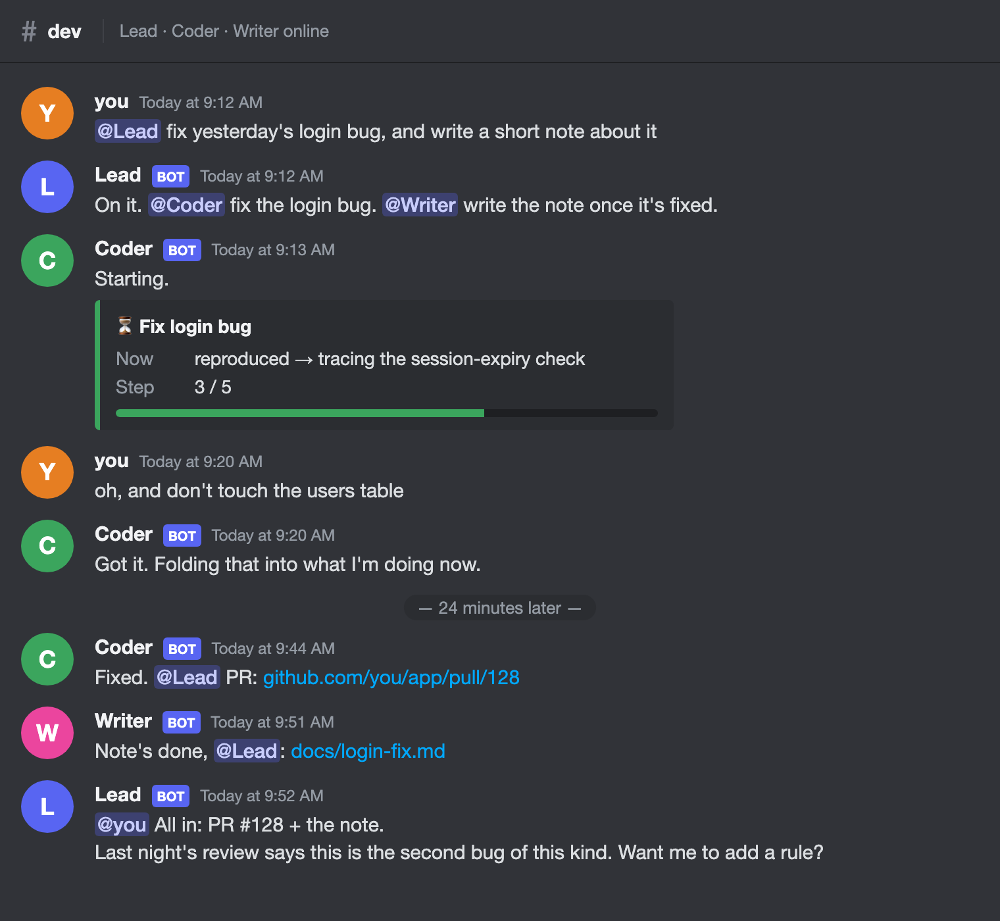

# bothouse

English | [中文](README.zh-CN.md)

**Your AIs shouldn't wake up with amnesia every day.** bothouse turns Claude, Codex, Gemini, DeepSeek, MiniMax and friends into a team that lives in your group chat: named roles, real handoffs, a memory of yesterday, and a review every night. It gets to know you better the more you use it.

You probably already use Claude Code, Codex, Gemini or DSH (DeepSeek's agent framework). Each works alone, and none remembers what the others said.
bothouse is a plugin. Install it, and those AIs become a team with personalities inside your Discord, Feishu, or self-hosted channel.
@ one of them and it does the work. They hand tasks to each other and report back. They share one memory that grows.

> **One conversation runs all your projects. Nobody fights over the work.**
> Talk to one of them; they split the rest.

## Quick start

**Works once the first release is out.** The repository is private while we prepare and there's no installer yet. To try it now, follow section 1 of [Getting started](docs/GETTING_STARTED.md) (Chinese).

```sh
# macOS / Linux
curl -fsSL https://raw.githubusercontent.com/zuiho-kai/bothouse/main/install.sh | sh && cc-connect
```

```powershell
# Windows (PowerShell)
irm https://raw.githubusercontent.com/zuiho-kai/bothouse/main/install.ps1 | iex; cc-connect
```

The command is `cc-connect`: bothouse ships with the open-source cc-connect bundled, so there's nothing else to install. No Go, no Node.

**You'll need:** a Discord server (or a Feishu workspace) and at least one AI CLI you're already logged into (Claude Code, Codex or Gemini CLI). The wizard walks you through creating the bot.

1. **Install**: run the one-liner above.
2. **Configure**: run `cc-connect`. The wizard opens in your browser: pick a platform → connect the bots → pick a local CLI per role → persona → save.
   Or tell your Claude Code / Codex "set up cc-connect and connect it to Discord"; it asks for everything once.
3. **Use**: after saving, click "Restart to apply", then @ a role in your channel.

To let an AI decide who should answer (a small component we call the gate, think of it as a dispatcher), or to add the team memory, install two more pieces: see [the dispatcher and the team memory](docs/ccm-and-wiki.md) (Chinese).
The full walkthrough is in [Getting started](docs/GETTING_STARTED.md) (Chinese). English docs are on the way.

## Why

Working with AI today looks like this: open a window, explain the background, do one thing, close it. Open another window, explain the background again.
Want two AIs at once? Switch between two windows. Want to check in from your phone? Good luck.

What we want is what a team has:

- Everyone has a fixed name and a job. You never re-explain who does what.
- You say one thing. The right person answers. Nobody talks over each other.
- Every task has an owner. When something breaks, you hear about it.
- Everyone keeps the same notebook. What was learned today is still there tomorrow.
- You can reach them anywhere: desktop, phone, browser.

None of this should be locked inside one vendor's app. So bothouse is a plugin: it connects the AIs you already use to the chat apps you already use.

## What it looks like



opus, Whale and Writer can be Claude Code, DSH and Codex. Give them the names and personas you like.

## Features

### A team, not a pile of chatbots

- **Speaks only when called.** One lead answers by default. The others hear every message but speak only when @-ed or named. Several AIs in one group don't all answer at once.
- **Hand off, report back.** The lead @s a teammate with a task. The teammate's final answer @s the lead automatically, and the lead wraps up.
- **Teammate status (optional).** Turn it on and the lead starts every turn knowing who's busy in which channel.
- **Interrupt while it works.** Add a message while an AI is working and it picks it up mid-task. No waiting.
- **Swap the lead in one sentence.** "Whale, you lead now." "Back to opus." The default responder changes on the spot.
- **Sessions continue.** One session per channel, and it continues after a restart. Messages posted while a role was offline are handed to it before it answers.

### One team memory that grows

Others build memory as a database for the agent. We build it as a wiki for the team.

- **You can read it, edit it, diff it.** The memory is a tree of markdown pages. Each page has current state, key facts, decisions and pitfalls, open items.
  The git log is literally "what the AI remembered today". If it got something wrong, edit the file.
- **Two layers.** One shared main memory the whole team reads, plus a personal notebook per role.
- **Pages come to the role; it doesn't have to go looking.** Every incoming message is first searched against the wiki, and the matching pages are placed in front of it.
  Whatever the group is talking about, the role has the right page in hand, mid-session too.
- **Model-agnostic.** opus on Claude, Whale on DSH, Writer on Codex: all three read the same memory.

The memory layer is the open [llm-wiki](https://github.com/zuiho-kai/llm-wiki). It remembers one person and one assistant. bothouse shares it across several roles, records what Claude, Codex and DSH each did, hands the relevant pages to a role with every message, and reviews it nightly.

**Where we fall short, up front:** no benchmark numbers yet, so we won't claim we're more accurate; it's heavier to set up than a one-package memory library like ai-memory, since two extra pieces have to be installed; search is keyword-only (BM25), so a reworded question can miss.

### A review every night, so it grows into your way of working

- **Day, a cheap fast model.** When a session ends, sits idle for 30 minutes, or hits a problem mid-session, the new content is distilled into the wiki.
- **Night, a free, slow model that reads carefully.** It checks every batch written during the day against the original transcript: fixes errors, fills gaps, removes duplicates. On Sundays it reads the whole wiki for a check-up.
- **Dream.** The last step every night. It reads only what you said during the day, turns the things you kept correcting into rule candidates, and writes a short "today's reflection".
- **Two gates.** Every quote in a candidate is checked word for word against what you actually said, so nothing made up gets in. A candidate becomes a rule only when you say yes. It never changes your rules behind your back.
- **After the dream, the lead gets a turn in the channel**, so the next morning you can see what the team learned yesterday.

### Plugs into what you already use

| Platform | What works today |
| --- | --- |
| Discord | The full team: call by name, handoffs, teammate status, log channel |
| Self-hosted channel | A Discord-like web channel you can start on your own machine; several roles, call by name, handoffs |
| Feishu (Lark) | One role chatting, for now |
| DSH web | Experimental: a Channels page inside DSH web, see [DSH channels](dsh/collab/README.md) |

Connect to Discord or Feishu and you get phone, desktop and browser for free. No extra app to install.
Plug into DSH and our guardrails and tools install through DSH's own plugin system. We don't rebuild it.

On the AI side: Claude Code, Codex, Gemini CLI, OpenCode and other CLIs you're already logged into work directly; agents like DSH connect over a standard protocol (ACP).
You can also point a CLI at a third-party API (SiliconFlow, OpenRouter, DeepSeek, MiniMax, a local model, any OpenAI-compatible endpoint); see the [matrix](docs/connect-discord-feishu.md#4-第三方-api--本机-cli) (Chinese).

### Guardrails and small tools included

- **Guardrails:** dangerous commands are stopped first. If an AI says "fixed" with no proof, it gets sent back. If it promises to "check back later" without setting a timer, same thing. Claude Code and DSH share one set.
- **Small tools:** see what each teammate is doing right now, turn a video into text and frames, free web search.
- Don't want one? Tell the bot in the chat: "turn the checks off."

## How it compares

| You may be looking at | What it solves | How bothouse differs |
| --- | --- | --- |
| Orca and other multi-agent IDEs | One person watching several coding tasks at once | It's a workbench; we're a team. Agents there are opened per task and closed after. Here they're resident colleagues who live in your group chat and remember yesterday: you can assign work from your phone in a chat, instead of babysitting an IDE |
| ai-memory, agentmemory, TencentDB Agent Memory | Giving an agent a memory store | They're databases; we're a wiki. You can read and edit it; matching pages reach the role before every message; it's reviewed every night. The trade-off: heavier setup, no benchmarks yet |
| llm-wiki | Memory for one person and one assistant | It's our memory layer. bothouse shares it across several roles, records what Claude, Codex and DSH each did, hands pages to a role with every message, and reviews it nightly |
| Claude Code agent teams, CrewAI, MetaGPT | Spinning up a crew for one task | They spin up a fresh crew per project, and every crew re-reads the background, so you pay for the same understanding again and again. Ours stay: one generalist reads the knowledge base and takes any project, and spins off temporary sub-agents when needed, with long-lived specialists on the roadmap. By design, you don't pay for the same background on every project (we haven't measured how much it saves yet) |

```
traditional agent team                       bothouse
project A ─ temp PM ─ temp coder ─ temp QA    you ─@─ opus   (resident, own session and wiki)
project B ─ temp PM ─ temp coder ─ temp QA           ├─ @Whale  (resident, DSH) ─ spawns sub-agents when needed
(disbands after the task, context rebuilt)           └─ @Writer (resident, Codex)
                                              projects A/B/C all flow through the same few people
```

## Where we want to take it

What works today is step one: one group, several AIs, one shared memory. What we want next:

- **No double-grabbing.** With many projects running, a role claims a task before touching it, so two roles never collide.
- **Roles that grow roles.** Say "we need to ship to the App Store", and the lead spins up a release specialist who reads your past decisions, does the job, and retires. You don't create them one by one.
- **Hire a role like you hire a person.** Role packs: persona, memory template and tools in one bundle, one click into the group.
- **A memory you can take with you.** New machine, new model, same team, same memory.
- **Stop paying for repeated background.** Resident roles don't re-read the project for every task. We'll publish numbers when we have a real comparison.
- **Team features on more platforms.** DSH web channels first, then Telegram, Slack, QQ, WeCom (single-role connections already ship with cc-connect).
- **Smarter memory.** Semantic search next to keyword search, so a different wording still finds the page.

Want to see this happen? Star the repo to follow along.

## How it works

```
Discord / Feishu / self-hosted web channel
        │
  platform adapter ──► engine (channel sessions, queue, handoffs) ──► agent adapter ──► local CLI or ACP agent
        ▲                      │          ▲
        │                      ▼          │
        │        dispatcher / gate (who answers) ◄──┤
        │                      │          │
        └──── replies ◄────────┘   shared wiki (searched per message, reviewed at night)
```

Modules and data flow: [Architecture](docs/ARCHITECTURE.md) (Chinese).

## Docs

| Doc | What's in it |
| --- | --- |
| [Getting started](docs/GETTING_STARTED.md) | Install, wizard, check it's online (Chinese) |
| [Connect Discord or Feishu](docs/connect-discord-feishu.md) | Every wizard step, let an AI configure it, third-party APIs (Chinese) |
| [The dispatcher and the team memory](docs/ccm-and-wiki.md) | The gate (who answers) and the shared wiki memory (Chinese) |
| [Per-role wiki and nightly review](bridge/contrib/wiki/README.md) | One wiki per role, scheduled distilling, the review (Chinese) |
| [Guardrails and tools](bridge/contrib/hooks/README.md) | Hook rules, how to switch them off, [small tools](bridge/contrib/tools/README.md) |
| [Teamwork details](bridge/MAOMAO.md) | Lead and subs, handoff rules, gate protocol |
| [Self-hosted channel protocol](bridge/docs/cloud-web.md) | The interface between the channel and the plugin |
| [Architecture](docs/ARCHITECTURE.md) | Modules and data flow (Chinese) |

Contributors: start with [CONTRIBUTING.md](CONTRIBUTING.md) and [AGENTS.md](AGENTS.md).

## License

bothouse is licensed under [MIT](LICENSE). See [LICENSING.md](LICENSING.md) (Chinese) for details.

bothouse is a plugin for platforms such as [cc-connect](https://github.com/chenhg5/cc-connect) and DSH. For a one-command install, `bridge/` ships a copy of cc-connect; its MIT notice is kept in [bridge/LICENSE-MIT-upstream](bridge/LICENSE-MIT-upstream). Thanks to the cc-connect authors and contributors. Third-party dependency licenses are in [THIRD-PARTY-LICENSES.md](THIRD-PARTY-LICENSES.md).
