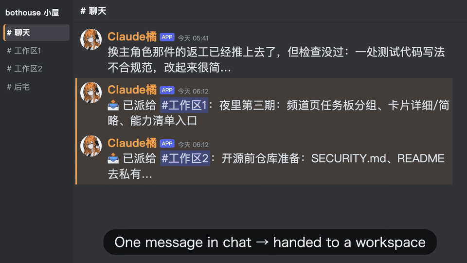

# bothouse

English | [中文](README.zh-CN.md)

Using Claude Code, Codex and DeepSeek together used to mean switching between terminals and copying messages back and forth. Close a window and the context is gone; step away from the computer and the work stops.

So we built **bothouse**: a hub that brings your local CLIs and models into one group, gives them a shared memory, and connects your computer, phone, browser and even desktop companion hardware.

**Send a task from your phone and your home computer gets to work. Leave instructions before bed, let the AI team work through the night, and collect the results in the morning.**

## Why we built it

- **No more copying messages between tools; one shared memory.** Your existing Claude Code, Codex, Gemini CLI and DSH installations become permanent members, without another account or subscription. They share a local Markdown Wiki, so the next member can look up what the previous one learned instead of asking you to repeat the background.
- **Keep long tasks on course, with a separate reviewer.** Every handoff carries your original request. Another AI with a fresh context checks the finished work. Child agents write a handoff before their context fills; idle sessions also restart with a handoff to keep accumulated context manageable.
- **Keep conversation and execution separate.** The lead sends substantial work to independent workspaces while chat stays available. One task card shows who is working, what is done and what is blocked.
- **Background work and nightly reflection (Autodream).** Scheduled and long tasks run in the background. At night, the system reviews conversations, corrects and deduplicates memory, and proposes rules based on your repeated corrections. Every quotation is checked against your original words, and new rules require your approval. A report is ready in the morning.
- **Spend tokens where they help.** Cheap or local models handle chat and routine work; stronger models take difficult tasks. Configuration determines which model each channel uses.

## What it looks like

Real channel footage: the main channel hands work to a workspace → members split, accept and return tasks → the task board updates while the main conversation continues.

In DSH Channels, add or edit a member and open **Optional → Avatar → Upload image** to choose a local PNG (up to 256KB). The browser resizes it to 256×256; portraits stay in the local data directory. Uploading for an existing member applies immediately; **Restore default** removes the uploaded portrait.

In DSH Channels, the member sidebar shows task counts. Click **Task board** to open a scrollable dialog grouped by channel, workspace and owner; completed tasks start collapsed, and Dispatch / Delivery links jump to the original messages.

In **Channel settings**, choose a primary role independently for each channel and save an existing absolute **Working directory**. Saving asks whether to recreate that channel’s DSH sessions now, clearing their conversation context, or apply the directory when sessions are next created. Workspaces inherit their parent channel’s settings. The directory affects write scope and relative paths, not read access.

Image attachments in DSH Channels have **Download** and **Copy image** actions: hover over the image or focus it with Tab; touch and narrow screens keep the actions visible. Clicking the image opens a large preview with the same Download and Copy image actions. Close it with Esc, the backdrop, or the top-right button; keyboard focus stays inside the preview and returns to the image on close. If copying is unavailable or denied, an error appears in the preview (or below the thumbnail) and Download stays highlighted.

### Everyday use

1. **Give a task in plain language:** “Build a dashboard showing how many tokens each role used today.”
2. **Split the work:** the lead assigns pieces such as statistics, a menu bar icon, the role list and the desktop companion interface to different AI members with `@` mentions. Progress appears on one task card.
3. **Steer and review:** add instructions while work is running. Claude Code, Codex app-server and DSH backends with ACP steering support receive them during the active task; CLIs such as `codex exec` read them on the next turn. When the work and the lead's checks are complete, you get a report of changes, validation and remaining work.

## One CLI or one model can still power a team

Even with just one installed Codex CLI or one DeepSeek API account, you can create several independent members. They share the underlying account but have separate names, personas, responsibilities and sessions. Three DeepSeek members, for example, can plan, implement and review code, assigning and returning work through mentions in the shared channel.

In DSH web, open **Channels → Add member**, select the same model or local CLI, and save each member with a different name and responsibility. Set the channel's dispatch mode to **Full team**. Session contexts are independent; account quotas and rate limits remain shared. See [a team from one CLI](docs/single-cli-team.en.md).

---

## Quick start

### 1. Install

Download your platform's package from [Releases](https://github.com/zuiho-kai/bothouse/releases). No Go or Node installation is needed. We recommend the one-line installer below, which verifies SHA256 automatically. For manual downloads, compare the file's SHA256 hash with that release's SHA256SUMS before opening it or bypassing an OS warning. See the [installation guide](docs/GETTING_STARTED.md) for more details.

- **macOS:** `bothouse-mac.dmg` for Apple Silicon and Intel. Drag it into Applications; because it is unsigned, **right-click → Open** on first launch.
- **Windows:** `bothouse-windows.exe` is the x64 (amd64) build; ARM64 Windows runs it under x64 emulation. If SmartScreen blocks it, choose **More info → Run anyway**.
- **Linux:** `bothouse-linux-x64` or `bothouse-linux-arm64`. Run `chmod +x` on the file, then launch it.

Or install the latest release, including prereleases, with one command. SHA256 verification is included; set `BOTHOUSE_VERSION=<tag>` to pin a version.

~~~sh
# macOS / Linux
curl -fsSL https://raw.githubusercontent.com/zuiho-kai/bothouse/main/install.sh | sh
~~~

If the installer reports that `~/.local/bin` is not on PATH, run the PATH command it prints first, then run `bothouse`.

~~~powershell
# Windows (PowerShell)
irm https://raw.githubusercontent.com/zuiho-kai/bothouse/main/install.ps1 | iex; bothouse
~~~

### 2. Configure and start

Choose your entry platform: Discord needs a server, and Feishu needs a workspace. Self-hosted web needs neither account; follow the [connection guide](docs/connect-discord-feishu.md). DSH has separate requirements in the expandable section below. Roles using a local AI CLI need that CLI installed and logged in, such as Claude Code, Codex or Gemini CLI.

1. **Open the wizard:** run `bothouse`; the wizard opens in your browser.
2. **Connect roles:** choose a platform → connect bots → select a local CLI for each role → save. New roles default to fully automatic YOLO permissions; you can change this in the dashboard's project settings. Names start with the CLI label (Codex, then Codex-2); personas are optional and applied only when selected. Optional settings let you customize a name and keep it when selecting a library persona. Custom names display beside the backend, for example Coder·Codex, and stay when switching CLI; untouched default names follow the new backend. Existing roles keep their names and personas. You can also tell your local Claude Code or Codex: “Set up bothouse and connect it to Discord.” It will ask for the required configuration.
3. **Start working:** click **Restart to apply**, then mention your roles in the channel.

For background operation, run `bothouse daemon install` to register and immediately start the service. Start at login is off for new installations; reinstalls and upgrades preserve the current setting. Change it in **Settings → Start at login** without interrupting active tasks.

To let a small model decide who should answer, configure jev in the wizard; bothouse manages the gate automatically. For shared memory, install and connect the Wiki separately using [dispatcher and team memory](docs/ccm-and-wiki.md). See [Getting started](docs/GETTING_STARTED.md) for the complete walkthrough.

### DSH channel (experimental)

<b>Requirements and setup steps</b>

You need DSH `>= 0.2.1-rc.2`, `pnpm` on PATH, and Node `>= 22.12.0`. Choose DSH in the first wizard step, then detect dsh → install plugins → run the returned command to open DSH web. Configure bots, CLIs and personas in DSH afterwards. Set `BOTHOUSE_DSH_DIR` for development or to override the directory.
The equivalent CLI command is `bothouse setup dsh install --lang en`. You can also install the plugin directly from GitHub:

~~~sh
dsh plugin --profile web add 'github:zuiho-kai/bothouse#dsh-plugin&path:dsh/plugin-pkg'
~~~

## Platforms and integrations

Discord and Feishu already provide phone and desktop clients, so there is no extra wrapper app to build. On DSH, guardrails and tools use its native plugin system.

| Platform | Status | Supported capabilities |
| --- | --- | --- |
| Discord | Full support | Multiple roles, mentions, task handoffs, teammate status and log channels; slash commands in servers and direct messages |
| Self-hosted web | Team mode | A local, Discord-like web interface with multiple roles, mentions and task handoffs |
| Feishu (Lark) | Single role | Conversation with one connected role |
| DSH web | Experimental | A Channels page inside DSH web; see [DSH channels](dsh/collab/README.md) |

QQ / NapCat users can configure the [OneBot adapter](bridge/docs/qq.md) manually. Both array and CQ-string message formats support incoming media, mentions and cached quote context; see the guide for dependencies and current limits.

Already logged-in Claude Code, Codex, Gemini CLI and OpenCode installations run directly. Agents such as DSH connect through ACP. You can also configure CLIs with third-party APIs, including SiliconFlow, OpenRouter, DeepSeek, MiniMax, local models and other OpenAI-compatible endpoints. See [connection setup](docs/connect-discord-feishu.md).

## Remote access from your phone with Tailscale

bothouse runs on your home computer and includes a web management dashboard. Tailscale lets your phone reach it without renting a server or exposing public ports. Check team progress and token usage, or add instructions while away from your desk.

### 1. Connect your devices

Install Tailscale on the computer running bothouse and on your phone or laptop. Sign in with the same account so they join the same tailnet:

~~~sh
# macOS
brew install --cask tailscale
# Linux
curl -fsSL https://tailscale.com/install.sh | sh
~~~

Run `tailscale ip -4` and note the computer's `100.x.y.z` address.

### 2. Enable the dashboard and live bridge

Send `/web setup` to the bot, or run `bothouse web`. It configures the dashboard and live conversation channel and generates a login token. Restart once as instructed.

For manual configuration, edit `~/.bothouse/config.toml`. A configuration file with the same name in the current directory takes precedence.

~~~toml
[management]
enabled = true
host = "100.x.y.z"        # Your Tailscale address from the previous step
port = 9820               # Default port
token = "replace-with-a-long-random-password"

[bridge]
enabled = true            # Required for sending messages, not just viewing data
token = "replace-with-a-different-random-bridge-token"
~~~

The `bridge.token` field is separate from `management.token`. Set a long random bridge token, or use the bridge token generated by `/web setup`.

Network and migration notes:

- Start Tailscale before bothouse. Without an explicit `host`, normal operation listens on all interfaces. Only the initial wizard, before any platform is configured, binds to `127.0.0.1`. Specify `host` for remote access.
- When enabled, the bridge is available on the dashboard port and also listens on port 9810 on all interfaces. To restrict access to the tailnet, use the host firewall to block port 9810 on LAN and public interfaces. Tailscale ACLs can further restrict tailnet access, but do not replace the host firewall.
- On first use of the default `~/.bothouse` directory, scheduled-task and usage JSON data is incrementally copied from `~/.cc-connect`. Expired one-shot tasks are marked as skipped to prevent a burst of executions; existing files are not overwritten.

### 3. Sign in and use it

Get your token through `/web setup`, `bothouse web --no-browser`, or `config.toml`. Open `http://100.x.y.z:9820/` on your phone and enter the token. The dashboard adapts to mobile screens and remembers your credentials.

- **Status and usage:** view uptime and today's or this month's token usage by role and model, with daily and hourly heatmaps.
- **Configuration:** add roles, edit personas and change models from the Roles, Projects, Skills and System pages. Restart to apply changes.
- **Conversation:** open a project to see its context and add instructions to its active task, through the same conversation flow used by Discord.

## How the team works

### 1. Separate chat from workspaces

- **Keep chat available:** the lead moves a substantial task into Workspace 1 while remaining available in chat. Additional workspaces open when needed.
- **Return results to one place:** the workspace lead splits work and mentions teammates; members accept and return assignments. Decisions needing your input come back to the main channel, so you only need to follow one conversation.
- **See assignments:** the task board groups work by chat channel → workspace → role. Before assigning work, the lead checks whether teammates are already busy. Each channel supports single-model/multiprocess, full-team or mixed dispatch modes.

### 2. Team rules and the small-model dispatcher (jev)

- **Speak when called:** the lead answers by default. Other roles follow the conversation and respond when mentioned or named. Ask another role to take the lead, or switch back to opus, in plain language. If the old lead can no longer reply, use `bothouse handoff switch --to <project>`; task cards, workspaces and pending questions keep their original task IDs. See [manual lead handoff](docs/LEAD_HANDOFF.md).
- **Choose who answers:** the lightweight jev dispatcher, or Gate, decides whether opus, another member or nobody should respond to an unaddressed message. It can use a free small model on SiliconFlow or a local model such as Qwen 0.6B.

### 3. Shared memory built on llm-wiki

We extended our open-source llm-wiki into a shared memory for multiple roles. Memory lives in local Markdown files you can read and edit. Git history records what the team learned.

- **Retrieve before responding:** each incoming message triggers a Wiki search. Relevant pages about current state, facts, decisions, lessons and pending work are attached before the role responds.
- **Share across models:** opus running Claude, a DSH member and a Codex member all read and write the same knowledge base.

### 4. Nightly review and Autodream

- **Capture during the day; refine at night:** when a session ends, has been idle for 30 minutes or encounters an error, a fast model records progress in the Wiki. At night, a slower, more thorough free model compares it with original conversations to correct errors, fill gaps and remove duplication. A full Wiki review runs on Sundays.
- **Autodream:** the final nightly step reviews your original messages, turns repeated corrections into candidate rules and writes a daily reflection.
- **Check quotations:** code compares every quoted instruction with your actual words and rejects invented quotations. Proposed rules are sent to the group for review and require your approval before taking effect.

### 5. Guardrails and tools

- **Require evidence:** dangerous commands are blocked. Claims that a problem is fixed need verification evidence; promises to check later need a timer. You can ask in chat to turn checks off.
- **Built-in tools:** inspect teammate progress, extract video frames and transcripts, search the web, and view child-agent durations and status. Child status supports Codex and DSH with the status-forwarding integration. `bothouse voice-desk` can announce progress on demand.

## How it compares

| Alternative | Approach | bothouse's approach |
| --- | --- | --- |
| Orca / multi-agent IDEs | Several coding windows at your desk | Permanent roles stay in a group, remember previous work and accept tasks from your phone. |
| ai-memory / vector memory stores | A database attached to an agent | An editable Markdown Wiki, retrieved before each message and reviewed and deduplicated at night. |
| CrewAI / MetaGPT / Claude Teams | A temporary team assembled for each task | Persistent roles carry the shared knowledge base between projects, reducing repeated background explanation. |

~~~text
Temporary agent team                    bothouse
Project A → PM → developer → tester      You → @opus (persistent session + shared Wiki)
Project B → PM → developer → tester             ├─ @DSH member → children as needed
(Rebuild context for each project)              └─ @Codex member
                                         The same team works across projects A/B/C.
~~~

## Architecture and data flow

~~~text
Discord / Feishu / self-hosted channels
        │
Platform adapters → Core engine → Role adapters → Local CLI or ACP agent
        ▲           │     ▲
        │           ▼     │
        │       Dispatcher gate
        │           │     │
        └─ Responses┘     Shared Wiki
                          (retrieval before messages, nightly review)
~~~

This diagram shows the bridge path. DSH web uses a separate native plugin path; see [Architecture](docs/ARCHITECTURE.md) for module responsibilities.

## Roadmap

The first step is working: one group, persistent AI members and a shared memory. The following are development directions. Track current status in [Issues](https://github.com/zuiho-kai/bothouse/issues) and [Pull requests](https://github.com/zuiho-kai/bothouse/pulls):

- **Claim tasks before starting:** lock assignments so multiple members do not start the same task.
- **Create specialists as needed:** a request such as publishing to the App Store could create a specialist that reads prior decisions, completes the assignment and exits without manual setup.
- **Role packs and a plugin marketplace:** bundle personas, memory templates and tools for one-step installation, and browse community roles.
- **Portable memory and semantic search:** carry the Wiki between computers and models, and add semantic retrieval alongside keyword search.
- **Automatic workspace cleanup:** clear context after the last assignment so the next task starts fresh.
- **More group-chat platforms:** extend full team mode to DSH web channels, Telegram, Slack, QQ and WeCom.

## Documentation

Most guides below are currently in Chinese; the self-hosted platform protocol is in English.

| Guide | Contents |
| --- | --- |
| [Getting started](docs/GETTING_STARTED.md) | Installation, wizard and first run |
| [A team from one CLI](docs/single-cli-team.en.md) | Multiple roles from one DeepSeek or Codex account, with configuration and session boundaries |
| [Discord and Feishu setup](docs/connect-discord-feishu.md) | Platform connections, AI-assisted setup and third-party APIs |
| [Dispatcher and team memory](docs/ccm-and-wiki.md) | jev and the shared Wiki |
| [Role packs](docs/persona-packs.md) | Choose, build and import personas and avatars |
| [Per-role Wiki and nightly reflection](bridge/contrib/wiki/README.md) | Wiki isolation, maintenance and Autodream |
| [Guardrails and tools](bridge/contrib/hooks/README.md) | Hook rules, switches and [built-in utilities](bridge/contrib/tools/README.md) |
| [Self-hosted platform protocol](bridge/docs/cloud-web.md) | Communication between the web platform and plugins |
| [Architecture](docs/ARCHITECTURE.md) | Module responsibilities and data flow |

To contribute, read [CONTRIBUTING.md](CONTRIBUTING.md) and [AGENTS.md](AGENTS.md).

Source builds with the web management dashboard must build the frontend before
Go compilation and omit `no_web`. See [dashboard builds and private remote
access](docs/dashboard-source-build.md).

### Collaboration helper scripts

The setup wizard automatically installs the packaged task board, timer, handoff and
primary role helpers for a newly created primary role. Other roles do not receive them.
To install them explicitly for an existing role, use
`bothouse setup lead install --work-dir /path/to/role --agent codex`.
See [configuration and requirements](bridge/contrib/lead/README.md).

## License and community

- **License:** [Apache-2.0](LICENSE); see [LICENSING.md](LICENSING.md) for details. The bridge is built on [cc-connect](https://github.com/chenhg5/cc-connect) and keeps its full commit history, so the contributor list also includes cc-connect's authors and contributors. Thanks to [@chenhg5](https://github.com/chenhg5) and every cc-connect contributor. The upstream MIT notice is kept in [bridge/LICENSE-MIT-upstream](bridge/LICENSE-MIT-upstream). Third-party dependencies are listed in [THIRD-PARTY-LICENSES.md](THIRD-PARTY-LICENSES.md).
- **Community:** [linux.do](https://linux.do)

Quota exhaustion, or less than 5% of a five-hour quota remaining, triggers automatic cooldown when the reset time is known. Idle teammates in the same channel can take over unfinished work; scheduled wakes stop during cooldown and temporary primary-role changes are restored after recovery. See [architecture](docs/ARCHITECTURE.md#团队与记忆).

### Local token usage

The management API exposes daily, hourly, role, and model usage totals, with optional configured price estimates. Accounting starts from installation; backends without complete billing usage remain explicitly unknown. See [usage API and pricing](docs/api/usage.md).
