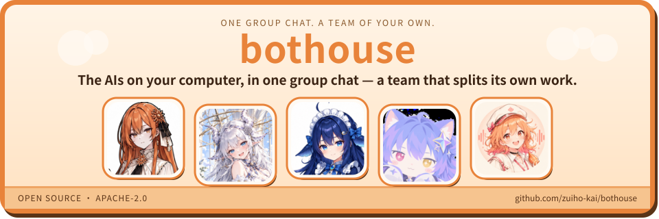
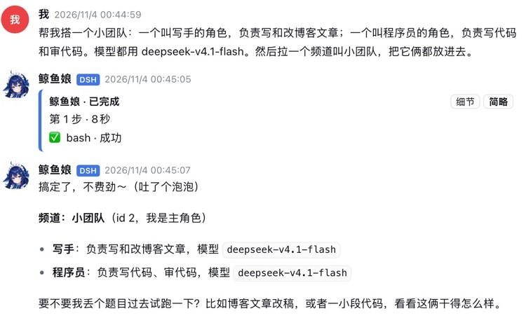
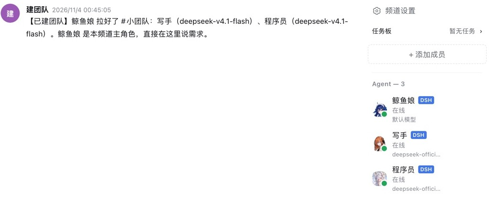
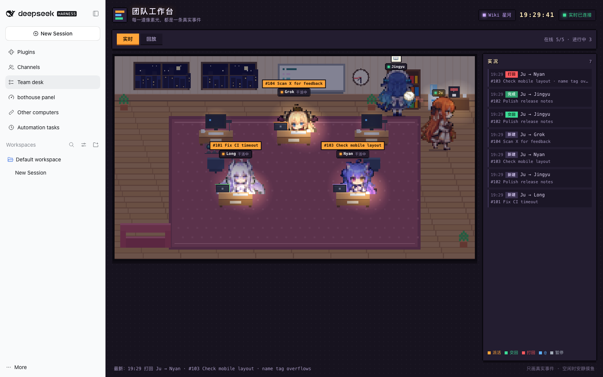
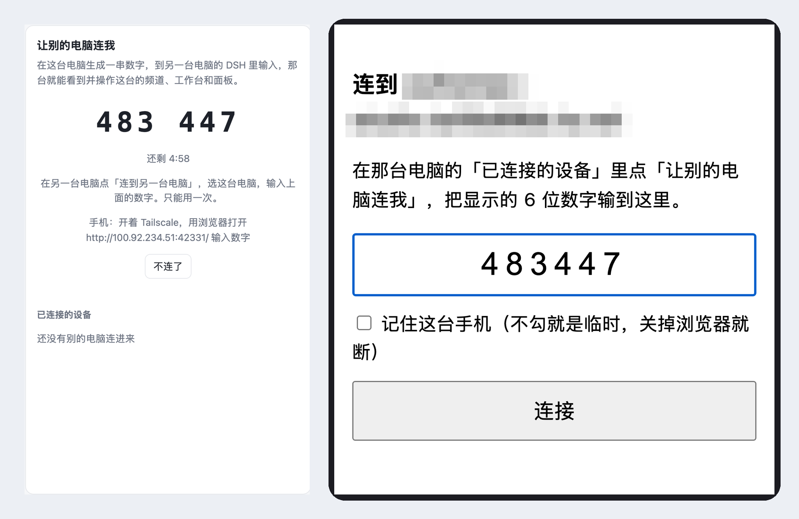
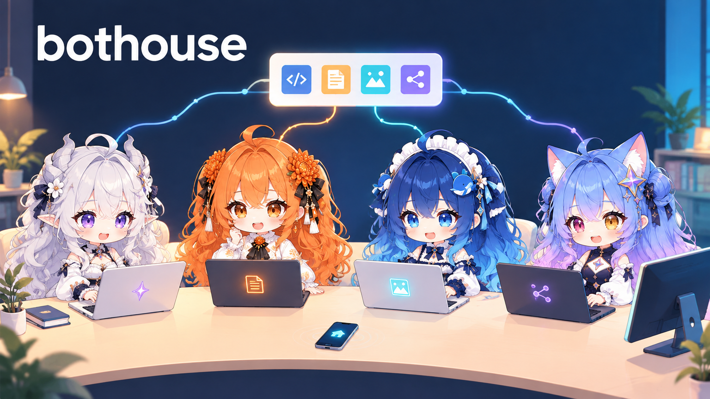
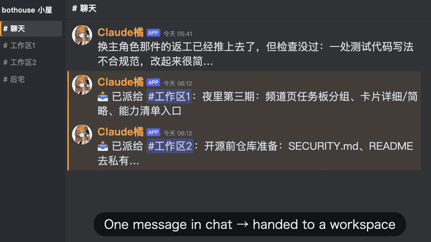
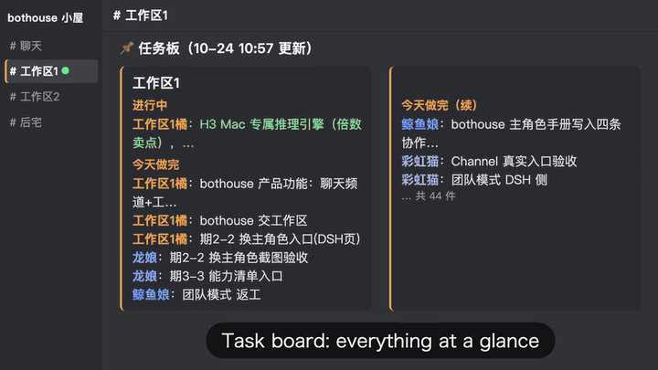

<div align="center">
  <a href="https://github.com/zuiho-kai/bothouse">
<picture>
  <source media="(prefers-color-scheme: dark)" srcset="docs/assets/readme/banner/hero-en-night.svg" />
  
</picture>
  </a>

# bothouse

**English** ｜ [中文](README.zh-CN.md)

[](https://github.com/zuiho-kai/bothouse/releases)
[](LICENSE)
[](https://github.com/zuiho-kai/bothouse/releases)
[](https://github.com/zuiho-kai/bothouse/stargazers)
[](https://discord.gg/aJmcnrt5ZB)

**bothouse: a team collaboration platform for one agent or many. A team, or just you with a single model, can use it, and different sessions and models share one project memory.**

Discord, DSH and QQ are the three ways in; bring the agent CLIs you already signed in to: Claude Code, Codex, Antigravity, DSH, Gemini CLI, OpenCode, and Grok or others over ACP.

What's next: [team mode](#next) — one person tunes the AI, the whole team uses it; [hardware](#next) — give a role a small ESP32 body ([bothouse-iot](https://github.com/zuiho-kai/bothouse-iot)).

[Video](#video) · [Three ways in](#usage) · [DSH users](#dsh) · [Install](#install) · [Features](#features) · [What's next](#next) · [Screenshots](#screenshots) · [Memory](#memory) · [Compare](#compare) · [Community](#community) · [Docs](docs/GETTING_STARTED.md)

</div>

<a id="video"></a>

## Promo video

Watch bothouse in 3 minutes: one message goes in; the crew splits the work, takes it on and hands it back. Click the cover to play.

<p align="center">
  <a href="https://x.com/amber_ai_lab/status/2115798143011008545"></a>
</p>

New installs default to **Only when addressed**: the role you @ answers, nothing extra to install. Smart routing can be turned on in the wizard or later on the panel's Gate page; it needs a judge model that returns logprobs, and the wizard offers a one-click preset for the Qwen3.5-4B we run ourselves (local, mlx-lm on Apple silicon; not downloaded automatically). See [routing choices](docs/connect-discord-feishu.md#5-jev-和主角色).

## What it looks like

I had Claude Code, Codex and DeepSeek open at the same time across two screens: four Claude Code windows on one, Codex on the other, and getting them to work together was a pain. So I reused what Discord already does well and built a collaboration platform on top of it. Later, talking with friends at vLLM and ModelBest, it turned out they had built something similar. As the community grew, DSH and QQ support followed.

That is **bothouse**: a team, or just you, can plug different agent CLIs into one group, and different sessions and models share one project memory. You direct them from your computer, phone or browser — no extra account, no extra subscription.

<a id="usage"></a>

<picture>
  <source media="(prefers-color-scheme: dark)" srcset="docs/assets/readme/banner/usage-en-night.svg" />
  
</picture>

## Three ways in

| What you have | How to use it |
| --- | --- |
| **Several agent CLIs** | Bring the Claude Code, Codex, Antigravity, DSH and Grok you already signed in to into one group; the lead splits the work and hands it out, and everyone shares one project memory. See [Install](#install). |
| **One model, one account** | One model and one role works fine. Want more roles? Create several members anyway, each with its own job. See [A team from one CLI](docs/single-cli-team.en.md). |
| **DSH** | Say "install bothouse-dsh for me" in DSH and it is installed, or run `bothouse module add dsh`. One more sentence to the lead starts a small team of roles on a single model. See below. |

<a id="dsh"></a>

### DSH users: one model with many roles

Two ways in: say "install bothouse-dsh for me" in DSH (it fetches the plugin from npm), or run `bothouse module add dsh` (it installs the copy that ships with the bothouse you just installed). On the npm route, name the exact version if you want the newest release right away: DSH installs plugins with pnpm, which skips releases from the last day. Details in [bothouse-dsh](dsh/plugin-pkg/README.en.md).

One model and one role works fine; the DSH plugins you already have keep working, and popular plugins are being adapted.

To write your own plugin, start from the template in the [plugin guide](docs/plugins/plugin-dev.md) (Chinese); [plugins/](plugins) has working examples (webhook on finish/error, event journal, desktop notifications).

For one model with many roles, say one sentence to the lead in a channel:

> Build me a small team: a writer and a programmer, both on deepseek-v4.1-flash, and put them in a channel

The lead creates the channel and both roles in one go through the channels API (`POST /collab/api/rooms/{id}/team`, only the channel's primary role may call it), and posts what it built. The wording of the sentence is not fixed: name the roles, and optionally the model, persona and channel.

<p align="center"><br><b>One sentence, two roles</b></p>

<p align="center"><br><b>The roles are in the new channel</b></p>

<a id="install"></a>

<picture>
  <source media="(prefers-color-scheme: dark)" srcset="docs/assets/readme/banner/install-en-night.svg" />
  
</picture>

## Install

Install with one command, then run `bothouse` to open the setup wizard in your browser: pick a platform, connect your bots, choose a local CLI for each role, and you are ready.

```sh
curl -fsSL https://raw.githubusercontent.com/zuiho-kai/bothouse/main/install.sh | sh
```

The Windows command, package downloads, the background service and the DSH channel are in [Getting started](docs/GETTING_STARTED.md).

**Let an AI agent set it up.** Give Claude Code, Codex, DSH or any agent CLI this repo link and say "install bothouse and connect it to Discord"; it needs a bot token, the server ID and (optional) a channel ID from you. Agents: no browser needed, these three steps are the whole job (details and every error code in [AGENTS.md](AGENTS.md#用户说配-discord--飞书把这个配好接上-discord)):

```sh
curl -fsSL https://raw.githubusercontent.com/zuiho-kai/bothouse/main/install.sh | sh
~/.local/bin/bothouse module add discord --token "$(cat <token file>)" --guild <server ID> --channel <channel ID>
~/.local/bin/bothouse daemon install   # if it fails inside an agent sandbox: nohup ~/.local/bin/bothouse > ~/.bothouse/run.log 2>&1 &
```

`module add` prints JSON: `ok: true` means saved; with `needs_user_action: true`, pass every `blocking` warning's `message` and `fix` to the user. Done when the log shows `discord: connected`; then ask the user to @ the bot in the channel. A bot ignores its own messages, so do not try to test it with its own token.

**Put it into DSH (desktop app or web) and @ members in a DSH channel.** Say "install bothouse into DSH": no token, no browser, no bothouse service. Agents: these two commands are the whole job (see [AGENTS.md](AGENTS.md#用户说装进-dsh在-dsh-频道里--成员)):

```sh
curl -fsSL https://raw.githubusercontent.com/zuiho-kai/bothouse/main/install.sh | sh
~/.local/bin/bothouse module add dsh --lang en
```

`ok: true` means done; pass `next_steps` to the user as is. No Node needed: the desktop app's bundled one is used, the open app loads the plugin by itself, and the channel starts with one member, 鲸鱼娘. Do not restart the desktop app (you may be running inside it) and do not test the channel yourself.

<a id="features"></a>

<picture>
  <source media="(prefers-color-scheme: dark)" srcset="docs/assets/readme/banner/features-en-night.svg" />
  
</picture>

## What you can do with it

| You want | How bothouse helps |
| --- | --- |
| **An AI team of your own** | Bring the Claude Code, Codex, Antigravity, DSH, Gemini CLI or OpenCode you already signed in to — Grok and others over ACP too; every role gets its own name, persona and session. |
| **A team from one account** | Only one Codex or DeepSeek account? Create several members anyway, each with its own name, persona, job and session; they assign and hand back work by mentioning each other. |
| **Find it in the chat apps you use** | @ it in Discord, Feishu, QQ, the self-hosted web chat or DSH web; Discord and Feishu already have phone apps, so you can hand out work from bed. |
| **Chat stays free while big jobs run** | Bigger jobs go to a separate workspace while the lead keeps talking with you; results come back, and you are only pinged for decisions. |
| **Everyone remembers the same thing** | All roles read and write one shared memory, so whoever picks up the job already knows the background. |
| **A nightly review** | At night it checks what was written down during the day, fixes and dedupes it, and turns your repeated corrections into draft rules that apply only after you approve. |
| **Long jobs stay on track** | Every handoff carries your original words; a second AI with a clean context checks the result; “fixed” needs evidence. |
| **Manage it from your phone** | A built-in web dashboard shows who is busy and how much quota is used, lets you edit personas, open a project and add a note to work that is already running. |
| **Draw a picture when you ask for one** | Optional and off by default: point `[image_gen]` at an OpenAI-compatible image service and the dashboard's image-generation page draws one picture into a local file. It never posts it for you — `bothouse send --image` is a separate, deliberate step. |

<a id="team-mode"></a>

### Team mode: the lead hands out the work, workspaces get it done

One role in each chat channel is the **lead**. You talk to it; it splits the work and hands it to other models — Codex writes the code, DeepSeek polishes the text, Gemini digs up the references — and you collect the results in chat.

- **Big jobs go to a workspace.** Anything longer than about ten minutes, or that needs code changes and tests, goes to its own workspace channel with a handoff that carries your original words, the scope and what "done" looks like. Chat never stalls; one workspace, one job, and finished workspaces go back to the pool.
- **Task board.** Every job gets a number. The board shows who owns it, where it stands and what is waiting on you; pause, resume or finish it in one command.
- **Hand-backs are checked.** A workspace reports back in four short parts — background, what was done, what you need to do, what it added beyond your words — plus proof from the place you actually use. `bothouse report check` sends back any report that skips an item in scope or comes without evidence.
- **Nothing stalls quietly.** The bridge looks at dispatched work every ten minutes: progress keeps it going, silence nudges the owner and pauses the job.
- **You are asked only for decisions.** A workspace that needs your call posts an `[ask]` to chat and frees itself; your answer is routed back to a free workspace that picks up where it left off.

<a id="desk"></a>

### Team desk: watch the team at work

The team desk is a pixel office for your crew. Every member is a little character: idle ones wander between the window, whiteboard and coffee machine; whoever is working sits at a desk facing you, with the task tag above their head. A dispatch flies over as an envelope, progress notes float back to the lead's desk, finished work stacks up there waiting for review, rejected work comes back as a crumpled paper ball, and a paused member raises a hand. Even when nothing is moving you can see who handed what to whom. Every frame is a real event — a quiet team means a quiet office — and any past window can be replayed at 1×/4×/16×.

In DSH, switch on **Team desk** under Plugins → bothouse; it appears in the sidebar and works on a phone too. See [Team desk](dsh/collab/desk/README.md).

<a id="pairing"></a>

### Remote pairing: run your team from another computer or your phone

Open **Other computers** in the DSH sidebar and generate a code: six digits. Type them on another computer's DSH, or open the address shown in your phone's browser — no app to install — and you are in: channels, team desk and panel, sending messages and handing out work as if you were at home. Choose a temporary connection or remember the device; the home computer lists every connected device and can kick one off, which drops it on the spot. It only listens on your Tailscale network: codes are single-use, expire after five minutes and die after five wrong tries.

<p align="center"> </p>

<a id="team"></a>

Per-channel model and reasoning: use `/model` and `/reasoning` in the channel you are talking in. Selections stay with that channel and survive restarts and `/new`. See [model and reasoning](docs/model-and-reasoning.md).

### Roles and avatars



Every role has its own avatar and persona. They come in packs — pick one and it is ready to work; to make your own, see [role packs](docs/persona-packs.md) (Chinese).

<a id="next"></a>

## What's next: team mode and hardware

Once it works for one person, we grow it in two directions.

### Team mode: one person tunes the AI, the whole team uses it

Bring every teammate's Claude Code, Codex, Gemini and DeepSeek into one team group, and the team shares one set of AI know-how.

- **Shared experience:** the team shares one memory. A nightly review checks against the original messages and records progress, corrections and lessons, so the next day every teammate's AI follows them. People new to AI get the setup the experts tuned.
- **Knows each person:** it remembers each person's standards and habits separately, and answers each sender their own way.
- **Splits the work itself:** say it once and the AIs divide the work; every handoff carries your original words, and a fresh AI checks the result. Within one group this is live today — see [Team mode](#team-mode).

### Hardware: give a role a body

[bothouse-iot](https://github.com/zuiho-kai/bothouse-iot) connects small ESP32 round-screen boards. Each board is a role: talk to it, the role answers, and the dial face changes with it. See [Hardware](#iot) below.

<a id="screenshots"></a>

## Screenshots

<table>
  <tr>
    <td width="50%"><a href="docs/assets/readme/shot-handoff.en.png"></a><br><b>One message, handed to a workspace</b>: the lead sends big work out and chat carries on.</td>
    <td width="50%"><a href="docs/assets/readme/shot-workspace.en.png"></a><br><b>Task board</b>: what each workspace is doing and what landed today, at a glance.</td>
  </tr>
  <tr>
    <td width="50%"><a href="docs/assets/readme/shot-roles.en.jpg"></a><br><b>Roles</b>: which CLI each role runs, what it is busy with, which model — pause or restart in one click.</td>
    <td width="50%"><a href="docs/assets/readme/shot-library.en.jpg"></a><br><b>Library</b>: personas and avatars come in packs; pick one and it is ready to work.</td>
  </tr>
</table>

_Top row: real channel footage. Bottom row: the author's own dashboard._

<a id="memory"></a>

<picture>
  <source media="(prefers-color-scheme: dark)" srcset="docs/assets/readme/banner/memory-en-night.svg" />
  
</picture>

## Memory you can see

The team's memory is a plain folder of Markdown files. Each incoming message first looks up the relevant pages; a nightly review fixes what was written down wrong. You can read and edit it directly; Git records every change and pushes it to your own private GitHub repo, so the memory follows you to another computer.

- **Only the titles go in:** each turn picks the related memories by keyword and injects their titles and line numbers; a role opens the full text when it needs it. It costs very little and cuts rework and repeated corrections about your habits — fewer "I already told you that". The idea came from vLLM.
- **Light on cost:** no knowledge-graph CRUD and no always-on vector store, so cost and memory use stay small.
- **Memory forum:** the panel's "Memory forum" page scores each memory as a reply — upvotes, downvotes, how often it was pushed and quoted — and sorts the thread for you. Answers to the same question are grouped into one post and ranked, so a wrong memory falls down instead of being repeated.

See [dispatcher and team memory](docs/ccm-and-wiki.md) (Chinese).

To browse that memory as a star map, open **bothouse panel → Overview → Wiki galaxy**. The galaxy is a subpage with a link back to Overview, rather than a separate navigation item. Existing `/wiki-galaxy` and DSH `#wiki-galaxy` bookmarks still work.

<picture>
  <source media="(prefers-color-scheme: dark)" srcset="docs/assets/readme/architecture-en-night.svg" />
  
</picture>

<a id="how"></a>

## How the team works

Proactive follow-up has explicit `off`, `observe`, and `auto` policies. Observation records local decisions without starting a proactive worker or sending a proactive confirmation; ordinary chat and explicit requests retain their existing routing and permission checks. Automatic admission requires administrator-bound platform identities and matching rules. Routing and wiki context do not grant execution authority. See [proactive authorization](docs/PROACTIVE_AUTHORIZATION.md) for configuration, audit records, and revocation boundaries.

Task-bound result text can use the send command with task, revision and delivery ID to persist before sending. Each fragment has its own receipt; ambiguous sends remain visible as unknown instead of being blindly retried. See [task text delivery](docs/TASK_TEXT_DELIVERY.md) for usage and platform boundaries.

You say one thing from your phone, computer or browser → the **lead** in the chat channel (the AI you talk to by default) takes it → big work goes to a **workspace**: @coder and @writer in Workspace 1, @researcher in Workspace 2 → they hand it back.

Chat keeps going the whole time; members take the work on and hand it back, and only decisions that need you come back to chat.

- **The lead splits the work:** the lead breaks real work down and hands it out by skill and quota, so five AIs in one group still don't talk over each other. When it dispatches a sub-agent, the code maps that match the task go with it, and what the sub-agent learns is appended back to that map.
- **Speak when called:** the lead answers by default; other roles follow along and reply when mentioned or named. Unaddressed messages go to jev, a lightweight dispatcher (a small model that only answers multiple-choice questions), which decides who picks them up. It can run on a free small model from SiliconFlow or the local Qwen3.5-4B we run ourselves (one-click preset in the wizard).
- **Shared memory:** we extended our open-source llm-wiki into a memory shared by every role. It lives in local Markdown you can read and edit, and Git history records what the team learned.
- **Nightly review:** when a session ends, idles for 30 minutes or errors, a fast model records progress in the Wiki. At night a slower, more thorough free model checks it against the original conversations to fix errors and fill gaps; on Sundays it reviews everything. Code checks every quoted instruction against your actual words and rejects invented quotes.
- **Guardrails and tools:** dangerous commands are blocked; “fixed” needs verification evidence and “I'll check later” needs a timer; turn any check off with one message in chat. Built-in tools: check teammate progress, extract video frames and transcripts, search the web, and see how long each child agent has run and what state it is in.
- **Manual lead handoff:** if the lead can no longer reply, `bothouse handoff switch --to <project>` moves the role; task cards, workspaces and pending questions keep their IDs. See [manual lead handoff](docs/LEAD_HANDOFF.md).

## Platforms

Discord and Feishu already have phone and desktop apps, so there is no extra wrapper to install.

| Platform | Status | Capabilities |
| --- | --- | --- |
| Discord | Full support | Multiple roles, mentions, task handoffs, teammate status and log channels; slash commands in servers and DMs |
| Feishu (Lark) | Single role | Conversation with one connected role |
| QQ official bot | Manual setup | Group/private chat, group @user and @everyone; see [QQ Bot setup](bridge/docs/qqbot.md) |
| DSH desktop app / web | Experimental | A Channels page inside the DeepSeek Harness desktop app (default) or DSH web; see [DSH](docs/platforms/dsh.md) |
<!-- Self-hosted platform entry disabled (no longer maintained, 2026-11-05). Original row:
| Self-hosted web | Team mode | A local, Discord-like web UI with multiple roles, mentions and task handoffs |
-->

QQ / NapCat users can configure the [OneBot adapter](bridge/docs/qq.md) manually.
Quoted QQ messages retain their author and text, fetching missing originals through OneBot. Agents can send native quoted text replies with `bothouse send --reply-to MESSAGE_ID --message 'reply'`; see the adapter guide for same-conversation checks and verification limits.

The OneBot guide also covers optional paragraph splitting, original-image storage, labelled forwarded chats and a [judging model](bridge/contrib/qq-gate/README.md) using a self-hosted service or remote API. Personal prompts and model credentials are supplied by the operator.

On the AI side: Claude Code, Codex, Gemini CLI, OpenCode and other CLIs you're already logged into work directly; agents like DSH connect over a standard protocol (ACP).
You can also point a CLI at a third-party API (SiliconFlow, OpenRouter, DeepSeek, MiniMax, a local model, any OpenAI-compatible endpoint); see the [matrix](docs/connect-discord-feishu.md#4-第三方-api--本机-cli) (Chinese).
In the setup wizard, enter the Base URL and API key, then click **Fetch models** to search and select a model returned by the endpoint. You can also enter a model ID manually.

<details>
<summary><b>Everyday actions in DSH Channels</b></summary>

- **Avatars:** add or edit a member and open **Optional → Avatar → Upload image** to pick a local PNG (up to 256KB). The browser automatically resizes it to 256×256 and keeps it in the local data directory; click **Restore default** to remove the uploaded avatar.
- **Task board:** the member sidebar shows task counts; **Task board** opens a dialog grouped by channel, workspace and owner. Completed tasks start collapsed, and Dispatch / Delivery links jump to the original messages.
- **Channel settings:** pick a primary role per channel and save an existing absolute **Working directory**; choose whether to recreate that channel's DSH sessions now (clearing context) or leave that for the next time sessions are created. Workspaces inherit their parent channel's settings.
- **Images:** image attachments have **Download** and **Copy image**; click to open a large preview and close it with Esc, the backdrop or the top-right button.

</details>

<details>
<summary><b>Remote access from your phone with Tailscale</b></summary>

bothouse runs on your home computer with a built-in web dashboard. Tailscale lets your phone reach it without renting a server or opening public ports.

1. **Connect devices:** install Tailscale on the computer and your phone with the same account (macOS `brew install --cask tailscale`; Linux `curl -fsSL https://tailscale.com/install.sh | sh`) and note the computer's `100.x.y.z` from `tailscale ip -4`.
2. **Enable the dashboard and live bridge:** send `/web setup` to the bot or run `bothouse web`, then restart once. Or edit `~/.bothouse/config.toml`:

   ```toml
   [management]
   enabled = true
   host = "100.x.y.z"        # your Tailscale address
   port = 9820
   token = "replace-with-a-long-random-password"

   [bridge]
   enabled = true            # required for sending messages, not just viewing
   token = "replace-with-a-different-random-token"
   ```

3. **Sign in:** open `http://100.x.y.z:9820/` on your phone and enter the token. See uptime and token usage by role and model with daily and hourly heatmaps; add roles, edit personas and change models; open a project to add instructions to running work.

Network notes: start Tailscale first, then bothouse. Without `host`, it listens on all interfaces, so set it explicitly for remote access. With the bridge enabled, port 9810 also listens on all interfaces. To keep it on the tailnet, block 9810 on LAN and public interfaces with the host firewall.

</details>

<a id="compare"></a>

<a id="iot"></a>

### Hardware: bothouse-iot

[bothouse-iot](https://github.com/zuiho-kai/bothouse-iot) is the hardware networking plugin. It connects ESP32 round-screen boards that speak the xiaozhi protocol, so each board becomes the body of one role: talk to the board and the words reach that role's bot; the bot replies and the board speaks it, with the dial showing idle / thinking / speaking. It joins bothouse as an external platform through the bridge protocol, so bothouse itself needs no changes. Firmware patches, flashing tools and wiring docs are in that repo.

## bothouse and other projects: different focus

People often ask: DeepSeek now ships its own agent, and there are Tobs, DS Bot, OpenClaw and more — how is bothouse different?

**Most of them are one agent with a crew of sub-agents. bothouse puts the several AIs you already use into one group chat, splits the work between them, and gives them one shared memory.**

- **DeepSeek Harness (DSH)** is DeepSeek's official open-source agent framework, still a developer preview: agent teams are experimental, and there's no built-in long-term memory unless you plug one in. bothouse's assignment, task board and shared memory are in daily use already — and DSH itself can join over ACP as one of the teammates.
- **Tobs and DS Bot** are community bot projects built on DSH; every bot in the team runs on DSH. bothouse isn't tied to one agent: Claude Code, Codex, Gemini CLI, OpenCode and DSH each take their own jobs in the same group.

| | What it is | Which AIs | How several AIs work together | Memory | Where you chat |
| --- | --- | --- | --- | --- | --- |
| **bothouse** | **A coordination layer on your own computer + web panel** | **Claude Code, Codex, Antigravity, Gemini CLI, OpenCode, DSH; Grok and others over ACP; OpenAI-compatible APIs** | **The lead role hands work to separate workspaces; task board; one thread per job** | **One shared Markdown wiki, reviewed nightly** | Discord, self-hosted web, Feishu, QQ, DSH web (experimental) |
| [DeepSeek Harness](https://github.com/deepseek-ai/deepseek-harness) | DeepSeek's official agent framework (developer preview) | DeepSeek by default; other providers can be added | Subagents; agent teams are experimental | No built-in long-term memory; memory plugins can be added | Its own desktop app and web UI |
| [Tobs](https://github.com/BotHarness/DeepSeekBot) | Bot plugin built on DSH | Models configured in DSH | @ whoever you need; assignments | One Git repo per bot | Feishu, Slack, Discord, QQ, WeChat |
| [DS Bot](https://github.com/Fei2411/DS-Bot) | Desktop app / plugin / Docker built on DSH | Models configured in DSH | A chief bot runs the team; group admins coordinate | Memory per bot and per group | In the app |

Mature personal assistants and coding tools get compared too:

| | What it is | How several AIs work together | Memory | How bothouse differs |
| --- | --- | --- | --- | --- |
| [OpenClaw](https://github.com/openclaw/openclaw) | Personal AI assistant with pluggable harnesses (Claude, Codex and more), 20+ chat apps | Team preset: a coordinator delegates to researcher, writer and reviewer | Sessions split per agent; Memory Wiki shared by default, can be split per agent | One assistant with swappable engines vs several signed-in CLIs working side by side in one group |
| [Hermes Agent](https://github.com/NousResearch/hermes-agent) | Self-improving personal assistant, any model | Isolated subagents in parallel | Manages its own memory, writes its own skills | It learns one person; bothouse gives a team one shared memory |
| [Orca](https://github.com/stablyai/orca) | Multi-agent coding IDE using your own CLIs | Several agents race on one task; merge the best | Left to each CLI | It has you watch the race; bothouse lets you hand it off and walk away |
| [LobeHub](https://github.com/lobehub/lobehub) | Open-source agent workspace (web, desktop, mobile; cloud or self-hosted), 40+ model providers, can bring in Claude Code and Codex | Agent Team: sequential, parallel, iterative or debate; delegated tasks | Structured memories you can review and edit | A full workspace you move into vs a small program that drives your signed-in CLIs in the group you already use, with one Git-tracked Markdown memory |

**Which to pick**: for a personal assistant you can reach anywhere and that learns you, OpenClaw and Hermes Agent are mature; to watch several coding agents race side by side, pick Orca; if you only use DSH and want a few bots, there are Tobs and DS Bot. If you already have several AI CLIs and want them to split the work in one group and share one memory — say it before bed, collect results in the morning — pick bothouse. Many of these can be used together.

<details>
<summary>Others people ask about</summary>

| | What it's good at | What bothouse adds |
| --- | --- | --- |
| [Raft](https://www.testingcatalog.com/raft-1-0-puts-ai-agents-in-team-mode/) | People and agents in one new Slack-like workspace | No new app: plugs into the Discord, Feishu or web you already use; open source and self-hostable |
| [Cindy](https://github.com/makecindy/cindy) | One client for Claude Code and Codex; switch models without losing context | The lead role splits the work and hands it out, so you don't have to |
| [Tencent Mavis](https://technode.com/2026/05/21/tencent-unveils-mavis-ai-assistant-that-turns-pcs-into-conversational-interfaces/) | System-level assistant: files, PC and phone apps | Several AIs split project work: code, research, review |
| [magpie](https://github.com/yetone/magpie) / [cc-switch](https://github.com/farion1231/cc-switch) | One place to manage model providers | Different layer: they decide which model, bothouse decides who takes which job and what the team remembers — use them together |
| [llm-wiki](https://github.com/zuiho-kai/llm-wiki) | Turns sessions into a layered wiki memory | bothouse's memory builds on it and shares it across roles |

</details>

## Roadmap

- **Claim before starting:** lock assignments so two members never start the same task.
- **Specialists on demand:** “publish to the App Store” spins up a specialist that reads prior decisions, does the job and exits.
- **Role packs and a plugin marketplace:** personas, memory templates and tools in one-step bundles; browse community roles.
- **Portable memory and semantic search:** carry the Wiki between computers and models, with semantic retrieval beside keyword search.
- **Automatic workspace cleanup:** clear context after the last assignment so the next task starts fresh.
- **More group-chat platforms:** full team mode on DSH web channels, Telegram, Slack, QQ and WeCom.
- **Team-wide rules and skills:** push the team's rules, skills and tool settings to every member's computer in one step.
- **Deep support for popular DSH plugins:** reuse the DSH plugin ecosystem, with deep support for the popular plugins.

<a id="docs"></a>

## Contributing

Contributions are welcome — start with [CONTRIBUTING.md](CONTRIBUTING.md) and [AGENTS.md](AGENTS.md). Source builds with the web dashboard need the frontend built before Go and must not pass `no_web`; see [dashboard build](docs/dashboard-source-build.md).

More: [Getting started](docs/GETTING_STARTED.md) · [A team from one CLI](docs/single-cli-team.en.md) · [Discord and Feishu setup](docs/connect-discord-feishu.md) · [Model and reasoning](docs/model-and-reasoning.md) · [Codex bot session isolation](docs/codex-session-isolation.md) · [Dispatcher and team memory](docs/ccm-and-wiki.md) · [Role packs](docs/persona-packs.md) · [Per-role Wiki and nightly reflection](bridge/contrib/wiki/README.md) · [Guardrails and tools](bridge/contrib/hooks/README.md) · [Memory read-frequency report](docs/READ_FREQUENCY.md) · [Cross-CLI workflow hooks](docs/workflow-hooks.md) · [Usage API](docs/api/usage.md) · [Self-hosted web protocol](bridge/docs/cloud-web.md) · [Architecture](docs/ARCHITECTURE.md) · [Lead collaboration scripts](bridge/contrib/lead/README.md)

Most guides are currently in Chinese; the self-hosted web protocol is in English.

<a id="community"></a>

<picture>
  <source media="(prefers-color-scheme: dark)" srcset="docs/assets/readme/banner/community-en-night.svg" />
  
</picture>

## Community

Questions, ideas and the teams you build are all welcome.

| Drop by | |
| --- | --- |
| [Discord](https://discord.gg/aJmcnrt5ZB) | chat with users and contributors |
| [GitHub Issues](https://github.com/zuiho-kai/bothouse/issues) | bugs and ideas |
| [Pull requests](https://github.com/zuiho-kai/bothouse/pulls) | build it with us |
| [linux.do](https://linux.do) | Chinese community forum |

<a id="repository-status"></a>

<picture>
  <source media="(prefers-color-scheme: dark)" srcset="docs/assets/readme/banner/status-en-night.svg" />
  
</picture>

## Repository status

<picture>
  <source media="(prefers-color-scheme: dark)" srcset="https://raw.githubusercontent.com/zuiho-kai/bothouse/readme-status/stats-en-night.svg" />
  
</picture>

**Last 30 days**: closed PRs include merged PRs; commits count all history reachable from the default branch, including merge and bot commits. Updated every six hours; the time on the card is the last successful update.

[Text data and definitions](https://github.com/zuiho-kai/bothouse/tree/readme-status#readme) · [JSON](https://raw.githubusercontent.com/zuiho-kai/bothouse/readme-status/stats.json) · [Update workflow](https://github.com/zuiho-kai/bothouse/actions/workflows/readme-status.yml)

<a href="https://github.com/zuiho-kai/bothouse">
<picture>
  <source media="(prefers-color-scheme: dark)" srcset="docs/assets/readme/banner/star-en-night.svg" />
  
</picture>
</a>

## Managing DSH members

The panel's Roles page can add, edit and delete DSH roster-managed members; config and external members are read-only. In an installed environment, adding a DSH role opens the daily member flow instead of reinstalling. Native members can select a DSH provider and model; Codex members can select advertised models and reasoning effort. The desired settings apply before the next turn, and the page shows their application status.

Panel providers apply to bridge projects that reference them. Manage DSH native routes in the DSH shell under Settings → Models; CLI members use local CLI authentication. Bridge project counts are separate from DSH member counts. See [DSH panel APIs](docs/api/dsh-panel.md).

The panel's Plugins page can edit each installed plugin row's YAML configuration, including plugins without a native settings form. Saves preserve `!!js` tags and write the existing DSH profile patch with a backup; restart DSH to apply them. Clearing the editor restores the bundle defaults without changing the row's enabled state. A HOME-level override is read-only here. See [plugin configuration APIs](bridge/docs/management-api.md).

Credential fields use `!bothouse/secret` placeholders: leave a placeholder unchanged to retain its current value, replace the entire placeholder to update it, or set an empty string/remove the field to clear it. Nested keys containing key, token, secret, password, credential, authorization or cookie (case-insensitive) are hidden; anchors and aliases are also hidden to prevent alternate references exposing them. This is field-name based, not a plugin schema: arbitrary credentials embedded in other fields or comments cannot be identified reliably. Configuration requests are limited to 1 MiB, including the JSON envelope.

## License and thanks

- **License:** [Apache-2.0](LICENSE); see [LICENSING.md](LICENSING.md). Third-party dependencies are listed in [THIRD-PARTY-LICENSES.md](THIRD-PARTY-LICENSES.md).
- **Thanks:** the bridge is built on [cc-connect](https://github.com/chenhg5/cc-connect) and keeps its full commit history, so the contributor list includes cc-connect's authors and contributors. Thanks to [@chenhg5](https://github.com/chenhg5) and every cc-connect contributor; the upstream MIT notice is kept in [bridge/LICENSE-MIT-upstream](bridge/LICENSE-MIT-upstream).
- **Community:** [linux.do](https://linux.do)

## Star History

<a href="https://www.star-history.com/#zuiho-kai/bothouse&Date">
  <picture>
    <source media="(prefers-color-scheme: dark)" srcset="https://api.star-history.com/svg?repos=zuiho-kai/bothouse&type=Date&theme=dark" />
    
  </picture>
</a>
