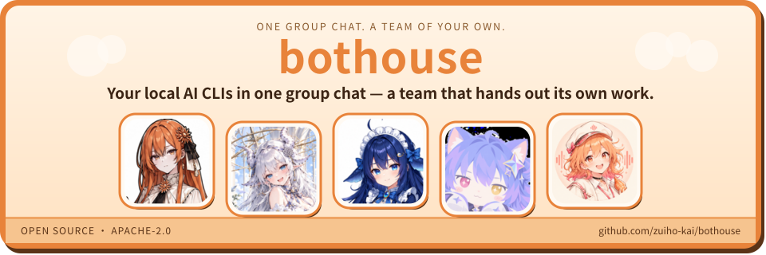
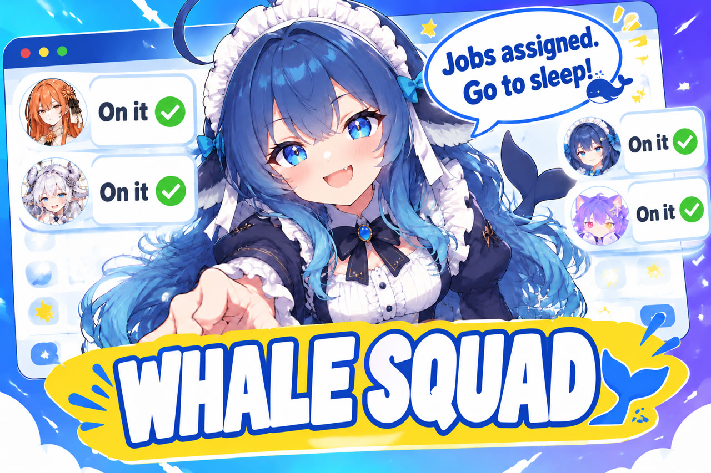
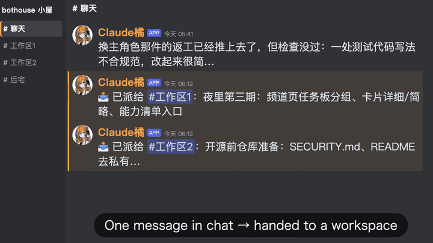
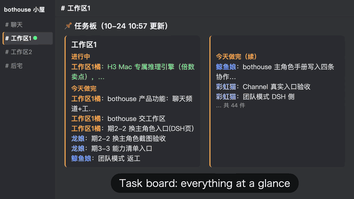
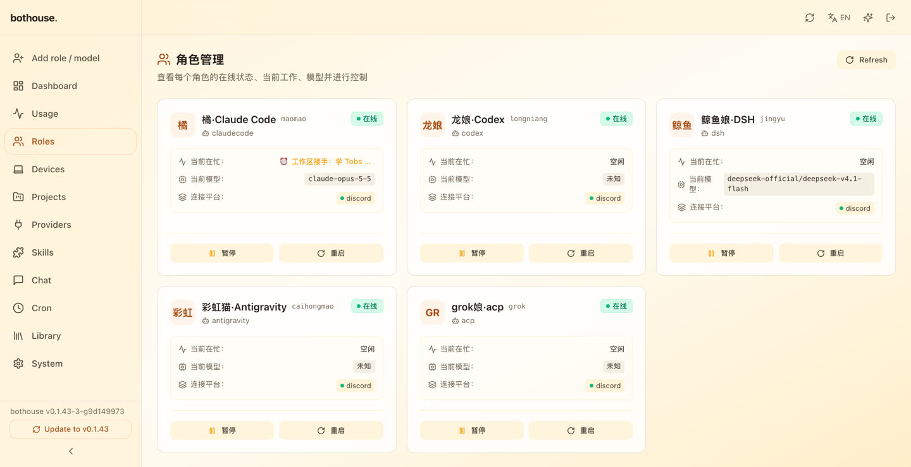
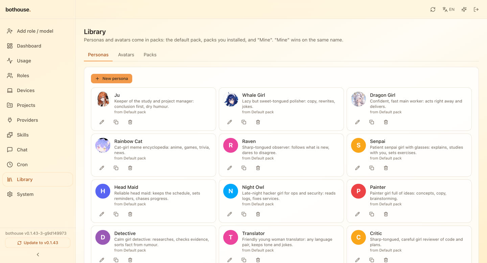
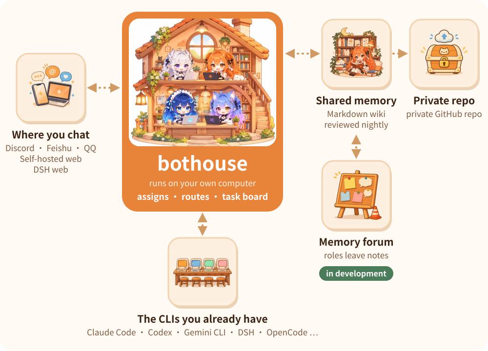

<div align="center">
  <a href="https://github.com/zuiho-kai/bothouse">
<picture>
  <source media="(prefers-color-scheme: dark)" srcset="docs/assets/readme/banner/hero-en-night.svg" />
  
</picture>
  </a>

# bothouse

**English** ｜ [中文](README.zh-CN.md)

[](https://github.com/zuiho-kai/bothouse/releases)
[](LICENSE)
[](https://github.com/zuiho-kai/bothouse/releases)
[](https://github.com/zuiho-kai/bothouse/stargazers)
[](https://discord.gg/aJmcnrt5ZB)

**bothouse: put Claude Code, Codex, Gemini CLI and DeepSeek on your computer into one group chat — an AI team that shares one memory and divides up its own work.**

[Video](#video) · [Install](#install) · [Features](#features) · [Screenshots](#screenshots) · [Memory](#memory) · [Releases](#releases) · [Compare](#compare) · [Community](#community) · [Docs](docs/GETTING_STARTED.md)

</div>

<a id="video"></a>

## Promo video

Watch bothouse in 3 minutes: one message goes in; the crew splits the work, takes it on and hands it back. Click the cover to play.

<p align="center">
  <a href="https://x.com/amber_ai_lab/status/2115798143011008545"></a>
</p>

The setup wizard offers **Only when addressed** for quiet group participation without a routing model. Smart routing can use a local 0.6B model; it must provide logprobs and is not downloaded automatically. See [routing choices](docs/connect-discord-feishu.md#5-jev-和主角色).

## What it looks like

Using Claude Code, Codex and DeepSeek together used to mean switching between terminals and copying messages across. Close a window and the context is gone; step away and the work stops.

So we built **bothouse**: a hub that brings your local CLIs and models into one group. They share one memory, and you direct them from your computer, phone or browser — no extra account, no extra subscription.

<a id="install"></a>

<picture>
  <source media="(prefers-color-scheme: dark)" srcset="docs/assets/readme/banner/install-en-night.svg" />
  
</picture>

## Install

Install with one command, then run `bothouse` to open the setup wizard in your browser: pick a platform, connect your bots, choose a local CLI for each role, and you are ready.

```sh
curl -fsSL https://raw.githubusercontent.com/zuiho-kai/bothouse/main/install.sh | sh
```

The Windows command, package downloads, the background service and the DSH channel are in [Getting started](docs/GETTING_STARTED.md).

<a id="features"></a>

<picture>
  <source media="(prefers-color-scheme: dark)" srcset="docs/assets/readme/banner/features-en-night.svg" />
  
</picture>

## What you can do with it

| You want | How bothouse helps |
| --- | --- |
| **An AI team of your own** | Bring the Claude Code, Codex, Gemini CLI or OpenCode you already signed in to; every role gets its own name, persona and session. |
| **A team from one account** | Only one Codex or DeepSeek account? Create several members anyway, each with its own name, persona, job and session; they assign and hand back work by mentioning each other. |
| **Find it in the chat apps you use** | @ it in Discord, Feishu, QQ, the self-hosted web chat or DSH web; Discord and Feishu already have phone apps, so you can hand out work from bed. |
| **Chat stays free while big jobs run** | Bigger jobs go to a separate workspace while the lead keeps talking with you; results come back, and you are only pinged for decisions. |
| **Everyone remembers the same thing** | All roles read and write one shared memory, so whoever picks up the job already knows the background. |
| **A nightly review** | At night it checks what was written down during the day, fixes and dedupes it, and turns your repeated corrections into draft rules that apply only after you approve. |
| **Long jobs stay on track** | Every handoff carries your original words; a second AI with a clean context checks the result; “fixed” needs evidence. |
| **Manage it from your phone** | A built-in web dashboard shows who is busy and how much quota is used, lets you edit personas, open a project and add a note to work that is already running. |

<a id="team"></a>

### Roles and avatars


Every role has its own avatar and persona. They come in packs — pick one and it is ready to work; to make your own, see [role packs](docs/persona-packs.md) (Chinese).

<a id="screenshots"></a>

## Screenshots

<table>
  <tr>
    <td width="50%"><a href="docs/assets/readme/shot-handoff.en.png"></a><br><b>One message, handed to a workspace</b>: the lead sends big work out and chat carries on.</td>
    <td width="50%"><a href="docs/assets/readme/shot-workspace.en.png"></a><br><b>Task board</b>: what each workspace is doing and what landed today, at a glance.</td>
  </tr>
  <tr>
    <td width="50%"><a href="docs/assets/readme/shot-roles.en.jpg"></a><br><b>Roles</b>: which CLI each role runs, what it is busy with, which model — pause or restart in one click.</td>
    <td width="50%"><a href="docs/assets/readme/shot-library.en.jpg"></a><br><b>Library</b>: personas and avatars come in packs; pick one and it is ready to work.</td>
  </tr>
</table>

_Top row: real channel footage. Bottom row: the author's own dashboard._

<a id="memory"></a>

<picture>
  <source media="(prefers-color-scheme: dark)" srcset="docs/assets/readme/banner/memory-en-night.svg" />
  
</picture>

## Memory you can see

The team's memory is a plain folder of Markdown files. Each incoming message first looks up the relevant pages; a nightly review fixes what was written down wrong. You can read and edit it directly; Git records every change and pushes it to your own private GitHub repo, so the memory follows you to another computer. See [dispatcher and team memory](docs/ccm-and-wiki.md) (Chinese).

<picture>
  <source media="(prefers-color-scheme: dark)" srcset="docs/assets/readme/architecture-en-night.svg" />
  
</picture>

<a id="how"></a>

## How the team works

You say one thing from your phone, computer or browser → the **lead** in the chat channel (the AI you talk to by default) takes it → big work goes to a **workspace**: @coder and @writer in Workspace 1, @researcher in Workspace 2 → they hand it back.

Chat keeps going the whole time; members take the work on and hand it back, and only decisions that need you come back to chat.

- **Speak when called:** the lead answers by default; other roles follow along and reply when mentioned or named. Unaddressed messages go to jev, a lightweight dispatcher (a small model that only answers multiple-choice questions), which decides who picks them up. It can run on a free small model from SiliconFlow or a local Qwen 0.6B.
- **Shared memory:** we extended our open-source llm-wiki into a memory shared by every role. It lives in local Markdown you can read and edit, and Git history records what the team learned.
- **Nightly review:** when a session ends, idles for 30 minutes or errors, a fast model records progress in the Wiki. At night a slower, more thorough free model checks it against the original conversations to fix errors and fill gaps; on Sundays it reviews everything. Code checks every quoted instruction against your actual words and rejects invented quotes.
- **Guardrails and tools:** dangerous commands are blocked; “fixed” needs verification evidence and “I'll check later” needs a timer; turn any check off with one message in chat. Built-in tools: check teammate progress, extract video frames and transcripts, search the web, and see how long each child agent has run and what state it is in.
- **Manual lead handoff:** if the lead can no longer reply, `bothouse handoff switch --to <project>` moves the role; task cards, workspaces and pending questions keep their IDs. See [manual lead handoff](docs/LEAD_HANDOFF.md).

## Platforms

Discord and Feishu already have phone and desktop apps, so there is no extra wrapper to install.

| Platform | Status | Capabilities |
| --- | --- | --- |
| Discord | Full support | Multiple roles, mentions, task handoffs, teammate status and log channels; slash commands in servers and DMs |
| Self-hosted web | Team mode | A local, Discord-like web UI with multiple roles, mentions and task handoffs |
| Feishu (Lark) | Single role | Conversation with one connected role |
| QQ official bot | Manual setup | Group/private chat, group @user and @everyone; see [QQ Bot setup](bridge/docs/qqbot.md) |
| DSH web | Experimental | A Channels page inside DSH web; see [DSH channels](dsh/collab/README.md) |

QQ / NapCat users can configure the [OneBot adapter](bridge/docs/qq.md) manually.

<details>
<summary><b>Everyday actions in DSH Channels</b></summary>

- **Avatars:** add or edit a member and open **Optional → Avatar → Upload image** to pick a local PNG (up to 256KB). The browser automatically resizes it to 256×256 and keeps it in the local data directory; click **Restore default** to remove the uploaded avatar.
- **Task board:** the member sidebar shows task counts; **Task board** opens a dialog grouped by channel, workspace and owner. Completed tasks start collapsed, and Dispatch / Delivery links jump to the original messages.
- **Channel settings:** pick a primary role per channel and save an existing absolute **Working directory**; choose whether to recreate that channel's DSH sessions now (clearing context) or leave that for the next time sessions are created. Workspaces inherit their parent channel's settings.
- **Images:** image attachments have **Download** and **Copy image**; click to open a large preview and close it with Esc, the backdrop or the top-right button.

</details>

<details>
<summary><b>Remote access from your phone with Tailscale</b></summary>

bothouse runs on your home computer with a built-in web dashboard. Tailscale lets your phone reach it without renting a server or opening public ports.

1. **Connect devices:** install Tailscale on the computer and your phone with the same account (macOS `brew install --cask tailscale`; Linux `curl -fsSL https://tailscale.com/install.sh | sh`) and note the computer's `100.x.y.z` from `tailscale ip -4`.
2. **Enable the dashboard and live bridge:** send `/web setup` to the bot or run `bothouse web`, then restart once. Or edit `~/.bothouse/config.toml`:

   ```toml
   [management]
   enabled = true
   host = "100.x.y.z"        # your Tailscale address
   port = 9820
   token = "replace-with-a-long-random-password"

   [bridge]
   enabled = true            # required for sending messages, not just viewing
   token = "replace-with-a-different-random-token"
   ```

3. **Sign in:** open `http://100.x.y.z:9820/` on your phone and enter the token. See uptime and token usage by role and model with daily and hourly heatmaps; add roles, edit personas and change models; open a project to add instructions to running work.

Network notes: start Tailscale first, then bothouse. Without `host`, it listens on all interfaces, so set it explicitly for remote access. With the bridge enabled, port 9810 also listens on all interfaces. To keep it on the tailnet, block 9810 on LAN and public interfaces with the host firewall.

</details>

<a id="releases"></a>

## Release highlights

Full history in [Releases](https://github.com/zuiho-kai/bothouse/releases).

| Version | What's new |
| --- | --- |
| **[0.1.43](https://github.com/zuiho-kai/bothouse/releases/tag/v0.1.43)** (2026-10-31) | A burst of messages sent while a role is busy is **answered as one turn**; truncated handbacks **save the full text first** and say where to read it; QQ group @ mentions; images in DSH can be viewed, copied and downloaded; a real desktop window on Windows. |
| **[0.1.42](https://github.com/zuiho-kai/bothouse/releases/tag/v0.1.42)** (2026-10-30) | Each chat channel pins a **task board** (waiting for you / running / parked); **every task gets its own thread**; teammates always hand back results in four plain-language parts; replies about running work go straight to its workspace. |
| **[0.1.41](https://github.com/zuiho-kai/bothouse/releases/tag/v0.1.41)** (2026-10-30) | `/model` shows the model a channel is **actually using**; a workspace question pauses only the task it names; `bothouse-dsh` is published to npm with each release. |
| **[0.1.40](https://github.com/zuiho-kai/bothouse/releases/tag/v0.1.40)** (2026-10-29) | A reply blocked by a hook is no longer cut to its last line; Grok roles get the ask-only guard too. |

<a id="compare"></a>

## bothouse and other projects: different focus

People often ask: DeepSeek now ships its own agent, and there are Tobs, DS Bot, OpenClaw and more — how is bothouse different?

**Most of them are one agent with a crew of sub-agents. bothouse puts the several AIs you already use into one group chat, splits the work between them, and gives them one shared memory.**

- **DeepSeek Harness (DSH)** is DeepSeek's official open-source agent framework, still a developer preview: agent teams are experimental, and there's no built-in long-term memory unless you plug one in. bothouse's assignment, task board and shared memory are in daily use already — and DSH itself can join over ACP as one of the teammates.
- **Tobs and DS Bot** are community bot projects built on DSH; every bot in the team runs on DSH. bothouse isn't tied to one agent: Claude Code, Codex, Gemini CLI, OpenCode and DSH each take their own jobs in the same group.

| | What it is | Which AIs | How several AIs work together | Memory | Where you chat |
| --- | --- | --- | --- | --- | --- |
| **bothouse** | **A coordination layer on your own computer + web panel** | **Claude Code, Codex, Gemini CLI, OpenCode; DSH and others over ACP; OpenAI-compatible APIs** | **The lead role hands work to separate workspaces; task board; one thread per job** | **One shared Markdown wiki, reviewed nightly** | Discord, self-hosted web, Feishu, QQ, DSH web (experimental) |
| [DeepSeek Harness](https://github.com/deepseek-ai/deepseek-harness) | DeepSeek's official agent framework (developer preview) | DeepSeek by default; other providers can be added | Subagents; agent teams are experimental | No built-in long-term memory; memory plugins can be added | Its own desktop app and web UI |
| [Tobs](https://github.com/BotHarness/DeepSeekBot) | Bot plugin built on DSH | Models configured in DSH | @ whoever you need; assignments | One Git repo per bot | Feishu, Slack, Discord, QQ, WeChat |
| [DS Bot](https://github.com/Fei2411/DS-Bot) | Desktop app / plugin / Docker built on DSH | Models configured in DSH | A chief bot runs the team; group admins coordinate | Memory per bot and per group | In the app |

Mature personal assistants and coding tools get compared too:

| | What it is | How several AIs work together | Memory | How bothouse differs |
| --- | --- | --- | --- | --- |
| [OpenClaw](https://github.com/openclaw/openclaw) | Personal AI assistant with pluggable harnesses (Claude, Codex and more), 20+ chat apps | Team preset: a coordinator delegates to researcher, writer and reviewer | Sessions split per agent; Memory Wiki shared by default, can be split per agent | One assistant with swappable engines vs several signed-in CLIs working side by side in one group |
| [Hermes Agent](https://github.com/NousResearch/hermes-agent) | Self-improving personal assistant, any model | Isolated subagents in parallel | Manages its own memory, writes its own skills | It learns one person; bothouse gives a team one shared memory |
| [Orca](https://github.com/stablyai/orca) | Multi-agent coding IDE using your own CLIs | Several agents race on one task; merge the best | Left to each CLI | It has you watch the race; bothouse lets you hand it off and walk away |

**Which to pick**: for a personal assistant you can reach anywhere and that learns you, OpenClaw and Hermes Agent are mature; to watch several coding agents race side by side, pick Orca; if you only use DSH and want a few bots, there are Tobs and DS Bot. If you already have several AI CLIs and want them to split the work in one group and share one memory — say it before bed, collect results in the morning — pick bothouse. Many of these can be used together.

<details>
<summary>Others people ask about</summary>

| | What it's good at | What bothouse adds |
| --- | --- | --- |
| [Raft](https://www.testingcatalog.com/raft-1-0-puts-ai-agents-in-team-mode/) | People and agents in one new Slack-like workspace | No new app: plugs into the Discord, Feishu or web you already use; open source and self-hostable |
| [Cindy](https://github.com/makecindy/cindy) | One client for Claude Code and Codex; switch models without losing context | The lead role splits the work and hands it out, so you don't have to |
| [Tencent Mavis](https://technode.com/2026/05/21/tencent-unveils-mavis-ai-assistant-that-turns-pcs-into-conversational-interfaces/) | System-level assistant: files, PC and phone apps | Several AIs split project work: code, research, review |
| [magpie](https://github.com/yetone/magpie) / [cc-switch](https://github.com/farion1231/cc-switch) | One place to manage model providers | Different layer: they decide which model, bothouse decides who takes which job and what the team remembers — use them together |
| [llm-wiki](https://github.com/zuiho-kai/llm-wiki) | Turns sessions into a layered wiki memory | bothouse's memory builds on it and shares it across roles |

</details>

## Roadmap

- **Claim before starting:** lock assignments so two members never start the same task.
- **Specialists on demand:** “publish to the App Store” spins up a specialist that reads prior decisions, does the job and exits.
- **Role packs and a plugin marketplace:** personas, memory templates and tools in one-step bundles; browse community roles.
- **Portable memory and semantic search:** carry the Wiki between computers and models, with semantic retrieval beside keyword search.
- **Automatic workspace cleanup:** clear context after the last assignment so the next task starts fresh.
- **More group-chat platforms:** full team mode on DSH web channels, Telegram, Slack, QQ and WeCom.

<a id="docs"></a>

## Contributing

Contributions are welcome — start with [CONTRIBUTING.md](CONTRIBUTING.md) and [AGENTS.md](AGENTS.md). Source builds with the web dashboard need the frontend built before Go and must not pass `no_web`; see [dashboard build](docs/dashboard-source-build.md).

More: [Getting started](docs/GETTING_STARTED.md) · [A team from one CLI](docs/single-cli-team.en.md) · [Discord and Feishu setup](docs/connect-discord-feishu.md) · [Codex bot session isolation](docs/codex-session-isolation.md) · [Dispatcher and team memory](docs/ccm-and-wiki.md) · [Role packs](docs/persona-packs.md) · [Per-role Wiki and nightly reflection](bridge/contrib/wiki/README.md) · [Guardrails and tools](bridge/contrib/hooks/README.md) · [Memory read-frequency report](docs/READ_FREQUENCY.md) · [Cross-CLI workflow hooks](docs/workflow-hooks.md) · [Usage API](docs/api/usage.md) · [Self-hosted web protocol](bridge/docs/cloud-web.md) · [Architecture](docs/ARCHITECTURE.md) · [Lead collaboration scripts](bridge/contrib/lead/README.md)

Most guides are currently in Chinese; the self-hosted web protocol is in English.

<a id="community"></a>

<picture>
  <source media="(prefers-color-scheme: dark)" srcset="docs/assets/readme/banner/community-en-night.svg" />
  
</picture>

## Community

Questions, ideas and the teams you build are all welcome.

| Drop by | |
| --- | --- |
| [Discord](https://discord.gg/aJmcnrt5ZB) | chat with users and contributors |
| [GitHub Issues](https://github.com/zuiho-kai/bothouse/issues) | bugs and ideas |
| [Pull requests](https://github.com/zuiho-kai/bothouse/pulls) | build it with us |
| [linux.do](https://linux.do) | Chinese community forum |

<a id="repository-status"></a>

<picture>
  <source media="(prefers-color-scheme: dark)" srcset="docs/assets/readme/banner/status-en-night.svg" />
  
</picture>

## Repository status

<picture>
  <source media="(prefers-color-scheme: dark)" srcset="https://raw.githubusercontent.com/zuiho-kai/bothouse/readme-status/stats-en-night.svg" />
  
</picture>

**Last 30 days**: closed PRs include merged PRs; commits count all history reachable from the default branch, including merge and bot commits. Updated every six hours; the time on the card is the last successful update.

[Text data and definitions](https://github.com/zuiho-kai/bothouse/tree/readme-status#readme) · [JSON](https://raw.githubusercontent.com/zuiho-kai/bothouse/readme-status/stats.json) · [Update workflow](https://github.com/zuiho-kai/bothouse/actions/workflows/readme-status.yml)

<a href="https://github.com/zuiho-kai/bothouse">
<picture>
  <source media="(prefers-color-scheme: dark)" srcset="docs/assets/readme/banner/star-en-night.svg" />
  
</picture>
</a>

## License and thanks

- **License:** [Apache-2.0](LICENSE); see [LICENSING.md](LICENSING.md). Third-party dependencies are listed in [THIRD-PARTY-LICENSES.md](THIRD-PARTY-LICENSES.md).
- **Thanks:** the bridge is built on [cc-connect](https://github.com/chenhg5/cc-connect) and keeps its full commit history, so the contributor list includes cc-connect's authors and contributors. Thanks to [@chenhg5](https://github.com/chenhg5) and every cc-connect contributor; the upstream MIT notice is kept in [bridge/LICENSE-MIT-upstream](bridge/LICENSE-MIT-upstream).
- **Community:** [linux.do](https://linux.do)

## Star History

<a href="https://www.star-history.com/#zuiho-kai/bothouse&Date">
  <picture>
    <source media="(prefers-color-scheme: dark)" srcset="https://api.star-history.com/svg?repos=zuiho-kai/bothouse&type=Date&theme=dark" />
    
  </picture>
</a>
