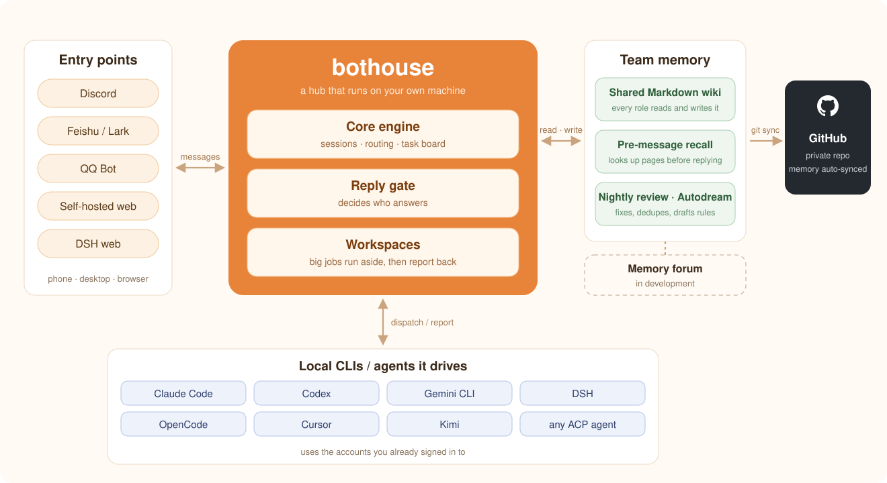

<div align="center">


**English** ｜ [中文](README.zh-CN.md)

[](https://github.com/zuiho-kai/bothouse/releases)
[](LICENSE)
[](https://github.com/zuiho-kai/bothouse/releases)
[](https://github.com/zuiho-kai/bothouse/stargazers)

**Put the Claude Code, Codex, Gemini CLI and DeepSeek on your computer into one group chat — an AI team with a shared memory that hands out its own work.**

**Send one line from your phone before bed. Your home computer works through the night. Collect the results in the morning.**

[Video](#video) · [Install](#install) · [Features](#features) · [Screenshots](#screenshots) · [How it works](#how) · [Releases](#releases) · [Docs](#docs)

</div>

<a id="video"></a>

## Watch it in 3 minutes

One message goes in; a team of AI roles splits the work, takes it on and hands it back. Click the cover to play.

<p align="center">
  <a href="https://x.com/amber_ai_lab/status/2115798143011008545"></a>
</p>

Using Claude Code, Codex and DeepSeek together used to mean switching terminals and copying messages back and forth. Close a window and the context is gone; step away and the work stops.

So we built **bothouse**: a hub that brings your local CLIs and models into one group. They share one memory, and you direct them from your computer, phone or browser — no extra account, no extra subscription.

<a id="install"></a>

## Install

Install with one command, run `bothouse` to open the setup wizard in your browser, then pick a platform, connect your bots and choose a local CLI for each role:

```sh
curl -fsSL https://raw.githubusercontent.com/zuiho-kai/bothouse/main/install.sh | sh
```

Windows, package downloads, the background service and the DSH channel are covered in [Getting started](docs/GETTING_STARTED.md).

<a id="features"></a>

## What you can do with it

| You want | How bothouse helps |
| --- | --- |
| **Your existing CLIs as teammates** | Logged-in Claude Code, Codex, Gemini CLI and OpenCode run directly; agents such as DSH connect over ACP; SiliconFlow, OpenRouter, DeepSeek, MiniMax, local models and other OpenAI-compatible endpoints work too. |
| **A team from one account** | One Codex or one DeepSeek account is enough for several members, each with its own name, persona, duty and session, assigning and returning work through mentions. See [a team from one CLI](docs/single-cli-team.en.md). |
| **Chat that never blocks** | The lead moves substantial work into separate workspaces and keeps talking to you; members accept and return tasks, and only decisions that need you come back to chat. |
| **See who is doing what** | Each chat channel pins one task table — waiting for you, running, parked — and every task has its own thread from dispatch to handback. |
| **One memory for everyone** | Every role reads and writes the same local Markdown Wiki; relevant pages are retrieved before each message, so nobody asks you for the background twice. |
| **Nightly reflection** | At night the day's notes are checked, corrected and deduplicated; Autodream turns your repeated corrections into candidate rules that take effect only after you approve. |
| **Long tasks that stay on course** | Every handoff carries your original words; a fresh-context AI checks the result; dangerous commands are blocked and “it's fixed” needs evidence. |
| **Tokens spent where they help** | Cheap or local models take chat and routine work, strong models take hard tasks; near a quota limit a role cools down and idle teammates pick up the work. |
| **Manage it from your phone** | A built-in web dashboard for roles, usage heatmaps, scheduled tasks and the persona library — readable and steerable from your phone. |

<a id="screenshots"></a>

## Screenshots

<table>
  <tr>
    <td width="50%"><br><b>One message, handed to a workspace</b>: the lead sends big work out and chat carries on.</td>
    <td width="50%"><br><b>Task board</b>: what each workspace is doing and what landed today, at a glance.</td>
  </tr>
  <tr>
    <td width="50%"><br><b>Roles</b>: which CLI each role runs, what it is busy with, which model — pause or restart in one click.</td>
    <td width="50%"><br><b>Library</b>: personas and avatars come in packs; pick one and it is ready to work.</td>
  </tr>
</table>

_Top row: real channel footage. Bottom row: the author's own dashboard._

<a id="how"></a>

## How the team works

```text
You (phone / computer / browser)
   │  one message
   ▼
Chat channel ── lead (persistent session + shared Wiki)
   │  big work goes out, chat keeps going
   ├─ Workspace 1 ── @coder writes code · @writer drafts copy ── hand back
   └─ Workspace 2 ── @researcher digs up facts ── hand back
   ▲
   └─ only decisions that need you come back to chat
```

- **Speak when called:** the lead answers by default; other roles follow along and reply when mentioned or named. The lightweight jev dispatcher (a small model that only answers multiple-choice questions) decides who should answer an unaddressed message, using a free small model on SiliconFlow or a local model such as Qwen 0.6B.
- **Shared memory:** we extended our open-source llm-wiki into a memory shared by every role. It lives in local Markdown you can read and edit, and Git history records what the team learned.
- **Nightly review:** when a session ends, idles for 30 minutes or errors, a fast model records progress in the Wiki; at night a slower, thorough free model compares it with the original conversations to fix errors and fill gaps, with a full review on Sundays. Code checks every quoted instruction against your actual words and rejects invented quotes.
- **Guardrails and tools:** dangerous commands are blocked; “fixed” needs verification evidence and “I'll check later” needs a timer; turn any check off with one message in chat. Built-in tools inspect teammate progress, extract video frames and transcripts, search the web, and show child-agent durations and status.
- **Manual lead handoff:** if the lead can no longer reply, `bothouse handoff switch --to <project>` moves the role; task cards, workspaces and pending questions keep their IDs. See [manual lead handoff](docs/LEAD_HANDOFF.md).

## Platforms

Discord and Feishu already have phone and desktop apps, so there is no extra wrapper to install.

| Platform | Status | Capabilities |
| --- | --- | --- |
| Discord | Full support | Multiple roles, mentions, task handoffs, teammate status and log channels; slash commands in servers and DMs |
| Self-hosted web | Team mode | A local, Discord-like web UI with multiple roles, mentions and task handoffs |
| Feishu (Lark) | Single role | Conversation with one connected role |
| QQ official bot | Manual setup | Group/private chat, group @user and @everyone; see [QQ Bot setup](bridge/docs/qqbot.md) |
| DSH web | Experimental | A Channels page inside DSH web; see [DSH channels](dsh/collab/README.md) |

QQ / NapCat users can configure the [OneBot adapter](bridge/docs/qq.md) manually.

<details>
<summary><b>Everyday actions in DSH Channels</b></summary>

- **Avatars:** add or edit a member and open **Optional → Avatar → Upload image** to pick a local PNG (up to 256KB). The browser resizes it to 256×256 and it stays in the local data directory; **Restore default** removes it.
- **Task board:** the member sidebar shows task counts; **Task board** opens a dialog grouped by channel, workspace and owner. Completed tasks start collapsed, and Dispatch / Delivery links jump to the original messages.
- **Channel settings:** pick a primary role per channel and save an existing absolute **Working directory**; choose whether to recreate that channel's DSH sessions now (clearing context) or on next creation. Workspaces inherit their parent channel's settings.
- **Images:** image attachments have **Download** and **Copy image**; click to open a large preview and close it with Esc, the backdrop or the top-right button.

</details>

<details>
<summary><b>Remote access from your phone with Tailscale</b></summary>

bothouse runs on your home computer with a built-in web dashboard. Tailscale lets your phone reach it without renting a server or opening public ports.

1. **Connect devices:** install Tailscale on the computer and your phone with the same account (macOS `brew install --cask tailscale`; Linux `curl -fsSL https://tailscale.com/install.sh | sh`) and note the computer's `100.x.y.z` from `tailscale ip -4`.
2. **Enable the dashboard and live bridge:** send `/web setup` to the bot or run `bothouse web`, then restart once. Or edit `~/.bothouse/config.toml`:

   ```toml
   [management]
   enabled = true
   host = "100.x.y.z"        # your Tailscale address
   port = 9820
   token = "replace-with-a-long-random-password"

   [bridge]
   enabled = true            # required for sending messages, not just viewing
   token = "replace-with-a-different-random-token"
   ```

3. **Sign in:** open `http://100.x.y.z:9820/` on your phone and enter the token. See uptime and token usage by role and model with daily and hourly heatmaps; add roles, edit personas and change models; open a project to add instructions to running work.

Network notes: start Tailscale before bothouse, and set `host` explicitly for remote access. With the bridge enabled, port 9810 also listens on all interfaces; block it on LAN and public interfaces with the host firewall if it should stay on the tailnet.

</details>

<a id="releases"></a>

## Release highlights

Full notes in [Releases](https://github.com/zuiho-kai/bothouse/releases).

| Version | What's new |
| --- | --- |
| **[0.1.43](https://github.com/zuiho-kai/bothouse/releases/tag/v0.1.43)** (2026-10-31) | A burst of messages sent while a role is busy is **answered as one turn**; truncated handbacks **save the full text first** and say where to read it; QQ group @ mentions; images in DSH can be viewed, copied and downloaded; Windows desktop windows. |
| **[0.1.42](https://github.com/zuiho-kai/bothouse/releases/tag/v0.1.42)** (2026-10-30) | Each chat channel pins a **task table** (waiting for you / running / parked); **every task gets its own thread**; handbacks in four plain-language parts; replies about running work go straight to its workspace. |
| **[0.1.41](https://github.com/zuiho-kai/bothouse/releases/tag/v0.1.41)** (2026-10-30) | `/model` shows the model a channel is **actually using**; a workspace question pauses only the task it names; `bothouse-dsh` is published to npm with each release. |
| **[0.1.40](https://github.com/zuiho-kai/bothouse/releases/tag/v0.1.40)** (2026-10-29) | A reply blocked by a hook is no longer cut to its last line; Grok roles get the ask-only guard too. |

## Architecture

<p align="center">
  
</p>

See [Architecture](docs/ARCHITECTURE.md) for module responsibilities.

## Roadmap

The first step works: one group, persistent AI members and a shared memory. Next directions (track them in [Issues](https://github.com/zuiho-kai/bothouse/issues) and [Pull requests](https://github.com/zuiho-kai/bothouse/pulls)):

- **Claim before starting:** lock assignments so two members never start the same task.
- **Specialists on demand:** “publish to the App Store” spins up a specialist that reads prior decisions, does the job and exits.
- **Role packs and a plugin marketplace:** personas, memory templates and tools in one-step bundles; browse community roles.
- **Portable memory and semantic search:** carry the Wiki between computers and models, with semantic retrieval beside keyword search.
- **Automatic workspace cleanup:** clear context after the last assignment so the next task starts fresh.
- **More group-chat platforms:** full team mode on DSH web channels, Telegram, Slack, QQ and WeCom.

<a id="docs"></a>

## Documentation

Most guides are currently in Chinese; the self-hosted platform protocol is in English.

| Guide | Contents |
| --- | --- |
| [Getting started](docs/GETTING_STARTED.md) | Installation, wizard and first run |
| [A team from one CLI](docs/single-cli-team.en.md) | Several roles from one DeepSeek or Codex account |
| [Discord and Feishu setup](docs/connect-discord-feishu.md) | Platform connections, AI-assisted setup and third-party APIs |
| [Dispatcher and team memory](docs/ccm-and-wiki.md) | jev and the shared Wiki |
| [Role packs](docs/persona-packs.md) | Choose, build and import personas and avatars |
| [Per-role Wiki and nightly reflection](bridge/contrib/wiki/README.md) | Wiki isolation, maintenance and Autodream |
| [Guardrails and tools](bridge/contrib/hooks/README.md) | Hook rules, switches and [built-in utilities](bridge/contrib/tools/README.md) |
| [Usage API](docs/api/usage.md) | Daily, hourly, role and model token totals with optional price estimates |
| [Self-hosted platform protocol](bridge/docs/cloud-web.md) | Communication between the web platform and plugins |
| [Architecture](docs/ARCHITECTURE.md) | Module responsibilities and data flow |

## Contributing

Contributions welcome — start with [CONTRIBUTING.md](CONTRIBUTING.md) and [AGENTS.md](AGENTS.md).

- Source builds with the web dashboard must build the frontend before compiling Go and omit `no_web`; see [dashboard builds and private remote access](docs/dashboard-source-build.md).
- The setup wizard installs the task board, timer, handoff and lead helpers for a newly created primary role. For an existing role: `bothouse setup lead install --work-dir /path/to/role --agent codex`; see [configuration and requirements](bridge/contrib/lead/README.md).

## License and thanks

- **License:** [Apache-2.0](LICENSE); see [LICENSING.md](LICENSING.md). Third-party dependencies are listed in [THIRD-PARTY-LICENSES.md](THIRD-PARTY-LICENSES.md).
- **Thanks:** the bridge is built on [cc-connect](https://github.com/chenhg5/cc-connect) and keeps its full commit history, so the contributor list includes cc-connect's authors and contributors. Thanks to [@chenhg5](https://github.com/chenhg5) and every cc-connect contributor; the upstream MIT notice is kept in [bridge/LICENSE-MIT-upstream](bridge/LICENSE-MIT-upstream).
- **Community:** [linux.do](https://linux.do)

## Star History

<a href="https://www.star-history.com/#zuiho-kai/bothouse&Date">
  <picture>
    <source media="(prefers-color-scheme: dark)" srcset="https://api.star-history.com/svg?repos=zuiho-kai/bothouse&type=Date&theme=dark" />
    
  </picture>
</a>
