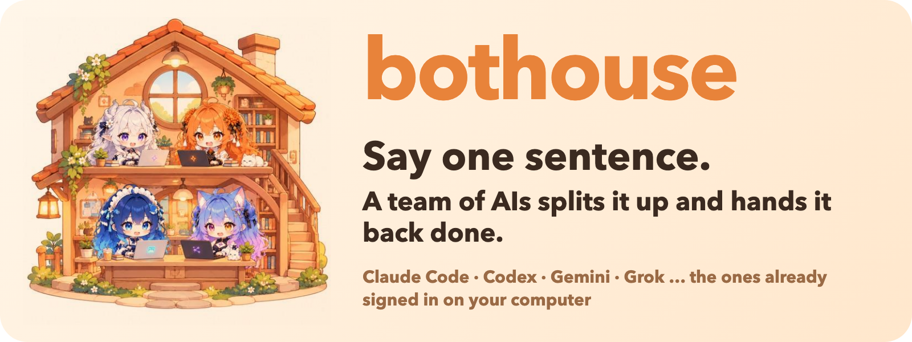
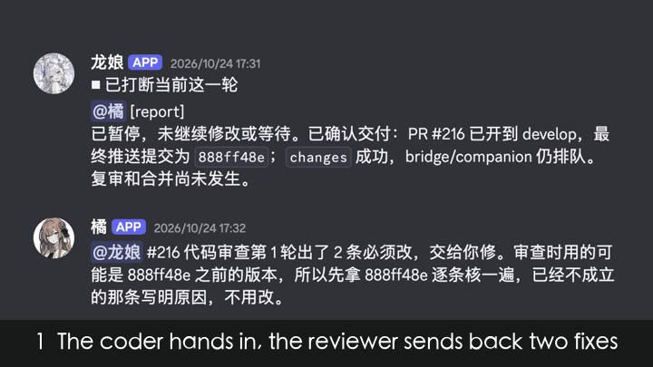
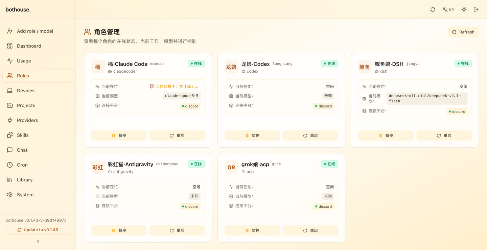
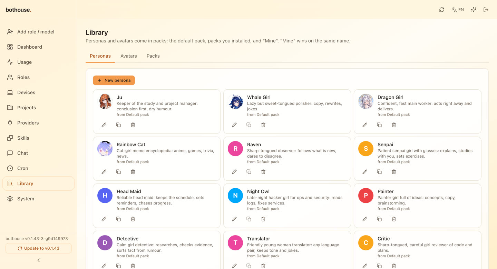
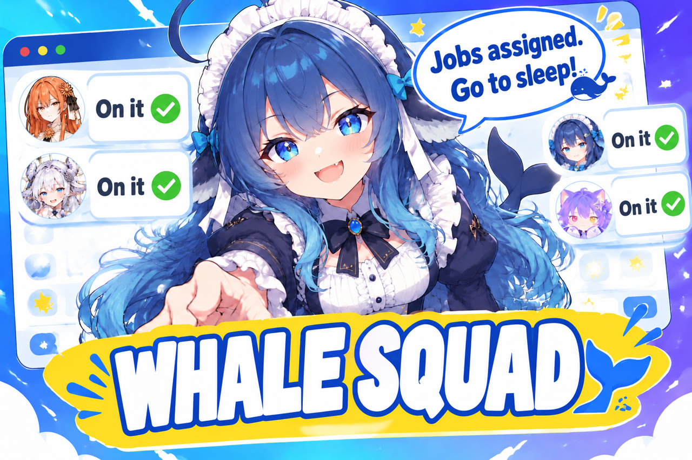
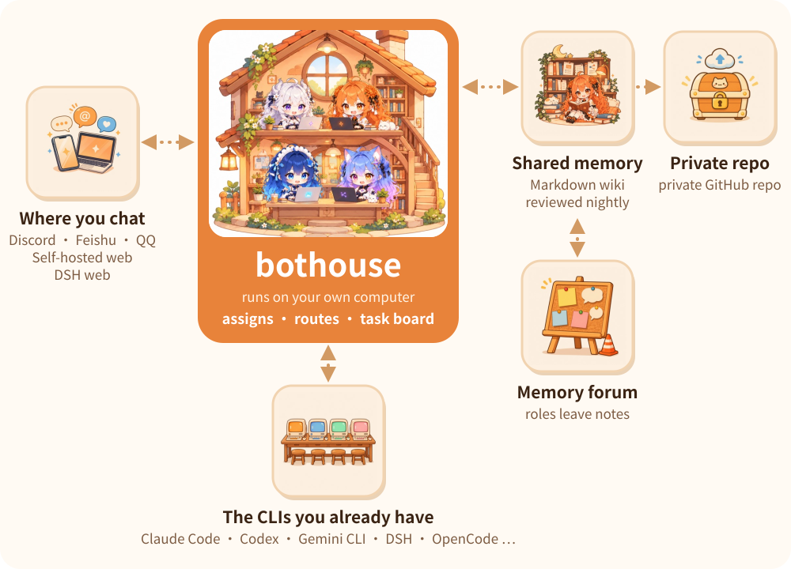
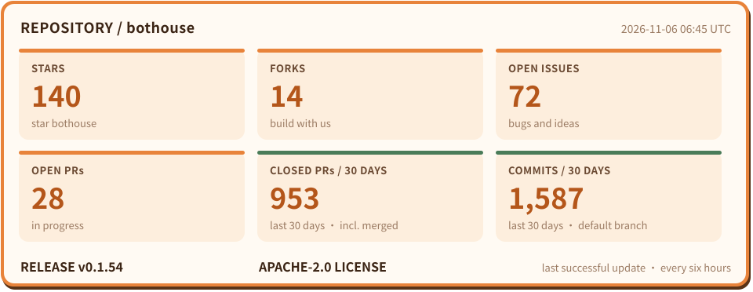

<div align="center">

<a href="https://github.com/zuiho-kai/bothouse"></a>

**botHouse: a team platform for one agent or many. Works for one person with one model, works for a whole team, and everyone shares the same project memory.**

First-class on Discord, DSH and QQ; the agent CLIs you are already signed in to — Claude Code, Codex, Antigravity, DSH, Grok — join as teammates.

<a href="#dsh"></a>
<a href="#install"></a>

[](https://github.com/zuiho-kai/bothouse/stargazers)
[](https://github.com/zuiho-kai/bothouse/releases)
[](LICENSE)
[](https://discord.gg/aJmcnrt5ZB)

**English** ｜ [中文](README.zh-CN.md)

</div>

- 🧠 **Memory that tends itself**: idle sessions and a nightly pass summarise and tidy into an llm-wiki, synced to your private GitHub repo every night.
- 📌 **Memory forum**: each turn injects the memories that match its keywords; it costs very little and stops the rework of "telling it the same thing twice".
- 🧵 **Chat and workspaces are separate**: keep chatting while workspaces take jobs; a workspace sees your original words and the project memory, and gets the code map and project map on its first turn instead of re-reading everything.
- 🧩 **Reuses the DSH plugin ecosystem**: your existing DSH plugins keep working, and we are adapting the popular ones in depth.

<a id="dsh"></a>

## DSH users: install in one sentence, then turn one DeepSeek into a whole team

Tell DSH "install the plugin bothouse-dsh, pinned to the newest version on npm" and it is installed. A lead is already in the channel, so with one model and one role you can start chatting and handing out work right away.

Want a crew? Say one sentence to the lead:

> Build me a small team: a writer and a programmer, both on deepseek-v4.1-flash, and put them in a channel

The roles are created and added to the channel; the lead splits the work, hands it to them, and they hand it back done. One DeepSeek is enough: members differ by name, persona and their own sessions, not by model.

<!-- Screenshot placeholder: one-sentence team in DSH (replace with docs/assets/readme/demo/dsh-oneline-team.jpg once task #994 lands) -->

<details>
<summary>Install from the command line</summary>

```sh
dsh plugin --profile web add "bothouse-dsh@$(npm view bothouse-dsh version)"
```

Naming the version installs the newest release on npm right away. You can also open the DSH sidebar → "Plugins" → "Add plugin" and enter `bothouse-dsh@<newest version on npm>`. Without a version, the pnpm that DSH uses holds back fresh releases and you get an older one. To add members one by one, or use Codex / Claude Code as members, see [a team from one CLI](docs/single-cli-team.en.md).

</details>

<a id="install"></a>

## Get started in three steps (Discord, QQ, self-hosted web)

1. **Install** with one command (Windows command and packages are in [Getting started](docs/GETTING_STARTED.md)):

   ```sh
   curl -fsSL https://raw.githubusercontent.com/zuiho-kai/bothouse/main/install.sh | sh
   ```

2. **Connect a chat app**: run `bothouse` and the wizard in your browser walks you through picking a platform and connecting bots ([Discord and Feishu](docs/connect-discord-feishu.md), [QQ bot](bridge/docs/qqbot.md)).
3. **Pick teammates**: choose a local CLI for each role and make one the lead. One CLI and one account are enough ([a team from one CLI](docs/single-cli-team.en.md)).

Then try saying in the group: "Rewrite this repo's README in Chinese and English, then have someone else review it."

> 💡 Rather not do it yourself? Send this to the Claude Code or Codex on your computer and it will set things up:<br/>
> `Follow https://github.com/zuiho-kai/bothouse/blob/main/docs/GETTING_STARTED.md to install bothouse on this computer and open the setup wizard.`

## Why we built it

I had cc, codex and ds open at the same time across two screens: four cc windows on one, codex on the other, and getting them to work together was painful. So I reused what Discord already does and built a collaboration platform on it. Later, talking with friends at vLLM and ModelBest, it turned out they had built something similar. As the community grew, DSH, QQ and more joined.

The memory forum idea came from the vLLM folks too.

<a id="features"></a>

## What it can do

### 1. One bridge, every platform

QQ, Discord, Feishu, DSH web channels and a self-hosted web chat all run on the same backend. Send a line from Discord on your phone, keep reading on your computer: same roles, same memory.

### 2. Chat and workspaces are separate: several jobs in one channel, and you can still talk

You talk to the lead in the chat channel; big jobs go straight to workspaces — the coder, the writer and the researcher each take one. Chat stays free, so you can cut in, ask for progress or start something new without interrupting anyone. Every job gets its own thread, and a task board pinned at the top shows what is waiting for you, what is running and what is parked.

A workspace takes the job with your original words and the project memory; it gets the code map and project map on its first turn, and adds what it learned back to the map when it hands in, so the next one doesn't start from scratch.

<div align="center">

<h3>"What did everyone get done today?"</h3>

<a href="docs/assets/readme/demo/board.jpg"></a>

<sub>The pinned task board: who is on what, and what landed today</sub>

<h3>"Fix this bug, and have someone check it"</h3>

<a href="docs/assets/readme/demo/reject.jpg"></a>

<sub>One AI writes, another hunts for mistakes: two must-fixes, sent straight back</sub>

<h3>"Make an English cut of the promo video"</h3>

<a href="docs/assets/readme/demo/team-masked.jpg"></a>

<sub>One AI cuts it, another checks every shot side by side and signs off only when it is all English</sub>

</div>

<details>
<summary>More demos</summary>

<table>
<tr>
<td align="center" colspan="3"><br/>Relay in the group: Codex writes, Claude reviews, Gemini verifies, then it reports back merged (three real screenshots from the author's own team, redacted)</td>
</tr>
<tr>
<td align="center" width="33%"><br/>"Verify this PR again": a live progress card shows which step it is on</td>
<td align="center" width="33%"><br/>One card per task: who has it and how far along; it reports back merged with CI green</td>
<td align="center" width="33%"><br/>First run: the web wizard walks you through platform, bots and CLIs</td>
</tr>
<tr>
<td align="center"><br/>Roles: which CLI, what it is busy with, which model; pause or restart in one click</td>
<td align="center"><br/>Library: personas and avatars come in packs; pick one and it is ready to work</td>
<td align="center"><a href="https://x.com/amber_ai_lab/status/2115798143011008545"></a><br/>The 3-minute promo video</td>
</tr>
</table>

</details>

<sub>The demos come from the author's own Discord server, which runs in Chinese; Long, Ju, Whale and Nyan are the names the author gave the AIs. It works the same in DSH, QQ, Feishu and the self-hosted web chat, and your team can talk in English.</sub>

### 3. Many agents, many models, many roles: the lead splits the work — no semantic routing

Only whoever is @-mentioned speaks; the rest read along and stay quiet, so five AIs in one group never talk over each other. Only unaddressed messages go to a small model that picks who answers: it returns a single choice and can be a free small model or a local Qwen 0.6B ([routing choices](docs/connect-discord-feishu.md#5-jev-和主角色)).

The real work is split by the lead agent (Opus, in the author's setup) and handed out by ability and quota. Claude Code, Codex, Antigravity, DSH, Grok, Gemini CLI, Cursor, Kimi and OpenCode can all be teammates; with one account you can still create several members, each with its own job.

### 4. Memory: remember as much as possible, cheaply, and redo less

<div align="center">

<picture>
  <source media="(prefers-color-scheme: dark)" srcset="docs/assets/readme/architecture-en-night.svg" />
  
</picture>

</div>

- **Memory is a folder of Markdown**: built on our open-source [llm-wiki](https://github.com/zuiho-kai/llm-wiki) and shared by every role. Read it and edit it directly; Git records every change and can push to your own private repo, so it moves with you to another computer.
- **It tidies itself**: when a session idles for 30 minutes or ends, a cheap model summarises it in the background. Every night it is checked against the original conversations to fix mistakes and fill gaps, with a full review on Sundays. Wherever your words are quoted, code checks each quote and rejects invented ones.
- **Light on cost**: no knowledge-graph CRUD and no resident vector database, so cost and memory use stay small.
- **Memory forum**: each turn picks the memories matching its keywords and injects only their titles; a role opens the full text when it needs it. Memories that helped or misled get voted on, so useful ones rise and stale ones sink. Recall goes up at low cost, and you stop telling it the same thing twice.

See [dispatcher and team memory](docs/ccm-and-wiki.md) (Chinese).

### 5. Teams: a whole department working from one memory

Not just for one person. A whole team can share one agent memory: who decided what and which pitfalls were hit stays there, whoever or whichever model picks the job up next.

<details>
<summary>And also</summary>

- **Nobody reviews their own work**: every handoff carries your original words; a second AI with a clean context checks the result, and "fixed" needs evidence.
- **Guardrails and tools**: dangerous commands are blocked; "I'll check later" needs a timer; turn any check off with one message. Built-in tools check teammate progress, extract video frames and transcripts, search the web, and show how long each child agent has run and what state it is in.
- **Manage it from your phone**: a built-in web dashboard shows who is busy and how much quota is used, lets you edit personas and add a note to work that is already running.
- **Role packs**: every role has its own avatar and persona, managed in packs; to make your own, see [role packs](docs/persona-packs.md) (Chinese).
- **Manual lead handoff**: if the lead can no longer reply, `bothouse handoff switch --to <project>` moves the role; task cards, workspaces and pending questions keep their IDs. See [manual lead handoff](docs/LEAD_HANDOFF.md).
- **Runs on your own computer**: scheduling runs locally and memory syncs to your own private GitHub repo; open source under Apache-2.0.

</details>

## Platforms

Discord, QQ and Feishu already have phone and desktop apps, so there is no extra wrapper to install.

| Platform | Status | Capabilities |
| --- | --- | --- |
| Discord | Full support | Multiple roles, mentions, task handoffs, teammate status and log channels; slash commands in servers and DMs |
| DSH web | Plugin | A Channels page inside DSH web: several members, a lead, workspaces and a task board; see [DSH channels](dsh/collab/README.md) |
| QQ official bot | Supported | Group/private chat, group @user and @everyone; see [QQ Bot setup](bridge/docs/qqbot.md) |
| Self-hosted web | Team mode | A local, Discord-like web UI with multiple roles, mentions and task handoffs |
| Feishu (Lark) | Single role | Conversation with one connected role |

QQ / NapCat users can configure the [OneBot adapter](bridge/docs/qq.md) manually.

The OneBot guide also covers optional paragraph splitting, original-image storage, labelled forwarded chats and a [judging model](bridge/contrib/qq-gate/README.md) using a self-hosted service or remote API. Personal prompts and model credentials are supplied by the operator.

<details>
<summary><b>Everyday actions in DSH Channels</b></summary>

- **Avatars:** add or edit a member and open **Optional → Avatar → Upload image** to pick a local PNG (up to 256KB). The browser automatically resizes it to 256×256 and keeps it in the local data directory; click **Restore default** to remove the uploaded avatar.
- **Task board:** the member sidebar shows task counts; **Task board** opens a dialog grouped by channel, workspace and owner. Completed tasks start collapsed, and Dispatch / Delivery links jump to the original messages.
- **Channel settings:** pick a primary role per channel and save an existing absolute **Working directory**; choose whether to recreate that channel's DSH sessions now (clearing context) or leave that for the next time sessions are created. Workspaces inherit their parent channel's settings.
- **Images:** image attachments have **Download** and **Copy image**; click to open a large preview and close it with Esc, the backdrop or the top-right button.

</details>

<details>
<summary><b>Remote access from your phone with Tailscale</b></summary>

bothouse runs on your home computer with a built-in web dashboard. Tailscale lets your phone reach it without renting a server or opening public ports.

1. **Connect devices:** install Tailscale on the computer and your phone with the same account (macOS `brew install --cask tailscale`; Linux `curl -fsSL https://tailscale.com/install.sh | sh`) and note the computer's `100.x.y.z` from `tailscale ip -4`.
2. **Enable the dashboard and live bridge:** send `/web setup` to the bot or run `bothouse web`, then restart once. Or edit `~/.bothouse/config.toml`:

   ```toml
   [management]
   enabled = true
   host = "100.x.y.z"        # your Tailscale address
   port = 9820
   token = "replace-with-a-long-random-password"

   [bridge]
   enabled = true            # required for sending messages, not just viewing
   token = "replace-with-a-different-random-token"
   ```

3. **Sign in:** open `http://100.x.y.z:9820/` on your phone and enter the token. See uptime and token usage by role and model with daily and hourly heatmaps; add roles, edit personas and change models; open a project to add instructions to running work.

Network notes: start Tailscale first, then bothouse. Without `host`, it listens on all interfaces, so set it explicitly for remote access. With the bridge enabled, port 9810 also listens on all interfaces. To keep it on the tailnet, block 9810 on LAN and public interfaces with the host firewall.

</details>

<a id="releases"></a>

## Release highlights

Full history in [Releases](https://github.com/zuiho-kai/bothouse/releases).

| Version | What's new |
| --- | --- |
| **[0.1.43](https://github.com/zuiho-kai/bothouse/releases/tag/v0.1.43)** (2026-10-31) | A burst of messages sent while a role is busy is **answered as one turn**; truncated handbacks **save the full text first** and say where to read it; QQ group @ mentions; images in DSH can be viewed, copied and downloaded; a real desktop window on Windows. |
| **[0.1.42](https://github.com/zuiho-kai/bothouse/releases/tag/v0.1.42)** (2026-10-30) | Each chat channel pins a **task board** (waiting for you / running / parked); **every task gets its own thread**; teammates always hand back results in four plain-language parts; replies about running work go straight to its workspace. |
| **[0.1.41](https://github.com/zuiho-kai/bothouse/releases/tag/v0.1.41)** (2026-10-30) | `/model` shows the model a channel is **actually using**; a workspace question pauses only the task it names; `bothouse-dsh` is published to npm with each release. |
| **[0.1.40](https://github.com/zuiho-kai/bothouse/releases/tag/v0.1.40)** (2026-10-29) | A reply blocked by a hook is no longer cut to its last line; Grok roles get the ask-only guard too. |

<a id="compare"></a>

## How it compares with popular projects

| | How several AIs work together | Memory |
| --- | --- | --- |
| **botHouse** | **The lead splits the work into separate workspaces; a task board tracks progress** | **The whole team shares one Markdown wiki, reviewed nightly** |
| [OpenClaw](https://github.com/openclaw/openclaw) | One assistant with swappable engines; a coordinator preset hands out work | Memory Wiki shared by default |
| [Hermes Agent](https://github.com/NousResearch/hermes-agent) | Isolated subagents in parallel | Manages its own memory and writes its own skills; it learns one person |
| [Orca](https://github.com/stablyai/orca) | Several agents race on one task; merge the best | Left to each CLI |
| [DSH](https://github.com/deepseek-ai/deepseek-harness) / [Tobs](https://github.com/BotHarness/DeepSeekBot) / [DS Bot](https://github.com/Fei2411/DS-Bot) | Subagents or bot teams, all running on DSH | A plugin, or one per bot |

DSH can also join over ACP as one teammate, and the bothouse-dsh plugin brings the channels, workspaces and shared memory into DSH web. Many of these can be used together.

<details>
<summary>In detail: what it is, which AIs, where you chat</summary>

| | What it is | Which AIs | How several AIs work together | Memory | Where you chat |
| --- | --- | --- | --- | --- | --- |
| **bothouse** | **A coordination layer on your own computer + web panel** | **Claude Code, Codex, Antigravity, Gemini CLI, OpenCode; DSH, Grok and others over ACP; OpenAI-compatible APIs** | **The lead role hands work to separate workspaces; task board; one thread per job** | **One shared Markdown wiki, reviewed nightly** | Discord, DSH web, QQ, self-hosted web, Feishu |
| [DeepSeek Harness](https://github.com/deepseek-ai/deepseek-harness) | DeepSeek's official agent framework (developer preview) | DeepSeek by default; other providers can be added | Subagents; agent teams are experimental | No built-in long-term memory; memory plugins can be added | Its own desktop app and web UI |
| [Tobs](https://github.com/BotHarness/DeepSeekBot) | Bot plugin built on DSH | Models configured in DSH | @ whoever you need; assignments | One Git repo per bot | Feishu, Slack, Discord, QQ, WeChat |
| [DS Bot](https://github.com/Fei2411/DS-Bot) | Desktop app / plugin / Docker built on DSH | Models configured in DSH | A chief bot runs the team; group admins coordinate | Memory per bot and per group | In the app |
| [OpenClaw](https://github.com/openclaw/openclaw) | Personal AI assistant with pluggable harnesses (Claude, Codex and more) | Pluggable harnesses | Team preset: a coordinator delegates to researcher, writer and reviewer | Sessions split per agent; Memory Wiki shared by default, can be split per agent | 20+ chat apps |
| [Hermes Agent](https://github.com/NousResearch/hermes-agent) | Self-improving personal assistant | Any model | Isolated subagents in parallel | Manages its own memory, writes its own skills | Several chat apps |
| [Orca](https://github.com/stablyai/orca) | Multi-agent coding IDE using your own CLIs | Your CLIs | Several agents race on one task; merge the best | Left to each CLI | In the IDE |

| | What it's good at | What bothouse adds |
| --- | --- | --- |
| [Raft](https://www.testingcatalog.com/raft-1-0-puts-ai-agents-in-team-mode/) | People and agents in one new Slack-like workspace | No new app: plugs into the Discord, DSH, QQ or web you already use; open source and self-hostable |
| [Cindy](https://github.com/makecindy/cindy) | One client for Claude Code and Codex; switch models without losing context | The lead role splits the work and hands it out, so you don't have to |
| [Tencent Mavis](https://technode.com/2026/05/21/tencent-unveils-mavis-ai-assistant-that-turns-pcs-into-conversational-interfaces/) | System-level assistant: files, PC and phone apps | Several AIs split project work: code, research, review |
| [magpie](https://github.com/yetone/magpie) / [cc-switch](https://github.com/farion1231/cc-switch) | One place to manage model providers | Different layer: they decide which model, bothouse decides who takes which job and what the team remembers — use them together |
| [llm-wiki](https://github.com/zuiho-kai/llm-wiki) | Turns sessions into a layered wiki memory | bothouse's memory builds on it and shares it across roles |

</details>

## What's next

- **Hardware**: support Xiaozhi devices so the characters step out of the screen and botHouse lands in the real world.
- **Deep support for popular DSH plugins**: the DSH plugins people use most work out of the box inside a bothouse team.
- **Role packs and a plugin marketplace**: personas, memory templates and tools in one-step bundles; browse community roles.
- **Claim before starting**: lock assignments so two members never start the same task.
- **Specialists on demand**: "publish to the App Store" spins up a specialist that reads prior decisions, does the job and exits.
- **Portable memory and semantic search**: carry the Wiki between computers and models, with semantic retrieval beside keyword search.
- **Full team mode on more platforms**: Telegram, Slack and WeCom.

Ideas welcome. If you want to build it with us, open a PR or an issue; if you like it, a Star helps.

<a id="docs"></a>

## Contributing

Contributions are welcome — start with [CONTRIBUTING.md](CONTRIBUTING.md) and [AGENTS.md](AGENTS.md). Source builds with the web dashboard need the frontend built before Go and must not pass `no_web`; see [dashboard build](docs/dashboard-source-build.md).

More: [Getting started](docs/GETTING_STARTED.md) · [DSH plugin](docs/platforms/dsh.md) · [A team from one CLI](docs/single-cli-team.en.md) · [Discord and Feishu setup](docs/connect-discord-feishu.md) · [Model and reasoning selection](docs/model-and-reasoning.md) · [Proactive authorization](docs/PROACTIVE_AUTHORIZATION.md) · [Task text delivery](docs/TASK_TEXT_DELIVERY.md) · [Codex bot session isolation](docs/codex-session-isolation.md) · [Dispatcher and team memory](docs/ccm-and-wiki.md) · [Role packs](docs/persona-packs.md) · [Per-role Wiki and nightly reflection](bridge/contrib/wiki/README.md) · [Guardrails and tools](bridge/contrib/hooks/README.md) · [Memory read-frequency report](docs/READ_FREQUENCY.md) · [Cross-CLI workflow hooks](docs/workflow-hooks.md) · [Usage API](docs/api/usage.md) · [Self-hosted web protocol](bridge/docs/cloud-web.md) · [Architecture](docs/ARCHITECTURE.md) · [Lead collaboration scripts](bridge/contrib/lead/README.md)

Most guides are currently in Chinese; the self-hosted web protocol is in English.

<a id="community"></a>

## Community

Questions, ideas and the teams you build are all welcome.

| Drop by | |
| --- | --- |
| [Discord](https://discord.gg/aJmcnrt5ZB) | chat with users and contributors |
| [GitHub Issues](https://github.com/zuiho-kai/bothouse/issues) | bugs and ideas |
| [Pull requests](https://github.com/zuiho-kai/bothouse/pulls) | build it with us |
| [linux.do](https://linux.do) | Chinese community forum |

<a id="repository-status"></a>

## Repository status

<picture>
  <source media="(prefers-color-scheme: dark)" srcset="https://raw.githubusercontent.com/zuiho-kai/bothouse/readme-status/stats-en-night.svg" />
  
</picture>

**Last 30 days**: closed PRs include merged PRs; commits count all history reachable from the default branch, including merge and bot commits. Updated every six hours; the time on the card is the last successful update.

[Text data and definitions](https://github.com/zuiho-kai/bothouse/tree/readme-status#readme) · [JSON](https://raw.githubusercontent.com/zuiho-kai/bothouse/readme-status/stats.json) · [Update workflow](https://github.com/zuiho-kai/bothouse/actions/workflows/readme-status.yml)

<a href="https://github.com/zuiho-kai/bothouse">
<picture>
  <source media="(prefers-color-scheme: dark)" srcset="docs/assets/readme/banner/star-en-night.svg" />
  
</picture>
</a>

## License and thanks

- **License:** [Apache-2.0](LICENSE); see [LICENSING.md](LICENSING.md). Third-party dependencies are listed in [THIRD-PARTY-LICENSES.md](THIRD-PARTY-LICENSES.md).
- **Thanks:** the bridge is built on [cc-connect](https://github.com/chenhg5/cc-connect) and keeps its full commit history, so the contributor list includes cc-connect's authors and contributors. Thanks to [@chenhg5](https://github.com/chenhg5) and every cc-connect contributor; the upstream MIT notice is kept in [bridge/LICENSE-MIT-upstream](bridge/LICENSE-MIT-upstream).
- **Community:** [linux.do](https://linux.do)

## Star History

<a href="https://www.star-history.com/#zuiho-kai/bothouse&Date">
  <picture>
    <source media="(prefers-color-scheme: dark)" srcset="https://api.star-history.com/svg?repos=zuiho-kai/bothouse&type=Date&theme=dark" />
    
  </picture>
</a>

外部变化需要跟进已有任务时，可用结构化 cron/poll 或鉴权 webhook，并通过本地 task event-source、task events、task event-ack 管理来源与回执。配置、样例及各平台能力边界见 [外部任务事件](docs/implementation/750-external-task-events.md)。

Workspace final reports remain pending until the dispatcher verifies their artifacts. The board distinguishes pending review from paused work; overdue review reminders survive restarts. See [handback verification](docs/implementation/797-handback-verification.md).
模型额度冷却按账号及已知共享额度组保存：切到独立额度目标不会清空原目标的期限，切回仍受限制；共享额度的模型不能靠切换绕过限制。旧版本的角色级冷却只有在测得目标额度可用后才对该目标放行，无法查询时保留限制。模型切换仍须使用已有入口，由用户明确选择。
