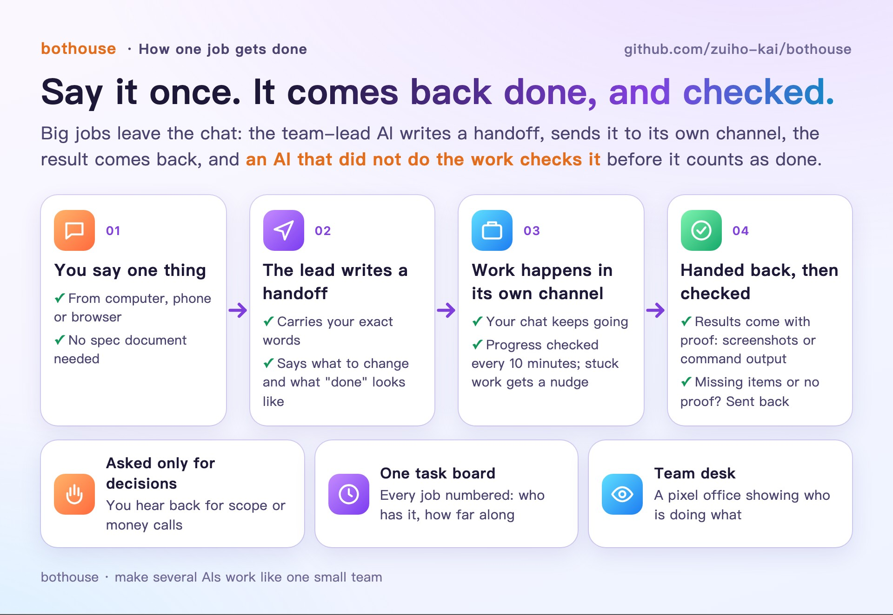
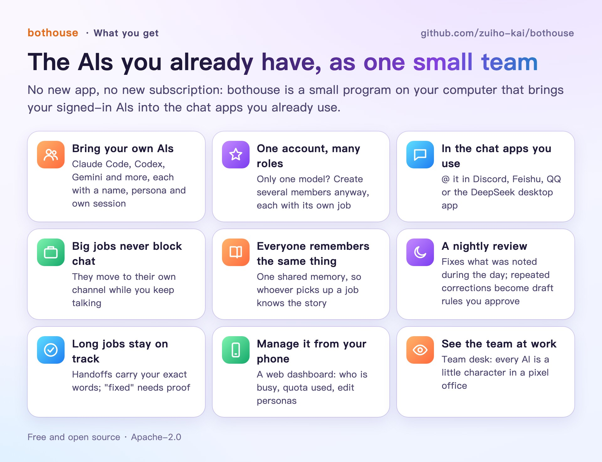

<div align="center">
  <a href="https://github.com/zuiho-kai/bothouse">
<picture>
  <source media="(prefers-color-scheme: dark)" srcset="docs/assets/readme/banner/hero-en-night.svg" />
  
</picture>
  </a>

# bothouse

**English** ｜ [中文](README.zh-CN.md)

[](https://github.com/zuiho-kai/bothouse/releases)
[](LICENSE)
[](https://github.com/zuiho-kai/bothouse/releases)
[](https://github.com/zuiho-kai/bothouse/stargazers)
[](https://discord.gg/aJmcnrt5ZB)

**Put the AIs you already use — Claude Code, Codex, Gemini CLI — into one group chat. A team-lead AI splits the work and hands it out; they all share one memory.**

[Video](#video) · [Why](#why) · [Three ways in](#usage) · [Install](#install) · [How it works](#how) · [Features](#features) · [Memory](#memory) · [Platforms](#platforms) · [Compare](#compare) · [Roadmap](#roadmap) · [Community](#community) · [Docs](docs/GETTING_STARTED.md)

</div>

<picture>
  <source media="(prefers-color-scheme: dark)" srcset="docs/assets/readme/info/overview-en-night.jpg" />
  
</picture>

<a id="video"></a>

**Watch it in 3 minutes** — one message goes in; the crew splits the work, does it and hands it back. Click the cover to play.

<p align="center">
  <a href="https://x.com/amber_ai_lab/status/2115798143011008545"></a>
</p>

```sh
curl -fsSL https://raw.githubusercontent.com/zuiho-kai/bothouse/main/install.sh | sh
```

<a id="why"></a>

## Why

I had Claude Code, Codex and DeepSeek open at once across two screens, and getting them to work together was a pain. So I put them all in one Discord group, let one of them hand out the work, and gave them a shared memory. No extra account, no extra subscription — you direct them from your computer, phone or browser.

<a id="usage"></a>

<picture>
  <source media="(prefers-color-scheme: dark)" srcset="docs/assets/readme/banner/usage-en-night.svg" />
  
</picture>

## Three ways in

<a id="dsh"></a>

| What you have | Where to start |
| --- | --- |
| **Several AI command-line tools** | The setup wizard (see [Install](#install)): each role gets one of your signed-in AI command-line tools ("CLIs" below). |
| **One model, one account** | Create several members on the same model, each with its own job. See [A team from one CLI](docs/single-cli-team.en.md). |
| **DSH** (DeepSeek Harness, DeepSeek's own AI assistant app) | Say "install bothouse-dsh for me" in DSH, or run `bothouse module add dsh`. See [bothouse in DSH](docs/platforms/dsh.en.md). |


<a id="install"></a>

<picture>
  <source media="(prefers-color-scheme: dark)" srcset="docs/assets/readme/banner/install-en-night.svg" />
  
</picture>

## Install

Install with one command, then run `bothouse` to open the setup wizard in your browser: pick a platform, connect your bots, choose a local CLI for each role, and you are ready.

```sh
curl -fsSL https://raw.githubusercontent.com/zuiho-kai/bothouse/main/install.sh | sh
```

The Windows command, package downloads and the background service are in [Getting started](docs/GETTING_STARTED.md).

**Let an AI agent install it for you:** give Claude Code, Codex or any agent CLI this repo link and say "install bothouse and connect it to Discord". The agent-side steps are in [AGENTS.md](AGENTS.md#用户说配-discord--飞书把这个配好接上-discord).


<a id="how"></a>
<a id="team-mode"></a>
<a id="team"></a>

## How it works

<picture>
  <source media="(prefers-color-scheme: dark)" srcset="docs/assets/readme/info/flow-en-night.jpg" />
  
</picture>

Only three ideas to learn:

- **The team-lead AI** ("the lead" in the docs) — the AI you talk to in each chat channel. It splits real work and hands it out by skill and quota, so five AIs in one group still don't talk over each other. The others reply when you mention or name them.
- **Workspaces** — big jobs (more than about ten minutes, or code changes and tests) go to a separate job channel with a handoff that carries your original words, the scope and what "done" looks like. Chat never stalls; one workspace, one job. The lead keeps a task board, and the bridge looks at every job every ten minutes. Results come back with proof, and only decisions that need you come back to chat. This is what we call **team mode**.
- **Shared memory** — every role reads and writes the same Markdown notes, so whoever picks up a job already knows the background. See [Memory](#memory).

More detail — who replies when nobody is named, the nightly review, guardrails, switching the lead by hand — is in [How the team works](docs/readme-details.en.md#how-the-team-works).

<a id="features"></a>

<picture>
  <source media="(prefers-color-scheme: dark)" srcset="docs/assets/readme/banner/features-en-night.svg" />
  
</picture>

## Features

<picture>
  <source media="(prefers-color-scheme: dark)" srcset="docs/assets/readme/info/features-en-night.jpg" />
  
</picture>

| You want | How bothouse helps |
| --- | --- |
| **An AI team of your own** | Claude Code, Codex, Antigravity, DSH, Gemini CLI, OpenCode, Grok and more; each role has its own name, persona and session. |
| **A team from one account** | Several members on one model, each with its own job; they hand work to each other by mention. |
| **The chat apps you use** | Discord, Feishu, QQ or DSH; Discord and Feishu have phone apps, so you can hand out work from bed. |
| **Long jobs stay on track** | Handoffs carry your original words; a second AI with a clean context checks the result; "fixed" needs evidence. |
| **A nightly review** | Fixes and dedupes what was noted during the day; your repeated corrections become draft rules that apply only after you approve. |
| **Manage it from your phone** | A web dashboard: who is busy, quota used, edit personas, add a note to running work. |

<a id="desk"></a><a id="pairing"></a>

Also: [team desk](docs/readme-details.en.md#team-desk) — a pixel office that shows the team at work; [remote pairing](docs/readme-details.en.md#remote-pairing) — run your team from another computer or your phone with a six-digit code; [per-channel model and reasoning](docs/model-and-reasoning.md); [role packs and avatars](docs/readme-details.en.md#roles-and-avatars); [optional image generation](docs/readme-details.en.md#image-generation).

<a id="screenshots"></a>

<table>
  <tr>
    <td width="50%"><a href="docs/assets/readme/shot-handoff.en.png"></a><br><b>One message, handed to a workspace</b>: the team-lead AI sends big work out and chat carries on.</td>
    <td width="50%"><a href="docs/assets/readme/shot-workspace.en.png"></a><br><b>Task board</b>: what each workspace is doing and what landed today, at a glance.</td>
  </tr>
  <tr>
    <td width="50%"><a href="docs/assets/readme/shot-roles.en.jpg"></a><br><b>Roles</b>: which CLI each role runs, what it is busy with, which model — pause or restart in one click.</td>
    <td width="50%"><a href="docs/assets/readme/shot-library.en.jpg"></a><br><b>Library</b>: personas and avatars come in packs; pick one and it is ready to work.</td>
  </tr>
</table>

_Top row: real channel footage. Bottom row: the author's own dashboard._

<a id="memory"></a>

<picture>
  <source media="(prefers-color-scheme: dark)" srcset="docs/assets/readme/banner/memory-en-night.svg" />
  
</picture>

## Memory you can see

The team's memory is a plain folder of Markdown files. Each incoming message first looks up the relevant pages; a nightly review fixes what was written down wrong. You can read and edit it directly; Git records every change and pushes it to your own private GitHub repo, so the memory follows you to another computer.

- **Only the titles go in:** each turn picks the related memories by keyword and injects their titles and line numbers; a role opens the full text when it needs it. It costs very little and cuts rework — fewer "I already told you that". The idea came from vLLM.
- **Light on cost:** no knowledge-graph CRUD and no always-on vector store, so cost and memory use stay small.
- **Memory forum:** the panel's "Memory forum" page scores each memory as a reply — upvotes, downvotes, how often it was pushed and quoted — so a wrong memory falls down instead of being repeated.

See [dispatcher and team memory](docs/ccm-and-wiki.md) (Chinese) and the [Wiki galaxy](docs/readme-details.en.md#wiki-galaxy).

<picture>
  <source media="(prefers-color-scheme: dark)" srcset="docs/assets/readme/architecture-en-night.svg" />
  
</picture>

<a id="platforms"></a>

## Platforms

| Platform | Status | Capabilities |
| --- | --- | --- |
| Discord | Full support | Multiple roles, mentions, task handoffs, teammate status and log channels; slash commands in servers and DMs |
| Feishu (Lark) | Single role | Conversation with one connected role |
| QQ official bot | Manual setup | Group/private chat, group @user and @everyone; see [QQ Bot setup](bridge/docs/qqbot.md) |
| DSH desktop app / web | Experimental | A Channels page inside the DeepSeek Harness desktop app (default) or DSH web; see [DSH](docs/platforms/dsh.en.md) |
<!-- Self-hosted platform entry disabled (no longer maintained, 2026-11-05). Original row:
| Self-hosted web | Team mode | A local, Discord-like web UI with multiple roles, mentions and task handoffs |
-->

<a id="iot"></a>

QQ via OneBot/NapCat, remote access from your phone with Tailscale, and hardware bodies for roles are in [Platform details](docs/readme-details.en.md#platform-details).

<a id="compare"></a>

## bothouse and other projects

**Most of them are one agent with a crew of sub-agents. bothouse puts the several AIs you already use into one group chat, splits the work between them, and gives them one shared memory.**

**Which to pick**: for a personal assistant you can reach anywhere and that learns you, OpenClaw and Hermes Agent are mature; to watch several coding agents race side by side, pick Orca; if you only use DSH and want a few bots, there are Tobs and DS Bot. If you already have several AI CLIs and want them to split the work in one group and share one memory — say it before bed, collect results in the morning — pick bothouse. Many of these can be used together.

<details>
<summary><b>Side-by-side tables</b></summary>

People often ask: DeepSeek now ships its own agent, and there are Tobs, DS Bot, OpenClaw and more — how is bothouse different?

- **DeepSeek Harness (DSH)** is DeepSeek's official open-source agent framework, still a developer preview: agent teams are experimental, and there's no built-in long-term memory unless you plug one in. bothouse's assignment, task board and shared memory are in daily use already — and DSH itself can join as one of the teammates.
- **Tobs and DS Bot** are community bot projects built on DSH; every bot in the team runs on DSH. bothouse isn't tied to one agent: Claude Code, Codex, Gemini CLI, OpenCode and DSH each take their own jobs in the same group.

| | What it is | Which AIs | How several AIs work together | Memory | Where you chat |
| --- | --- | --- | --- | --- | --- |
| **bothouse** | **A coordination layer on your own computer + web panel** | **Claude Code, Codex, Antigravity, Gemini CLI, OpenCode, DSH; Grok and more; OpenAI-compatible APIs** | **The lead role hands work to separate workspaces; task board; one thread per job** | **One shared Markdown wiki, reviewed nightly** | Discord, self-hosted web, Feishu, QQ, DSH web (experimental) |
| [DeepSeek Harness](https://github.com/deepseek-ai/deepseek-harness) | DeepSeek's official agent framework (developer preview) | DeepSeek by default; other providers can be added | Subagents; agent teams are experimental | No built-in long-term memory; memory plugins can be added | Its own desktop app and web UI |
| [Tobs](https://github.com/BotHarness/DeepSeekBot) | Bot plugin built on DSH | Models configured in DSH | @ whoever you need; assignments | One Git repo per bot | Feishu, Slack, Discord, QQ, WeChat |
| [DS Bot](https://github.com/Fei2411/DS-Bot) | Desktop app / plugin / Docker built on DSH | Models configured in DSH | A chief bot runs the team; group admins coordinate | Memory per bot and per group | In the app |

Mature personal assistants and coding tools get compared too:

| | What it is | How several AIs work together | Memory | How bothouse differs |
| --- | --- | --- | --- | --- |
| [OpenClaw](https://github.com/openclaw/openclaw) | Personal AI assistant with pluggable harnesses (Claude, Codex and more), 20+ chat apps | Team preset: a coordinator delegates to researcher, writer and reviewer | Sessions split per agent; Memory Wiki shared by default, can be split per agent | One assistant with swappable engines vs several signed-in CLIs working side by side in one group |
| [Hermes Agent](https://github.com/NousResearch/hermes-agent) | Self-improving personal assistant, any model | Isolated subagents in parallel | Manages its own memory, writes its own skills | It learns one person; bothouse gives a team one shared memory |
| [Orca](https://github.com/stablyai/orca) | Multi-agent coding IDE using your own CLIs | Several agents race on one task; merge the best | Left to each CLI | It has you watch the race; bothouse lets you hand it off and walk away |
| [LobeHub](https://github.com/lobehub/lobehub) | Open-source agent workspace (web, desktop, mobile; cloud or self-hosted), 40+ model providers, can bring in Claude Code and Codex | Agent Team: sequential, parallel, iterative or debate; delegated tasks | Structured memories you can review and edit | A full workspace you move into vs a small program that drives your signed-in CLIs in the group you already use, with one Git-tracked Markdown memory |

Others people ask about:

| | What it's good at | What bothouse adds |
| --- | --- | --- |
| [Raft](https://www.testingcatalog.com/raft-1-0-puts-ai-agents-in-team-mode/) | People and agents in one new Slack-like workspace | No new app: plugs into the Discord, Feishu or web you already use; open source and self-hostable |
| [Cindy](https://github.com/makecindy/cindy) | One client for Claude Code and Codex; switch models without losing context | The lead role splits the work and hands it out, so you don't have to |
| [Tencent Mavis](https://technode.com/2026/05/21/tencent-unveils-mavis-ai-assistant-that-turns-pcs-into-conversational-interfaces/) | System-level assistant: files, PC and phone apps | Several AIs split project work: code, research, review |
| [magpie](https://github.com/yetone/magpie) / [cc-switch](https://github.com/farion1231/cc-switch) | One place to manage model providers | Different layer: they decide which model, bothouse decides who takes which job and what the team remembers — use them together |
| [llm-wiki](https://github.com/zuiho-kai/llm-wiki) | Turns sessions into a layered wiki memory | bothouse's memory builds on it and shares it across roles |

</details>

<a id="roadmap"></a>

<a id="next"></a>

## Roadmap

- **Share across people:** bring every teammate's Claude Code, Codex, Gemini and DeepSeek into one group, so one person tunes the AI and the whole team uses it — shared lessons from the nightly review, and each person's own standards and habits remembered separately. (Splitting work inside one group already works — see [How it works](#how).)
- **Claim before starting:** lock assignments so two members never start the same task.
- **Specialists on demand:** "publish to the App Store" spins up a specialist that reads prior decisions, does the job and exits.
- **Role packs and a plugin marketplace:** personas, memory templates and tools in one-step bundles; browse community roles.
- **Portable memory and semantic search:** carry the Wiki between computers and models, with semantic retrieval beside keyword search.
- **Automatic workspace cleanup:** clear context after the last assignment so the next task starts fresh.
- **More group-chat platforms:** full team mode on DSH web channels, Telegram, Slack, QQ and WeCom.
- **Team-wide rules and skills:** push the team's rules, skills and tool settings to every member's computer in one step.
- **Deep support for popular DSH plugins:** reuse the DSH plugin ecosystem, with deep support for the popular plugins.
- **Hardware:** give a role a small ESP32 round-screen body with [bothouse-iot](https://github.com/zuiho-kai/bothouse-iot) — see [Hardware](docs/readme-details.en.md#hardware).

<a id="docs"></a>

## Docs and contributing

Contributions are welcome — start with [CONTRIBUTING.md](CONTRIBUTING.md) and [AGENTS.md](AGENTS.md). Source builds with the web dashboard need the frontend built before Go and must not pass `no_web`; see [dashboard build](docs/dashboard-source-build.md).

More: [Getting started](docs/GETTING_STARTED.md) · [README details](docs/readme-details.en.md) · [A team from one CLI](docs/single-cli-team.en.md) · [bothouse in DSH](docs/platforms/dsh.en.md) · [Discord and Feishu setup](docs/connect-discord-feishu.md) · [Model and reasoning](docs/model-and-reasoning.md) · [Codex bot session isolation](docs/codex-session-isolation.md) · [Dispatcher and team memory](docs/ccm-and-wiki.md) · [Role packs](docs/persona-packs.md) · [Per-role Wiki and nightly reflection](bridge/contrib/wiki/README.md) · [Guardrails and tools](bridge/contrib/hooks/README.md) · [Memory read-frequency report](docs/READ_FREQUENCY.md) · [Cross-CLI workflow hooks](docs/workflow-hooks.md) · [Usage API](docs/api/usage.md) · [Self-hosted web protocol](bridge/docs/cloud-web.md) · [Architecture](docs/ARCHITECTURE.md) · [Lead collaboration scripts](bridge/contrib/lead/README.md)

Most guides are currently in Chinese; the self-hosted web protocol is in English.

<a id="community"></a>

<picture>
  <source media="(prefers-color-scheme: dark)" srcset="docs/assets/readme/banner/community-en-night.svg" />
  
</picture>

## Community

Questions, ideas and the teams you build are all welcome.

| Drop by | |
| --- | --- |
| [Discord](https://discord.gg/aJmcnrt5ZB) | chat with users and contributors |
| [GitHub Issues](https://github.com/zuiho-kai/bothouse/issues) | bugs and ideas |
| [Pull requests](https://github.com/zuiho-kai/bothouse/pulls) | build it with us |
| [linux.do](https://linux.do) | Chinese community forum |

<a id="repository-status"></a>

<picture>
  <source media="(prefers-color-scheme: dark)" srcset="docs/assets/readme/banner/status-en-night.svg" />
  
</picture>

## Repository status

<picture>
  <source media="(prefers-color-scheme: dark)" srcset="https://raw.githubusercontent.com/zuiho-kai/bothouse/readme-status/stats-en-night.svg" />
  
</picture>

**Last 30 days**: closed PRs include merged PRs; commits count all history reachable from the default branch, including merge and bot commits. Updated every six hours; the time on the card is the last successful update.

[Text data and definitions](https://github.com/zuiho-kai/bothouse/tree/readme-status#readme) · [JSON](https://raw.githubusercontent.com/zuiho-kai/bothouse/readme-status/stats.json) · [Update workflow](https://github.com/zuiho-kai/bothouse/actions/workflows/readme-status.yml)

<a href="https://github.com/zuiho-kai/bothouse">
<picture>
  <source media="(prefers-color-scheme: dark)" srcset="docs/assets/readme/banner/star-en-night.svg" />
  
</picture>
</a>

## License and thanks

- **License:** [Apache-2.0](LICENSE); see [LICENSING.md](LICENSING.md). Third-party dependencies are listed in [THIRD-PARTY-LICENSES.md](THIRD-PARTY-LICENSES.md).
- **Thanks:** the bridge is built on [cc-connect](https://github.com/chenhg5/cc-connect) and keeps its full commit history, so the contributor list includes cc-connect's authors and contributors. Thanks to [@chenhg5](https://github.com/chenhg5) and every cc-connect contributor; the upstream MIT notice is kept in [bridge/LICENSE-MIT-upstream](bridge/LICENSE-MIT-upstream).
- **Community:** [linux.do](https://linux.do)

## Star History

<a href="https://www.star-history.com/#zuiho-kai/bothouse&Date">
  <picture>
    <source media="(prefers-color-scheme: dark)" srcset="https://api.star-history.com/svg?repos=zuiho-kai/bothouse&type=Date&theme=dark" />
    
  </picture>
</a>
