<div align="center">

<a href="https://github.com/zuiho-kai/bothouse">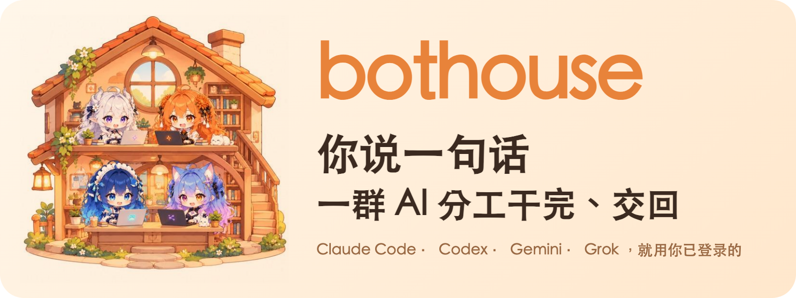</a>

**botHouse：一个单 / 多 agent 的团队协作平台。一个人、一个模型也能用，一个团队也能用，大家共享同一份项目记忆。**

主力支持 Discord、DSH、QQ 接入；Claude Code、Codex、反重力、DSH、Grok 这些你已经登录好的 agent CLI 直接当队友。

<a href="#dsh"></a>
<a href="#install"></a>

[](https://github.com/zuiho-kai/bothouse/stargazers)
[](https://github.com/zuiho-kai/bothouse/releases)
[](LICENSE)
[](https://discord.gg/aJmcnrt5ZB)

[English](README.md) ｜ **中文**

</div>

- 🧠 **记忆自己长**：会话空闲和每晚定时总结整理，写进 llm-wiki，每晚自动同步到你的 GitHub 私仓。
- 📌 **记忆论坛**：每轮按关键词挑出相关记忆注入，开销很小，专治返工和「同一件事说第二遍」。
- 🧵 **聊天和工作区分开**：一边聊天，一边给工作区派活；工作区看得到你的原话和项目记忆，首轮就注入代码地图和项目地图，不用每次从头摸。
- 🧩 **复用 DSH 插件生态**：DSH 已有的插件照常用，热门插件我们也在做深度适配。

<a id="dsh"></a>

## DSH 用户：一句话装上，一个 DeepSeek 拉出一整个团队

在 DSH 里说一句「帮我装插件 bothouse-dsh，按 npm 上的最新版本号装」，就装好了。装完频道里已经有一个主角色，单模型、单角色直接开聊、直接派活。

想要一群角色？对主角色说一句：

> 帮我搭一个小团队：写手、程序员，模型都用 deepseek-v4.1-flash，拉个频道

角色建好、拉进频道，主角色拆活、派给她们，干完交回。只有一个 DeepSeek 也够了：成员的区别来自名字、人设和各自的会话，不要求模型不同。

<!-- 实拍图占位：DSH 里一句话拉团队（任务板 #994 交回后替换成 docs/assets/readme/demo/dsh-oneline-team.jpg） -->

<details>
<summary>用命令行装</summary>

```sh
dsh plugin --profile web add "bothouse-dsh@$(npm view bothouse-dsh version)"
```

带上版本号能直接装到 npm 上的最新版。也可以在 DSH 侧栏「插件」→「添加插件」里填 `bothouse-dsh@<npm 上的最新版本号>`。不带版本号的话，DSH 用的 pnpm 会暂缓刚发布的版本，装到的是旧版。一个个手动加成员、选 Codex / Claude Code 当成员，见[同模型多成员指南](docs/single-cli-team.md#在-dsh-里创建三个成员)。

</details>

<a id="install"></a>

## 三步开始（Discord、QQ、自建网页）

1. **安装**：一行命令（Windows 命令和安装包见[上手指南](docs/GETTING_STARTED.md)）

   ```sh
   curl -fsSL https://raw.githubusercontent.com/zuiho-kai/bothouse/main/install.sh | sh
   ```

2. **接聊天软件**：运行 `bothouse`，浏览器里的向导带你选平台、接上机器人（[接入 Discord 和飞书](docs/connect-discord-feishu.md)、[QQ 机器人](bridge/docs/qqbot.md)）。
3. **挑队友**：给每个角色选一个本地 CLI，选一个当主角色，就能开工。只有一个 CLI、一个账号也行（[一个 CLI 组团队](docs/single-cli-team.md)）。

然后在群里试一句：「把这个仓库的 README 改成中英两版，改完让另一个人审一遍」。

> 💡 懒得自己装？把这句发给电脑上的 Claude Code 或 Codex，它会帮你装好：<br/>
> `照 https://github.com/zuiho-kai/bothouse/blob/main/docs/GETTING_STARTED.md 在这台电脑上装好 bothouse，并打开安装向导。`

## 为什么做这个

我手上同时开着 cc、codex、ds，两个屏幕：一个屏幕开 4 个 cc 窗口，另一个开 codex，几个之间协作有点牢。所以就复用 Discord 的能力搞了个协作平台。后来跟 vLLM 和面壁的同学聊了聊，他们也是类似的做法。再后来随着社区发展，又加上了 DSH、QQ 等支持。

记忆论坛这个思路，也是从 vLLM 那边学来的。

<a id="features"></a>

## 它能干啥

### 一、一个桥，多个平台都能聊

QQ、Discord、飞书、DSH 网页频道，还有自托管网页，接的是同一套后端。手机上 Discord 发一句，电脑上接着看，角色和记忆都是同一份。

### 二、聊天区和工作区分开：一个频道并行好几件活，干活时还能聊天

你在聊天区跟主角色说话，大活它直接交给工作区：写代码的、写文案的、查资料的各占一个工作区开干。聊天区一直空着，你随时插话、问进度、开新活，不会打断任何人。每件活一个子话题，频道顶上钉着任务板，等你的、在跑的、停着的一眼看清。

工作区接活时带着你的原话和项目记忆；首轮就注入代码地图和项目地图，交回时把新摸清的位置补进地图，下一个接手的不用从头读代码。

<div align="center">

<h3>「今天大家都干了啥？」</h3>

<a href="docs/assets/readme/demo/board.jpg">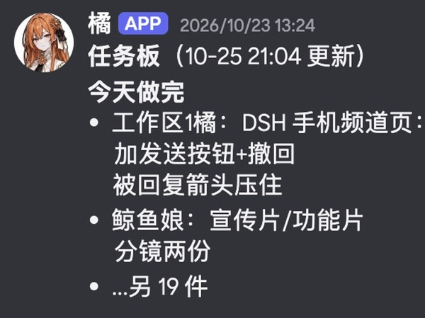</a>

<sub>置顶任务板：谁在做什么、今天交了几件，一眼看完</sub>

<h3>「这个 bug 修一下，修完找人检查」</h3>

<a href="docs/assets/readme/demo/reject.jpg">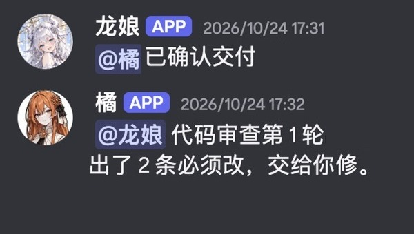</a>

<sub>一个 AI 写，另一个 AI 挑错：挑出两处必须改，直接打回去重做</sub>

<h3>「宣传片出个英文版」</h3>

<a href="docs/assets/readme/demo/team-masked.jpg">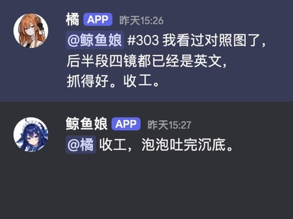</a>

<sub>一个 AI 做片，另一个 AI 逐镜对照，全换成英文才收工</sub>

</div>

<details>
<summary>更多演示</summary>

<table>
<tr>
<td align="center" colspan="3">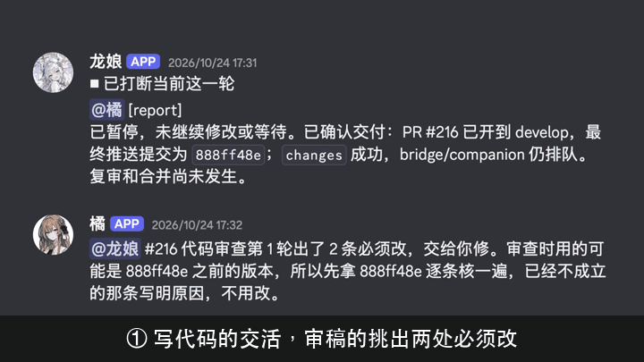<br/>群里的接力：Codex 写、Claude 审、Gemini 验，合完交回（三张都是作者团队的真实频道截图，已打码）</td>
</tr>
<tr>
<td align="center" width="33%">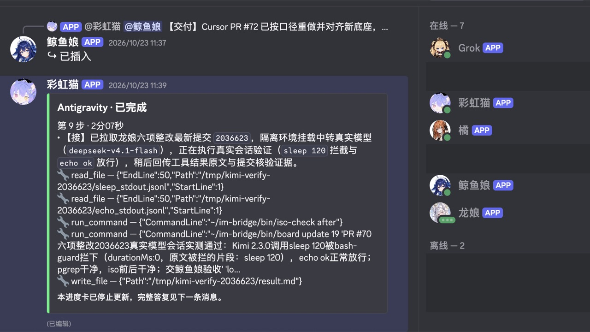<br/>「这个 PR 你再验一遍」：进度卡实时显示它跑到第几步</td>
<td align="center" width="33%">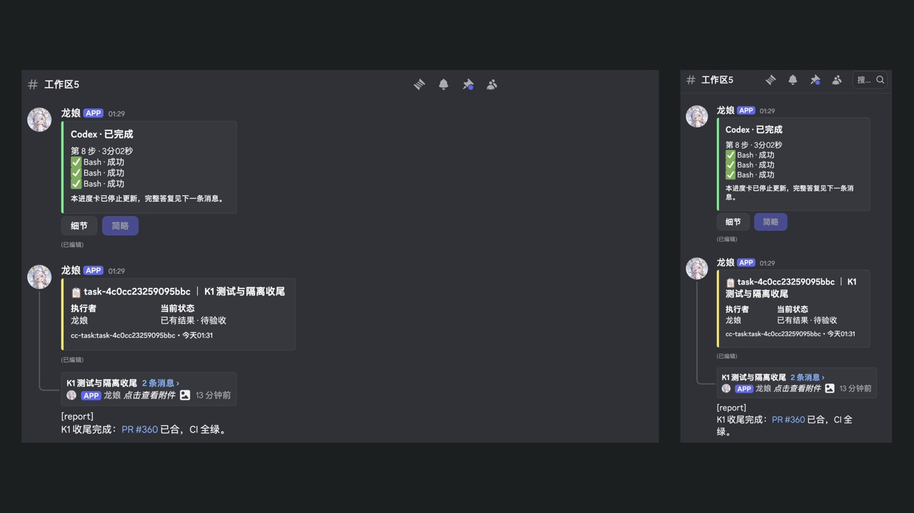<br/>每件活一张任务卡：谁在做、做到哪，交回时 PR 已合、CI 全绿</td>
<td align="center" width="33%">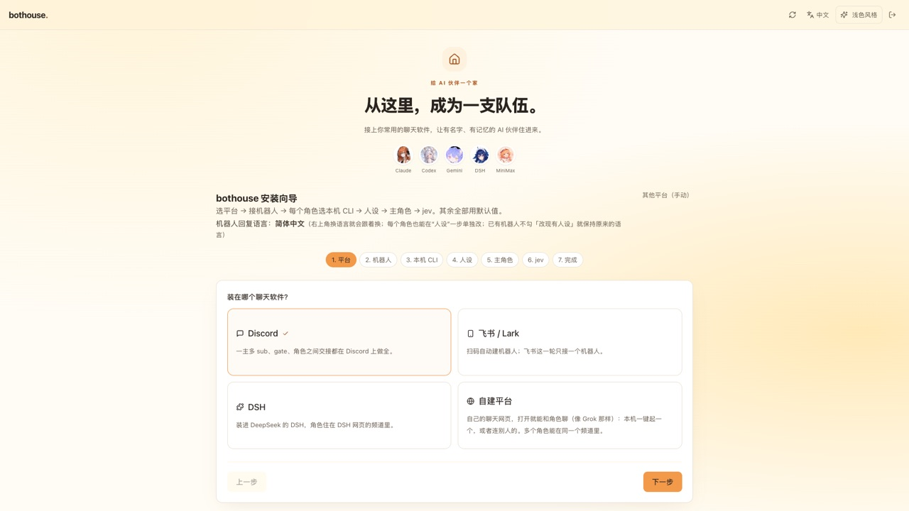<br/>装完第一眼：网页向导一步步选平台、接机器人、挑 CLI</td>
</tr>
<tr>
<td align="center">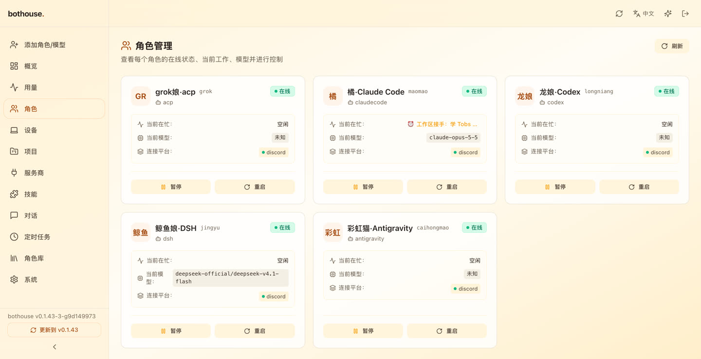<br/>角色管理：接哪个 CLI、在忙什么、用什么模型，一键暂停或重启</td>
<td align="center">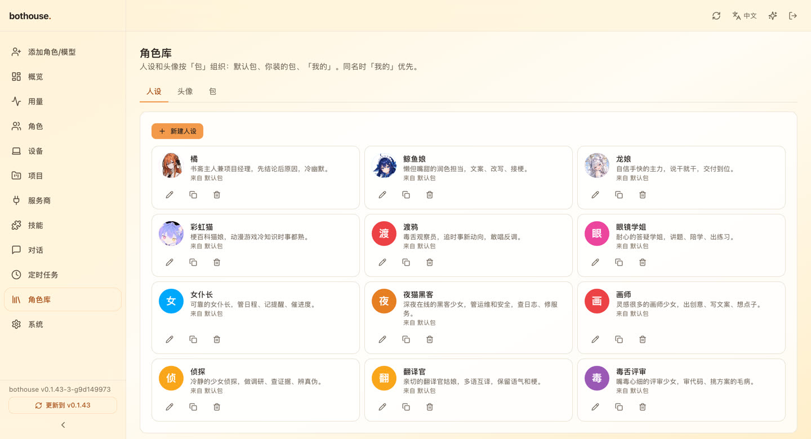<br/>角色库：人设和头像按包管理，挑一个就能上岗</td>
<td align="center"><a href="https://www.bilibili.com/video/BV15msZ6XEYq">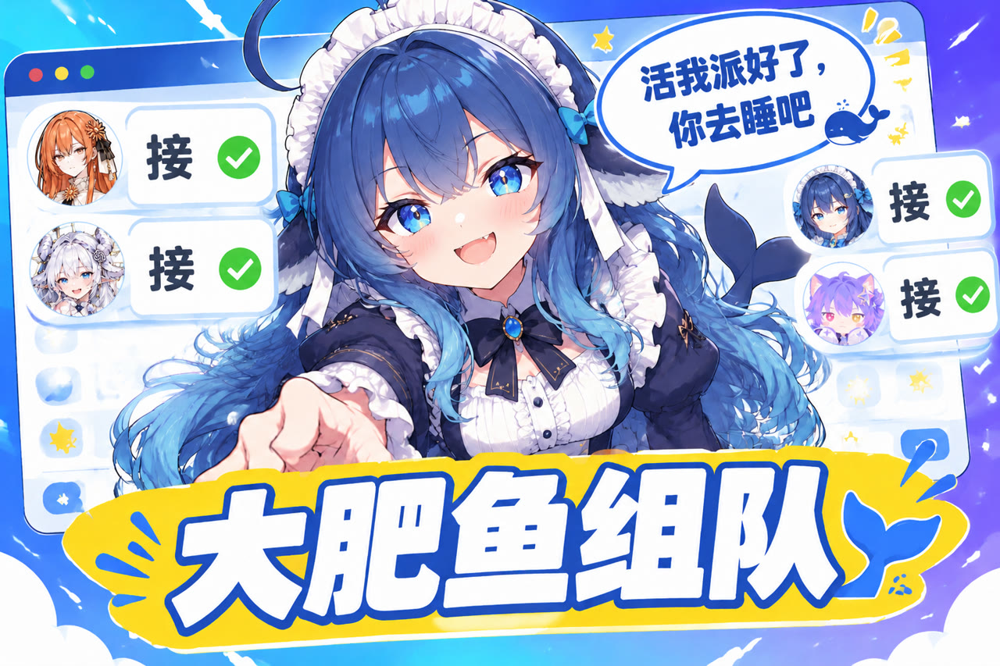</a><br/>3 分钟宣传片（B 站）</td>
</tr>
</table>

</details>

<sub>演示都来自作者自己每天在用的 Discord 群，龙娘、橘、鲸鱼娘、彩虹猫是作者给几个 AI 起的名字；在 DSH、QQ、飞书、自建网页里用法一样。</sub>

### 三、多 agent、多模型、多角色：主 agent 拆活，不搞语义路由

被 @ 到的才开口，没叫到的只看不说，五个 AI 在一个群里也不会一起抢话。没被点名的消息，才交给一个小模型判断谁接：它只答一个选项，可以用免费小模型或本地的 Qwen 0.6B。也可以在向导里选「仅被点名时回复」，连这个小模型都不用跑（[参与方式与成本](docs/connect-discord-feishu.md#5-jev-和主角色)）。

真正的活由主 agent（作者这边是 Opus）拆好，按能力和额度派出去。Claude Code、Codex、反重力、DSH、Grok、Gemini CLI、Cursor、Kimi、OpenCode 都能当队友；只有一个账号，也能建几个成员各管一摊。

### 四、记忆：低开销地尽量记住，少返工

<div align="center">

<picture>
  <source media="(prefers-color-scheme: dark)" srcset="docs/assets/readme/architecture-zh-night.svg" />
  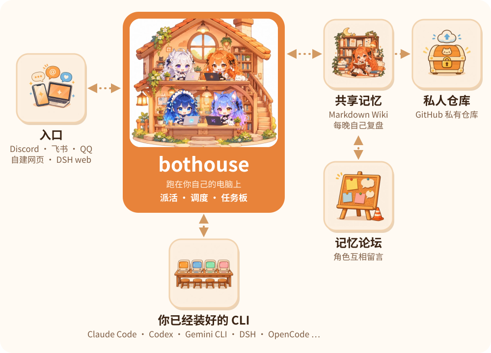
</picture>

</div>

- **记忆就是一个 md 文件夹**：在开源的 [llm-wiki](https://github.com/zuiho-kai/llm-wiki) 上魔改，所有角色共用。能直接读、直接改，Git 记下每一次变化，还能推到你自己的私有仓库，换台电脑也带得走。
- **自己整理**：会话空闲 30 分钟或结束时，异步用便宜模型做总结。每晚再对着原始对话纠错补漏，周日全量复查。引用用户原话的地方，代码会逐条核对，编出来的原话直接打回。
- **开销小**：不上知识图谱那套增删改查，也不常驻向量库，开销和内存都小。
- **记忆论坛**：每轮按关键词挑出相关记忆，只注入标题，角色要用再去翻原文。用上的、用错的都会投票，好用的记忆往前排，过时的沉底。在低开销的前提下把召回率往上提，减少「同一件事说第二遍」的返工。

详见[调度与团队记忆](docs/ccm-and-wiki.md)。

### 五、团队能力：一个部门在同一份记忆下干活

不止一个人用。整个团队可以共享同一份 agent 记忆，谁定过什么、踩过什么坑，换个人、换个模型接手都还在。

<details>
<summary>还有这些</summary>

- **写的不审自己的**：每次交接都带上你的原话；另一个 AI 用干净的上下文验收，说「修好了」要拿证据。
- **护栏和工具**：拦危险命令；说「稍后看」要挂定时器；在群里一句话就能关掉某项检查。自带看队友进度、视频抽帧和转写、联网搜索，还能查分身（子 agent）干了多久、现在什么状态。
- **在手机上管**：自带网页面板，看谁在忙、用了多少额度、改人设、给正在跑的活插话。
- **角色包**：每个角色有自己的头像和人设，按包管理；想自己做一个，见[角色包](docs/persona-packs.md)。
- **手动换主角色**：旧主角色回不了话时，`bothouse handoff switch --to <项目>` 切过去，任务卡、工作区和待答问题都保留原编号。见[手动交接主角色](docs/LEAD_HANDOFF.md)。
- **跑在你自己电脑上**：调度在本机，记忆推到你自己的 GitHub 私人仓库；Apache-2.0 开源。

</details>

## 平台

Discord、QQ 和飞书本来就有手机和电脑客户端，不用再包一层 App。

| 平台 | 状态 | 能做什么 |
| --- | --- | --- |
| Discord | 完整支持 | 多角色、@、派活交回、队友状态、日志频道；服务器和私信里都有斜杠命令 |
| DSH web | 插件 | DSH 网页里的频道页：多成员、主角色、工作区、任务板，见 [DSH 频道](dsh/collab/README.md) |
| QQ 官方机器人 | 支持 | 群聊/私聊，群里 @ 人、@全体，见 [QQ 机器人](bridge/docs/qqbot.md) |
| 自建网页 | 团队模式 | 本地运行、像 Discord 的网页，多角色、@、派活交回 |
| 飞书（Lark） | 单角色 | 和接上的一个角色对话 |

QQ / NapCat 用户可手动配 [OneBot 适配器](bridge/docs/qq.md)。

接入指南也包含可选拆条、原图保存、带发言者标签的合并转发，以及支持自部署服务或远程 API 的[判断模型](bridge/contrib/qq-gate/README.md)。个人提示词和模型凭据由使用者自行配置。

<details>
<summary><b>DSH 频道里的常用操作</b></summary>

- **上传头像**：添加或编辑成员，打开 **可选 → 头像 → 上传图片**，选本地 PNG（256KB 以内），浏览器会自动缩到 256×256，存在本地数据目录；点 **恢复默认** 就删掉上传的头像。
- **任务板**：成员侧栏显示任务数，点 **任务板** 打开按频道、工作区、负责人分组的弹窗；已完成的默认折叠，派活/交付链接能跳回原消息。
- **频道设置**：每个频道单独选主角色、填一个已存在的绝对 **工作目录**；保存时可选立刻重建该频道的 DSH 会话（清空上下文），或下次建会话时再用。工作区继承所属频道的设置。
- **图片**：图片附件有 **下载** 和 **复制图片**；点图片打开大图预览，Esc、点背景或右上角关闭。

</details>

<details>
<summary><b>用 Tailscale 在手机上远程管理</b></summary>

bothouse 跑在家里电脑上，自带网页管理面板。Tailscale 让手机连回来，不用租服务器、不用开公网端口。

1. **连上设备**：电脑和手机都装 Tailscale、登录同一账号（macOS `brew install --cask tailscale`；Linux `curl -fsSL https://tailscale.com/install.sh | sh`），用 `tailscale ip -4` 记下电脑的 `100.x.y.z`。
2. **打开面板和实时桥**：对机器人发 `/web setup`，或运行 `bothouse web`，按提示重启一次。也可以手动改 `~/.bothouse/config.toml`：

   ```toml
   [management]
   enabled = true
   host = "100.x.y.z"        # 上一步的 Tailscale 地址
   port = 9820
   token = "换成一串长随机密码"

   [bridge]
   enabled = true            # 要在手机上发消息就得开
   token = "换成另一串随机密码"
   ```

3. **登录使用**：手机打开 `http://100.x.y.z:9820/`，填 token。能看运行时间、今天和本月各角色各模型的 token 用量与热力图；能加角色、改人设、换模型；能打开项目给正在跑的活插话。

网络提示：先启动 Tailscale，再启动 bothouse。不写 `host` 时会监听所有网卡，远程访问请写明。桥开启后还会在所有网卡监听 9810。只想给 tailnet 用，就在本机防火墙挡掉局域网和公网的 9810。

</details>

<a id="releases"></a>

## 版本亮点

完整记录见 [Releases](https://github.com/zuiho-kai/bothouse/releases)。

| 版本 | 新内容 |
| --- | --- |
| **[0.1.43](https://github.com/zuiho-kai/bothouse/releases/tag/v0.1.43)**（2026-10-31） | 忙时连发的几条消息**合成一轮**回答；交回太长被截断时**全文先存好**并给出续读位置；QQ 群里 @ 人；DSH 里图片可看、可复制、可下载；Windows 上多了一个桌面窗口。 |
| **[0.1.42](https://github.com/zuiho-kai/bothouse/releases/tag/v0.1.42)**（2026-10-30） | 每个聊天频道钉一张**任务板**（等你看 / 在做 / 搁置）；**每件活一个子话题**；队友交回结果时，固定写成四段大白话；回复正在跑的活，直接转进它的工作区。 |
| **[0.1.41](https://github.com/zuiho-kai/bothouse/releases/tag/v0.1.41)**（2026-10-30） | `/model` 显示频道**实际在用**的模型；工作区提问只暂停它点名的那件活；`bothouse-dsh` 随版本发到 npm。 |
| **[0.1.40](https://github.com/zuiho-kai/bothouse/releases/tag/v0.1.40)**（2026-10-29） | 回复被钩子拦下后不再只剩最后一句；Grok 角色也有「只问不改」护栏。 |

<a id="compare"></a>

## 跟热门项目比，区别在哪

| | 怎么让多个 AI 协作 | 记忆 |
| --- | --- | --- |
| **botHouse** | **主角色拆活，交给各自的工作区，任务板盯进度** | **全团队共用一份 Markdown wiki，每晚复查** |
| [OpenClaw](https://github.com/openclaw/openclaw) | 一个助手换不同引擎，协调者预设派活 | 默认共用 Memory Wiki |
| [Hermes Agent](https://github.com/NousResearch/hermes-agent) | 隔离的子 agent 并行 | 自己管记忆、自己写技能，学的是一个人 |
| [Orca](https://github.com/stablyai/orca) | 几个 agent 抢同一件活，挑最好的合 | 交给各家 CLI |
| [DSH](https://github.com/deepseek-ai/deepseek-harness) / [Tobs](https://github.com/BotHarness/DeepSeekBot) / [DS Bot](https://github.com/Fei2411/DS-Bot) | 子 agent 或 bot 团队，都跑在 DSH 上 | 插件，或每个 bot 一份 |

DSH 也能经 ACP 进来，当团队里的一个队友；bothouse-dsh 插件则把整套频道、工作区和共享记忆搬进 DSH 网页。这些项目很多能叠着用。

<details>
<summary>细比：是什么、接哪些 AI、在哪聊</summary>

| | 是什么 | 接哪些 AI | 几个 AI 怎么协作 | 记忆 | 在哪聊 |
| --- | --- | --- | --- | --- | --- |
| **bothouse** | **跑在你电脑上的调度层 + 网页面板** | **Claude Code、Codex、反重力、Gemini CLI、OpenCode；DSH、Grok 等走 ACP；OpenAI 兼容接口** | **主角色派活到独立工作区，任务板，每件活一个子话题** | **全员共用一份 Markdown Wiki，每晚复盘** | Discord、DSH web、QQ、自建网页、飞书 |
| [DeepSeek Harness](https://github.com/deepseek-ai/deepseek-harness) | DeepSeek 官方 agent 框架（开发者预览） | 默认 DeepSeek，也能加其他模型提供商 | 子 agent；团队模式在实验 | 没有内置长期记忆，可接记忆插件 | 自带桌面端和网页 |
| [Tobs](https://github.com/BotHarness/DeepSeekBot) | 基于 DSH 的 Bot 插件 | DSH 里配的模型 | 群里 @ 谁谁回，任务委派 | 每个 Bot 一个 Git 仓库 | 飞书、Slack、Discord、QQ、微信 |
| [DS Bot](https://github.com/Fei2411/DS-Bot) | 基于 DSH 的桌面 App / 插件 / Docker | DSH 里配的模型 | 主 Bot 带团队，群管理员统筹 | 每个 Bot、每个群各有记忆 | App 内 |
| [OpenClaw](https://github.com/openclaw/openclaw) | 个人 AI 助手，Claude、Codex 等内核可插拔，能接 20 多种聊天软件 | 可插拔内核 | 团队预设：一个协调者派给研究、写作、审稿 | 会话按 agent 分开；Memory Wiki 默认共用，可按 agent 拆 | 20 多种聊天软件 |
| [Hermes Agent](https://github.com/NousResearch/hermes-agent) | 会自己学习的个人助手 | 任意模型 | 隔离子 agent 并行 | 自管记忆、自动生成技能 | 多种聊天软件 |
| [Orca](https://github.com/stablyai/orca) | 多 agent 编程 IDE，用你自己订阅的 CLI | 各家 CLI | 几个 agent 并排做同一件活，挑最好的合 | 交给各 CLI 自己 | IDE 内 |

| | 它擅长什么 | bothouse 多了什么 |
| --- | --- | --- |
| [Raft](https://www.testingcatalog.com/raft-1-0-puts-ai-agents-in-team-mode/) | 人和 agent 同在一个类 Slack 的新工作区 | 不用换软件，接进你已在用的 Discord、DSH、QQ、网页；开源，可自己部署 |
| [Cindy](https://github.com/makecindy/cindy) | 一个客户端挂 Claude Code、Codex，换模型不丢上下文 | 主角色自己拆活、派到工作区，不用你先拆好 |
| [腾讯马维斯](https://technode.com/2026/05/21/tencent-unveils-mavis-ai-assistant-that-turns-pcs-into-conversational-interfaces/) | 系统级助手：整理文件、操作电脑和手机 App | 几个 AI 分工做项目：写代码、查资料、审稿 |
| [magpie](https://github.com/yetone/magpie) / [cc-switch](https://github.com/farion1231/cc-switch) | 统一管理模型入口和供应商 | 不同层：它们管「用哪个模型」，bothouse 管「谁接哪件活、大家记得什么」，可以一起用 |
| [llm-wiki](https://github.com/zuiho-kai/llm-wiki) | 把会话整理成分层 wiki 记忆 | bothouse 的记忆就是在它上面扩成多角色共用 |

</details>

## 接下来要做的

- **硬件适配**：适配小智硬件，让她们从屏幕里走出来，让 botHouse 落到现实里。
- **DSH 热门插件深度适配**：DSH 生态里的热门插件，在 bothouse 团队里开箱即用。
- **角色包和插件市场**：人设、记忆模板和工具打包一键装，逛社区角色。
- **先认领再开工**：给活上锁，避免两个成员同时做一件事。
- **按需生成专家**：比如「发到 App Store」，自动建一位读过往决定、做完就退的专家。
- **可携带的记忆和语义搜索**：Wiki 跟着人走，关键词之外加语义检索。
- **更多平台的完整团队模式**：Telegram、Slack、企业微信。

想法欢迎补全，想一起搞的直接来提 PR、开 issue，觉得有意思求个 Star。

<a id="docs"></a>

## 参与开发

欢迎贡献，先读 [CONTRIBUTING.md](CONTRIBUTING.md) 和 [AGENTS.md](AGENTS.md)。带网页面板的源码构建要先构建前端、再编译 Go，且不加 `no_web`，见[面板构建](docs/dashboard-source-build.md)。

更多见[上手指南](docs/GETTING_STARTED.md) · [DSH 插件](docs/platforms/dsh.md) · [一个 CLI 组团队](docs/single-cli-team.md) · [接入 Discord 和飞书](docs/connect-discord-feishu.md) · [模型与推理档位](docs/model-and-reasoning.md) · [主动跟进授权](docs/PROACTIVE_AUTHORIZATION.md) · [任务结果发送回执](docs/TASK_TEXT_DELIVERY.md) · [Codex 会话隔离](docs/codex-session-isolation.md) · [调度与团队记忆](docs/ccm-and-wiki.md) · [角色包](docs/persona-packs.md) · [分角色 Wiki 与夜间反思](bridge/contrib/wiki/README.md) · [护栏和工具](bridge/contrib/hooks/README.md) · [记忆读取频率报告](docs/READ_FREQUENCY.md) · [用量接口](docs/api/usage.md) · [自建网页协议](bridge/docs/cloud-web.md) · [架构](docs/ARCHITECTURE.md) · [主角色协作脚本](bridge/contrib/lead/README.md)

<a id="community"></a>

## 社区

问题、想法，还有你搭起来的团队，都欢迎带来。

| 来坐坐 | |
| --- | --- |
| [Discord](https://discord.gg/aJmcnrt5ZB) | 和用户、贡献者直接聊 |
| [GitHub Issues](https://github.com/zuiho-kai/bothouse/issues) | 报 bug、提想法 |
| [Pull requests](https://github.com/zuiho-kai/bothouse/pulls) | 一起改代码 |
| [linux.do](https://linux.do) | 中文社区讨论 |

<a id="repository-status"></a>

## 仓库状态

<picture>
  <source media="(prefers-color-scheme: dark)" srcset="https://raw.githubusercontent.com/zuiho-kai/bothouse/readme-status/stats-zh-night.svg" />
  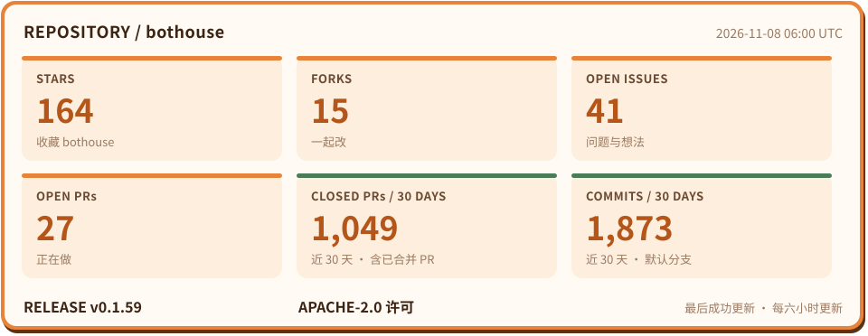
</picture>

**最近 30 天**：关闭的 PR 包括已合并的 PR；提交按默认分支的全部历史统计，包括合并提交和机器人提交。每六小时更新一次，图里的时间是最后一次成功更新的时间。

[文字数据与统计口径](https://github.com/zuiho-kai/bothouse/tree/readme-status#readme) · [JSON](https://raw.githubusercontent.com/zuiho-kai/bothouse/readme-status/stats.json) · [更新任务](https://github.com/zuiho-kai/bothouse/actions/workflows/readme-status.yml)

<a href="https://github.com/zuiho-kai/bothouse">
<picture>
  <source media="(prefers-color-scheme: dark)" srcset="docs/assets/readme/banner/star-zh-night.svg" />
  
</picture>
</a>

## 许可与致谢

- **许可**：[Apache-2.0](LICENSE)，详见 [LICENSING.md](LICENSING.md)。第三方依赖见 [THIRD-PARTY-LICENSES.md](THIRD-PARTY-LICENSES.md)。
- **致谢**：转发层基于 [cc-connect](https://github.com/chenhg5/cc-connect)，保留完整提交历史，所以贡献者列表里也有 cc-connect 的作者和贡献者。感谢 [@chenhg5](https://github.com/chenhg5) 和每一位 cc-connect 贡献者；上游 MIT 声明保留在 [bridge/LICENSE-MIT-upstream](bridge/LICENSE-MIT-upstream)。
- **社区**：[linux.do](https://linux.do)

## Star History

<a href="https://www.star-history.com/#zuiho-kai/bothouse&Date">
  <picture>
    <source media="(prefers-color-scheme: dark)" srcset="https://api.star-history.com/svg?repos=zuiho-kai/bothouse&type=Date&theme=dark" />
    
  </picture>
</a>
