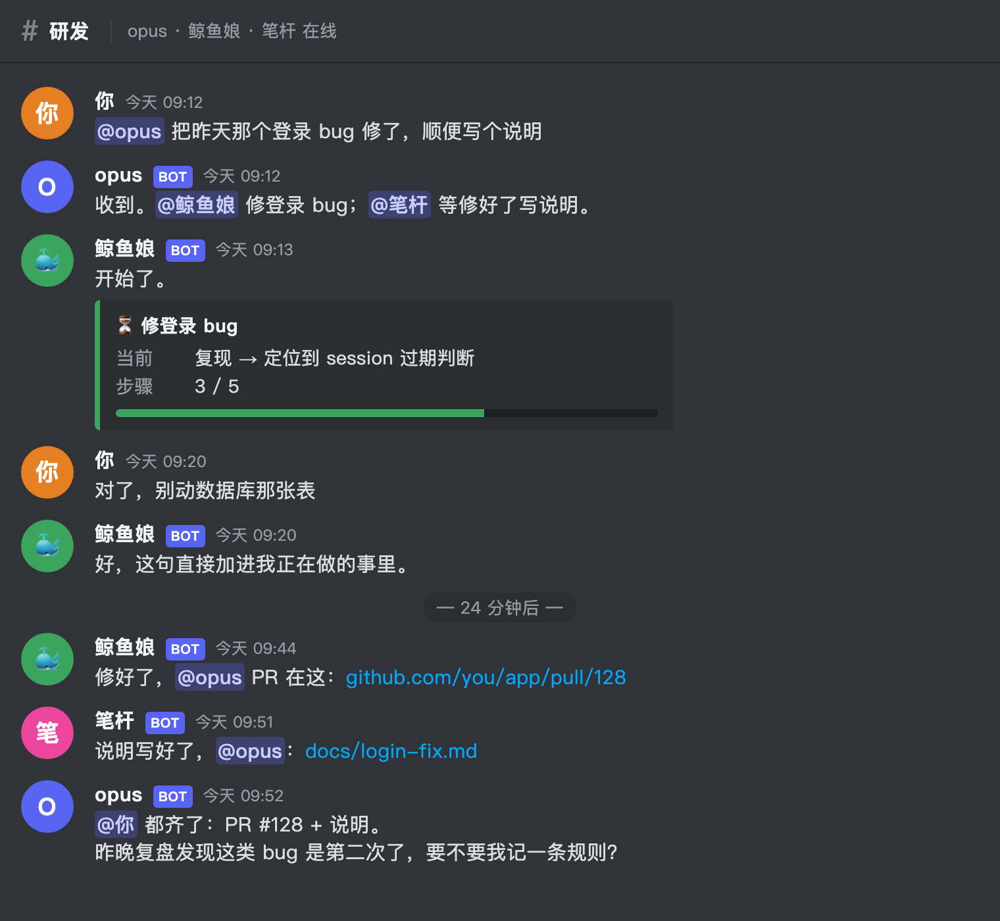

# bothouse

[English](README.md) | 中文

**你的 AI 不该每天失忆。** 把 Claude、Codex、Gemini、DeepSeek、MiniMax 们变成一支住在群里的团队：有名字、有分工、记得昨天、每晚复盘，越用越懂你。

你大概已经在用 Claude Code、Codex、Gemini，或者 DSH（DeepSeek 出的智能体工具）。它们各干各的，谁也不记得谁说过什么。
bothouse 是一个插件：装上它，这几个 AI 变成一支有性格的团队，住进你的 Discord、飞书或自建频道。
你在群里 @ 谁，谁就干活；他们之间会派活、交差；大家共用一份会长大的记忆。

> **一个会话管理所有项目，不会互相抢项目。**
> 你只用对一个人说话，剩下的他们自己分。

## 快速上手

**首个版本发布后可用。** 仓库准备期间保持私有，安装包还没发；现在想先试，按[从零用起](docs/GETTING_STARTED.md)第 1 节装。

```sh
# macOS / Linux
curl -fsSL https://raw.githubusercontent.com/zuiho-kai/bothouse/main/install.sh | sh && cc-connect
```

```powershell
# Windows（PowerShell）
irm https://raw.githubusercontent.com/zuiho-kai/bothouse/main/install.ps1 | iex; cc-connect
```

装好后的命令叫 `cc-connect`：bothouse 把开源的 cc-connect 一起带着装，你不用另外装它。不用装 Go，不用装 Node。

**开始前准备：** 一个 Discord 服务器（或飞书企业），加上至少一个本机已登录的 AI 命令行工具（Claude Code / Codex / Gemini CLI 任一）。机器人怎么建，向导会一步步带你。

1. **装**：运行上面那一行命令。
2. **配**：运行 `cc-connect`，浏览器里会打开向导：选平台 → 接机器人 → 每个角色选本机 CLI → 人设 → 保存。
   也可以对你的 Claude Code / Codex 说「帮我把 cc-connect 配好接上 Discord」，它会一次问齐要的东西。
3. **用**：保存后点「重启生效」，去频道里 @ 一个角色说句话。

想让 AI 自己判断一句话该谁回（这个组件叫 gate，可以理解成调度员），或者想要团队记忆，再装两个配套组件，见[装调度员和团队记忆](docs/ccm-and-wiki.md)。
完整步骤见[从零用起 bothouse](docs/GETTING_STARTED.md)。

## 为什么做这个

今天和 AI 干活是这样的：开一个窗口，说一遍背景，干一件事，关掉。再开一个窗口，再说一遍背景。
想同时用两个 AI，就两个窗口来回切。想在手机上看一眼进度，没门。

我们想要的是一支团队该有的东西：

- 每个人有固定的名字和活儿，不用每次重新介绍自己。
- 你说一句，该谁回谁回，不会七嘴八舌。
- 每件活有人负责，出事有人告诉你。
- 大家记同一本账，今天学到的明天还在。
- 在哪都能找到他们：电脑、手机、网页。

这些东西不该锁在某一家的 App 里。所以 bothouse 做成插件：接你已经在用的 AI，进你已经在用的聊天软件。

## 用起来是什么样



主管、码农、笔杆可以分别是 Claude Code、Codex、DSH。换成你喜欢的名字和人设就行。

## 特性

### 一支团队，不是一群聊天机器人

- **点名才回。** 一个主角色默认接话，其他角色听得到每句话，只有被 @ 或被点名才开口。几个 AI 在一个群里不会抢答。
- **派活、交差。** 主角色 @ 一位队友派活，队友做完的最终答复自动 @ 回主角色，由主角色收尾。
- **队友状态（可选）。** 打开这个开关后，主角色每次回话前能看到谁在哪个频道忙什么，派活前知道谁有空。
- **干活时能插话。** AI 正在干活时你补一句，这句话会直接加进它正在做的事里，不用等它做完。
- **一句话换队长。** 「码农，你当主」「换回主管」，团队立刻换人默认接话。
- **接得上上次。** 每个频道各记一条对话线，重启之后接着聊；掉线期间的消息，回来后先补给它再回答。

### 一份会长大的团队记忆

别人把记忆做成 agent 的数据库。我们把记忆做成团队的 wiki。

- **人能读、能改、能 diff。** 记忆是一棵 markdown 目录，每页写「现状 / 关键事实 / 决策与踩坑 / 待办」。
  git 提交记录就是「AI 今天记住了什么」。觉得它记错了，直接改文件。
- **两层。** 一份共用的主记忆，全队都读；每个角色再有一本自己的小本子。
- **相关页自动递到角色手边，不等它想起来去查。** 你每说一句，先按这句话在 wiki 里检索，把相关页放在消息前面交给角色。
  你在群里聊到哪，角色手上就有哪页，会话中途也一样。
- **不挑模型。** 主角色是 Claude、码农是 Codex、笔杆是 DSH，读的是同一份记忆。

记忆层用的是公开的 [llm-wiki](https://github.com/zuiho-kai/llm-wiki)。它只记你和一个助手的对话；bothouse 让几个角色共用一份，Claude、Codex、DSH 的对话都会记进去，你每说一句就递上相关页，每晚还有复盘。

**我们还差的地方，先说清楚：** 没有测评数字，不敢说比谁准；装起来比 ai-memory 这类一个包的工具重，要多装两样东西；检索只有关键词匹配（BM25），换个说法可能找不到。

### 每晚复盘，越用越像你

- **白天，便宜模型。** 会话结束、空闲 30 分钟、或者会话过程中遇到问题，就把新内容整理进 wiki。
- **夜里，强模型。** 重读白天的记录，核对白天写的记忆；每周通读整棵 wiki，挑矛盾和过期。
- **做梦。** 像人睡觉时整理记忆一样，把你白天反复纠正的话整理成规则候选。
- **两道关。** 候选里的每条引文，程序逐字对回你的原话，编的进不来。候选要变成规则，得你点头，它不会偷偷改你的规矩。
- **复盘结果发回群里**，第二天早上你一眼能看到团队昨天学到了什么。

### 接你已经在用的东西

| 平台 | 现在能做什么 |
| --- | --- |
| Discord | 多角色团队全部功能：点名、派活交差、队友状态、日志频道 |
| 自建平台 | 自带一个类 Discord 的网页频道，可以在本机启动；多角色点名、派活交差 |
| 飞书 | 先接一个角色对话 |
| DSH 网页 | 实验：DSH 网页里的「频道」页，见 [DSH 频道入口](dsh/collab/README.md) |

接进 Discord 和飞书，手机、电脑、网页就都有了，不用我们再做一个 App。
接进 DSH，我们的护栏和小工具直接走 DSH 自己的插件机制装，不另造一套。

AI 这一侧：本机已登录的 Claude Code、Codex、Gemini CLI、OpenCode 等直接用；DSH 这类智能体通过标准协议（ACP）接入。
也可以给 CLI 挂第三方 API（硅基流动、OpenRouter、DeepSeek、MiniMax、本机模型、任意 OpenAI 兼容接口），
对应关系见[接入文档](docs/connect-discord-feishu.md#4-第三方-api--本机-cli)。

### 自带护栏和小工具

- **护栏**：危险命令先拦。AI 说「修好了」却拿不出证据，会被打回去补；说「等会儿再看」却没定闹钟，也会被拦下。Claude Code 和 DSH 用同一份。
- **小工具**：看队友现在在干什么、把一段视频看成文字和截图、免费搜网页。
- 不想要哪个，在群里跟机器人说一句「把检查关了」就行。

## 和别的项目比

| 你可能在看 | 它解决的问题 | bothouse 不同在哪 |
| --- | --- | --- |
| Orca、各类多 agent IDE | 一个人同时盯几个编码任务 | 它是工位，我们是团队。agent 在它那里按任务开、用完关；在我们这里是常驻的同事，住在你的群里，记得昨天的事。你出门用手机在群里说一句就能派活，不用守在电脑前盯 IDE |
| ai-memory、agentmemory、TencentDB Agent Memory | 给 agent 配一个记忆库 | 它们是数据库，我们是 wiki：你能读能改；相关页每句话前自动递到角色手边；每晚有复盘。代价：装得比它们重，也还没有测评数字 |
| llm-wiki | 一个人、一个助手的记忆 | 它是我们的记忆层。bothouse 让几个角色共用一份，Claude、Codex、DSH 的对话都记进去，你每说一句就递上相关页，每晚复盘 |
| Claude Code agent teams、CrewAI、MetaGPT | 一个任务临时拉一队 | 它们每个项目拉一队临时角色，每次从头读背景，token 花在重复理解上。我们的角色常驻，读了知识库就能接任何项目，要专人时开临时子代理，以后还能自己派生长期专人（见路线图）。按设计，背景不用每个项目重付一遍（省多少还没测） |

```
传统 agent team                          bothouse
项目A ─ 临时PM ─ 临时码农 ─ 临时测试      你 ─@─ 主管（常驻，有自己的会话和 wiki）
项目B ─ 临时PM ─ 临时码农 ─ 临时测试             ├─ @码农（常驻，Codex）─ 需要时再开子代理
（任务完就散，下次重建上下文）                    └─ @笔杆（常驻，DSH）
                                         项目 A/B/C 都在这几个人手里流转
```

## 我们想做成什么样

今天能用的是第一步：一个群，几个 AI，一份共享记忆。往后想做的：

- **不会抢活。** 多个项目同时跑时，角色先认领再动手，两个人不会撞在同一件事上。
- **角色自己长出角色。** 比如你提了一句「要上架 App Store」，主管自己派生一个「上架专员」，读完你的历史决策就开工，上架完就退场。不用你一个个建。
- **像招人一样招角色。** 角色包：人设、记忆模板、工具一起打包，一键进群。
- **团队记忆可以带走。** 换电脑、换模型，团队还是那支团队，记得的事一件不少。
- **省下重复的背景。** 常驻角色不用每个任务重读项目。等我们有对比数据再公布数字。
- **更多平台跑团队功能。** DSH 网页频道，然后是 Telegram、Slack、QQ、企微（单角色接入已随 cc-connect 带着）。
- **记忆更聪明。** 关键词检索之外加语义检索，让换个说法也找得到。

想看到这些饼落地？点个 ⭐ 关注进度。

## 现在的边界

- 还没发安装包，一行命令安装要等第一个 Release。
- 飞书只有单角色；DSH 网页频道是实验。
- 团队记忆要另装调度员（gate）和 wiki。第一次整理历史会话可能跑几小时、花不少额度。调度员的本地小模型只能在 Apple 芯片的 Mac 上跑；其他电脑会改用固定规则或云端模型来判断。
- 记忆检索只有关键词匹配，没有向量。
- 没有测评数字。省多少、准多少，测出来再报数。

## 怎么工作的

```
Discord / 飞书 / 自建网页频道
        │
   平台适配器 ──► 引擎（频道会话、队列、交差）──► 角色适配器 ──► 本机 CLI 或 ACP 智能体
        ▲                   │        ▲
        │                   ▼        │
        │          调度员 gate（谁来回）◄──┤
        │                   │        │
        └───── 回话 ◄───────┘   共享 wiki（每句检索，夜间复盘）
```

模块职责和数据流见[架构](docs/ARCHITECTURE.md)。

## 文档

| 文档 | 内容 |
| --- | --- |
| [从零用起](docs/GETTING_STARTED.md) | 安装、向导、确认上线 |
| [接进 Discord 或飞书](docs/connect-discord-feishu.md) | 向导每一步、让 AI 帮你配、第三方 API |
| [装调度员和团队记忆](docs/ccm-and-wiki.md) | gate（谁来回话）和共享 wiki 记忆 |
| [每角色 wiki 与夜间反思](bridge/contrib/wiki/README.md) | 每个角色一本 wiki、定时整理、复盘 |
| [护栏与小工具](bridge/contrib/hooks/README.md) | hook 规则、开关方法、[小工具](bridge/contrib/tools/README.md) |
| [团队协作细节](bridge/MAOMAO.md) | 一个主角色带几个队友、交接规则、gate 协议（英文） |
| [自建平台协议](bridge/docs/cloud-web.md) | 自建平台和插件之间的接口（英文） |
| [架构](docs/ARCHITECTURE.md) | 模块职责和数据流 |

参与开发先读 [CONTRIBUTING.md](CONTRIBUTING.md) 和 [AGENTS.md](AGENTS.md)。

## 许可

bothouse 按 [MIT](LICENSE) 授权，详见[许可说明](LICENSING.md)。

bothouse 是接入 [cc-connect](https://github.com/chenhg5/cc-connect)、DSH 等平台的插件。为了一条命令装好，`bridge/` 随附了一份 cc-connect，它的 MIT 声明保留在 [bridge/LICENSE-MIT-upstream](bridge/LICENSE-MIT-upstream)。感谢 cc-connect 的作者和贡献者。第三方依赖的许可见 [THIRD-PARTY-LICENSES.md](THIRD-PARTY-LICENSES.md)。
