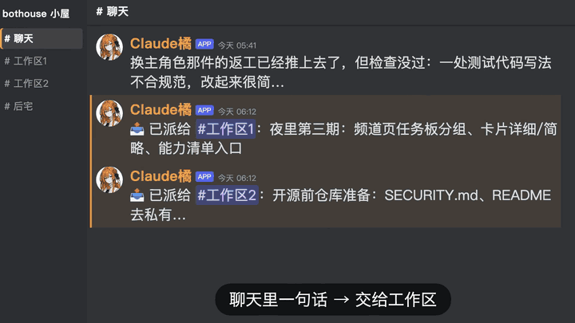
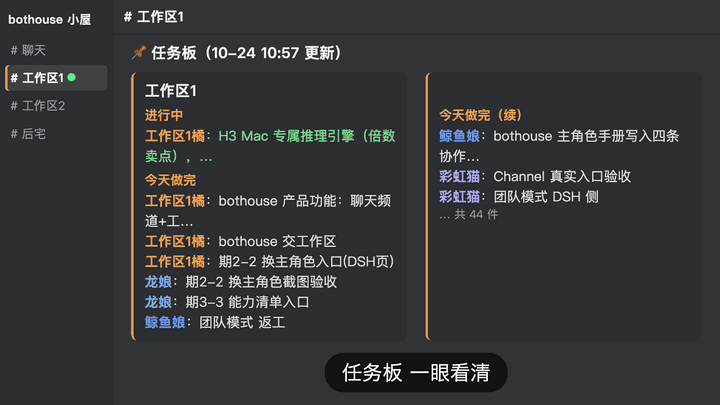
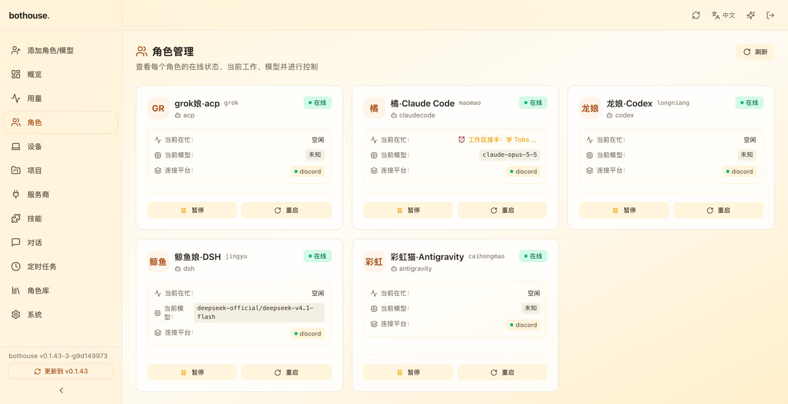
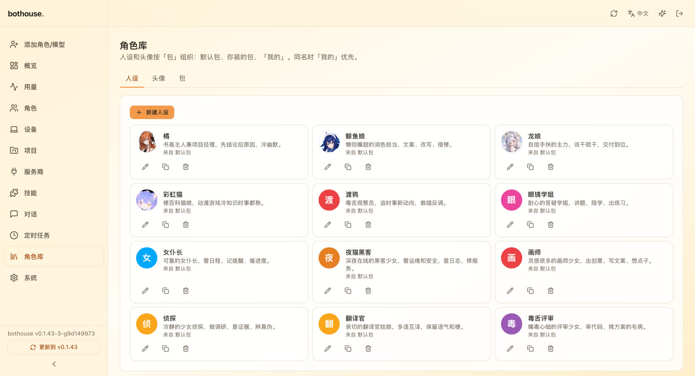
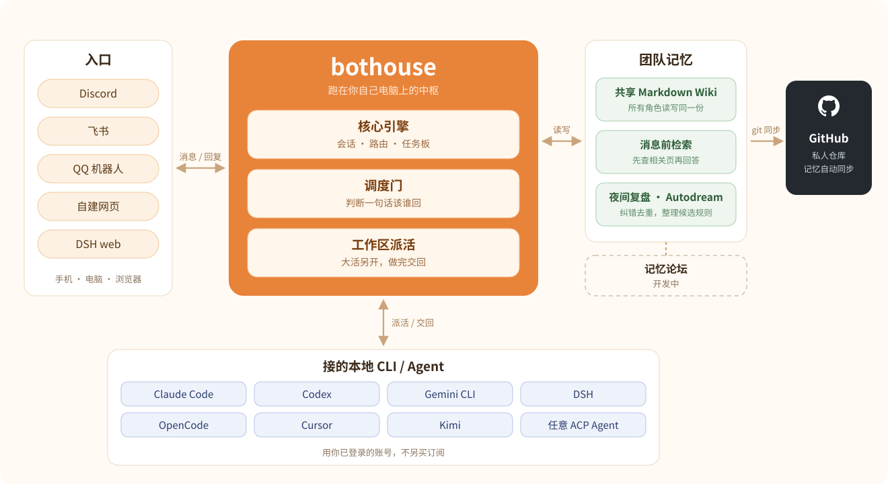

<div align="center">


[English](README.md) ｜ **中文**

[](https://github.com/zuiho-kai/bothouse/releases)
[](LICENSE)
[](https://github.com/zuiho-kai/bothouse/releases)
[](https://github.com/zuiho-kai/bothouse/stargazers)

**把你电脑上的 Claude Code、Codex、Gemini CLI 和 DeepSeek 拉进一个群，组成一支有共同记忆、会自己派活的 AI 小团队。**

**睡前在手机上交代一句，家里电脑通宵干活，早上起来收结果。**

[宣传片](#video) · [安装](#install) · [能做什么](#features) · [截图](#screenshots) · [怎么运转](#how) · [版本亮点](#releases) · [文档](#docs)

</div>

<a id="video"></a>

## 宣传片

3 分钟看懂 bothouse：一句话交代下去，几个 AI 角色自己分工、接活、交回。点击封面播放。

<p align="center">
  <a href="https://www.bilibili.com/video/BV15msZ6XEYq"></a>
</p>

以前同时用 Claude Code、Codex 和 DeepSeek，要在几个终端之间来回切、来回复制。窗口一关上下文就没了，人一离开电脑活就停。

所以我们做了 **bothouse**：一个把本地 CLI 和模型拉进同一个群的中枢。它们共用一份记忆，你在电脑、手机和浏览器上都能指挥。不用另开账号，不用另买订阅。

<a id="install"></a>

## 安装

一行命令装好，运行 `bothouse` 打开浏览器里的向导，选平台、接机器人、给每个角色选一个本地 CLI 就能开工：

```sh
curl -fsSL https://raw.githubusercontent.com/zuiho-kai/bothouse/main/install.sh | sh
```

Windows、安装包下载、常驻后台和 DSH 频道见[上手指南](docs/GETTING_STARTED.md)。

<a id="features"></a>

## 能用它做什么

| 你想要 | bothouse 怎么帮你 |
| --- | --- |
| **已有的 CLI 直接变成队友** | 登录好的 Claude Code、Codex、Gemini CLI、OpenCode 直接跑；DSH 这类 Agent 通过 ACP 接入；硅基流动、OpenRouter、DeepSeek、MiniMax、本地模型等 OpenAI 兼容接口也能配。 |
| **一个账号也能组队** | 只有一个 Codex 或一个 DeepSeek 账号，也能建几个独立成员：名字、人设、分工、会话各自分开，在频道里 @ 来 @ 去地派活交活。见[一个 CLI 组团队](docs/single-cli-team.md)。 |
| **聊天不卡，大活另开工作区** | 主角色把大活交给独立工作区，自己继续陪你聊；队友接活、交回，要你拍板的事统一回到聊天频道。 |
| **一眼看清谁在干什么** | 每个频道钉一张任务表：等你看、在做、搁置；每件活有自己的子话题，从派活到交回一路可查。 |
| **大家记得同一件事** | 所有角色读写同一份本地 Markdown Wiki；每条消息进来先检索相关页，下一位不用你再讲一遍背景。 |
| **晚上自己复盘** | 夜里核对白天的记忆、纠错去重；Autodream 把你反复的纠正整理成候选规则，你点头才生效。 |
| **长任务不跑偏** | 每次交接都带上你的原话；干净上下文的另一个 AI 验收；危险命令被拦，说「修好了」要拿证据。 |
| **钱花在刀刃上** | 闲聊和杂活给便宜模型或本地模型，难活给强模型；额度快用完时自动冷却，同频道空闲队友接手。 |
| **在手机上管** | 自带网页管理面板：角色、用量热力图、定时任务、人设库，手机上也能看、也能插话。 |

<a id="screenshots"></a>

## 截图

<table>
  <tr>
    <td width="50%"><br><b>一句话交给工作区</b>：主角色把大活派出去，聊天频道照常说话。</td>
    <td width="50%"><br><b>任务板</b>：哪个工作区在做什么、今天交了什么，一眼看完。</td>
  </tr>
  <tr>
    <td width="50%"><br><b>角色管理</b>：每个角色接哪个 CLI、在忙什么、用什么模型，一键暂停或重启。</td>
    <td width="50%"><br><b>角色库</b>：人设和头像按包管理，挑一个就能上岗。</td>
  </tr>
</table>

_上面两张是真实频道录屏，下面两张是作者自己在用的管理面板。_

<a id="how"></a>

## 团队怎么运转

```text
你（手机 / 电脑 / 浏览器）
   │  一句话
   ▼
聊天频道 ── 主角色（常驻会话 + 共享 Wiki）
   │  大活交出去，聊天不停
   ├─ 工作区1 ── @写代码的角色 · @写文案的角色 ── 交回
   └─ 工作区2 ── @查资料的角色 ── 交回
   ▲
   └─ 要你拍板的事回到聊天频道，别的不打扰你
```

- **叫到才开口**：默认主角色接话，其他角色跟着看，被 @ 或点名才回。轻量调度器 jev（一个只做选择题的小模型）判断没点名的消息该谁回，能用硅基流动的免费小模型或本地 Qwen 0.6B。
- **共享记忆**：基于我们开源的 llm-wiki 扩展成多角色共用的记忆，存在本地 Markdown 里，能直接读、直接改，Git 记录团队学到的东西。
- **夜间复盘**：会话结束、闲置 30 分钟或出错时，快模型把进度记进 Wiki；夜里慢而细的免费模型对照原始对话纠错补漏，周日全量检查。引用你的话会被代码逐字核对，编造的引用直接拒掉。
- **护栏和工具**：拦危险命令；说「修好了」要附验证证据，说「稍后看」要挂定时器；在群里一句话就能关掉某项检查。自带看队友进度、视频抽帧和转写、联网搜索、子 agent 用时和状态等工具。
- **手动换主角色**：旧主角色回不了话时，`bothouse handoff switch --to <项目>` 切过去，任务卡、工作区和待答问题都保留原编号。见[手动交接主角色](docs/LEAD_HANDOFF.md)。

## 平台

Discord 和飞书本来就有手机和电脑客户端，不用再包一层 App。

| 平台 | 状态 | 能做什么 |
| --- | --- | --- |
| Discord | 完整支持 | 多角色、@、派活交回、队友状态、日志频道；服务器和私信里都有斜杠命令 |
| 自建网页 | 团队模式 | 本地运行、像 Discord 的网页，多角色、@、派活交回 |
| 飞书（Lark） | 单角色 | 和接上的一个角色对话 |
| QQ 官方机器人 | 手动配置 | 群聊/私聊，群里 @ 人、@全体，见 [QQ 机器人](bridge/docs/qqbot.md) |
| DSH web | 实验 | DSH web 里的频道页，见 [DSH 频道](dsh/collab/README.md) |

QQ / NapCat 用户可手动配 [OneBot 适配器](bridge/docs/qq.md)。

<details>
<summary><b>DSH 频道里的常用操作</b></summary>

- **上传头像**：添加或编辑成员，打开 **可选 → 头像 → 上传图片**，选本地 PNG（256KB 以内），浏览器缩到 256×256，存在本地数据目录；**恢复默认** 删掉上传的头像。
- **任务板**：成员侧栏显示任务数，点 **任务板** 打开按频道、工作区、负责人分组的弹窗；已完成的默认折叠，派活/交付链接能跳回原消息。
- **频道设置**：每个频道单独选主角色、填一个已存在的绝对 **工作目录**；保存时可选立刻重建该频道的 DSH 会话（清空上下文），或下次建会话时再用。工作区继承所属频道的设置。
- **图片**：图片附件有 **下载** 和 **复制图片**；点图片打开大图预览，Esc、点背景或右上角关闭。

</details>

<details>
<summary><b>用 Tailscale 在手机上远程管理</b></summary>

bothouse 跑在家里电脑上，自带网页管理面板。Tailscale 让手机连回来，不用租服务器、不用开公网端口。

1. **连上设备**：电脑和手机都装 Tailscale、登录同一账号（macOS `brew install --cask tailscale`；Linux `curl -fsSL https://tailscale.com/install.sh | sh`），用 `tailscale ip -4` 记下电脑的 `100.x.y.z`。
2. **打开面板和实时桥**：对机器人发 `/web setup`，或运行 `bothouse web`，按提示重启一次。也可以手动改 `~/.bothouse/config.toml`：

   ```toml
   [management]
   enabled = true
   host = "100.x.y.z"        # 上一步的 Tailscale 地址
   port = 9820
   token = "换成一串长随机密码"

   [bridge]
   enabled = true            # 要在手机上发消息就得开
   token = "换成另一串随机密码"
   ```

3. **登录使用**：手机打开 `http://100.x.y.z:9820/`，填 token。能看运行时间、今天和本月各角色各模型的 token 用量与热力图；能加角色、改人设、换模型；能打开项目给正在跑的活插话。

网络提示：先启动 Tailscale 再启动 bothouse；不写 `host` 时监听所有网卡，远程访问请写明。桥开启后还会在所有网卡监听 9810，要只给 tailnet 用，请在本机防火墙挡掉局域网和公网的 9810。

</details>

<a id="releases"></a>

## 版本亮点

完整记录见 [Releases](https://github.com/zuiho-kai/bothouse/releases)。

| 版本 | 新内容 |
| --- | --- |
| **[0.1.43](https://github.com/zuiho-kai/bothouse/releases/tag/v0.1.43)**（2026-10-31） | 忙时连发的几条消息**合成一轮**回答；交回太长被截断时**全文先存好**并给出续读位置；QQ 群里 @ 人；DSH 里图片可看、可复制、可下载；Windows 桌面窗口。 |
| **[0.1.42](https://github.com/zuiho-kai/bothouse/releases/tag/v0.1.42)**（2026-10-30） | 每个聊天频道钉一张**任务表**（等你看 / 在做 / 搁置）；**每件活一个子话题**；交回改成四段大白话；回复正在跑的活，直接转进它的工作区。 |
| **[0.1.41](https://github.com/zuiho-kai/bothouse/releases/tag/v0.1.41)**（2026-10-30） | `/model` 显示频道**实际在用**的模型；工作区提问只暂停它点名的那件活；`bothouse-dsh` 随版本发到 npm。 |
| **[0.1.40](https://github.com/zuiho-kai/bothouse/releases/tag/v0.1.40)**（2026-10-29） | 回复被钩子拦下后不再只剩最后一句；Grok 角色也有「只问不改」护栏。 |

## 架构

<p align="center">
  
</p>

模块职责见[架构](docs/ARCHITECTURE.md)。

## 路线图

第一步已经跑通：一个群、常驻 AI 成员、一份共享记忆。接下来的方向（进度看 [Issues](https://github.com/zuiho-kai/bothouse/issues) 和 [PR](https://github.com/zuiho-kai/bothouse/pulls)）：

- **先认领再开工**：给活上锁，避免两个成员同时做一件事。
- **按需生成专家**：比如「发到 App Store」，自动建一位读过往决定、做完就退的专家。
- **角色包和插件市场**：人设、记忆模板和工具打包一键装，逛社区角色。
- **可携带的记忆和语义搜索**：Wiki 跟着人走，关键词之外加语义检索。
- **工作区自动清理**：最后一件活交完就清上下文。
- **更多群聊平台**：完整团队模式扩到 DSH web 频道、Telegram、Slack、QQ 和企业微信。

<a id="docs"></a>

## 文档

| 指南 | 内容 |
| --- | --- |
| [上手指南](docs/GETTING_STARTED.md) | 安装、向导、第一次运行 |
| [一个 CLI 组团队](docs/single-cli-team.md) | 一个 DeepSeek 或 Codex 账号建多个角色 |
| [接入 Discord 和飞书](docs/connect-discord-feishu.md) | 平台接入、让 AI 帮你配、第三方 API |
| [调度与团队记忆](docs/ccm-and-wiki.md) | jev 和共享 Wiki |
| [角色包](docs/persona-packs.md) | 挑选、制作、导入人设和头像 |
| [分角色 Wiki 与夜间反思](bridge/contrib/wiki/README.md) | Wiki 隔离、维护和 Autodream |
| [护栏和工具](bridge/contrib/hooks/README.md) | 钩子规则、开关和[自带工具](bridge/contrib/tools/README.md) |
| [用量接口](docs/api/usage.md) | 按天、按小时、按角色和模型的 token 统计与价格估算 |
| [自建平台协议](bridge/docs/cloud-web.md) | 网页平台与插件之间的通信 |
| [架构](docs/ARCHITECTURE.md) | 模块职责和数据流 |

## 参与开发

欢迎贡献，先读 [CONTRIBUTING.md](CONTRIBUTING.md) 和 [AGENTS.md](AGENTS.md)。

- 带网页面板的源码构建要先构建前端、再编译 Go，且不加 `no_web`，见[面板构建与私有远程访问](docs/dashboard-source-build.md)。
- 设置向导会给新建的主角色自动装任务板、定时器、交接等协作脚本；给已有角色装：`bothouse setup lead install --work-dir /path/to/role --agent codex`，见[配置与要求](bridge/contrib/lead/README.md)。

## 许可与致谢

- **许可**：[Apache-2.0](LICENSE)，详见 [LICENSING.md](LICENSING.md)。第三方依赖见 [THIRD-PARTY-LICENSES.md](THIRD-PARTY-LICENSES.md)。
- **致谢**：转发层基于 [cc-connect](https://github.com/chenhg5/cc-connect)，保留完整提交历史，所以贡献者列表里也有 cc-connect 的作者和贡献者。感谢 [@chenhg5](https://github.com/chenhg5) 和每一位 cc-connect 贡献者；上游 MIT 声明保留在 [bridge/LICENSE-MIT-upstream](bridge/LICENSE-MIT-upstream)。
- **社区**：[linux.do](https://linux.do)

## Star History

<a href="https://www.star-history.com/#zuiho-kai/bothouse&Date">
  <picture>
    <source media="(prefers-color-scheme: dark)" srcset="https://api.star-history.com/svg?repos=zuiho-kai/bothouse&type=Date&theme=dark" />
    
  </picture>
</a>
