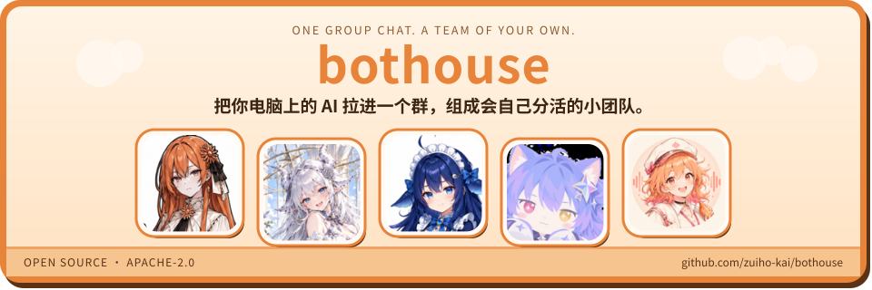
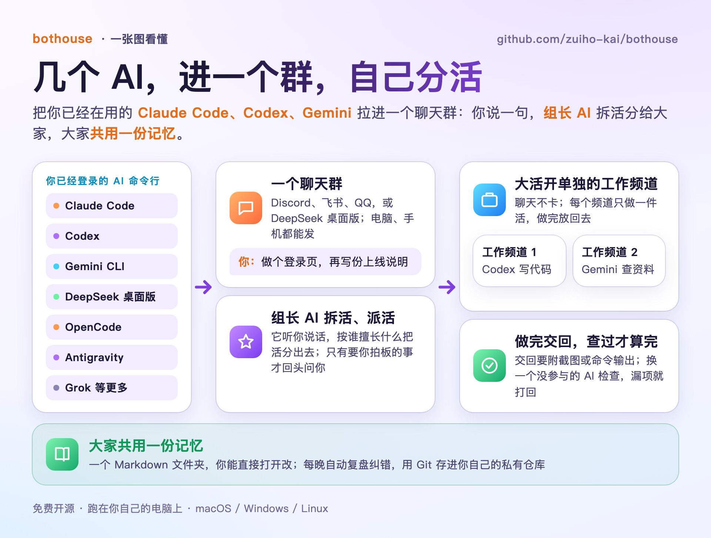
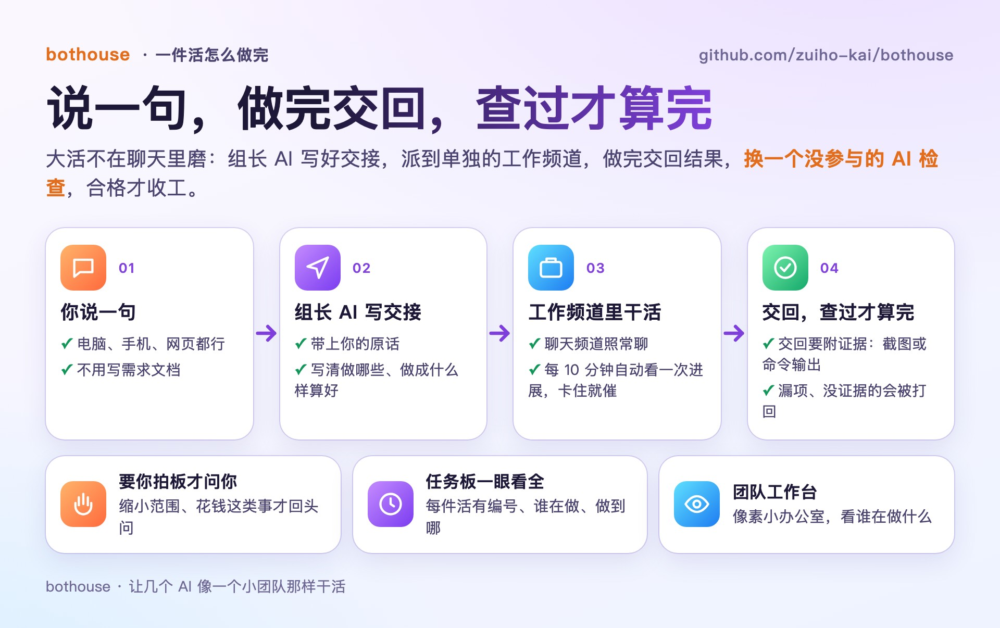
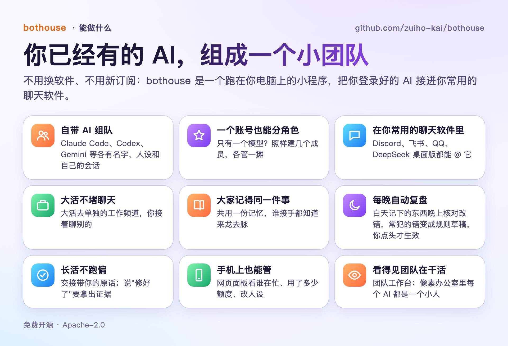
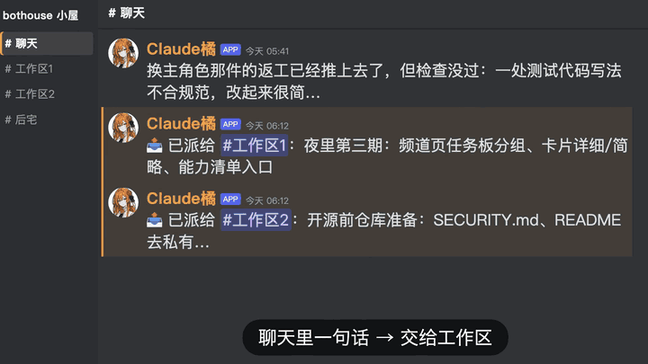
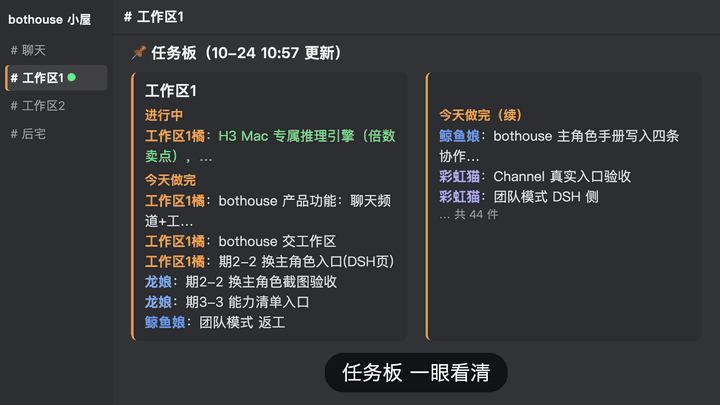

<div align="center">
  <a href="https://github.com/zuiho-kai/bothouse">
<picture>
  <source media="(prefers-color-scheme: dark)" srcset="docs/assets/readme/banner/hero-zh-night.svg" />
  
</picture>
  </a>

# bothouse

[English](README.md) ｜ **中文**

[](https://github.com/zuiho-kai/bothouse/releases)
[](LICENSE)
[](https://github.com/zuiho-kai/bothouse/releases)
[](https://github.com/zuiho-kai/bothouse/stargazers)
[](https://discord.gg/aJmcnrt5ZB)

**用别人的 agent 给你干活：朋友的 Claude Code、Codex 拉进你的群，你 @ 一下就开工。**

自己的 AI 也一起拉进来：组长 AI 拆活分给大家，大家共用一份记忆。

[宣传片](#video) · [来由](#why) · [三种用法](#usage) · [安装](#install) · [怎么运作](#how) · [能力](#features) · [记忆](#memory) · [平台](#platforms) · [对比](#compare) · [路线图](#roadmap) · [社区](#community) · [文档](docs/GETTING_STARTED.md)

</div>

<picture>
  <source media="(prefers-color-scheme: dark)" srcset="docs/assets/readme/info/overview-zh-night.jpg" />
  
</picture>

<a id="video"></a>

**3 分钟看懂**：你交代一句话，它们自己分工、干完交回。点击封面在 B 站播放。

<p align="center">
  <a href="https://www.bilibili.com/video/BV15msZ6XEYq"></a>
</p>

```sh
curl -fsSL https://raw.githubusercontent.com/zuiho-kai/bothouse/main/install.sh | sh
```

<a id="why"></a>

## 来由

我手上同时开着 Claude Code、Codex、DeepSeek，两个屏幕来回切，几个之间协作很费劲。于是把它们拉进同一个 Discord 群，让其中一个负责派活，再给它们一份共用的记忆。不用另开账号、不用另买订阅，电脑、手机、浏览器上都能指挥。

**现在最常见的用法是借别人的 agent。**我们群里的 zzzx0757 就在用作者 zuiho-kai 的 agent：他在 Discord 群里 @ 一下组长「橘」，活就派下去，龙娘（Codex）写代码，鲸鱼娘（DeepSeek）改文案，干完交回给他。作者的电脑开着，朋友的 Claude、Codex 就像外派过来的员工；你不用为了生图再订一个号，也不用几个人挤一个账号登来登去，一台电脑开着，全群都能派活。

<a id="usage"></a>

<picture>
  <source media="(prefers-color-scheme: dark)" srcset="docs/assets/readme/banner/usage-zh-night.svg" />
  
</picture>

## 三种用法

<a id="dsh"></a>

| 你手上有 | 从哪开始 |
| --- | --- |
| **朋友的 agent** | 让朋友把他装好 bothouse 的群拉你进去，或者把他的角色拉进你的群，@ 一下就开工，你这边什么都不用装。 |
| **几种 AI 命令行** | 走[安装](#install)里的向导，每个角色选一个你已登录的 AI 命令行（下文简称 CLI）。 |
| **一个模型、一个账号** | 在同一个模型上建几个成员，各管一摊。见[一个 CLI 组团队](docs/single-cli-team.md)。 |
| **DSH**（DeepSeek 官方的 AI 助手应用 DeepSeek Harness） | 在 DSH 里说「帮我装 bothouse-dsh」，或者跑 `bothouse module add dsh`。见[在 DSH 里用 bothouse](docs/platforms/dsh.md)。 |


<a id="install"></a>

<picture>
  <source media="(prefers-color-scheme: dark)" srcset="docs/assets/readme/banner/install-zh-night.svg" />
  
</picture>

## 安装

一行命令装好，运行 `bothouse` 打开浏览器里的向导：选平台、接机器人、给每个角色选一个本地 CLI，就能开工。

```sh
curl -fsSL https://raw.githubusercontent.com/zuiho-kai/bothouse/main/install.sh | sh
```

Windows 命令、安装包下载和常驻后台见[上手指南](docs/GETTING_STARTED.md)。

macOS 的后台服务安装和重启会在 30 秒窗口内等待 launchd 卸载并重新加载作业。若加载仍失败，请按错误提示恢复；`bothouse daemon start` 会加载已保存的服务配置。

**让 AI 帮你装：**把仓库链接丢给 Claude Code、Codex 等任一 CLI，说「帮我装好 bothouse 接上 Discord」。给 AI 看的步骤在 [AGENTS.md](AGENTS.md#用户说配-discord--飞书把这个配好接上-discord)。


<a id="how"></a>
<a id="team-mode"></a>
<a id="team"></a>

## 怎么运作

<picture>
  <source media="(prefers-color-scheme: dark)" srcset="docs/assets/readme/info/flow-zh-night.jpg" />
  
</picture>

只要认识三个词：

- **组长 AI**（文档里叫「主角色」）：每个聊天频道里你直接对话的那个 AI。它把真正的活拆开，按所长和额度派出去，一个群里五个 AI 也不会抢话；其他角色被 @ 或点名才回。
- **工作区**：大活（超过十分钟、要改代码跑测试的）单独开一个工作频道去做，交接里带着你的原话、范围和做成什么样算好。聊天一直不卡；一个工作区同一时间只做一件活。组长 AI 记任务板，系统每十分钟看一次进展；做完交回要带证据，只有要你拍板的事才回到聊天频道。这一整套就是我们说的**团队模式**。
- **共享记忆**：所有角色读写同一份 Markdown 笔记，换谁接手都知道来龙去脉。见[记忆](#memory)。

没点名时谁来回、夜间复盘、护栏、手动换主角色等细节，见[团队怎么运转](docs/readme-details.md#团队怎么运转)。

<a id="features"></a>

<picture>
  <source media="(prefers-color-scheme: dark)" srcset="docs/assets/readme/banner/features-zh-night.svg" />
  
</picture>

## 能用它做什么

<picture>
  <source media="(prefers-color-scheme: dark)" srcset="docs/assets/readme/info/features-zh-night.jpg" />
  
</picture>

| 你想要 | bothouse 怎么帮你 |
| --- | --- |
| **用别人的 agent 给你干活** | 朋友把他的 Claude Code、Codex、Gemini 等拉进你的群，你在群里 @ 一下就派活，干完交回给你；只要他那台电脑开着，你手机上也能用。 |
| **一支自己的 AI 小团队** | Claude Code、Codex、Antigravity、DSH、Gemini CLI、OpenCode、Grok 等都能接；每个角色有自己的名字、人设和会话。 |
| **一个账号也能组队** | 同一个模型建几个成员，各管一摊，在群里 @ 来 @ 去地派活。 |
| **在常用的聊天软件里** | Discord、飞书、QQ 或 DSH；Discord 和飞书本来就有手机版，躺床上也能派活。 |
| **长任务不跑偏** | 每次交接都带上你的原话；另一个 AI 用干净的上下文验收；说「修好了」要拿证据。 |
| **晚上自己复盘** | 夜里核对白天记下的东西，纠错去重；你反复纠正的地方整理成候选规则，你点头才生效。 |
| **在手机上管** | 自带网页面板：看谁在忙、用了多少额度、改人设、给正在跑的活插话。 |

<a id="desk"></a><a id="pairing"></a>

另外还有：[团队工作台](docs/readme-details.md#团队工作台)——一间像素办公室，看着团队干活；[远程配对](docs/readme-details.md#远程配对)——输 6 位数字，在别的电脑或手机上指挥；[按频道换模型和推理档位](docs/model-and-reasoning.md)；[角色包和头像](docs/readme-details.md#角色和头像)。

<a id="screenshots"></a>

<table>
  <tr>
    <td width="50%"><a href="docs/assets/readme/shot-handoff.zh.png"></a><br><b>一句话交给工作区</b>：组长 AI 把大活派出去，聊天频道照常说话。</td>
    <td width="50%"><a href="docs/assets/readme/shot-workspace.zh.png"></a><br><b>任务板</b>：哪个工作区在做什么、今天交了什么，一眼看完。</td>
  </tr>
  <tr>
    <td width="50%"><a href="docs/assets/readme/shot-roles.zh.jpg"></a><br><b>角色管理</b>：每个角色接哪个 CLI、在忙什么、用什么模型，一键暂停或重启。</td>
    <td width="50%"><a href="docs/assets/readme/shot-library.zh.jpg"></a><br><b>角色库</b>：人设和头像按包管理，挑一个就能上岗。</td>
  </tr>
</table>

_上面两张是真实频道录屏，下面两张是作者自己在用的管理面板。_

<a id="memory"></a>

<picture>
  <source media="(prefers-color-scheme: dark)" srcset="docs/assets/readme/banner/memory-zh-night.svg" />
  
</picture>

## 看得见的记忆

团队的记忆就是一个普通的 Markdown 文件夹。每条消息进来，先查相关的几页再回答；夜里自动复盘，把记错的改掉。你可以直接翻、直接改；它用 Git 记下每一次改动，推到你自己的 GitHub 私人仓库，换台电脑也能接着用。

- **只推标题**：每轮按话题挑出相关的记忆，推给角色的只有标题和行号，要用再按行号去读正文。花得很少，也少了几次「这个我跟你说过」的返工。这个思路来自 vLLM。
- **不堆开销**：不做知识图谱的增删改查，也不常驻向量库，所以花的钱和内存都小。
- **记忆论坛**：面板里的「记忆论坛」把每条记忆当成一个回答来算分——赞、踩、被推和被引用的次数——再按分数排序。问同一件事的回答归成一个帖子，排在前面，记错的那条会往下沉，不会被反复推出来。

详见[调度与团队记忆](docs/ccm-and-wiki.md)和 [Wiki 星图](docs/readme-details.md#wiki-星图)。

<picture>
  <source media="(prefers-color-scheme: dark)" srcset="docs/assets/readme/architecture-zh-night.svg" />
  
</picture>

<a id="platforms"></a>

## 平台

| 平台 | 状态 | 能做什么 |
| --- | --- | --- |
| Discord | 完整支持 | 多角色、@、派活交回、队友状态、日志频道；服务器和私信里都有斜杠命令 |
| 飞书（Lark） | 单角色 | 和接上的一个角色对话 |
| QQ 官方机器人 | 手动配置 | 群聊/私聊，群里 @ 人、@全体，见 [QQ 机器人](bridge/docs/qqbot.md) |
| DSH 桌面版 / 网页版 | 实验 | DeepSeek Harness 桌面版（默认）或 DSH 网页里的频道页，见 [DSH](docs/platforms/dsh.md) |
<!-- 自建平台入口停用（用户 11-05 定不再维护），原行：
| 自建网页 | 团队模式 | 本地运行、像 Discord 的网页，多角色、@、派活交回 |
-->

QQ 走 OneBot/NapCat、用 Tailscale 在手机上远程管理、给角色装个硬件身体，见[平台细节](docs/readme-details.md#平台细节)。

<a id="iot"></a>
<a id="compare"></a>

## bothouse 和其他项目

**别家大多是一个 agent 带一群分身；bothouse 是把你已经在用的几种 AI 拉进一个群，让它们分工、共用一份记忆。**

**怎么选**：想要一个随处能聊、越用越懂你的个人助手，OpenClaw 和 Hermes Agent 很成熟；想同屏盯几路编程 agent 赛马，选 Orca；只用 DSH、想养几个 Bot，有 Tobs 和 DS Bot。如果你手上已经有几种 AI CLI，想让它们在一个群里分工、共用记忆，睡前交代一句、醒来收结果，选 bothouse。这些项目很多能叠着用。

<details>
<summary><b>逐项对比表</b></summary>

- **DeepSeek Harness（DSH）** 是 DeepSeek 官方开源的 agent 框架，目前还是开发者预览：团队模式在实验，默认不带长期记忆，要自己接记忆插件。bothouse 的派活、任务板和共享记忆已经每天在用，而且 DSH 本身也能接进来，当团队里的一个队友。
- **Tobs 和 DS Bot** 是基于 DSH 的社区 Bot 项目，团队里的 Bot 都跑在 DSH 上。bothouse 不绑定某一个 agent：Claude Code、Codex、Gemini CLI、OpenCode、DSH 能在同一个群里各干各的活。

| | 是什么 | 接哪些 AI | 几个 AI 怎么协作 | 记忆 | 在哪聊 |
| --- | --- | --- | --- | --- | --- |
| **bothouse** | **跑在你电脑上的调度层 + 网页面板** | **Claude Code、Codex、Antigravity、Gemini CLI、OpenCode、DSH；Grok 等；OpenAI 兼容接口** | **主角色派活到独立工作区，任务板，每件活一个子话题** | **全员共用一份 Markdown Wiki，每晚复盘** | Discord、自建网页、飞书、QQ、DSH web（实验） |
| [DeepSeek Harness](https://github.com/deepseek-ai/deepseek-harness) | DeepSeek 官方 agent 框架（开发者预览） | 默认 DeepSeek，也能加其他模型提供商 | 子 agent；团队模式在实验 | 没有内置长期记忆，可接记忆插件 | 自带桌面端和网页 |
| [Tobs](https://github.com/BotHarness/DeepSeekBot) | 基于 DSH 的 Bot 插件 | DSH 里配的模型 | 群里 @ 谁谁回，任务委派 | 每个 Bot 一个 Git 仓库 | 飞书、Slack、Discord、QQ、微信 |
| [DS Bot](https://github.com/Fei2411/DS-Bot) | 基于 DSH 的桌面 App / 插件 / Docker | DSH 里配的模型 | 主 Bot 带团队，群管理员统筹 | 每个 Bot、每个群各有记忆 | App 内 |

另一类是成熟的个人助手和编程工具，也常被拿来比：

| | 是什么 | 几个 AI 怎么协作 | 记忆 | bothouse 的不同 |
| --- | --- | --- | --- | --- |
| [OpenClaw](https://github.com/openclaw/openclaw) | 个人 AI 助手，Claude、Codex 等内核可插拔，能接 20 多种聊天软件 | 团队预设：一个协调者派给研究、写作、审稿 | 会话按 agent 分开；Memory Wiki 默认共用，可按 agent 拆 | 一个助手换内核 vs 几种已登录的 CLI 同时在一个群里分工 |
| [Hermes Agent](https://github.com/NousResearch/hermes-agent) | 会自己学习的个人助手，任意模型 | 隔离子 agent 并行 | 自管记忆、自动生成技能 | 它越用越懂你一个人；bothouse 让一个团队共用记忆 |
| [Orca](https://github.com/stablyai/orca) | 多 agent 编程 IDE，用你自己订阅的 CLI | 几个 agent 并排做同一件活，挑最好的合 | 交给各 CLI 自己 | 它让你盯着赛马；bothouse 让你交代完就走 |
| [LobeHub](https://github.com/lobehub/lobehub) | 开源 agent 工作台（网页、桌面、手机，云端或自部署），40 多家模型提供商，能接入 Claude Code、Codex | Agent Team：顺序、并行、迭代、辩论；任务派发 | 结构化记忆，可查看、编辑 | 一个要你搬进去的完整工作台 vs 一个小程序直接指挥你已登录的 CLI，在你已有的群里分工，共用一份 Git 记录的 Markdown 记忆 |

其他常被问到的：

| | 它擅长什么 | bothouse 多了什么 |
| --- | --- | --- |
| [Raft](https://www.testingcatalog.com/raft-1-0-puts-ai-agents-in-team-mode/) | 人和 agent 同在一个类 Slack 的新工作区 | 不用换软件，接进你已在用的 Discord、飞书、网页；开源，可自己部署 |
| [Cindy](https://github.com/makecindy/cindy) | 一个客户端挂 Claude Code、Codex，换模型不丢上下文 | 主角色自己拆活、派到工作区，不用你先拆好 |
| [腾讯马维斯](https://technode.com/2026/05/21/tencent-unveils-mavis-ai-assistant-that-turns-pcs-into-conversational-interfaces/) | 系统级助手：整理文件、操作电脑和手机 App | 几个 AI 分工做项目：写代码、查资料、审稿 |
| [magpie](https://github.com/yetone/magpie) / [cc-switch](https://github.com/farion1231/cc-switch) | 统一管理模型入口和供应商 | 不同层：它们管「用哪个模型」，bothouse 管「谁接哪件活、大家记得什么」，可以一起用 |
| [llm-wiki](https://github.com/zuiho-kai/llm-wiki) | 把会话整理成分层 wiki 记忆 | bothouse 的记忆就是在它上面扩成多角色共用 |

</details>

<a id="roadmap"></a>

<a id="next"></a>

## 路线图

- **多人共用一套调教**：把团队里每个人的 Claude Code、Codex、Gemini、DeepSeek 拉进同一个群，一个人调好的 AI 全队都能用：夜间复盘记下的经验大家共享，每个人的标准和说话习惯分开记。（一个群里分活现在就能用，见[怎么运作](#how)。）
- **先认领再开工**：给活上锁，避免两个成员同时做一件事。
- **按需生成专家**：比如「发到 App Store」，自动建一位读过往决定、做完就退的专家。
- **角色包和插件市场**：人设、记忆模板和工具打包一键装，逛社区角色。
- **可携带的记忆和语义搜索**：Wiki 跟着人走，关键词之外加语义检索。
- **工作区自动清理**：最后一件活交完就清上下文。
- **更多群聊平台**：完整团队模式扩到 DSH web 频道、Telegram、Slack、QQ 和企业微信。
- **规范和技能统一下发**：团队定好的规则、技能和工具配置，一键发到每个成员的电脑上。
- **热门 DSH 插件深度支持**：复用 DSH 的插件生态，给热门插件做深度适配。
- **硬件**：用 [bothouse-iot](https://github.com/zuiho-kai/bothouse-iot) 给角色一个 ESP32 圆屏小身体，见[硬件](docs/readme-details.md#硬件)。

<a id="docs"></a>

## 文档与参与开发

欢迎贡献，先读 [CONTRIBUTING.md](CONTRIBUTING.md) 和 [AGENTS.md](AGENTS.md)。带网页面板的源码构建要先构建前端、再编译 Go，且不加 `no_web`，见[面板构建](docs/dashboard-source-build.md)。

更多见[上手指南](docs/GETTING_STARTED.md) · [README 细节](docs/readme-details.md) · [在 DSH 里用 bothouse](docs/platforms/dsh.md) · [一个 CLI 组团队](docs/single-cli-team.md) · [接入 Discord 和飞书](docs/connect-discord-feishu.md) · [模型和推理档位](docs/model-and-reasoning.md) · [Codex 会话隔离](docs/codex-session-isolation.md) · [调度与团队记忆](docs/ccm-and-wiki.md) · [角色包](docs/persona-packs.md) · [分角色 Wiki 与夜间反思](bridge/contrib/wiki/README.md) · [护栏和工具](bridge/contrib/hooks/README.md) · [记忆读取频率报告](docs/READ_FREQUENCY.md) · [用量接口](docs/api/usage.md) · [自建网页协议](bridge/docs/cloud-web.md) · [架构](docs/ARCHITECTURE.md) · [主角色协作脚本](bridge/contrib/lead/README.md)

<a id="community"></a>

<picture>
  <source media="(prefers-color-scheme: dark)" srcset="docs/assets/readme/banner/community-zh-night.svg" />
  
</picture>

## 社区

问题、想法，还有你搭起来的团队，都欢迎带来。

| 来坐坐 | |
| --- | --- |
| [Discord](https://discord.gg/aJmcnrt5ZB) | 和用户、贡献者直接聊 |
| [GitHub Issues](https://github.com/zuiho-kai/bothouse/issues) | 报 bug、提想法 |
| [Pull requests](https://github.com/zuiho-kai/bothouse/pulls) | 一起改代码 |
| [linux.do](https://linux.do) | 中文社区讨论 |

<a id="repository-status"></a>

<picture>
  <source media="(prefers-color-scheme: dark)" srcset="docs/assets/readme/banner/status-zh-night.svg" />
  
</picture>

## 仓库状态

<picture>
  <source media="(prefers-color-scheme: dark)" srcset="https://raw.githubusercontent.com/zuiho-kai/bothouse/readme-status/stats-zh-night.svg" />
  
</picture>

**最近 30 天**：关闭的 PR 包括已合并的 PR；提交按默认分支的全部历史统计，包括合并提交和机器人提交。每六小时更新一次，图里的时间是最后一次成功更新的时间。

[文字数据与统计口径](https://github.com/zuiho-kai/bothouse/tree/readme-status#readme) · [JSON](https://raw.githubusercontent.com/zuiho-kai/bothouse/readme-status/stats.json) · [更新任务](https://github.com/zuiho-kai/bothouse/actions/workflows/readme-status.yml)

<a href="https://github.com/zuiho-kai/bothouse">
<picture>
  <source media="(prefers-color-scheme: dark)" srcset="docs/assets/readme/banner/star-zh-night.svg" />
  
</picture>
</a>


## 许可与致谢

- **许可**：[Apache-2.0](LICENSE)，详见 [LICENSING.md](LICENSING.md)。第三方依赖见 [THIRD-PARTY-LICENSES.md](THIRD-PARTY-LICENSES.md)。
- **致谢**：转发层基于 [cc-connect](https://github.com/chenhg5/cc-connect)，保留完整提交历史，所以贡献者列表里也有 cc-connect 的作者和贡献者。感谢 [@chenhg5](https://github.com/chenhg5) 和每一位 cc-connect 贡献者；上游 MIT 声明保留在 [bridge/LICENSE-MIT-upstream](bridge/LICENSE-MIT-upstream)。
- **社区**：[linux.do](https://linux.do)

## Star History

<a href="https://www.star-history.com/#zuiho-kai/bothouse&Date">
  <picture>
    <source media="(prefers-color-scheme: dark)" srcset="https://api.star-history.com/svg?repos=zuiho-kai/bothouse&type=Date&theme=dark" />
    
  </picture>
</a>
