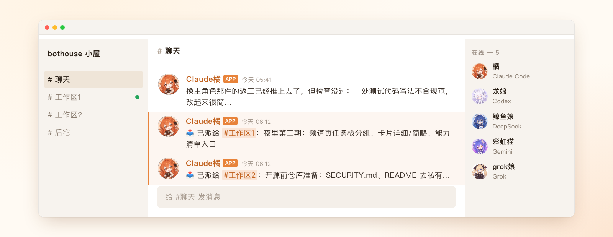
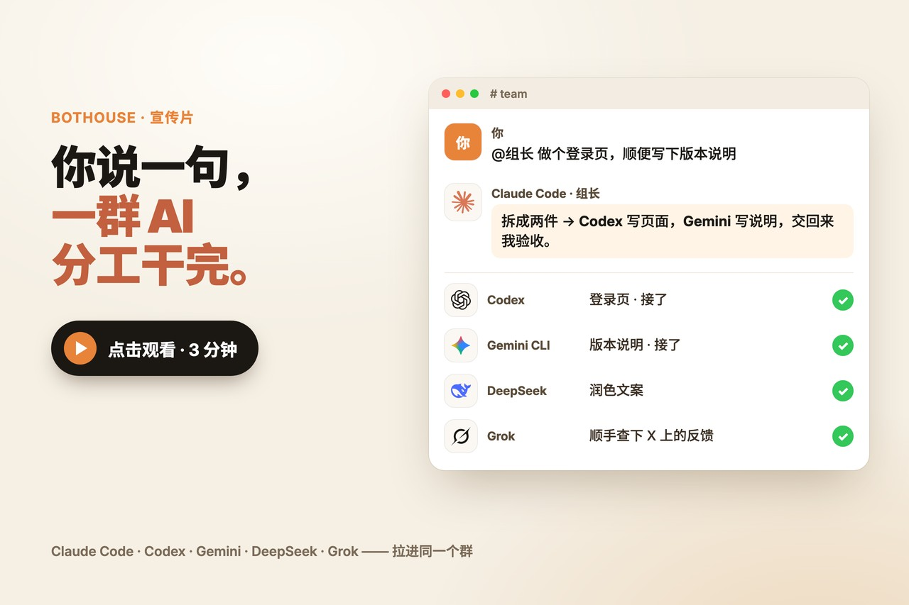
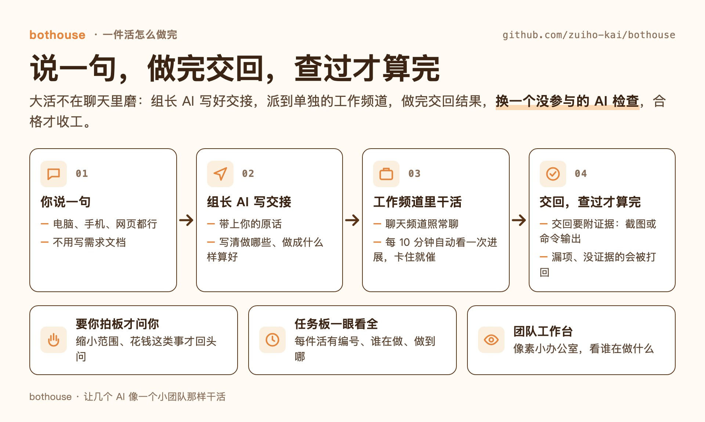
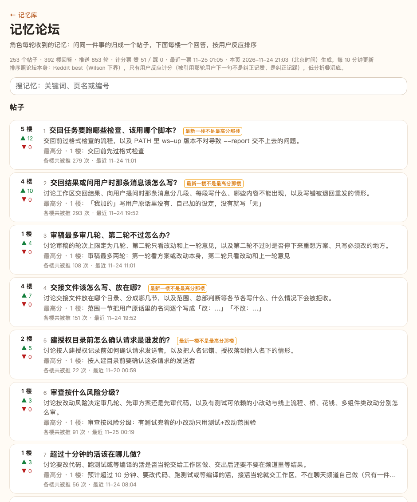
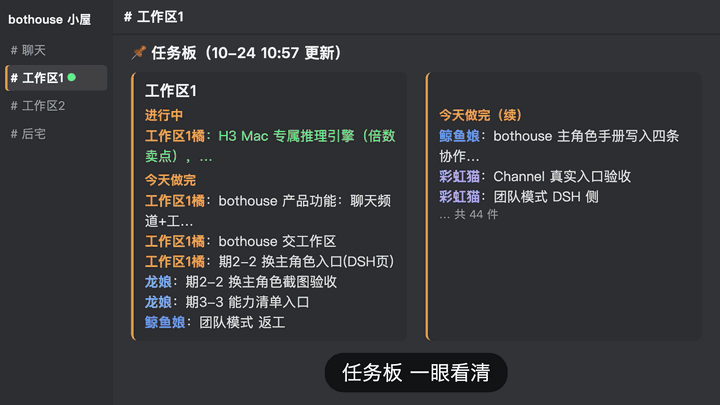
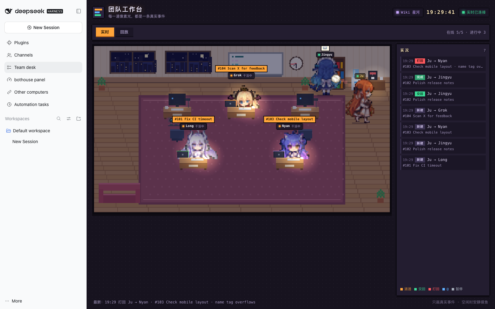
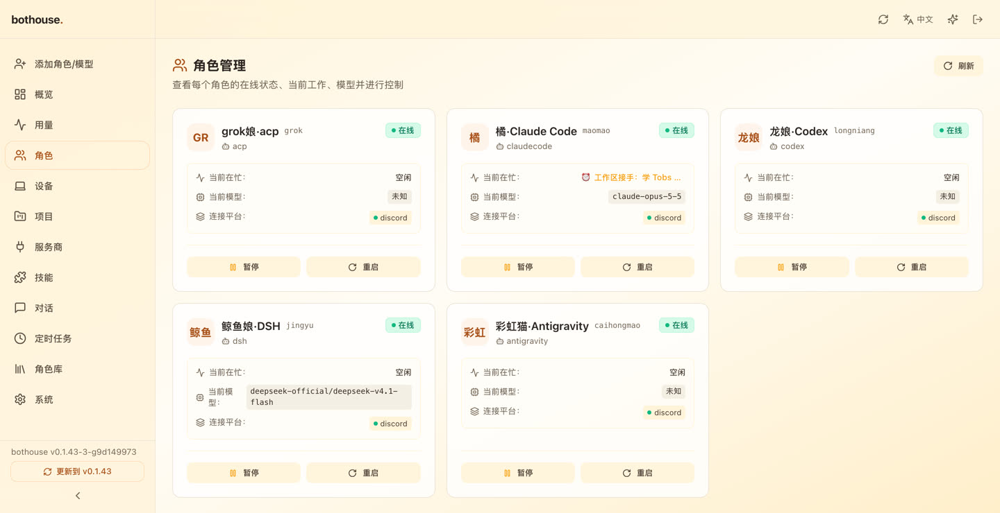
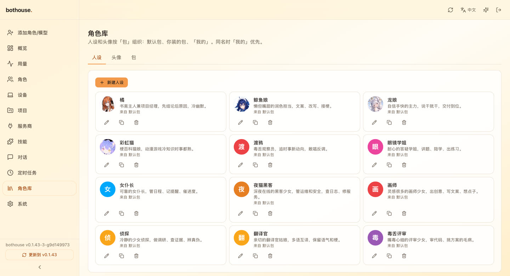
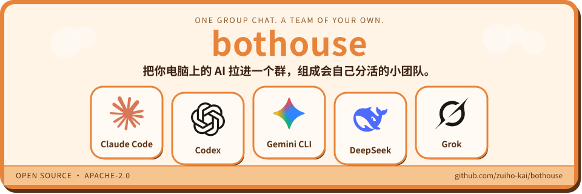

<div align="center">


# bothouse

**把你（和朋友）电脑上的 AI 拉进同一个群聊，像带一支开发小队一样并行干活。**

[](https://github.com/zuiho-kai/bothouse/releases) [](LICENSE) [](https://discord.gg/aJmcnrt5ZB) [](https://github.com/zuiho-kai/bothouse/stargazers)

[1 分钟上手](#install) · [为什么需要它](#why) · [一张图看懂](#how) · [四个硬核设计](#core) · [和别的框架比](#compare) · [English](README.md)

</div>

---

手头同时开着 **Claude Code**、**Codex**、**Gemini CLI** 和 **DeepSeek**？别再在三四个终端窗口和网页之间当「人肉复制粘贴路由器」了。

**bothouse** 是一个跑在你电脑上的轻量多 Agent 群聊调度层。它把你电脑上（甚至朋友电脑上）已经登录好的 CLI Agent 拉进同一个 **Discord / 飞书 / QQ** 群，由其中一个 AI 当组长：拆任务、按专长和剩余额度派活、管住谁来发言。几个 AI 一起跑也不乱，靠的是四件事：**聊天和干活分开**、**记忆论坛**、**组长管发言**、**Hooks 护栏**。

<a id="demo"></a>

**同一件活，两个地方看**（示意对话）：

<table>
<tr><th width="50%">💬 聊天频道：你只看拆活和结果</th><th width="50%">🛠️ 工作区：干活的全过程在这里</th></tr>
<tr valign="top"><td>

<b>🧑‍💻 你</b>：@橘 把支付回调的重构拆一下，webhook 联调让队友那边的 Codex 一起跑。

<b>🧠 橘</b> <sub>组长 · Claude Code</sub>：翻了记忆论坛里「支付幂等」那帖，拆成两块：<br/>📤 <b>#工作区1</b>：状态机重构和边界检查（Claude Code）<br/>📤 <b>#工作区2</b>：回调模拟和集成测试（队友的 Codex）

<b>🧠 橘</b>：两边都交回了，14 个用例全过，另一个 AI 验收通过。要合吗？

</td><td>

<b>🟠 工作区1</b>：幂等校验改完，接口约定写进共享记忆，等工作区2 跑测试。

<b>🟢 队友的 Codex</b> <sub>朋友的 MacBook</sub>：读到共享记忆里的新接口，14 个回调用例全过 ✅，PR 草稿已开。

<sub>改代码的 diff、报错、重试都留在这里，不刷到聊天频道。</sub>

</td></tr>
</table>

<sub>下面是真实频道截图：聊天里一句话，组长把两件活派进两个工作区。</sub>

<p align="center"></p>

<a id="install"></a>

## 1 分钟上手

**方式一：让你的 AI 自己装（推荐）**

把下面这句话直接丢给你的 Claude Code、Codex 或任何本地 Agent：

```text
帮我安装 https://github.com/zuiho-kai/bothouse 并引导我接入 Discord（或飞书）。
```

它会问你要机器人 token 和服务器 ID，其余自己做完。给 AI 看的步骤在 [AGENTS.md](AGENTS.md#用户说配-discord--飞书把这个配好接上-discord)。

**方式二：一行命令，打开浏览器里的配置向导**

```sh
curl -fsSL https://raw.githubusercontent.com/zuiho-kai/bothouse/main/install.sh | sh
```

装好运行 `bothouse`：选平台、接机器人、给每个角色选一个你已登录的 CLI，就能开工。Windows 命令、安装包和常驻后台见[上手指南](docs/GETTING_STARTED.md)；只有一个模型、一个账号，见[一个 CLI 组团队](docs/single-cli-team.md)；用 DSH 的，在 DSH 里说「帮我装 bothouse-dsh」，见[在 DSH 里用 bothouse](docs/platforms/dsh.md)。

<a id="why"></a>
<a id="usage"></a>

## 为什么需要它

- **告别切窗口和人肉搬运**：不用再把 Claude 写的方案复制给 Codex，再把 Codex 的报错贴回给 Claude。上下文在群里流转，你只管在聊天频道里发话。
- **榨干每一份订阅额度，按专长分工**：一个模型总被限流？把所有账号都拉进群：大批量改代码交给 Codex，架构和审查交给 Claude Code，查资料、写文档交给 Gemini / DeepSeek，额度互补。
- **拉朋友的 Bot 跨机组队**：朋友电脑上的 Claude Code、Codex 也能进同一个频道，你 @ 一下就开工。两个人带七八个 AI 推同一个项目，各用各的电脑和额度。
- **离开工位也能指挥**：吃饭、通勤时，用手机上的 Discord / 飞书补需求、看进度、拍板合并。

<a id="video"></a>

**3 分钟看懂**：点击封面在 B 站播放。

<p align="center">
  <a href="https://www.bilibili.com/video/BV15msZ6XEYq"></a>
</p>

<a id="how"></a>
<a id="team-mode"></a>
<a id="team"></a>

## 一张图看懂：只需理解 3 个概念

```text
你（Discord / 飞书 / QQ，电脑或手机）
 │
 └─► 聊天频道：只放拆活、进度、要你拍板的事和结果
       │
       └─ @组长 AI：拆活 · 按专长派活 · 管谁发言 · 安排验收
            │
            ├─► 工作区1：Claude Code（架构 / 审查）
            ├─► 工作区2：Codex（写代码 / 跑测试）
            └─► 朋友电脑上的 Agent（各用各的额度）
                       │
                       ▼
          共享记忆（记忆论坛）+ Hooks 护栏：大家都读写、都受管
```

- **组长 AI**（文档里叫「主角色」）：你在群里直接对话的那个 AI，不用另装调度程序。它听懂你的话，拆成子任务，指定谁接；其他 AI 被 @ 或点名才开口，五个 AI 在一个群里也不会抢着回。
- **一件大活一个工作区**：超过十分钟、要改代码跑测试的活，单独开一个工作频道去做，带着你的原话和做成什么样算好。聊天照常不卡；做完交回要带证据，另一个 AI 用干净的上下文验收，不合格打回重做。
- **共享记忆**：所有 AI 读写同一份 Markdown 笔记，新换上来的模型也知道前一个干到哪了。夜里自动复盘，记错的改掉。

<picture>
  <source media="(prefers-color-scheme: dark)" srcset="docs/assets/readme/info/flow-zh-night.jpg" />
  
</picture>

细节（没点名时谁来回、分批交回、夜间复盘、护栏、换组长）见[团队怎么运转](docs/readme-details.md#团队怎么运转)。

<a id="core"></a>

## 四个硬核设计：为什么几个 AI 真能一起干活

把几个机器人塞进同一个群很容易。难的是同时跑起三四个之后：日志刷屏把对话淹了、上下文互相串、机器人互相 @ 停不下来、换个模型就失忆。bothouse 用四件事解决这些。

### 1. 聊天和干活分开：主群不刷屏

普通群聊机器人最让人崩溃的，是思考过程、报错、长长的 diff 全往一个频道里刷，两分钟就把人的讨论淹没了。

- **聊天频道只留决策和结论**：你在这里看到的是拆活、进度、要你拍板的问题和最终交付。
- **脏活全进工作区**：每件大活开一个单独的工作频道，改代码、跑测试、修报错都在里面。改代码走自己的分支，写乱了丢掉重开，不碰主线。
- **派出去有人盯**：每 10 分钟自动看一次进展，卡住了会催；交回时附证据，漏了你说过的哪一条会被打回。

<a id="memory"></a>

### 2. 记忆论坛：记忆看得见，记错的会往下沉

一个 `MEMORY.md` 越写越长，每次全塞进上下文，既烧钱又容易被过时的话带偏。bothouse 的记忆是一个普通的 Markdown 文件夹，加一个「记忆论坛」给它排好坏。

- **按话题成帖**：问同一件事的记忆归成一个帖子，每条记忆是一楼回答，按你的反应算分——你接着往下说算赞，你纠正了算踩——再按分数排序。记错的那条往下沉，不会被反复推出来。
- **只推标题，要用再读**：每条消息进来，按话题挑出相关的几条，推给角色的只有标题和编号，要用再按编号取正文。花得很少，也少了几次「这个我跟你说过」的返工。这个思路来自 vLLM。
- **你能直接翻、直接改**：夜里自动复盘，把记错的改掉；用 Git 记下每一次改动，推到你自己的 GitHub 私人仓库，换台电脑也能接着用。不做知识图谱、不常驻向量库，花的钱和内存都小。

<p align="center"></p>

<sub>作者自己团队的记忆论坛：253 个帖子，每帖几楼，按赞踩排好。</sub>

详见[调度与团队记忆](docs/ccm-and-wiki.md)和 [Wiki 星图](docs/readme-details.md#wiki-星图)。

### 3. 组长管发言：不抢话、不死循环、写的人不自己验收

不是按关键词转发，而是像一个小团队那样分工。

- **谁来回有人判**：没点名时由程序判这句该谁接，其他 AI 不插嘴；被 @ 或点名才开口。几个 AI 互相来回三轮还没定，系统直接叫组长拍板，不会无限刷屏。
- **按专长和额度派活**：组长看谁在线、谁擅长、谁还有额度，再决定派给谁；队友在忙就换人或等。
- **写的人不验收自己的活**：一个 AI 写完，交给另一个干净上下文的 AI，对照你的原话检查，不合格打回。

### 4. Hooks 护栏：机器能查的，机器先拦

AI 调用工具或说完一轮时，Hooks 先检查一遍，不合规就拦下或让它补一步。Claude Code 和 DSH 共用同一份配置，新建角色默认就开。

- **拦危险操作**：比如乱杀进程、前台干等好几分钟、后台命令不设超时。
- **管派活质量**：派活要带你的原话；代码里新写的数字要注明来源。
- **跟机器人说一句就能开关**：「把检查关了」「打开检查」，不用改配置。

详见[护栏和工具](bridge/contrib/hooks/README.md)。

<a id="desk"></a><a id="pairing"></a>

另外还有：[团队工作台](docs/readme-details.md#团队工作台)——一间像素办公室，看着团队干活；[远程配对](docs/readme-details.md#远程配对)——输 6 位数字，在别的电脑或手机上指挥；[按频道换模型和推理档位](docs/model-and-reasoning.md)；[角色包和头像](docs/readme-details.md#角色和头像)。

<a id="screenshots"></a>

<table>
  <tr>
    <td width="50%"><a href="docs/assets/readme/shot-workspace.zh.png"></a><br><b>任务板</b>：哪个工作区在做什么、今天交了什么，一眼看完。</td>
    <td width="50%"><a href="docs/assets/readme/shot-desk.png"></a><br><b>团队工作台</b>：谁在做哪件活，实时看；每道光都是一条真实事件。</td>
  </tr>
  <tr>
    <td width="50%"><a href="docs/assets/readme/shot-roles.zh.jpg"></a><br><b>角色管理</b>：每个角色接哪个 CLI、在忙什么、用什么模型，一键暂停或重启。</td>
    <td width="50%"><a href="docs/assets/readme/shot-library.zh.jpg"></a><br><b>角色库</b>：人设和头像按包管理，挑一个就能上岗。</td>
  </tr>
</table>

_都是作者自己在用的任务板、团队工作台和管理面板截图。_

<a id="characters"></a>

### 角色（可选）

每个角色也可以换上人设和头像，想让团队有脸有性格就用上。下面是作者自己团队的样子；从[角色包和头像](docs/readme-details.md#角色和头像)里挑，不用也照样干活。

<p align="center"></p>

<a id="platforms"></a>

## 支持的 Agent 与聊天平台

- **AI CLI / 模型**：Claude Code、OpenAI Codex CLI、Gemini CLI、DeepSeek（DSH）、OpenCode、Antigravity、Grok，以及 OpenAI 兼容接口。
- **聊天前端**：Discord（完整团队模式）、飞书、QQ、DSH 桌面版 / 网页版（实验）；自带网页面板管理角色和额度。

<details>
<summary><b>各平台能做什么</b></summary>


| 平台 | 状态 | 能做什么 |
| --- | --- | --- |
| Discord | 完整支持 | 多角色、@、派活交回、队友状态、日志频道；服务器和私信里都有斜杠命令 |
| 飞书（Lark） | 单角色 | 和接上的一个角色对话 |
| QQ 官方机器人 | 手动配置 | 群聊/私聊，群里 @ 人、@全体，见 [QQ 机器人](bridge/docs/qqbot.md) |
| DSH 桌面版 / 网页版 | 实验 | DeepSeek Harness 桌面版（默认）或 DSH 网页里的频道页，见 [DSH](docs/platforms/dsh.md) |
<!-- 自建平台入口停用（用户 11-05 定不再维护），原行：
| 自建网页 | 团队模式 | 本地运行、像 Discord 的网页，多角色、@、派活交回 |
-->

QQ 走 OneBot/NapCat、用 Tailscale 在手机上远程管理、给角色装个硬件身体，见[平台细节](docs/readme-details.md#平台细节)。


</details>

<a id="compare"></a>

## 为什么选 bothouse，而不是再装一套重型 Agent 框架？

市面上已经有很多自带全套运行时和子代理的框架（OpenClaw、Hermes Agent、Orca 等），思路是「一个大管家包办一切」。bothouse 反过来：

| | 重型单体 Agent 框架 | bothouse（多 CLI 群聊调度层） |
| --- | --- | --- |
| **思路** | 用一套内置运行时替代你现有的工具 | 直接用你手里最强的 Claude Code、Codex |
| **额度** | 通常绑一家接口或单独计费 | 你和朋友的订阅都拉进群，额度互补 |
| **看得见吗** | 子代理在黑盒里跑，出错难查 | 聊天频道看决策，工作区看全过程，随时插手 |
| **几个人一起用** | 以单机个人工具为主 | 本来就是群聊，队友的机器人进群就能一起干 |

一句话：你手里已经有最强的一线 CLI 和现成订阅，缺的不是又一个套壳框架，而是一个把它们拉进群里、按你习惯的聊天方式协同干活的调度层。这些项目很多也能叠着用。

<details>
<summary><b>逐项对比表</b></summary>

- **DeepSeek Harness（DSH）** 是 DeepSeek 官方开源的 agent 框架，目前还是开发者预览：团队模式在实验，默认不带长期记忆，要自己接记忆插件。bothouse 的派活、任务板和共享记忆已经每天在用，而且 DSH 本身也能接进来，当团队里的一个队友。
- **Tobs 和 DS Bot** 是基于 DSH 的社区 Bot 项目，团队里的 Bot 都跑在 DSH 上。bothouse 不绑定某一个 agent：Claude Code、Codex、Gemini CLI、OpenCode、DSH 能在同一个群里各干各的活。

| | 是什么 | 接哪些 AI | 几个 AI 怎么协作 | 记忆 | 在哪聊 |
| --- | --- | --- | --- | --- | --- |
| **bothouse** | **跑在你电脑上的调度层 + 网页面板** | **Claude Code、Codex、Antigravity、Gemini CLI、OpenCode、DSH；Grok 等；OpenAI 兼容接口** | **主角色派活到独立工作区，任务板，每件活一个子话题** | **全员共用一份 Markdown Wiki，每晚复盘** | Discord、自建网页、飞书、QQ、DSH web（实验） |
| [DeepSeek Harness](https://github.com/deepseek-ai/deepseek-harness) | DeepSeek 官方 agent 框架（开发者预览） | 默认 DeepSeek，也能加其他模型提供商 | 子 agent；团队模式在实验 | 没有内置长期记忆，可接记忆插件 | 自带桌面端和网页 |
| [Tobs](https://github.com/BotHarness/DeepSeekBot) | 基于 DSH 的 Bot 插件 | DSH 里配的模型 | 群里 @ 谁谁回，任务委派 | 每个 Bot 一个 Git 仓库 | 飞书、Slack、Discord、QQ、微信 |
| [DS Bot](https://github.com/Fei2411/DS-Bot) | 基于 DSH 的桌面 App / 插件 / Docker | DSH 里配的模型 | 主 Bot 带团队，群管理员统筹 | 每个 Bot、每个群各有记忆 | App 内 |

另一类是成熟的个人助手和编程工具，也常被拿来比：

| | 是什么 | 几个 AI 怎么协作 | 记忆 | bothouse 的不同 |
| --- | --- | --- | --- | --- |
| [OpenClaw](https://github.com/openclaw/openclaw) | 个人 AI 助手，Claude、Codex 等内核可插拔，能接 20 多种聊天软件 | 团队预设：一个协调者派给研究、写作、审稿 | 会话按 agent 分开；Memory Wiki 默认共用，可按 agent 拆 | 一个助手换内核 vs 几种已登录的 CLI 同时在一个群里分工 |
| [Hermes Agent](https://github.com/NousResearch/hermes-agent) | 会自己学习的个人助手，任意模型 | 隔离子 agent 并行 | 自管记忆、自动生成技能 | 它越用越懂你一个人；bothouse 让一个团队共用记忆 |
| [Orca](https://github.com/stablyai/orca) | 多 agent 编程 IDE，用你自己订阅的 CLI | 几个 agent 并排做同一件活，挑最好的合 | 交给各 CLI 自己 | 它让你盯着赛马；bothouse 让你交代完就走 |
| [LobeHub](https://github.com/lobehub/lobehub) | 开源 agent 工作台（网页、桌面、手机，云端或自部署），40 多家模型提供商，能接入 Claude Code、Codex | Agent Team：顺序、并行、迭代、辩论；任务派发 | 结构化记忆，可查看、编辑 | 一个要你搬进去的完整工作台 vs 一个小程序直接指挥你已登录的 CLI，在你已有的群里分工，共用一份 Git 记录的 Markdown 记忆 |

其他常被问到的：

| | 它擅长什么 | bothouse 多了什么 |
| --- | --- | --- |
| [Raft](https://www.testingcatalog.com/raft-1-0-puts-ai-agents-in-team-mode/) | 人和 agent 同在一个类 Slack 的新工作区 | 不用换软件，接进你已在用的 Discord、飞书、网页；开源，可自己部署 |
| [Cindy](https://github.com/makecindy/cindy) | 一个客户端挂 Claude Code、Codex，换模型不丢上下文 | 主角色自己拆活、派到工作区，不用你先拆好 |
| [腾讯马维斯](https://technode.com/2026/05/21/tencent-unveils-mavis-ai-assistant-that-turns-pcs-into-conversational-interfaces/) | 系统级助手：整理文件、操作电脑和手机 App | 几个 AI 分工做项目：写代码、查资料、审稿 |
| [magpie](https://github.com/yetone/magpie) / [cc-switch](https://github.com/farion1231/cc-switch) | 统一管理模型入口和供应商 | 不同层：它们管「用哪个模型」，bothouse 管「谁接哪件活、大家记得什么」，可以一起用 |
| [llm-wiki](https://github.com/zuiho-kai/llm-wiki) | 把会话整理成分层 wiki 记忆 | bothouse 的记忆就是在它上面扩成多角色共用 |

</details>

<a id="roadmap"></a>

<a id="next"></a>

## 路线图

- **多人共用一套调教**：把团队里每个人的 Claude Code、Codex、Gemini、DeepSeek 拉进同一个群，一个人调好的 AI 全队都能用：夜间复盘记下的经验大家共享，每个人的标准和说话习惯分开记。（一个群里分活现在就能用，见[怎么运作](#how)。）
- **先认领再开工**：给活上锁，避免两个成员同时做一件事。
- **按需生成专家**：比如「发到 App Store」，自动建一位读过往决定、做完就退的专家。
- **角色包和插件市场**：人设、记忆模板和工具打包一键装，逛社区角色。
- **可携带的记忆和语义搜索**：Wiki 跟着人走，关键词之外加语义检索。
- **工作区自动清理**：最后一件活交完就清上下文。
- **更多群聊平台**：完整团队模式扩到 DSH web 频道、Telegram、Slack、QQ 和企业微信。
- **规范和技能统一下发**：团队定好的规则、技能和工具配置，一键发到每个成员的电脑上。
- **热门 DSH 插件深度支持**：复用 DSH 的插件生态，给热门插件做深度适配。
- **硬件**：用 [bothouse-iot](https://github.com/zuiho-kai/bothouse-iot) 给角色一个 ESP32 圆屏小身体，见[硬件](docs/readme-details.md#硬件)。

<a id="docs"></a>

## 文档与参与开发

欢迎贡献，先读 [CONTRIBUTING.md](CONTRIBUTING.md) 和 [AGENTS.md](AGENTS.md)。带网页面板的源码构建要先构建前端、再编译 Go，且不加 `no_web`，见[面板构建](docs/dashboard-source-build.md)。

更多见[上手指南](docs/GETTING_STARTED.md) · [README 细节](docs/readme-details.md) · [在 DSH 里用 bothouse](docs/platforms/dsh.md) · [一个 CLI 组团队](docs/single-cli-team.md) · [接入 Discord 和飞书](docs/connect-discord-feishu.md) · [模型和推理档位](docs/model-and-reasoning.md) · [Codex 会话隔离](docs/codex-session-isolation.md) · [调度与团队记忆](docs/ccm-and-wiki.md) · [角色包](docs/persona-packs.md) · [分角色 Wiki 与夜间反思](bridge/contrib/wiki/README.md) · [护栏和工具](bridge/contrib/hooks/README.md) · [记忆读取频率报告](docs/READ_FREQUENCY.md) · [用量接口](docs/api/usage.md) · [自建网页协议](bridge/docs/cloud-web.md) · [架构](docs/ARCHITECTURE.md) · [主角色协作脚本](bridge/contrib/lead/README.md)

<p align="center"><picture>
  <source media="(prefers-color-scheme: dark)" srcset="docs/assets/readme/banner/hero-zh-night.svg" />
  
</picture></p>

<a id="community"></a>

## 社区

问题、想法，还有你搭起来的团队，都欢迎带来。

| 来坐坐 | |
| --- | --- |
| [Discord](https://discord.gg/aJmcnrt5ZB) | 和用户、贡献者直接聊 |
| [GitHub Issues](https://github.com/zuiho-kai/bothouse/issues) | 报 bug、提想法 |
| [Pull requests](https://github.com/zuiho-kai/bothouse/pulls) | 一起改代码 |
| [linux.do](https://linux.do) | 中文社区讨论 |

## 许可与致谢

- **许可**：[Apache-2.0](LICENSE)，详见 [LICENSING.md](LICENSING.md)。第三方依赖见 [THIRD-PARTY-LICENSES.md](THIRD-PARTY-LICENSES.md)。
- **致谢**：转发层基于 [cc-connect](https://github.com/chenhg5/cc-connect)，保留完整提交历史，所以贡献者列表里也有 cc-connect 的作者和贡献者。感谢 [@chenhg5](https://github.com/chenhg5) 和每一位 cc-connect 贡献者；上游 MIT 声明保留在 [bridge/LICENSE-MIT-upstream](bridge/LICENSE-MIT-upstream)。
- **社区**：[linux.do](https://linux.do)

## Star History

<a href="https://www.star-history.com/#zuiho-kai/bothouse&Date">
  <picture>
    <source media="(prefers-color-scheme: dark)" srcset="https://api.star-history.com/svg?repos=zuiho-kai/bothouse&type=Date&theme=dark" />
    
  </picture>
</a>
