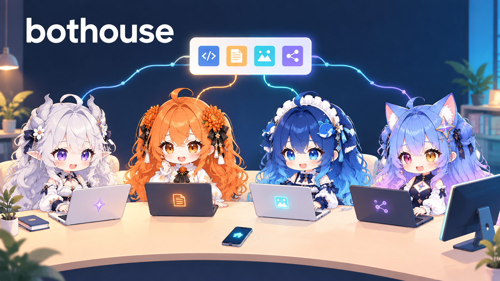
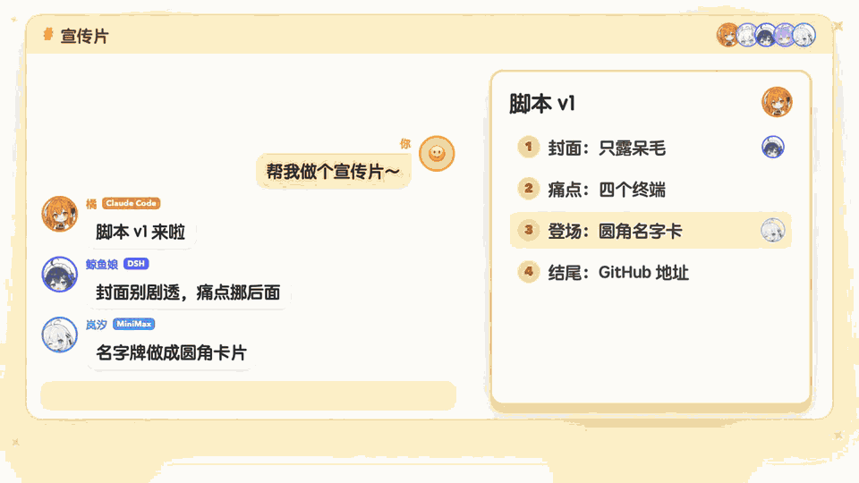

<p align="center"></p>

# bothouse



[English](README.md) | 中文

以前同时用 Claude Code、Codex、DeepSeek，经常在不同的终端窗口之间来回切换、反复复制粘贴传话，忙起来真是手忙脚乱。窗口一关上下文就断，人一离开电脑活就得停。

所以我们干脆从底层写了一套中枢（**bothouse**）：把你本机装好的各路 CLI 和模型全拉进同一个群里组队，共用一套记忆库，并且把电脑、手机、网页甚至桌宠硬件彻底打通。

**出门掏手机派个活，家里电脑直接开跑；睡前交代一句，一队 AI 在后台通宵接力，早上醒来直接收结果。**

## 为什么做它（我们怎么解决多 Agent 翻车）

- **不用来回复制粘贴，跨工具共用一套记忆**
  不用换账号、不用重买订阅，本机装好的 Claude Code、Codex、Gemini CLI、DSH 直接进群当常驻成员。它们共用一套本地 Markdown 记忆库（Wiki）：前一个刚踩完的坑，后一个接手转头就能查，不用你每天重新交代背景。
- **跑一整夜也不跑偏，做的人不验自己的活**
  每次任务交接都强制带着你的原话，传到第几手都不会走样。干完活必须换另一个干净的 AI 来交叉核验；子 Agent 上下文快满了会先写交接单再换新会话，空闲太久的会话也会带着交接重开，不会越聊越糊涂。
- **聊天和干活分离，几件事并行也管得住**
  你在主频道派个大活，主角色会把它拆包丢进独立的“工作区”并发推进，主频道照常跟你闲聊，互不堵车。谁在干嘛、做到哪一步、卡在哪，全在同一张任务卡上实时更新，不用挨个窗口去问“到哪了”。
- **后台自治 + 夜间“做梦”进化（Autodream）**
  定时任务和长任务挂在后台自己跑。每晚系统会自动复盘白天的对话，改错、去重，并从你反复纠正的话里提炼出新规则候选（每条引文都会由程序逐字核对原话，杜绝幻觉，点头后才生效）。早上醒来，群里直接躺着一份今日汇报。
- **好钢用在刀刃上，不白烧 Token**
  闲聊和杂活交给便宜模型或本地小模型，硬骨头才让主力模型出手。哪个频道用哪个模型，写进配置就定死。

## 跑起来是什么样



真实频道记录：主频道派活给工作区 -> 工作区拆活、接单、交差 -> 任务板实时刷新，主频道照常聊天。

### 日常怎么使唤它们

1. **随口派活**：在群里跟主角色说一句：“做个管理面板，我想看每个角色今天花了多少 token。”
2. **自动拆包并发**：主角色把活拆成“统计页、菜单栏图标、角色栏、桌宠接口”几块，直接 `@` 群里不同的 AI 分头开工。进度全汇总在一张任务卡上。
3. **随时插话 & 验收**：它们干活中途你随时能插话。只要底层是 Claude Code、Codex（app-server）或支持 ACP 的 DSH，你补的那句话会当场塞进它正在跑的任务里，不用干等（`codex exec` 这类 CLI 则会在下一轮读取）。全部跑完且主角色核验通过后，汇总回你一条：改了哪、怎么验的、还剩啥。

## 只有一个 CLI / 一个模型，也能拉起一支队伍

哪怕你电脑里只装了一个 Codex，或者只配了一个 DeepSeek API，也能拆出多个独立成员。
它们共用同一个底层账号，但在群里有各自的名字、人设、分工和独立会话——比如拉三个 DeepSeek 分身：**肥鱼甲**搞规划、**肥鱼乙**写代码、**肥鱼丙**做 Code Review，在公共频道里互相 `@` 派活交差。

在 DSH 网页打开「频道」→「添加成员」，选同一个模型或本机 CLI，分别填名字和职责保存三次，把频道派活方式设为「完全团队」就能直接跑。（注：独立的是会话上下文，底层仍共享该账号的额度和限流。详见[单 CLI 组建多成员团队](docs/single-cli-team.md)）。

---

## 快速上手

### 1. 安装

直接从 [Releases](https://github.com/zuiho-kai/bothouse/releases) 下载对应系统的包（无需预装 Go 或 Node）。手动下载后，先按[完整指南中的校验步骤](docs/GETTING_STARTED.md)对照同一发布的 SHA256SUMS 核验文件，再按下述方式首次打开；也可使用下方自带 SHA256 校验的一行安装命令。

- **macOS**：`bothouse-mac.dmg`（Apple Silicon / Intel 通用。因未签名，拖入 Applications 后**首次打开请「右键 → 打开」**）
- **Windows**：`bothouse-windows.exe`（x64 / ARM64 通用。若弹出 SmartScreen 拦截，点「更多信息 → 仍要运行」）
- **Linux**：`bothouse-linux-x64` 或 `bothouse-linux-arm64`（`chmod +x` 后直接运行）

或者一行命令直接装最新发布的版本（含预发布，自带 SHA256 校验；需固定版本可设 `BOTHOUSE_VERSION=<tag>`）：

```sh
# macOS / Linux
curl -fsSL https://raw.githubusercontent.com/zuiho-kai/bothouse/main/install.sh | sh && bothouse
```

```powershell
# Windows (PowerShell)
irm https://raw.githubusercontent.com/zuiho-kai/bothouse/main/install.ps1 | iex; bothouse
```

### 2. 配置与启动

准备条件按入口选择：Discord 需要一个服务器，飞书需要企业工作区；自建网页平台无需 Discord 或飞书账号，按[接入指南](docs/connect-discord-feishu.md)配置；DSH 的独立要求见下方折叠说明。使用本机 CLI 的角色，需要预先装好并登录对应的 AI 命令行工具（Claude Code / Codex / Gemini CLI 等）。

1. **打开向导**：终端运行 `bothouse`，浏览器会自动弹出配置向导。
2. **绑定角色**：按提示选平台 -> 接机器人 -> 给每个角色绑定本机 CLI 和人设 -> 保存（新建角色默认开启全自动 YOLO 权限模式，可在面板项目设置中改回）。
   💡 偷懒用法：你也可以直接对本机的 Claude Code 或 Codex 说：「帮我把 bothouse 配好接上 Discord」，它会自己找你要齐配置帮着搞定。
3. **上线开工**：点「重启生效」，去群里 @ 你的角色就能开始派活了。

后台常驻：运行 `bothouse daemon install` 即可注册为后台服务并立即启动（开机自启默认关闭，可在管理面板「设置 → 开机自动启动」中随时打开，切换不会中断当前任务）。

想让小模型自动判断“群里这句话该谁回”（调度员 gate），或者开启共享记忆库，可继续安装两个配套组件，详见[装调度员和团队记忆](docs/ccm-and-wiki.md)与[从零用起完整指南](docs/GETTING_STARTED.md)。

<details>
<summary><b>附：DSH 频道接入说明（实验性）</b></summary>

需要本机已有 DSH（>= 0.2.1-rc.2）、pnpm（需在 PATH 中）及 Node >= 22.12.0。
向导第 1 步选 DSH，按提示「检测 dsh → 安装插件 → 运行返回命令打开 DSH 网页」，后续在 DSH 页面内配好机器人、CLI 和人设即可（开发或覆盖目录可用 `BOTHOUSE_DSH_DIR` 指定）。
命令行等价操作：`bothouse setup dsh install --lang zh`，或直接通过 GitHub 安装插件：

```sh
dsh plugin --profile web add 'github:zuiho-kai/bothouse#dsh-plugin&path:dsh/plugin-pkg'
```

</details>

## 平台与生态支持

接进 Discord 和飞书，现成的手机端、电脑端就全有了，不用我们再造一个套壳 App；接进 DSH，护栏和小工具直接走 DSH 原生插件机制。

| 入口平台 | 当前状态 | 支持能力 |
| --- | --- | --- |
| Discord | 完整支持 | 多角色团队全套能力：点名、派活交差、队友状态感知、日志频道；服务器与私聊均支持斜杠命令 |
| 自建网页平台 | 团队模式 | 内置类 Discord 的本地网页端，开箱即用，支持多角色点名与派活交差 |
| 飞书 | 单角色 | 目前支持接入单个角色对话 |
| DSH 网页 | 实验支持 | DSH 网页内的「频道」页，详见 [DSH 频道入口](dsh/collab/README.md) |

底层 AI 接入：本机已登录的 Claude Code、Codex、Gemini CLI、OpenCode 直接调起；DSH 等智能体走标准 ACP 协议接入。同时也支持给 CLI 挂载任意第三方 API（硅基流动、OpenRouter、DeepSeek、MiniMax、本地模型及任意 OpenAI 兼容接口），配置方式见[接入文档](docs/connect-discord-feishu.md)。

## 手机远程遥控（基于 Tailscale）

bothouse 跑在你家里的主力机上，自带一个网页管理面板。配合 Tailscale 组网，不用买云服务器、也不用暴露公网端口——人在外面掏出手机打开网页，就能看团队状态、查 Token 账单、随时插话派活。

### 一、打通设备网络

在跑 bothouse 的电脑和你的手机/笔记本上安装 Tailscale，登录同一个账号，加入同一个 tailnet：

```sh
# macOS
brew install --cask tailscale
# Linux
curl -fsSL https://tailscale.com/install.sh | sh
```

运行 `tailscale ip -4`，记下这台电脑分配到的 `100.x.y.z` 地址。

### 二、开启远程面板与实时桥接

最省事的开法：直接在群里对机器人发 `/web setup`，或者在终端跑 `bothouse web`。它会自动帮你把面板和实时对话通道全部配好、生成登录令牌（Token），你只需按提示重启一次。

如果你想手动改配置文件（默认路径 `~/.bothouse/config.toml`，若当前目录有同名文件则优先读取当前目录）：

```toml
[management]
enabled = true
host = "100.x.y.z"        # 填上一步拿到的 tailscale ip
port = 9820               # 默认端口 9820
token = "换成一串足够长的随机密码"

[bridge]
enabled = true            # 必须开启，否则网页端只能看数据、不能发消息聊天
```

网络与安全注意：

- 请确保 Tailscale 在 bothouse 启动前已运行。如果不写 `host`，正常运行状态下默认监听所有网卡（仅未配置任何平台的向导阶段只听 `127.0.0.1`），建议远程访问时显式指定 `host`。
- `[bridge]` 开启后会同时跟随面板端口并在所有网卡的 9810 端口监听。若只允许 tailnet 内网访问，请务必在防火墙或 Tailscale ACL 中将 9810 端口一并限制。
- 历史数据兼容：首次使用默认目录 `~/.bothouse` 启动时，会自动从旧版 `~/.cc-connect` 增量补齐定时任务与用量 JSON（已过期的单次任务会自动标为跳过，防扎堆触发；同名文件不覆盖）。

### 三、手机登录与日常操作

通过群聊指令 `/web setup`、终端命令 `bothouse web --no-browser` 或直接查看 `config.toml` 拿到你的 token。
手机浏览器打开 `http://100.x.y.z:9820/`，填入令牌即可登录（支持手机自适应视图，浏览器会自动记住凭证）：

- **查账单与状态（概览 / 用量）**：看运行时长，按角色、按模型拆解今天和本月的 Token 消耗，自带按天/小时的用量热力图。
- **随时改配置（角色 / 项目 / 技能 / 系统）**：在手机上直接加角色、改人设、切底层模型，点一下重启当场生效。
- **无缝插话（对话）**：点进任意项目看完整上下文，随手补一句话，直接塞进对应角色正在干的活里，跟在 Discord 里说话完全同源。

## 核心机制拆解：怎么让这群 AI 像个真团队？

### 1. 聊天频道 + 工作区隔离：干活不堵嘴

- **前后台分离**：你在聊天频道派个大活，主角色接单后整块丢去“工作区 1”处理，自己留在聊天频道继续陪你聊。工作区 1 满了会自动开工作区 2。
- **闭环交差**：工作区里主角色拆活、@ 队友，队友回【接】、干完回【交回】；需要你拍板的事才汇总回主频道问你，你平时只需盯一个频道。
- **防撞车任务板**：任务板按「聊天频道 → 工作区 → 角色」分级展示。主角色派活前会自动瞄一眼队友在别的工作区忙不忙。支持按频道切换派活模式（单模型多进程 / 完全团队 / 默认混合）。

### 2. 团队规矩与小模型调度员（jev）

- **点名才回，绝不抢答**：群里默认由主角色接话，其他角色全程旁听，被 @ 或点名时才开口。想换人主持大局，随口说句「鲸鱼娘，你当主」或「换回 opus」，团队当场切主控。
- **调度员 jev（Gate）**：没点名的话该谁接？我们塞了一个轻量级调度组件 jev 专门做这道选择题（判断该 opus 回、鲸鱼娘回，还是全员闭嘴）。直接挂硅基流动的免费小模型，或者本机跑个 Qwen 0.6B 就能离线秒判。

### 3. 会自己长大的共享记忆（基于 llm-wiki）

底层基于我们开源的 llm-wiki 扩展成了多角色共享版。所有记忆就是本地的一堆 Markdown 文件，你随时能打开直接改，Git 提交记录就是“AI 今天记住了啥”。

- **开口前先把资料递到手边**：不等 AI 自己想起来去查——你每发一句话，系统先拿这句话去 Wiki 检索，把相关的「现状 / 关键事实 / 踩坑决策 / 待办」页面直接拼在消息前面喂给角色。
- **跨模型互通**：哪怕 opus 底层是 Claude、鲸鱼娘是 DSH、笔杆是 Codex，读写的都是同一本账。

### 4. 每晚自动复盘与“做梦”（Autodream - RSI 雏形）

- **日间快记 + 夜间精修**：白天会话结束、空闲满 30 分钟或遇到报错时，用快模型把新进展写进 Wiki；到了半夜，自动调起慢但细致的免费模型，对照原始聊天记录做改错、补漏、去重，每周日还会通读整棵 Wiki 做全量体检。
- **自动做梦（Autodream）**：每晚最后一步，系统会复盘你白天说过的原话，把你反复纠正的习惯提炼成“新规则候选”并写出一份《今日反思》。
- **防幻觉校验**：候选规则里的每一条引文，程序都会逐字比对你的聊天原话，AI 自己编造的一律打回。生成的新规则必须经你点头才会生效，第二天一早发进群里供你检阅。

### 5. 硬核护栏与实用挂件

- **防敷衍护栏**：危险命令直接拦截；AI 嘴上说「修好了」但拿不出验证证据，会被系统当场打回去重做；说「等会儿再看」却没设闹钟，同样会被拦下。嫌严了，在群里说句「把检查关了」随时能关。
- **自带工具箱**：查队友实时状态、把视频拆成文字+截图、免费联网搜索、子 Agent 耗时状态表（支持 Codex 与装了状态转发层的 DSH）。同时支持 `bothouse voice-desk` 语音总台按需播报进度。

## 和市面上其他方案有什么区别？

| 你可能在看 | 它们的思路 | bothouse 不一样在哪 |
| --- | --- | --- |
| Orca / 各类多 Agent IDE | 让你在电脑前同时盯几个编码窗口 | **它们是工位，我们是常驻团队。** 它们的 Agent 用完即毁，你得守在电脑前盯 IDE；我们的角色常驻在群里、记着昨天的事，出门用手机在群里甩句话就能远程派活。 |
| ai-memory / 各类向量记忆库 | 给 Agent 挂一个黑盒数据库 | **它们是数据库，我们是透明的 Wiki。** 纯 Markdown 文件你能直接读、直接改；每句话前自动把相关页递到 AI 手边，半夜还会自己跑复盘去重。 |
| CrewAI / MetaGPT / Claude Teams | 每个任务临时拉一队人马 | **告别重复交学费。** 临时团队每次开新项目都要重读一遍背景，Token 全花在重复理解上；我们的角色常驻，带着整套历史知识库直接切入新项目。 |

```text
传统 Agent Team                           bothouse
项目A ─ 临时PM ─ 临时码农 ─ 临时测试      你 ─@─ opus（常驻，自带会话与共享 Wiki）
项目B ─ 临时PM ─ 临时码农 ─ 临时测试             ├─ @鲸鱼娘（常驻，DSH）─ 按需拉起子代理
（任务完就散，下次重建上下文）                    └─ @笔杆（常驻，Codex）
                                         项目 A/B/C 全在这几个老熟人手里流转
```

## 架构与数据流

```text
Discord / 飞书 / 自建网页频道
        │
   平台适配器 ──► 核心引擎（会话管理、队列、派活交差）──► 角色适配器 ──► 本机 CLI 或 ACP 智能体
        ▲                   │            ▲
        │                   ▼            │
        │          调度员 gate（判谁接话）◄─┤
        │                   │            │
        └───── 响应 ◄───────┘      共享 Wiki（消息前检索，夜间复盘做梦）
```

详细模块职责见[架构设计文档](docs/ARCHITECTURE.md)。

## 接下来要填的坑（Roadmap）

目前跑通的是第一步：一个群、一屋子常驻 AI、一套共享记忆。接下来我们在搓这些特性（还没做完，感兴趣的直接 Watch 仓库）：

- **主动认领防撞车**：角色动手前先认领锁单，彻底杜绝两个人撞在同一件活上。
- **角色自己繁衍专员**：比如你提一句「要上架 App Store」，主角色自己派生出一个「上架专员」，读完你的历史决策就开始干，上架完自动退场，不用你手动建。
- **角色包与插件市场**：把人设、记忆模板、代码工具打成一个包，一键拉进群；做个在线市场直接逛别人捏好的角色。
- **记忆随身带 & 语义检索**：换电脑、换底层模型，拎着 Wiki 目录走，团队记忆丝毫不丢；在关键词检索基础上引入语义检索。
- **工作区自动清场**：收完名下最后一件活自动清空上下文，下次接单永远是干净脑子。
- **铺开更多多人群聊平台**：把完整团队模式推到 DSH 网页频道、Telegram、Slack、QQ、企业微信。

## 文档导航

| 文档 | 内容说明 |
| --- | --- |
| [从零用起](docs/GETTING_STARTED.md) | 安装、配置向导、首次跑通全流程 |
| [单 CLI 组建多成员团队](docs/single-cli-team.md) | 用同一个 DeepSeek 或 Codex 拆出多个角色的配置与会话边界 |
| [接进 Discord 或飞书](docs/connect-discord-feishu.md) | 平台绑定步骤、让 AI 自动帮你配、挂载第三方 API |
| [装调度员和团队记忆](docs/ccm-and-wiki.md) | 配置调度员 jev 与共享 Wiki 记忆库 |
| [角色库：人设、头像和包](docs/persona-packs.md) | 挑选、自制与导入角色人设包 |
| [每角色 Wiki 与夜间反思](bridge/contrib/wiki/README.md) | 独立 Wiki、定时整理与夜间“做梦”机制详解 |
| [护栏与小工具](bridge/contrib/hooks/README.md) | Hook 拦截规则、开关方式与内置小工具 |
| [自建平台协议](bridge/docs/cloud-web.md) | 自建网页端与插件间的通信接口（英文） |
| [架构设计](docs/ARCHITECTURE.md) | 核心模块职责与底层数据流 |

想一起写代码？先看一眼 [CONTRIBUTING.md](CONTRIBUTING.md) 和 [AGENTS.md](AGENTS.md)。

## 许可与社区

- **开源协议**：本项目按 Apache-2.0 授权，详见 [LICENSING.md](LICENSING.md)。随附桥接组件的上游 MIT 声明保留在 [bridge/LICENSE-MIT-upstream](bridge/LICENSE-MIT-upstream)，第三方依赖见 [THIRD-PARTY-LICENSES.md](THIRD-PARTY-LICENSES.md)。
- **交流社区**：linux.do
