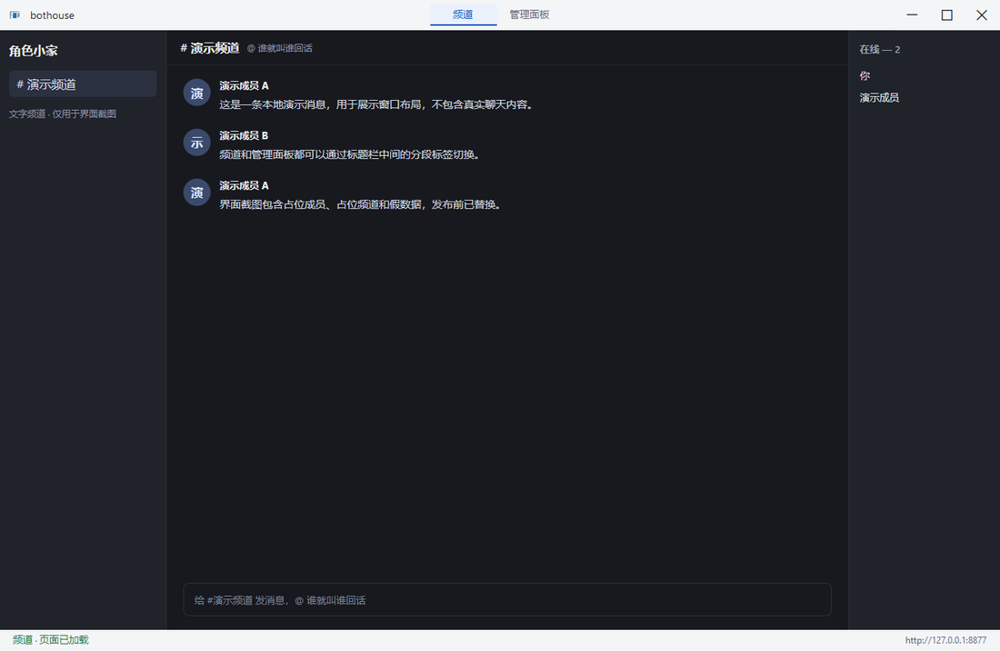

# Windows window shell for the bothouse web UI

`bridge/contrib/windows-desktop` opens the bothouse web UI in Edge/Chrome app mode. If you
want a real desktop window instead — frameless, own title bar with native Windows caption
buttons at the top-right, and both the channel page and the management panel in one
program — this optional helper wraps the same web UI in a small WinForms + WebView2 shell.

It does **not** modify bothouse, run a service, or replace the macOS app, the existing tray
entry, or `bridge/contrib/windows-desktop`. Start bothouse (or its daemon) first, then open
the window.

Approved as an optional contrib in
[Issue #2008](https://github.com/zuiho-kai/bothouse/issues/2008#issuecomment-7003715680).



*Screenshots use a local demo page with placeholder channels/members; no real chat data.*

## Requirements

- Windows 10 or 11 (x64)
- [WebView2 Runtime](https://developer.microsoft.com/microsoft-edge/webview2/) — usually
  preinstalled on Windows 10/11; the window shows an actionable error otherwise
- .NET Framework 4.8 (ships with Windows 10/11) to build from source
- bothouse already configured and running (`bothouse`, `bothouse daemon install`, or the
  DSH module)

## Build

```powershell
# dev build: bin\BothouseWindow.exe + the 3 WebView2 DLLs
powershell -NoProfile -ExecutionPolicy Bypass -File .\build.ps1

# single-file build: one exe with the WebView2 DLLs embedded as resources
powershell -NoProfile -ExecutionPolicy Bypass -File .\build.ps1 -SingleFile
```

The script downloads a pinned `Microsoft.Web.WebView2` NuGet package (default
`1.0.4314.35`, the version this helper was tested with). Downloads are cached per version
under `.webview2-sdk/<version>/` and verified by their `.nuspec`; deleting a file or asking
for another version triggers a refetch. Pass `-NuGetVersion ""` to fetch the latest, or a
specific version explicitly. The build uses `csc.exe` from .NET Framework and targets x64;
no Visual Studio, Node.js, or Electron required.

Optional: pass `-Icon <path.ico>` to embed an icon.

## Run

```powershell
# open both pages; URLs are discovered (see below)
powershell -NoProfile -ExecutionPolicy Bypass -File .\run.ps1

# explicit URLs
powershell -NoProfile -ExecutionPolicy Bypass -File .\run.ps1 `
  -ChannelUrl "http://127.0.0.1:8790/#token=..." `
  -ManagementUrl "http://127.0.0.1:9820/"

# start bothouse in the background first (default local URLs only)
powershell -NoProfile -ExecutionPolicy Bypass -File .\run.ps1 -StartService
```

Or run `bin\BothouseWindow.exe` (or the single-file exe) directly. `run.ps1` reports a
failure instead of printing a false success, restores `CC_LOG_FILE`, and skips the
localhost port prechecks when explicit URLs are passed.

## URL resolution

The channel page URL usually comes from `bothouse setup hub` (`open_url`, includes the web
token). The management panel is served by the bothouse dashboard (default port `9820`).

| Page | Resolution order |
| --- | --- |
| Channel | `--channel-url` → `BOTHOUSE_CHANNEL_URL` → `BOTHOUSE_HUB_JSON` → `hub.json` discovery → `http://127.0.0.1:8790/` |
| Management | `--management-url` → `BOTHOUSE_MANAGEMENT_URL` → `http://127.0.0.1:9820/` |

`hub.json` discovery checks `%USERPROFILE%\.bothouse\hub\hub.json` first, then walks up from
the executable looking for `hub\hub.json` and `tools\bothouse-hub\hub.json`. When a
`web_token` is present it is appended as `#token=...`.

**Token handling:** a token passed via `--channel-url` is visible in the process command
line, and environment variables are not a secret store. Prefer `BOTHOUSE_HUB_JSON` (a file
read locally) or the default discovery. The status bar and debug log only ever show
`scheme://host:port`, never path/query/fragment/userinfo.

## Options

| Flag | Meaning |
| --- | --- |
| `--channel-url <url>` | channel page URL |
| `--management-url <url>` | management panel URL |

Environment variables: `BOTHOUSE_CHANNEL_URL`, `BOTHOUSE_MANAGEMENT_URL`,
`BOTHOUSE_HUB_JSON`, `BOTHOUSE_WINDOW_DEBUG=1` (writes `bothouse-window.log` next to the exe).

## Behavior

- Frameless window + owner-drawn 40 DIP title bar; Windows-style caption buttons on the
  right (minimize / maximize-restore / close). Close hover uses `#C42B1C`.
- The segmented control has a visible 2px selected marker, not just a color change
  (Ctrl+Tab also switches).
- Two `WebView2` controls. Each page keeps its own loading/ready/failed state and its own
  navigation ID, so a background page failing or finishing cannot overwrite the visible
  page's status. Navigation success is shown as `page loaded`, not `service connected`.
- Failed pages show a native error panel with **retry** (only that page) and a button to
  switch to the other page. An initialization failure offers **retry initialization**
  instead of calling `Reload()` on an uninitialized control.
- Drag the title bar to move, double-click to maximize, drag any edge/corner to resize
  (only in the normal window state). The resize border follows DPI.
- The app reads the Windows light/dark app theme **at startup**; restart after changing the
  system theme. High-contrast mode is not specially handled.
- Shortcuts while the page has focus are forwarded by an injected script through
  `window.chrome.webview.postMessage`. The page script only sends the three fixed actions
  (`shell:tab`, `shell:close`, `shell:reload`) — it never reports typed keys. The host
  accepts a message only when the sending page's parsed origin matches that page's
  configured URL (invalid, non-HTTP(S), or credential-bearing URLs are rejected); browser
  accelerator keys are disabled so the page can see them: **Ctrl+Tab** switch page,
  **Ctrl+W** close window, **Ctrl+R / F5** reload the current page. The same shortcuts
  work from the window chrome.

## Single-file build

`-SingleFile` embeds `Microsoft.Web.WebView2.Core.dll`,
`Microsoft.Web.WebView2.WinForms.dll` and `WebView2Loader.dll`. On first run they are
published to a content-addressed directory (`<sha256-prefix>` from the embedded bytes):

1. `%LOCALAPPDATA%\bothouse-window\lib\<hash>\`
2. `%TEMP%\bothouse-window\lib\<hash>\`
3. `<exe folder>\bothouse-window-libs\<hash>\`

Each file is written to a unique temp file, verified with SHA256, then atomically
published; a locked file fails with an actionable message instead of silently loading a
stale DLL. The resolver only accepts the two expected managed WebView2 assemblies.

WebView2 user data uses `%LOCALAPPDATA%\bothouse-window\webview2-data` when writable, then
`%TEMP%\bothouse-window\webview2-data`, then `<exe folder>\webview2-data`; if none is
writable, WebView2's default folder is used. The single-file exe is a distribution format,
not a "zero writes to disk" guarantee.

## Troubleshooting

1. Do **not** pass a custom `userDataFolder` together with custom browser arguments to
   `CoreWebView2Environment.CreateAsync` here: on some Windows 10 machines
   `EnsureCoreWebView2Async` then fails with `0x8000FFFF` (`E_UNEXPECTED`). A plain custom
   user data folder is tried first and falls back automatically.
2. `Start-Process` can fail with "已添加项" when the environment contains both `NO_PROXY` and
   `no_proxy`; `run.ps1` turns that into an error message instead of a false success. Start
   the process with `Win32_Process.Create` or clean the duplicate variables if needed.
3. Embedded DLLs cannot be resolved with `Assembly.LoadFrom` reliably; use
   `Assembly.Load(File.ReadAllBytes(path))`.

## Limitations

- Windows 10/11 only (WinForms + WebView2); no macOS/Linux support (bothouse ships its own
  macOS app).
- Windows 10 has square corners and no Mica/Acrylic; Windows 11 gets DWM rounded corners.
- No Windows 11 Snap Layout hover menu, no window shadow handling, no window position/size
  memory, no single-instance guard, no tray icon.
- DPI: the manifest declares PerMonitorV2 and the title/status bars re-layout on
  `DpiChanged`, but the full 100/125/150/200% and mixed-DPI matrix is **not yet verified**;
  only 100% has been tested.
- Physical keyboard shortcuts were exercised end-to-end with a DOM-dispatched keydown on
  Windows 10; a physical-keyboard/IME pass on Win11 is still pending.
- Browser accelerator keys are disabled for the two pages (so the shell shortcuts can work).

## Third-party

The WebView2 SDK is redistributed under its own license, not the repository's Apache-2.0:
see [third-party/WebView2-SDK-LICENSE.txt](third-party/WebView2-SDK-LICENSE.txt)
and [third-party/WebView2-SDK-NOTICE.txt](third-party/WebView2-SDK-NOTICE.txt).
The WebView2 **Runtime** itself is not bundled; it is installed by the user or the OS.