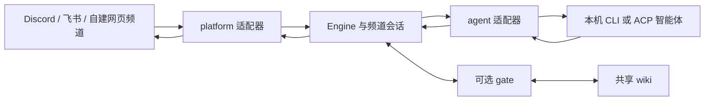

# bothouse 软件架构

bothouse 把聊天平台与本机智能体连接起来，在会话层增加团队协作、进展反馈与可选的共享记忆。平台入口、模型后端和记忆目录分别配置。

## 消息如何流动

接入 DSH 智能体的 ACP 协议与接入 DSH 网页聊天入口是两个方向。网页入口已有原生客户端插件实现（`dsh/packages/client-ui-discord`，走 collab 的 `/collab/api/*` 与 SSE，挂在 DSH 的 `sidebar.panellist` 和 `main`），仍在补齐手机端、停止和继续、等批准入口，尚未合并进 `main`；范围与验收见 [dsh/docs/channel-plugin-design.md](../dsh/docs/channel-plugin-design.md)。

## 模块与数据归属

| 模块 | 职责 |
| --- | --- |
| `bridge/core/` | Engine、频道会话、队列、管理 API、向导、技能及上下文注入 |
| `bridge/agent/` | 各 CLI / ACP 后端的启动、事件、权限与会话恢复 |
| `bridge/platform/` | 各聊天平台的身份、收发消息与卡片 |
| `bridge/contrib/gate/` | 可选的消息判定与 wiki 检索服务 |
| `role-household/rh/hub.py` | 随程序分发的自建网页频道，通过 cloud_web WebSocket 接入角色 |
| `companion/` | 保留的电脑语音、活动采集与归档扩展，独立配置 |
| `integrations/`、`skills/` | 智能体集成与工作约定 |

core 通过接口使用后端能力；agent 与 platform 适配器不互相导入。模型会话归各后端所有，共享 wiki 保存有来源的记录，凭据与运行数据留在仓库之外。

## 团队与记忆

- 平台把作者、点名和是否来自机器人带进 Engine。未触发回复的队友消息可作为上下文，作者身份保留。
- 队长与队员的路由通过 gate 与 fallback 配置决定。`team_lead_bot` 把被队长派发任务的最终回复交回队长；这不自动迁移另一个角色已经运行的任务。
- 自建平台多角色向导给每位成员写稳定的 `mention_id`，给队员写交回对象，并在人设的标记行说明自建平台上的队伍。手写且没有向导标记的人设保留。
- 共享记忆需要另行安装和配置 wiki / gate。检索出的主题页按需提供给角色；原会话的恢复仍由后端负责，两者不能互相替代。
- 工具审批、公开进展和任务卡按项目启用；一次任务有结果与真人已验收是不同状态。

协议与使用方法见 [团队协作](../bridge/MAOMAO.md)、[自建平台协议](../bridge/docs/cloud-web.md)、[wiki 配置](ccm-and-wiki.md)、[公开进展](PUBLIC_PROGRESS.md)、[工具代批](DELEGATED_PERMISSIONS.md)。

## 构建与发布

`make hubsrc` 把自建平台源码复制到 Go 嵌入目录，前端构建后随 cc-connect 二进制分发。安装脚本只下载当前仓库 Release 里的预编译包。发布从审核合入 main 的提交构建；提交、安装包和运行部署分别记录，见 [HANDOFF.md](HANDOFF.md)。
