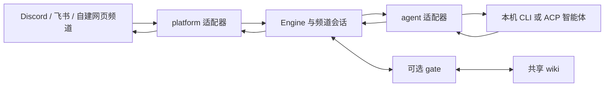

# bothouse 软件架构

## 会话与进程寿命

原生会话号和历史属于对话，agent 进程属于轮次。支持 `StrictResumeAgent` 的适配器，在轮次结束、队列为空且没有后台任务或存活子任务时关闭进程；发送失败也结束进程，下一条消息按保存的会话号恢复。ACP 还须通过 `ResumableSession` 暴露服务器实际声明的恢复能力。未提供这些能力的适配器保留原有关闭策略。

领取进程与关闭进程共用交互状态锁和关闭令牌；前台持有进程期间，后台完成事件不能安排或执行关闭。最后一次队列检查和会话解锁同时释放进程归属，随后才安排关闭；一旦进入关闭，下一轮等待实际 `Close` 完成再恢复。关闭只释放进程，不重置对话；期间排队的消息交给新状态继续处理。后台任务完成事件也走同一个轮次收尾入口。

## 角色与插件

DSH Channels discovery first reads the channel data directory's private `collab.owner.json`. A live owner PID and a validated loopback HTTP origin select the Channels transport, which authenticates with `X-Collab-Local` for state, member management and event streams. New connections re-read the record to follow host restarts. Missing or invalid records use the existing shell launch-record and log discovery. The local credential is scoped to Channels routes and stays inside the management server; DSH shell proxy authentication still uses its launch token.

管理 API 的角色 SSE 聚合桥接实际会话忙闲/智能体事件与 DSH 原生状态/事件流，角色键按来源隔离；连接先发快照，重连恢复当前状态。角色插件绑定独立存入数据目录 plugins/role-bindings.json，不改变 DSH 的全局插件加载和开关，不内置形象素材。字段、多会话规则及实测边界见 [角色事件接口](plugins/role-events.md)。

## 原生引用回复

平台可选实现 `MessageReplySender`，由平台验证目标消息属于当前会话。`send --reply-to` 经既有 `/send` API 和 `Engine.SendToSessionWithOptions` 调用该能力；不支持时返回错误，普通发送不变。公共入站边界只向具有该能力的平台提供消息 ID 和使用说明，因此 DSH / ACP 等不加载系统提示的后端同样能发现命令。QQ 的 `get_msg` 补取位于适配层，保留原作者、正文和 `Message.Reference`；原文不可读时保留引用 ID 并明确标记缺失。核心不判断平台或模型名称。

## 频道模型与推理强度

运行时选择按执行会话键写入 ProjectStateStore 的 `session_model_overrides`，模型与推理强度分别合并，未设置字段沿用配置。模型优先级为频道运行时选择、`session_models` 配置、现有目录工作区/项目默认值。原目录工作区覆盖继续兼容；切换频道不再调用共享 Agent 的模型/强度 setter，也不改 provider 或项目配置。

Engine 在普通启动、严格恢复、恢复失败后的启动及 relay 启动中，通过 context 传入不可变 SessionSettings。各支持切换的适配器在复制 provider 默认值后应用这份设置；Codex 原生压缩也显式接收模型与强度。CLI 切换排到下一轮应用，持久化失败则保留旧选择及排队请求；成功后只回收目标进程，保留原生对话编号和历史。空闲进程再次启动时比较快照，强度单独变化也会重建。

## 模型额度归属

团队可派判定复用 quota-cooling 中的 probe_status，并用 probe_scope 绑定产生证据的后端、账号和额度池；原 scope 仍只标识待处理的额度接管。成功终态回复或有效用量测量提供可用证据，期限经过本身不代表恢复。team heartbeat 发布 quota_status 和 cooling_until；队友提示、看板、语音台、自动接手、任务派单与审稿分配共用判定，缺失或未知证据先不派活，忙闲信息独立保留。旧版本状态文件缺少额度状态时按未知处理。任务派单先检查已有回执，再用锁外读取的额度证据决定是否创建新回执，避免查询旧结果触发执行或任务锁与额度锁互等。

额度冷却按后端、账号凭据来源与实际共享额度组记录，路径为数据目录下的 `quota-domains/<归属摘要>.json`；摘要包含凭据身份但不会保存原始凭据。同一个数据目录内的角色共享期限，进程内串行合并并原子落盘。角色原有的 `quota-cooling/<角色>.json` 继续保存交接回执。不带密钥、地址、环境变量凭据和请求头凭据的 provider（订阅登录）按当前登录账号归属，换号不继承旧冷却。冷却期限只是预测：真人点名或回复该角色的消息会照常发给后端试一次，后端正常回答即解除冷却，仍报额度用完就按新报错重新记；机器人、定时任务和交接唤醒照旧等待。一个数据目录仍须由一个桥接进程写入。

适配器通过 `QuotaScopeProvider` 提供已知额度组；Antigravity 沿用既有 native/cloud quota 解码器的 Gemini 与第三方组，只有提供方报告独立 Argon bucket 时才分离。Codex 使用既有 OAuth account_id 与账号级额度。没有共享组证据的后端按凭据来源保守共用，模型名不同不构成独立额度证据。第三方 API provider 按端点和凭据身份隔离，同一凭据的模型不擅自拆池。

`UsageWindow.QuotaGroup` 保留提供方窗口的机器可读归属；空值继承本次目标额度组，`account` 是约束所有模型的账号父额度。Claude 订阅模型 ID 与提供方模型周窗口归一到同一族键，核心不解析显示名称。结果观察、恢复探测和旧记录准入只消费目标模型及账号通用窗口；目标模型无法归属时保守保留全部约束。账号通用冷却对各模型生效，目标模型的成功终态可清除其模型域及账号父域，其他模型独立冷却保留。

旧角色级记录无可靠来源，保留为未知归属限制。只有目标模型的成功额度测量才豁免该目标，探测失败或空报告不豁免，也不宣称有额度。豁免与原期限同时保存，切回未经验证的旧目标仍受限。team heartbeat 分开保存容量冷却、旧额度限制与已归属额度，避免重启重新扩散到整个角色。会话和异步页脚探测固定发起时归属，避免迟到结果污染新目标。

DSH 首次向导另走 /setup/dsh/status 与 /setup/dsh/install，复用 dsh/install.sh 安装 web profile；不写 bridge 的机器人/CLI/人设配置。安装后交接 dsh web 启动命令，后续配置归 DSH 页面。安装器及插件资源当前从源码目录定位。

没有项目的设置模式监护已经打开过的 DSH web 宿主：根据既有 ready/starting 状态在桥启动时恢复，随后间隔五秒检查退出；恢复复用面板的 gate 端口准备和串行启动、归属校验及孤儿接管逻辑。首次未打开的安装及应用自管的桌面宿主不由此启动。设置模式结束前取消并等待监护，独立宿主仍可在桥退出后运行。

bothouse 把聊天平台与本机智能体连接起来，在会话层增加团队协作、进展反馈与可选的共享记忆。平台入口、模型后端和记忆目录分别配置。

## 消息如何流动

接入 DSH 智能体的 ACP 协议与接入 DSH 网页聊天入口是两个方向；后者通过 DSH 原生插件安装，向导负责首次安装与交接启动命令。

ACP 已接收的 prompt 通过同一事件流依次报告文本、工具与终态。RPC 失败、严格恢复校验失败和识别出的后端错误只产生一个 `EventError`，不再同时作为 `Send` 错误返回；发送前的会话校验与会话关闭取消仍由返回值报告。这样 Engine 不会在处理工具事件前先从另一个出口结束本轮。

ACP 的原生图片块在适配器入口校验 MIME、base64 和单附件大小，并随成功的 `EventResult.Images` 交付；取消或失败的 prompt 不发布暂存图片。Engine 沿用附件开关、输出授权和平台 `ImageSender`，图片发送失败按失败结束且不重放模型请求；只有平台确认已送达的媒体才允许空正文安静收尾，工具调用本身不算公开答复。

终态的正文来源由适配器显式标明：`EventResult.StreamedContentBytes` 是 `Content` 开头已经作为本轮 `EventText` 发出的字节数，剩余部分才是新增正文；零值保留独立定稿、错误或改写的语义，空正文沿用文本事件。iFlow 在同一锁下快照累计正文及实际流出的字节数，工具结果兜底和超时说明不计入已流出前缀。Engine 将新增尾部纳入文本账本，按已交付段游标收尾，不按正文相似度猜测来源。

预览的 `MaxChars` 只限制动态草稿。冻结为永久消息时提交完整正文，成功后才脱离预览并推进已交付段游标；提交失败则返回错误并结束该轮交付，不把截断草稿记成完整正文。事件流关闭时，未交付尾段仍由它的活动预览定稿，避免预览保留后又另发同一尾段。

容量错误的整轮重试只用于尚未出现工具事件的轮次。工具可能已经改变外部状态，无论工具消息是否展示，都不自动重发该用户提示，也不将其放回队列或冷却重投；失败正常报告，后续明确请求继续处理。模型内部的请求级退避仍归后端管理。

DSH 忙时插话（steer）要给 dsh-acp 打 integrations/dsh-acp-steer 的补丁，对端握手声明 `dsh/steer` 后适配器才走插话，否则排队。

子 Agent 状态仍由适配器采集，经可选 core.SubTaskReporter 交给现有表格渲染。Codex 原生协作事件直接映射；DSH 由 ACP 自有通知通道转发生命周期元数据，父会话 ID 与运行 ID 共同隔离事件。core 不解析各后端协议，普通工具完成不代表子任务完成。见[集成说明](../integrations/dsh-acp-subtasks/README.md)。

## 模块与数据归属

主动接单在可信平台回调进入 Engine 前经过 `proactive_ingress.go`：没有安装策略时保留既有路由；明确点名、私聊和命令仍走原权限路径。off/observe 不受理推断任务，记录决策后仍将消息交回原聊天路由和门闸，不附加主动授权。自动模式将匹配规则的源事件绑定到不可变决策和 Task，再进入已有执行队列。gate 不负责授予权限。

`proactive_authorization.go` 的项目级私有日志保存策略版本、平台账户绑定、决策、角色/后端分配及撤回通知。Task 日志暂存受理意图，随后转移到既有 turn journal；两次落盘之间中断仍可恢复同一 Task。队列、恢复、进度令牌与后台输出保留原 decision 引用，不能借续验后的决策继续旧操作。任务卡和本地日志沿现有平台能力与工作区规则展示。外部上下文事件永远是 ContextOnly，只复核原任务权限。管理接口、限制与例子见[主动授权](PROACTIVE_AUTHORIZATION.md)。

| 模块 | 职责 |
| --- | --- |
| `bridge/core/` | Engine、频道会话、队列、管理 API、向导、技能及上下文注入 |
| `bridge/agent/` | 各 CLI / ACP 后端的启动、事件、权限与会话恢复 |
| `bridge/platform/` | 各聊天平台的身份、收发消息与卡片 |
| `bridge/contrib/gate/` | 可选的消息判定与 wiki 检索服务 |
| `role-household/rh/hub.py` | 随程序分发的自建网页频道，通过 cloud_web WebSocket 接入角色 |
| `companion/` | 保留的电脑语音、活动采集与归档扩展，独立配置 |
| `integrations/`、`skills/` | 智能体集成与工作约定 |

DSH 自定义成员头像由 collab 的 owner 专用上传接口接收：浏览器缩放为 256×256 PNG，服务端检查 PNG 文件头、IHDR 尺寸和 256KB 上限，原子写入 `<dataDir>/avatars/<memberId>.png`，成员记录只存 `upload:<memberId>.png`。图片通过 owner 鉴权的静态路由读取；成员事件携带缓存版本，替换后列表和历史消息同步刷新。恢复默认或删除成员会清理本地图片。

core 通过接口使用后端能力；agent 与 platform 适配器不互相导入。模型会话归各后端所有，共享 wiki 保存有来源的记录，凭据与运行数据留在仓库之外。

工作区平台可选实现 `TeamWorkspaceShelver`：所有工作区（空着的、在用的）放在平台自己的一个分类里，认领时不搬回。Discord 是「工作区」分类：新建直接建在里面，老的由 core 在列池子、认领、释放时挪进去，旧版「空闲工作区」分类首次列频道时清空并删除；`TeamChannel.Shelved` 保留共享池的复用与编号语义；搬动失败只记日志，其他平台沿用原流程。

工作区编号全局唯一（整个池子里不重号），但复用只在本频道内：空闲的工作区仍属于它的聊天频道（DSH 按 `rooms.parent_id`，Discord/飞书按最近一次交接的频道），只有这个频道能再认领；别的频道派活时新建或排队，不改挂（#762）。

## 团队与记忆

Discord 任务论坛以服务器与来源聊天频道的现有类别寻址，同类频道共用论坛，未归类时只提示归类并保留任务板。共享的 task_forum.json 将任务编号绑定到帖子、父论坛、创建角色和原聊天频道；频道移动只影响新任务的发帖位置，旧帖依保存的身份继续更新、回话和归档。历史服务器级论坛映射保留供旧帖恢复。入站消息保留原频道会话与帖子回执的不同目标。类别帖的收口按实际论坛归属计算；旧全服论坛中的待拍板帖按保存的原来源频道当前类别计数，并附原帖链接，来源不存在或未归类时不计入类别汇总。状态仍只来自任务板。

QQ 独立手写记忆可经 [qq-memory-quote](../integrations/qq-memory-quote/README.md) 接入受控提交：现有 macOS 沙箱内的 DSH 及全部子进程对记忆只读，文件编辑器通过本地接口提交候选；沙箱外的服务读取 people_said 可信来源，按项目/会话/人物核对后原子发布。来源查询绑定会话 capability，不能用模型自报的作者或 user 角色代替真人身份。它约束新记忆写入，不替换现有记忆布局或读取/回复的场景隐私策略；未接入的启动器仍沿用旧行为。

成员身份与模型后端分开：多个成员可以指向同一模型或同一种 CLI。DSH 频道的绑定键是「成员 ID × 频道 ID」；原生成员创建独立的内部 DSH Session，本机 CLI 按成员创建实例并按频道维护 ACP session。不会以模型名或 CLI 类型作为成员唯一键。

独立会话并不隔离工作文件、操作系统权限或长期记忆。频道历史是显式提供给成员的共同输入，wiki 检索和共享文件也是信息传递路径；DSH 成员新会话使用频道的 `workspacePath`，工作区继承父频道；未设置时使用实例默认目录。界面保存目录在 `room_settings.workspace_path` 保留覆盖值（启动配置继续写入 `rooms.workspace_path`，不会覆盖界面选择）。主角色同样按 `room_settings.lead_id` 保存，频道默认接话、有效接话者展示及额度接管通过 `Hub.defaultReplyIn(roomId)` 读取；未设置时只有单成员频道自动接话，多成员须显式选择频道主角色或 @ 成员。私聊仍交给该私聊成员；派活票据、团队创建和派活交回仍通过 `Hub.primaryIn(roomId)` 保留旧全局回退兼容逻辑；未选择频道默认接话者不撤销已有派活权限，单成员自动接话也不会新增派活权限。派活模式 `solo` / `team` / `mixed` 分别选择自己的子任务、频道成员或两者，和成员是否使用同一模型无关。用户操作见[同模型多成员指南](single-cli-team.md)。

- 平台把作者、点名和是否来自机器人带进 Engine。未触发回复的队友消息可作为上下文，作者身份保留。
- 主角色与队员的路由通过 gate 与 fallback 配置决定。`team_lead_bot` 把被主角色派发任务的最终回复交回主角色；这不自动迁移另一个角色已经运行的任务。
- 工作区身份由当前归属、历史交接或平台上的工作区名称确认；释放不清除身份。`new` 的规划和 `claim` 共用此判断，`claim` 拒绝以工作区为来源（包括已有父频道的工作区），要求从原聊天频道发起；拒绝不新增归属、交接或看门记录。
- 工作区规则按频道身份注入，主角色和副手被队友点名时都使用工作区规则，需要真人决定的问题走 `ws-up --ask`。Discord 沿用工作区静默发送边界，对新消息、编辑、附件及交互回复设置原生提及权限，只允许已登记的机器人身份，并保留调用者更窄的限制；正文不改写，真人、身份组及全体提及不触发通知，聊天频道沿用原提及行为。
- 工作区只有首行明确标记 `[report]` / `[ask]` 的回复进入交付校验；定时回查和普通进度文字不因存在未完交接而自动变成报告。任务板新转完成、等用户或请求清会话时，缺报告恢复仍会保留会话并要求补交。
- 报告批次与整件任务的终态分开：`workspace exit --kind batch` / `ws-up --batch` 把批次属性存入待验报告，交回与放行均保留任务、工作区和会话；最终交回才释放工作区，最终放行才关卡。报告引擎负责自身会话，当前主角色负责任务板写入；明确退回的报告记录允许同文重交，任务板的实时交接绑定是脚本选任务的依据，最近交接文件只是缓存。
- 手动换主时，bridge 从持久任务卡、工作区登记和待回答 `[ask]` 生成 `lead-handoff.json`；旧主无需在线，新主在下一轮收到记录。它不迁移 CLI 内部 session 或工具进程，也不自动回切。见[主角色手动交接](LEAD_HANDOFF.md)。
- 额度事件或五小时额度剩余不足 5% 且有明确恢复时间时，公共层按本文“模型额度归属”保存所属额度域的期限。bridge 的定时任务、看门和 relay 按目标额度域决定是否启动；team 的 `cooling_until` 保留当前目标状态供外部宿主展示和接手，恢复时不会重新变成角色级限制。绑定在同一频道且空闲的成员接手未完成任务，保留原交接。全局主角色通过 gate `/lead`（无 gate 时为 `lead.json`）临时切换，恢复时仅撤销这次自动选择，保留后来的手动选择。DSH 宿主读取公布的期限管理频道主角色与原生任务；宿主回执单独保存为 `.takeover.json`，不覆盖桥的冷却文件。公开卡转交后，新负责人使用自己的轮次令牌续报原卡，结果仍需用户验收。
- 自建平台多角色向导给每位成员写稳定的 `mention_id`，给队员写交回对象，并在人设的标记行说明自建平台上的队伍。手写且没有向导标记的人设保留。
- 共享记忆需要另行安装和配置 wiki / gate。检索出的主题页按需提供给角色；原会话的恢复仍由后端负责，两者不能互相替代。
- 工具审批、公开进展和任务卡按项目启用；一次任务有结果与真人已验收是不同状态。
- 任务日志不依赖平台有卡片：没有 `TaskCardPublisher` 的平台也能记录开始、更新、结果、查询和重启恢复，成功只表示日志已写入，不表示消息或卡片已送达。任务可以有多次修订，产物引用和指定返工写在同一份日志里；产物引用不是上传或发布证明。无卡片平台不提供成员派工；平台后来获得卡片能力时只为工作区会话补投影，工作区外的记录保留但不会反复重写，也不会伪造投递序号。

协议与使用方法见 [自建平台协议](../bridge/docs/cloud-web.md)、[wiki 配置](ccm-and-wiki.md)、[公开进展](PUBLIC_PROGRESS.md)、[工具代批](DELEGATED_PERMISSIONS.md)。

## 构建与发布

绑定任务的文本投递复用 PublicProgress 的同一任务日志与轮询周期：正文和分片计划在私有记录中持久化，Task 查询只投影状态、目标、正文哈希与逐片回执。发送前先写 sending，进程中断恢复为 unknown，不重跑 agent；明确未受理才重试。平台通过 TaskTextSender 提供一次调用一个分片的能力。卡片事实、工作区 handback、原生 DSH 和语音不进入这个文本队列。详见 [任务文本投递](TASK_TEXT_DELIVERY.md)。

`make hubsrc` 把自建平台源码复制到 Go 嵌入目录，前端构建后随 cc-connect 二进制分发。安装脚本只下载当前仓库 Release 里的预编译包。发布从审核合入 main 的提交构建，流程见 [CONTRIBUTING.md](../CONTRIBUTING.md)。

## Collaboration helper packaging

`bridge/embed_lead.go` owns the embedded lead scripts and selected gate dependencies.
`core.InstallLeadTools` extracts their sibling layout under the configured data directory
and adds role instructions. The setup wizard calls it for a newly created primary role;
`setup lead install` remains the explicit CLI entry for existing roles.
The DSH adapter maps runtime session identity to `CC_SESSION` before subprocess
credential filtering. Gate services and platform credentials are configured separately.

## Usage ledger

QQ's optional group collector intercepts configured groups in the platform adapter before allow-list checks, attachment parsing and engine dispatch. A private SQLite store under the platform data directory keeps owner events, keyword-selected text and durable batch ownership. One Chat Completions request per nonempty batch records its returned usage in that store, independently of conversational agent usage; useful results use OneBot private delivery with a stored receipt. Neither collected events nor these sends create engine sessions. Calls or sends interrupted without a receipt remain recorded and are not replayed automatically. Configuration and inspection are documented in [QQ setup](platforms/qq.md#静默监听群消息).

The bridge entry point creates one `core.UsageLedger` per configured data directory and shares it with all engines and the management API. Agent adapters emit authoritative per-turn token categories on terminal events; core does not infer billing from context-window snapshots. Daily files contain individual records plus date/hour/role/model buckets. Read-only management endpoints provide dashboard aggregations with optional configured pricing. Unknown usage remains explicit. See [usage API](api/usage.md).

## DSH 语音公开答复

[公开答复插件](../integrations/dsh-public-output/README.md) 区分模型历史与展示：模型历史保留统一 JSON，配套 ACP 只输出解码正文。语音的实时正文经私密 relay 切句，由 companion 顺序合成并提供设备音频块，终态不重复。协议、失败行为及远程识别兼容见 [按句语音](VOICE_SENTENCE_STREAM.md)。

语音会话只接续本绑定的对话。语音总台的伙伴状态改为通过本地 `voice-desk` 命令按需读取，不再每轮附加其他频道摘要；跨频道转达仍要求下一轮明确确认。进度卡保留，语音不注入不可用的成员委派教程。ACP 正常关闭先请求后端持久化再停止子进程；可选 `voiceHistory` 使用带来源引用的历史替换事件清除过期包装，保留原始日志和实际对话。

### 外部任务输入

core/external_task_events.go 是私有受理日志；cron_poll.go、webhook.go 只负责入口，external_task_delivery.go 通过已有任务归属和工作区 claim 路由，复用 public-progress 循环。源游标只确认连续持久前缀；消费回执绑定执行代次，公开摘要流不充当受理权威。授权复查接口供独立准入层接线，具体契约与恢复限制见 [实现记录](implementation/750-external-task-events.md)。

### Member usage attribution

Completed interactive attempts write platform/account identity and bounded CLI-session intervals to `usage/turns/`. Native CLI logs remain the source of token counts. `UsageLedger.QueryMember` reads the intervals on each query, so already imported records acquire ownership after completion without reimporting tokens. Historical, automated and ambiguous overlapping usage remains unattributed. `/api/v1/usage/members` and the existing groups with a `member` filter share management authentication. Attribution is local to one instance; platform accounts are not merged.
