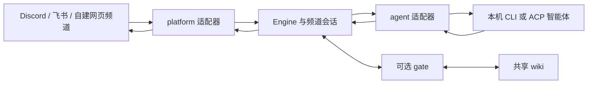

# bothouse 软件架构

DSH 首次向导另走 /setup/dsh/status 与 /setup/dsh/install，复用 dsh/install.sh 安装 web profile；不写 bridge 的机器人/CLI/人设配置。安装后交接 dsh web 启动命令，后续配置归 DSH 页面。安装器及插件资源当前从源码目录定位。

bothouse 把聊天平台与本机智能体连接起来，在会话层增加团队协作、进展反馈与可选的共享记忆。平台入口、模型后端和记忆目录分别配置。

## 消息如何流动

接入 DSH 智能体的 ACP 协议与接入 DSH 网页聊天入口是两个方向；后者通过 DSH 原生插件安装，向导负责首次安装与交接启动命令。

DSH 忙时插话（steer）要给 dsh-acp 打 integrations/dsh-acp-steer 的补丁，对端握手声明 `dsh/steer` 后适配器才走插话，否则排队。

子 Agent 状态仍由适配器采集，经可选 core.SubTaskReporter 交给现有表格渲染。Codex 原生协作事件直接映射；DSH 由 ACP 自有通知通道转发生命周期元数据，父会话 ID 与运行 ID 共同隔离事件。core 不解析各后端协议，普通工具完成不代表子任务完成。见[集成说明](../integrations/dsh-acp-subtasks/README.md)。

## 模块与数据归属

| 模块 | 职责 |
| --- | --- |
| `bridge/core/` | Engine、频道会话、队列、管理 API、向导、技能及上下文注入 |
| `bridge/agent/` | 各 CLI / ACP 后端的启动、事件、权限与会话恢复 |
| `bridge/platform/` | 各聊天平台的身份、收发消息与卡片 |
| `bridge/contrib/gate/` | 可选的消息判定与 wiki 检索服务 |
| `role-household/rh/hub.py` | 随程序分发的自建网页频道，通过 cloud_web WebSocket 接入角色 |
| `companion/` | 保留的电脑语音、活动采集与归档扩展，独立配置 |
| `integrations/`、`skills/` | 智能体集成与工作约定 |

DSH 自定义成员头像由 collab 的 owner 专用上传接口接收：浏览器缩放为 256×256 PNG，服务端检查 PNG 文件头、IHDR 尺寸和 256KB 上限，原子写入 `<dataDir>/avatars/<memberId>.png`，成员记录只存 `upload:<memberId>.png`。图片通过 owner 鉴权的静态路由读取；成员事件携带缓存版本，替换后列表和历史消息同步刷新。恢复默认或删除成员会清理本地图片。

core 通过接口使用后端能力；agent 与 platform 适配器不互相导入。模型会话归各后端所有，共享 wiki 保存有来源的记录，凭据与运行数据留在仓库之外。

## 团队与记忆

成员身份与模型后端分开：多个成员可以指向同一模型或同一种 CLI。DSH 频道的绑定键是「成员 ID × 频道 ID」；原生成员创建独立的内部 DSH Session，本机 CLI 按成员创建实例并按频道维护 ACP session。不会以模型名或 CLI 类型作为成员唯一键。

独立会话并不隔离工作文件、操作系统权限或长期记忆。频道历史是显式提供给成员的共同输入，wiki 检索和共享文件也是信息传递路径；DSH 成员新会话使用频道的 `workspacePath`，工作区继承父频道；未设置时使用实例默认目录。界面保存目录在 `room_settings.workspace_path` 保留覆盖值（启动配置继续写入 `rooms.workspace_path`，不会覆盖界面选择）。主角色同样按 `room_settings.lead_id` 保存，所有频道路由通过 `Hub.primaryIn(roomId)` 读取，只有未设置时才回退到旧全局选择。派活模式 `solo` / `team` / `mixed` 分别选择自己的子任务、频道成员或两者，和成员是否使用同一模型无关。用户操作见[同模型多成员指南](single-cli-team.md)。

- 平台把作者、点名和是否来自机器人带进 Engine。未触发回复的队友消息可作为上下文，作者身份保留。
- 主角色与队员的路由通过 gate 与 fallback 配置决定。`team_lead_bot` 把被主角色派发任务的最终回复交回主角色；这不自动迁移另一个角色已经运行的任务。
- 工作区身份由当前归属、历史交接或平台上的工作区名称确认；释放不清除身份。`new` 的规划和 `claim` 共用此判断，`claim` 拒绝以工作区为来源（包括已有父频道的工作区），要求从原聊天频道发起；拒绝不新增归属、交接或看门记录。
- 手动换主时，bridge 从持久任务卡、工作区登记和待回答 `[ask]` 生成 `lead-handoff.json`；旧主无需在线，新主在下一轮收到记录。它不迁移 CLI 内部 session 或工具进程，也不自动回切。见[主角色手动交接](LEAD_HANDOFF.md)。
- 额度事件或五小时额度剩余不足 5% 且有明确恢复时间时，公共层将截止时间持久化为 `quota-cooling/<project>.json` 的 `cooling_until`，并沿用 team 状态里的同名字段。冷却期间定时任务、看门和 relay 不再启动该角色；绑定在同一频道且空闲的成员接手未完成任务，保留原交接。全局主角色通过 gate `/lead`（无 gate 时为 `lead.json`）临时切换，恢复时仅撤销这次自动选择，保留后来的手动选择。DSH 宿主读取相同期限，管理频道主角色与原生任务；宿主回执单独保存为 `.takeover.json`，不覆盖桥的冷却文件。公开卡转交后，新负责人使用自己的轮次令牌续报原卡，结果仍需用户验收。
- 自建平台多角色向导给每位成员写稳定的 `mention_id`，给队员写交回对象，并在人设的标记行说明自建平台上的队伍。手写且没有向导标记的人设保留。
- 共享记忆需要另行安装和配置 wiki / gate。检索出的主题页按需提供给角色；原会话的恢复仍由后端负责，两者不能互相替代。
- 工具审批、公开进展和任务卡按项目启用；一次任务有结果与真人已验收是不同状态。
- 任务日志不依赖平台有卡片：没有 `TaskCardPublisher` 的平台也能记录开始、更新、结果、查询和重启恢复，成功只表示日志已写入，不表示消息或卡片已送达。任务可以有多次修订，产物引用和指定返工写在同一份日志里；产物引用不是上传或发布证明。无卡片平台不提供成员派工；平台后来获得卡片能力时只为工作区会话补投影，工作区外的记录保留但不会反复重写，也不会伪造投递序号。

协议与使用方法见 [自建平台协议](../bridge/docs/cloud-web.md)、[wiki 配置](ccm-and-wiki.md)、[公开进展](PUBLIC_PROGRESS.md)、[工具代批](DELEGATED_PERMISSIONS.md)。

## 构建与发布

绑定任务的文本投递复用 PublicProgress 的同一任务日志与轮询周期：正文和分片计划在私有记录中持久化，Task 查询只投影状态、目标、正文哈希与逐片回执。发送前先写 sending，进程中断恢复为 unknown，不重跑 agent；明确未受理才重试。平台通过 TaskTextSender 提供一次调用一个分片的能力。卡片事实、工作区 handback、原生 DSH 和语音不进入这个文本队列。详见 [任务文本投递](TASK_TEXT_DELIVERY.md)。

`make hubsrc` 把自建平台源码复制到 Go 嵌入目录，前端构建后随 cc-connect 二进制分发。安装脚本只下载当前仓库 Release 里的预编译包。发布从审核合入 main 的提交构建，流程见 [CONTRIBUTING.md](../CONTRIBUTING.md)。

## Collaboration helper packaging

`bridge/embed_lead.go` owns the embedded lead scripts and selected gate dependencies.
`core.InstallLeadTools` extracts their sibling layout under the configured data directory
and adds role instructions. The setup wizard calls it for a newly created primary role;
`setup lead install` remains the explicit CLI entry for existing roles.
The DSH adapter maps runtime session identity to `CC_SESSION` before subprocess
credential filtering. Gate services and platform credentials are configured separately.

## Usage ledger

The bridge entry point creates one `core.UsageLedger` per configured data directory and shares it with all engines and the management API. Agent adapters emit authoritative per-turn token categories on terminal events; core does not infer billing from context-window snapshots. Daily files contain individual records plus date/hour/role/model buckets. Read-only management endpoints provide dashboard aggregations with optional configured pricing. Unknown usage remains explicit. See [usage API](api/usage.md).

## DSH 语音公开答复

[公开答复插件](../integrations/dsh-public-output/README.md) 区分模型历史与展示：模型历史保留统一 JSON，配套 ACP 只输出解码正文。语音的实时正文经私密 relay 切句，由 companion 顺序合成并提供设备音频块，终态不重复。协议、失败行为及远程识别兼容见 [按句语音](VOICE_SENTENCE_STREAM.md)。

语音会话只接续本绑定的对话。语音总台的伙伴状态改为通过本地 `voice-desk` 命令按需读取，不再每轮附加其他频道摘要；跨频道转达仍要求下一轮明确确认。进度卡保留，语音不注入不可用的成员委派教程。ACP 正常关闭先请求后端持久化再停止子进程；可选 `voiceHistory` 使用带来源引用的历史替换事件清除过期包装，保留原始日志和实际对话。

### 外部任务输入

core/external_task_events.go 是私有受理日志；cron_poll.go、webhook.go 只负责入口，external_task_delivery.go 通过已有任务归属和工作区 claim 路由，复用 public-progress 循环。源游标只确认连续持久前缀；消费回执绑定执行代次，公开摘要流不充当受理权威。授权复查接口供独立准入层接线，具体契约与恢复限制见 [实现记录](implementation/750-external-task-events.md)。
