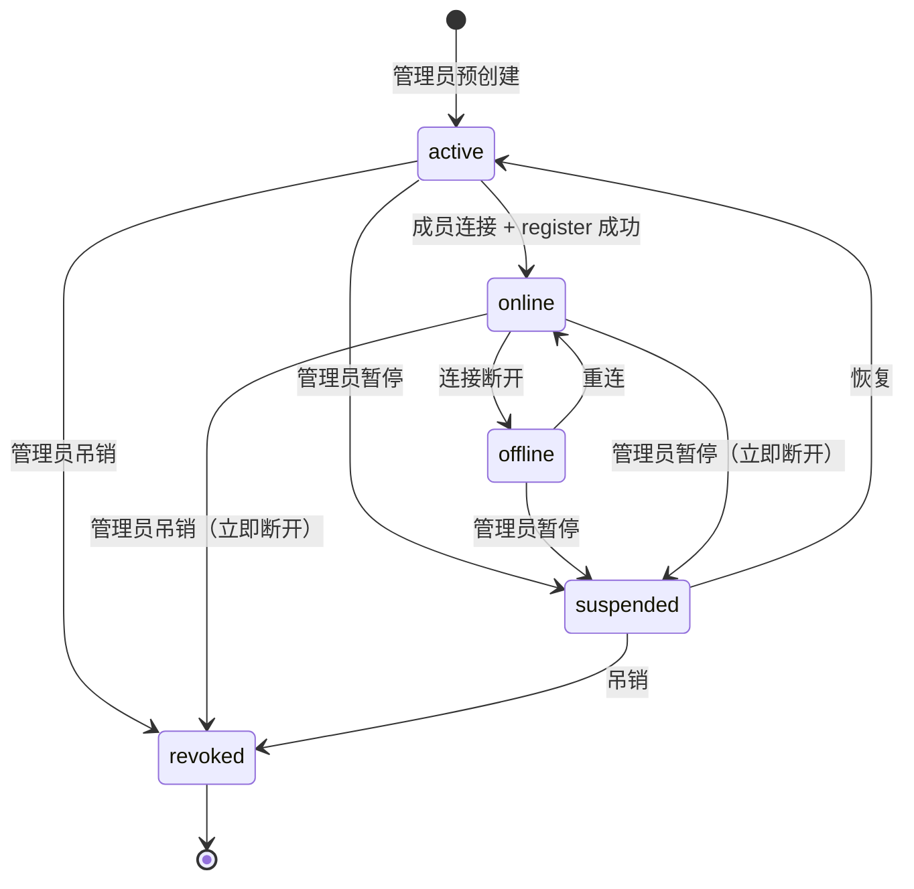

# 外部成员身份与权限设计说明（提案 v0.1）

> 状态：设计提案（proposal），待评审
> 语言：中文，关键术语附英文
> 关联：#321（外部聊天机器人作为频道成员）、#539（局域网多设备，已关闭）、#882（长任务阻塞消息）
> 基准代码：`develop`（2026-11-08 时点 `dsh/collab/cloudweb.mjs`）
> 作者：NethielChou（外部贡献者）

---

## 1. 背景与目标

### 1.1 背景

AstrBot / MaiBot 这类第三方聊天机器人已经在大量 QQ / 微信群中使用。用户希望它们能作为 **频道成员（channel member）** 进入 bothouse 自建频道（hub），与本地 DSH / Codex agent 同处一个频道协作：

- 能读频道上下文；
- 被 @ 时才回复（静默规则）；
- 与本地 agent 一样出现在成员列表、参与派活/汇总；
- 权限受控，高风险动作需要人类批准。

当前协议层（CWIP / cloud-web 网关）已经能跑通：外部 bot 可以注册、收发消息、被 @ 时回复；社区参考实现（AstrBot 插件）已在真机验证。缺的是 **产品化（productization）**：成员类型、持久化、认证、房间范围、在线态、审批、管理 UI。

### 1.2 目标（本设计要回答的问题）

1. 外部成员（external member）的**身份模型**是什么？字段、状态、生命周期？
2. 它**怎么认证**？共享 token 怎么过渡到可吊销的成员凭据？
3. 它**怎么进入房间名单**？房间范围（room scope）如何限制？
4. **静默与点名规则**如何复用现有 hub 路由（mention routing），避免抢话与回环？
5. **权限模型**：执行权（execution）与审批权（approval）如何分离？
6. 与现有 `dsh/collab` 如何**兼容与分期**（M1/M2/M3）？

### 1.3 非目标（Non-goals，第一版不做）

- 不做多频道同时接入（第一版单频道，见 §6）；
- 不做外部成员的"模型/推理"托管（仍由外部 bot 自己负责）；
- 不做外部成员自主审批高风险动作；
- 不改变现有 DSH / 本机 CLI 成员的行为；
- 不重写协议（复用现有 CWIP / cloud-web 帧格式，见 §10）。

---

## 2. 现状（已验证能力与缺口）

### 2.1 已具备（可直接复用，不重造）

| 能力 | 证据（代码/测试） |
|---|---|
| 外部 bot 以成员身份注册（id/name/mention id/avatar） | `dsh/collab/cloudweb.mjs` `register()`；`GET /cloud-web/ws?bot=&name=&mention_id=&avatar=` |
| 注册确认与能力协商（`register_ack` + `capabilities`） | 同上；`CAPABILITIES` |
| 被 @ 语义（`@名字` / `@id` / `<@mention_id>`） | `dsh/collab/mentions.mjs` |
| 消息帧含 `mentioned` / `from_bot` / `reply_ctx` / `reply_to_*` | `cloudweb.mjs` 消息下发 |
| 回复帧（`reply`）以角色身份入库并广播 | `cloudweb.mjs` `case 'reply'` |
| 断线/重连替换旧连接（4003）、重名/保留 id 拒绝（4002） | `cloudweb.mjs` `register()`；`collab.test.mjs` |
| 房间限制参数 `?room=`（可选） | `cloudweb.mjs` `register()` |
| token 校验（Bearer / `x-cloud-web-token` / `?token=`） | `cloudweb.mjs` `authorized()`；`collab.test.mjs` |

### 2.2 缺口（Gap，本设计要补的）

1. **成员类型缺失**：`hub.members` 只有 `dsh` / `bot`（连接态）/ `human`；没有"预先登记、持久化、可管理"的 external member；
2. **持久化缺失**：hub 重启或成员断开后，外部成员从名单消失/不可管理；
3. **认证过粗**：只有一个共享 bot token；拿到 token 可以冒充任意 bot id，无法按成员吊销/轮换；
4. **房间范围弱**：`?room=` 可选；不传即所有房间，不适合"最小权限"；
5. **无在线态反馈**：@ 离线外部成员没有任何提示；
6. **无审批边界**：外部成员与本地 agent 权限没有区分，缺少"高风险动作人类审批"；
7. **无管理 UI**：成员列表只有 DSH / CLI 两类，不能添加/移除/查看外部成员；
8. **文档/示例/测试不面向第三方**：现有文档多从 bothouse 一侧写"我连你的网关"，第三方作者缺"我该怎么写一个 bot 客户端"。

---

## 3. 用户故事与验收标准

### 3.1 用户故事（User stories）

- 作为**频道管理员**，我可以预先登记一个外部成员（名字、mention id、房间范围、凭据），上线后它出现在成员列表；
- 作为**频道用户**，我在频道里 @ 它，它会读上下文并回复；我不 @ 它，它保持安静；
- 作为**频道管理员**，我可以把它移出频道/吊销凭据，之后它无法再连接；
- 作为**频道成员**，我能看到它在线/离线状态；
- 作为**人类负责人**，高风险动作（删除文件、发布、付款等）必须由我批准，外部成员不能自批；
- 作为**第三方开发者**，我按文档 + 示例，30 分钟内能写出一个可接入的 bot 客户端。

### 3.2 验收标准（Acceptance criteria）

1. 管理员可创建/编辑/吊销外部成员；成员信息持久化（hub 重启后仍在）；
2. 外部成员连接后出现在成员列表（`kind=external`），离线显示离线；
3. 只有被 @（`mentioned=true`）且非 bot 消息（`from_bot=false`）时响应；不 @ 时保持安静；
4. 只能进入授权房间（第一版单频道，`rooms` 必填）；
5. 成员凭据可轮换、可吊销；旧凭据立即失效；
6. 高风险动作进入人类审批流；外部成员不能审批；
7. 现有 DSH / CLI / cc-connect 行为不回归（测试全绿）；
8. 文档 + 示例 + 自动测试齐全，第三方可自助接入。

---

## 4. 身份模型（Identity model）

### 4.1 成员类型（Member kind）

新增 `kind: "external"`（与 `dsh` / `cli` / `human` 并列）：

| kind | 含义 | 默认主角色候选 |
|---|---|---|
| `dsh` | 本机 DSH agent | ✅ 可 |
| `cli` | 本机 CLI agent（Codex 等） | ✅ 可 |
| `external` | 外部聊天机器人（AstrBot/MaiBot 等） | ❌ 默认不进（需人类显式指定为协调者，见 §8） |
| `human` | 人类 | — |

### 4.2 外部成员字段（ExternalMember）

| 字段 | 类型 | 说明 |
|---|---|---|
| `id` | string | 稳定唯一 id（注册时声明，建议 `ext-<平台>-<名称>`） |
| `name` | string | 显示名（@ 解析用；不得与本房间其他成员重名） |
| `mentionId` | string（数字） | 外部平台侧 mention id（用于 `<@mention_id>` 解析） |
| `avatar` | string? | 内置 slug 或 http(s) URL（可选） |
| `rooms` | number[] | 授权房间；第一版**必填且仅 1 个** |
| `credentialId` | string? | 关联的成员凭据（见 §5） |
| `trustLevel` | enum | `standard` / `coordinator`（见 §8） |
| `status` | enum | `active` / `suspended` / `revoked` |
| `createdBy` / `createdAt` | string / timestamp | 审计 |
| `revokedAt` | timestamp? | 吊销时间 |
| `lastSeenAt` | timestamp? | 最近上线时间（在线态辅助） |

### 4.3 状态机（Lifecycle）

```
(管理员预创建) active ──连接──> online
        │                        │
        │                        └──断开──> offline (仍为 active，可重连)
        │
        ├──暂停──> suspended（禁止连接/路由）
        └──吊销──> revoked（不可恢复；凭据失效）
```

- 预创建（pre-provision）：管理员在 UI 里登记，产生 `credential`；
- 上线：外部客户端用凭据连接并 `register`，校验成员 id / 房间 / 状态；
- 离线：连接断开 → `online=false`（成员仍在名册，可重连）；
- 吊销：管理员操作 → 立即断开当前连接、凭据失效、后续注册被拒（4002/403 类错误码待定）；
- hub 重启：成员名册从持久化存储恢复（M1）。

### 4.4 成员列表（Roster）展示

- 成员列表新增 `external` 类型分组/图标；
- 显示：名字、mention id、在线/离线、房间、信任级别、最近上线；
- 管理员操作：添加、编辑、暂停、吊销、轮换凭据。

---

## 5. 认证与凭据（Authentication & credentials）

### 5.1 当前实现（共享 token）

- `CloudWebGateway` 只有一个 `token`；校验 `Authorization: Bearer` / `x-cloud-web-token` / `?token=`；
- 任何持有该 token 的客户端都可以声明任意 `bot=` id，注册为任意成员；
- 无法按成员吊销/轮换；token 泄露 = 全频道 bot 身份泄露。

### 5.2 过渡方案（Stage 1，兼容现有协议）

在**不改协议帧**的前提下，增加服务端约束：

1. **成员 id 白名单（allowlist）**：只有已登记的成员 id 才能注册；
2. **房间绑定**：注册时 `?room=` 必须等于成员被授权的房间（第一版单房间）；
3. **凭据绑定**：每个成员分配一个成员 token（可覆盖/轮换），校验 `token → member id`；
4. **保留**共享 token 作为"管理员/兼容模式"，用配置开关控制（默认关闭共享模式，仅过渡期开启）。

> 兼容性：cc-connect / 现有外部客户端只需把共享 token 换成成员 token，协议不变。

### 5.3 目标方案（Stage 2，per-member credential）

- 每成员独立凭据（secret/token），支持**轮换**（rotation）与**吊销**（revocation）；
- 凭据在存储中**只保存哈希**（hashed at rest），不落明文日志；
- 连接握手：仍用现有 `Authorization: Bearer <member-token>`；网关查表映射到成员；
- 审计：记录凭据使用（成员、时间、来源 IP/主机、成功/失败）；
- 远程连接要求 TLS（wss）或受保护隧道；本机回环可豁免；
- 凭据泄露应对：管理员可一键吊销并重新签发。

### 5.4 安全要求（Security requirements）

- token/凭据**不得**出现在仓库、日志、QQ 群、issue/PR 中；
- 示例客户端默认只连 `ws://127.0.0.1`，token 从环境变量读取；
- 文档明确"共享 token 模式 = 高信任/仅本机/过渡用"；
- 所有外部连接默认拒绝，除非成员已登记且状态 `active`。

---

## 6. 房间范围（Room scope）

- **第一版：单频道（single room）**，`rooms` 必填且长度为 1；
- `register` 时 `?room=` 必须匹配授权房间；不传 → 拒绝（4002 类）；
- 成员只收到授权房间的消息；不能 @/被 @ 到其他房间；
- **多频道（multi-room）后置**：未来扩展 `rooms: number[]`，需重新评估权限与 UI；
- 与"默认主角色"解耦：外部成员不因加入房间而自动成为主角色候选。

---

## 7. 静默与点名规则（Silence & mention routing）

### 7.1 服务端职责（hub）

- 继续由 hub 计算 `mentioned`（`@名字` / `@id` / `<@mention_id>` / 行首名字 / DM）；
- 外部成员消息不进"主角色兜底"（不会替人类接默认消息）；
- 外部成员之间默认**不互相触发**（`from_bot=true` 的消息不自动路由）；
- 被移除/离线成员的 @ 不投递（M2 加"@ 离线成员"提示）。

### 7.2 客户端职责（external bot）

外部客户端必须遵守（M3 文档要写清楚）：

1. **只回复** `mentioned === true && from_bot === false` 的消息；
2. 不回复自己发的消息（防自回环）；
3. 按 `msg_id` 去重（重连/重放场景）；
4. 限速（每房间/每分钟上限，具体值待定）；
5. 不自行解析 mention（服务端已算好 `mentioned`），避免方言差异；
6. 上下文读取：通过 `reply_ctx` / `msg_id` 获取频道上下文（具体由客户端实现）。

### 7.3 协调者（Coordinator，可选）

- 管理员可把某外部成员设为 `trustLevel=coordinator`：
  - 可向其他成员派活/汇总（复用 hub 派活语义）；
  - **不能**审批高风险动作；
  - 不能成为"人类默认消息"的承接者；
- 第一版默认 `standard`，coordinator 后置或按需开启。

---

## 8. 权限模型（Authorization）

### 8.1 两权分离（Separation of execution and approval）

| 权力 | 外部成员 | 本地 agent | 人类 |
|---|---|---|---|
| 执行权（execution） | ✅（受房间/工具限制） | ✅ | ✅ |
| 审批权（approval） | ❌（默认） | ⚠️按配置 | ✅ |
| 主角色/人类默认承接 | ❌ | ✅ | — |
| 派活/协调（coordinator） | ⚠️需人类显式指定 | ✅ | ✅ |

### 8.2 风险分级（Risk levels，示例）

| 风险级别 | 示例动作 | 外部成员 |
|---|---|---|
| L0 只读 | 读消息、查状态 | 允许 |
| L1 低风险写 | 发消息、写草稿 | 允许（限房间） |
| L2 中风险 | 修改文件、跑测试 | 需人类审批（可配置） |
| L3 高风险 | 删除、发布、付款、改权限 | **必须人类审批** |

### 8.3 审计（Audit）

- 记录外部成员的连接/断开、消息、审批请求/结果、凭据使用；
- 审计日志可导出；不含明文凭据。

### 8.4 能力边界（Capability boundaries）

外部成员不能：

- 绕过 `allow_from` 等既有准入规则；
- 自动触发其他 bot 的回合（防雪崩/回环）；
- 自批高风险动作；
- 修改成员名册/凭据/权限（只能由人类管理员操作）。

---

## 9. 与现有实现的兼容与迁移（Compatibility & migration）

1. **协议不变**：继续用现有 cloud-web WS + `register` / `message` / `reply` 帧；
2. **默认行为不变**：未登记的外部连接默认拒绝；现有 cc-connect 走"管理员/兼容模式"开关；
3. **配置开关**（示例）：
   - `external_members.enabled`（默认 false）
   - `external_members.allow_shared_token`（过渡期默认 false）
   - `external_members.max_per_room` 等；
4. **数据迁移**：外部成员名册存于 hub 存储；从"仅内存"迁移到持久化，需版本化 schema；
5. **回退**：关闭 `external_members.enabled` 即回到现状（只允许共享 token/现有客户端）。

---

## 10. 分期落地（Milestones）

| 阶段 | 范围 | 是否碰核心 | 依赖 |
|---|---|---|---|
| **M3** | `docs/external-member.md` + 最小示例客户端 + `collab.test.mjs` 用例 | ❌ 不碰 | 现有协议 |
| **M1** | 外部成员类型/持久化/名册/房间范围/凭据/吊销/UI | ✅ 核心 | 本设计定稿 |
| **M2** | 在线态/离线提示/审批卡片/审计 UI | ✅ 核心 | M1 |

> 当前可先做 M3（维护者已欢迎先提 PR）；M1/M2 等本设计评审通过后实现。

### 10.1 M3 交付物（先做）

- `docs/external-member.md`：第三方接入说明书（协议、字段、规则、限制、安全）；
- `bridge/contrib/cwip-example/`：零依赖最小客户端 + 自检；
- `collab.test.mjs` 新增：注册/名册/房间/重连/重名/保留 id/token 校验/示例逻辑；
- 可选：`docs/astrbot-bridge.md` §7 更新为指向新文档。

### 10.2 M1 交付物

- 成员类型 `external` + 持久化 schema；
- 凭据（per-member token）+ 轮换/吊销；
- 房间范围强制（单房间）；
- 成员管理 API/UI；
- 测试：预创建/吊销/重启恢复/房间隔离。

### 10.3 M2 交付物

- 在线态展示与 @ 离线提示；
- 审批请求/卡片（人类审批）；
- 审计日志 UI；
- 测试：离线状态、审批流、权限边界。

---

## 11. 风险与未决问题（Risks & open questions）

1. **凭据模型**：共享 token → per-member credential 的迁移成本；是否接受过渡期双模式？
2. **存储**：名册持久化放在现有 store（SQLite/JSON）还是独立表？需要 schema 迁移策略；
3. **UI 范围**：第一版是否必须做 GUI，还是先 API + 配置文件？
4. **协议扩展**：是否需要新增 `register` 字段（如 `credential`/`room` 校验错误码）？尽量不改帧；
5. **多房间**：第一版单房间是否满足主要场景？多房间优先级？
6. **coordinator 模型**：是否第一版就支持？还是 standard-only 先落地？
7. **兼容性**：现有 cc-connect 使用共享 token，是否允许继续？默认策略？
8. **测试基建**：`collab.test.mjs` 已有 FakeWs 辅助，新增用例可直接复用；CI 是否覆盖 `dsh/collab` 测试？
9. **文档位置/语言**：`docs/external-member.md`（英文？中文？双语？）；维护者偏好？

---

## 12. 参考资料（References）

- #321：外部聊天机器人作为频道成员（设计复核与讨论）
- #539：局域网多设备协作（已关闭；真机验证背景）
- #882：共享会话长任务阻塞消息（真机测试发现，另行跟踪）
- `dsh/collab/cloudweb.mjs`：cloud-web 网关（注册/路由/回复/鉴权）
- `dsh/collab/mentions.mjs`：mention 解析
- `dsh/collab/collab.test.mjs`：collab 测试（FakeWs / makeHub / connect 辅助）
- `docs/astrbot-bridge.md` §7：L2 成员身份已验证行为（社区文档）
- `bridge/docs/cloud-web.md`：bothouse 作为客户端连接 cloud-web 的协议文档

---

## 13. 已确认事项与待确认问题（评审用）

### 13.1 已确认（维护者 2026-11-09 回复）

| 项 | 结论 |
|---|---|
| **文档位置/形式** | 提 docs PR，文件放 `docs/EXTERNAL_MEMBER_DESIGN.md`（仓库没有 `docs/design/` 目录）；评论区不便逐行审，PR 里讨论 |
| **语言** | 中文正文、关键术语附英文，可以 |
| **粒度** | 以产品和权限层面为主；附录写**一版 M1 字段级契约**（成员字段、register/message/reply 帧、状态机），实现时对照即可；**客户端写法细节放 M3 的 `docs/external-member.md`，两份不重复** |
| **边界** | 单频道、`rooms` 必填、不进默认主角色、执行权与审批权分离——按 11-08 回复视为**已定** |
| **M3 先行** | 可以，不用等设计定稿；`docs/external-member.md`、最小示例客户端、`collab.test.mjs` 用例可先提 PR，与设计文档并行审 |
| **凭据方向** | 认同"共享 token + 成员 id 白名单 + 房间绑定作为过渡，按成员发/可轮换/可吊销作为目标"；#56 关闭后没有历史包袱，**要求在设计里评估两种做法（过渡 vs M1 直接 per-member）的代价**；若直接做成本不高，可以跳过过渡 |

### 13.2 仍需确认（设计评审时逐项拍板）

1. **凭据选型**：按附录 G 的评估，建议 M1 直接 per-member credential；是否保留 shared-token 兼容模式给现有 cc-connect？
2. **存储**：扩展现有 `members` 表，还是新增独立表/独立 store？schema 迁移策略？
3. **UI 范围**：第一版 API + 配置文件是否足够，还是必须 GUI？
4. **coordinator 角色**：第一版是否支持？建议后置。
5. **审计**：保留期、导出格式、是否包含消息正文？
6. **M3 文档语言**：`docs/` 下现有文档多为英文；`docs/external-member.md` 用英文是否可以（当前 M3 草稿是英文）？

---

## 14. 附录 A：M1 字段级契约（当前 develop 已实现部分）

> 按维护者 2026-11-09 的粒度要求，本附录只保留**实现对照所需**的字段/帧/状态；面向第三方作者的完整客户端写法、示例与自检**放在 M3 的 `docs/external-member.md` / `bridge/contrib/cwip-example/`，此处不重复**。
> 以下以 `develop`（2026-11-08，`dsh/collab/cloudweb.mjs`）为准。

### 14.1 连接（Connection）

```
ws(s)://<host>:<port>/cloud-web/ws
  ?bot=<member id>
  &name=<display name>
  &mention_id=<digits, optional>
  &avatar=<built-in slug | http(s) URL, optional>
  &room=<room id, optional; 当前实现不传=所有房间>
```

- 路径常量：`WS_PATH = '/cloud-web/ws'`
- 鉴权（任选其一，**推荐 Bearer**）：
  - `Authorization: Bearer <token>`
  - `x-cloud-web-token: <token>`
  - `?token=<token>`（不推荐：token 会出现在日志/代理记录中）
- 未鉴权/错误 token：HTTP upgrade 被拒绝（由上层 HTTP server 处理，非 WS 帧错误）。

### 14.2 注册（Register）

连接建立后 **10 秒内**必须发送首帧：

```json
{ "type": "register", "platform": "cloud_web", "client": "my-bot", "project": "my-project", "transport": "ws" }
```

- `bot` 缺省时用 `project` 兜底；
- `id` 为 `user` / `system` 保留，不可用；
- 同一 id 重连：旧连接被关闭（`4003 replaced`），新连接生效；
- 重名（同房间内）→ `4002`；
- 未知房间 → `4002 unknown room`；
- 注册超时 → `4002 register timeout`。

成功响应：

```json
{
  "type": "register_ack",
  "ok": true,
  "capabilities": ["text", "typing", "preview", "reply_in_place", "buttons", "tasks", "dispatch_mode", "queue"],
  "server": { "name": "conest-dsh-collab" }
}
```

失败响应：

```json
{ "type": "register_ack", "ok": false, "error": "name xxx is already used by another member" }
```

### 14.3 收消息（Server → Bot）

```json
{
  "type": "message",
  "msg_id": "hub-123",
  "chat_id": "room-1",
  "chat_type": "group",
  "user_id": "owner",
  "user_name": "我",
  "content": "看看这个日志",
  "reply_ctx": "room-1",
  "mentioned": true,
  "from_bot": false,
  "chat_name": "general",
  "user_mention_id": "111",
  "reply_to_id": "hub-120",
  "reply_to_author": "橘",
  "reply_to_text": "之前那条"
}
```

字段说明：

| 字段 | 必填 | 说明 |
|---|---|---|
| `msg_id` | ✅ | `hub-<数字>`，客户端去重键 |
| `chat_id` | ✅ | `room-<数字>` |
| `chat_type` | ✅ | `group` / `direct` |
| `user_id` / `user_name` | ✅ | 发送者 |
| `content` | ✅ | 已按成员视角改写（mention 归一化、`【名字】` 前缀等） |
| `reply_ctx` | ✅ | 回复时必须原样带回 |
| `mentioned` | ✅ | 是否 @ 到自己（服务端计算） |
| `from_bot` | ✅ | 是否是其他 bot 发的 |
| `chat_name` | 可选 | 房间名 |
| `user_mention_id` | 可选 | 发送者 mention id |
| `reply_to_*` | 可选 | 引用消息信息 |
| 附件字段 | 可选 | 图片/文件/音频（`image`/`file`/`audio` 等，视 capabilities） |

### 14.4 回消息（Bot → Server）

```json
{
  "type": "reply",
  "reply_ctx": "room-1",
  "content": "收到，我看了一下，没问题。",
  "kind": "report",
  "agent": true
}
```

| 字段 | 必填 | 说明 |
|---|---|---|
| `type` | ✅ | 固定 `reply` |
| `reply_ctx` | ✅ | 原样带回消息里的 `reply_ctx` |
| `content` | ✅ | 正文；`kind=ask/report` 时服务端加 `[kind]` 前缀 |
| `kind` | 可选 | `ask` / `report` |
| `ref_id` | 可选 | 请求回执：服务端返回 `preview_ack.ref_id` |
| `preview_handle` | 可选 | `reply_in_place`：用预览行作为最终回复 |
| `agent` | 可选 | `true` 表示来自 agent 回合（`from_turn`） |

### 14.5 可选帧（高级能力，M3 文档只列"可选"，不作为最小闭环）

| 帧 | 方向 | 用途 |
|---|---|---|
| `typing_start` / `typing_stop` | Bot → Server | 输入中状态 |
| `preview_start` / `preview_update` / `preview_ack` | Bot ↔ Server | 流式/草稿行 |
| `ping` / `pong` | Bot ↔ Server | 心跳 |
| `queue` | Bot → Server | 排队状态（长任务场景） |
| `buttons` | Bot → Server | 权限卡片按钮（需审批能力） |
| `task` / `task_ack` | Bot ↔ Server | 任务板操作（需 tasks 能力） |
| `team_workspace` | Bot ↔ Server | 工作区池（需该能力） |
| `delete_message` / `message_recall` | Bot ↔ Server | 撤回/删除 |

### 14.6 关闭码（Close codes）

| 码 | 含义 | 客户端应做什么 |
|---|---|---|
| `4002` | 注册失败（bad register / 未知房间 / 重名 / 超时） | 修正参数后重连；不要盲目重试 |
| `4003` | 同 id 新连接替换旧连接 | 旧进程退出；新进程继续 |
| `1000` | 正常关闭 | 视需要重连 |

### 14.7 客户端必须遵守的规则（M3 文档核心）

1. **只在 `mentioned === true && from_bot === false` 时回复**；
2. 不回复自己发的消息（`user_id === bot id`）；
3. 按 `msg_id` 去重（最近 N 条，建议 ≥500）；
4. 限速（每房间每分钟上限，具体值待定）；
5. 不自行解析 mention（服务端已算好 `mentioned`）；
6. token 只放本机配置/环境变量，不写代码、不提交仓库；
7. 远程连接用 `wss` 或受保护隧道；本机回环可用 `ws`。

---

## 15. 附录 B：外部成员状态机（M1 目标）



说明：
- `active/offline/online` 均出现在成员列表（M2 展示在线态）；
- `suspended/revoked` 不允许连接；`revoked` 不可恢复；
- 连接断开不删除成员（与当前"断开仍在成员列表"的 bot 行为一致）。

---

## 16. 附录 C：错误码与拒绝行为（M1 建议）

| 场景 | 建议响应 | 说明 |
|---|---|---|
| 成员未登记 | `register_ack ok=false`, `error:"unknown member"` + `4002` | 普通外部连接默认拒绝 |
| 成员已吊销/暂停 | `register_ack ok=false`, `error:"member revoked/suspended"` + `4002` | 不透漏过多细节 |
| 凭据错误/过期 | HTTP 401（upgrade 前）或 `4002 bad credential` | 优先在 HTTP 层拒绝 |
| 房间越权 | `4002 unknown room`（不暴露"存在但无权"） | 最小信息泄露 |
| 同 id 重连 | 旧连接 `4003` | 保持现有行为 |
| 超出限速 | `reply` 丢弃 + 审计日志；可选 `error` 提示 | 第一版静默丢弃 |
| 消息过大 | 服务端截断/丢弃并记日志 | 复用 `MAX_TEXT` 限制 |

> 错误码具体取值/文案待维护者确认；若要与现有 4002/4003 风格一致，建议统一 `4002`（注册类）与 `4003`（替换类），新增 HTTP 401（凭据类）。

---

## 17. 附录 D：配置与管理 API 草案（M1，非约束性）

### 17.1 配置（示例，待定）

```toml
[external_members]
enabled = false                 # 默认关闭，避免意外暴露
allow_shared_token = false      # 过渡期兼容开关
max_per_room = 8
remote_require_tls = true
```

### 17.2 管理 API（草案，路径待定）

| 方法 | 路径（示例） | 用途 |
|---|---|---|
| GET | `/api/external-members` | 列表（含 online/status/lastSeen） |
| POST | `/api/external-members` | 创建（name/mention_id/rooms/trustLevel）→ 返回一次性 credential |
| PATCH | `/api/external-members/:id` | 改名/房间/状态 |
| POST | `/api/external-members/:id/rotate` | 轮换凭据 |
| DELETE | `/api/external-members/:id` | 吊销（保留审计记录） |

- credential 仅在创建/轮换响应中出现一次，服务端只存哈希；
- UI 可先不做，API + 配置文件可满足第一版。

---

## 18. 附录 E：M3 与 M1/M2 的边界（本设计使用）

| 事项 | M3（先做，不碰核心） | M1 | M2 |
|---|---|---|---|
| 第三方接入文档 | ✅ `docs/external-member.md` | — | — |
| 最小示例客户端 + 自检 | ✅ `bridge/contrib/cwip-example/` | — | — |
| 服务端行为测试（当前能力） | ✅ `collab.test.mjs` 新增用例 | — | — |
| 成员预创建/持久化 | — | ✅ | — |
| 每成员凭据/轮换/吊销 | — | ✅ | — |
| 房间范围强制（单房间） | — | ✅ | — |
| 成员管理 UI | — | ✅ | — |
| 在线态/@离线提示 | — | — | ✅ |
| 审批卡片/审计 UI | — | — | ✅ |
| coordinator 角色 | — | （可后置） | （可后置） |

> M3 文档必须**明确写当前限制**（无预创建、无成员凭据、无离线提示），避免第三方误以为 M1/M2 已实现。

---

## 19. 附录 F：评审检查清单（Reviewer checklist）

- [ ] 身份模型是否覆盖 external 的完整生命周期（创建/上线/离线/暂停/吊销/重启恢复）？
- [ ] 认证方案是否兼容现有共享 token 客户端，并给出明确的迁移路径？
- [ ] 房间范围是否默认最小权限（单房间必填）？
- [ ] 静默/点名规则是否明确"服务端算 mentioned、客户端只回被 @ 且非 bot"？
- [ ] 审批权是否严格保留给人类？外部成员是否默认不进主角色候选？
- [ ] 是否明确 M3 可先做、M1/M2 依赖本设计定稿？
- [ ] 是否有安全/隐私要求（TLS、token 存储、日志脱敏）？
- [ ] 是否列出未决问题，供维护者逐项拍板？

---

## 20. 附录 G：凭据方案代价评估（M1 直接做 per-member vs 过渡）

维护者 2026-11-09 要求评估两种做法的代价，结论如下（供评审）。

### 20.1 方案 A：过渡——共享 token + 成员 id 白名单 + 房间绑定

| 维度 | 评估 |
|---|---|
| 改动范围 | `cloudweb.register()` 增加"已登记 + 房间匹配"检查；成员表增加 external 记录；配置开关 |
| 协议兼容 | **完全兼容**：现有 cc-connect / 外部客户端不改协议，只把成员 id 加入白名单 |
| 安全 | 仍是**共享 token**：token 泄露可冒充任意已登记成员；吊销只能删成员/换全局 token |
| 实现成本 | **低**（主要是查表 + 配置） |
| 迁移成本 | 无（现有客户端直接可用） |
| 主要风险 | 把安全问题推迟；后面做 per-member 时还要再改一次认证层 |

### 20.2 方案 B：M1 直接做 per-member credential（推荐）

| 维度 | 评估 |
|---|---|
| 改动范围 | 成员表增加 `credential_hash` / `credential_rotated_at`；网关认证从"单一共享 token 比较"改为"凭据 → 成员"查表；新增创建/轮换/吊销 API（或 CLI）；审计字段 |
| 协议兼容 | **握手帧不变**：仍用 `Authorization: Bearer <member-credential>`；客户端只需换成自己的凭据 |
| 安全 | 每成员独立、可轮换、可吊销；泄露影响面小；支持审计 |
| 实现成本 | **中**（认证层 + 成员管理 + 测试；UI 可后置） |
| 迁移成本 | 现有 cc-connect 需要换凭据或走兼容开关；因为 #56 已关、没有历史包袱，迁移面可控 |
| 主要风险 | 需要一次性把成员管理做对；兼容开关若长期保留会削弱安全收益 |

### 20.3 建议

1. **优先方案 B（直接 per-member）**：避免"先做 A 再做 B"的重复改动；#56 关闭后没有旧凭据模型要兼容，成本增量主要是成员管理 API/表结构，属于 M1 本来就要做的事。
2. **保留一个短期的 `allow_shared_token` 兼容开关**（默认 false；仅升级期开启，并记录审计/告警），让现有 cc-connect 有迁移窗口；M1 发布说明里标注"共享 token 模式将移除"。
3. 若维护者希望 M1 范围更小：可先做 A（1 个小 PR）作为过渡，但需在 M1 路线图里明确 B 的时间点，避免长期停留在共享 token。
4. 无论 A/B，**房间绑定与成员白名单都是必须的**（最小权限），不能只靠 token。

### 20.4 需要维护者拍板

- 选 **B（推荐）** 还是 **A → B**？
- 是否接受"`allow_shared_token` 过渡开关 + 迁移告警"？
- 成员凭据的创建入口：API 优先，还是必须同时有 GUI？
