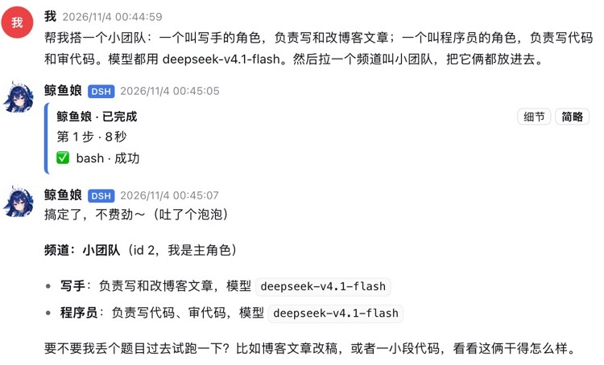
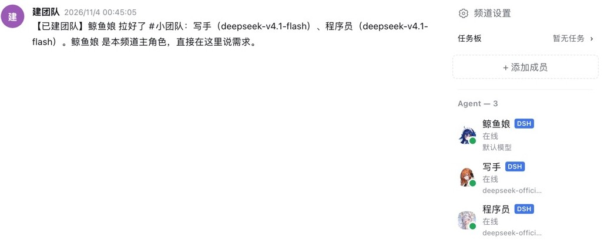

# bothouse in DSH (experimental)

**English** ｜ [中文](dsh.md) · [Back to README](../../README.md)

DSH (DeepSeek Harness) is DeepSeek's agent app, on desktop and web. bothouse adds a Channels page to it: roles live in DSH channels and reply when you @ them. Setup steps are in the [Chinese guide](dsh.md); the sections below came from the README.

## DSH users: one model with many roles

Two ways in: say "install bothouse-dsh for me" in DSH (it fetches the plugin from npm), or run `bothouse module add dsh` (it installs the copy that ships with the bothouse you just installed). On the npm route, name the exact version if you want the newest release right away: DSH installs plugins with pnpm, which skips releases from the last day. Details in [bothouse-dsh](../../dsh/plugin-pkg/README.en.md).

One model and one role works fine; the DSH plugins you already have keep working, and popular plugins are being adapted.

To write your own plugin, start from the template in the [plugin guide](../plugins/plugin-dev.md) (Chinese); [plugins/](../../plugins) has working examples (webhook on finish/error, event journal, desktop notifications).

For one model with many roles, say one sentence to the lead in a channel:

> Build me a small team: a writer and a programmer, both on deepseek-v4.1-flash, and put them in a channel

The lead creates the channel and both roles in one go through the channels API (`POST /collab/api/rooms/{id}/team`, only the channel's primary role may call it), and posts what it built. The wording of the sentence is not fixed: name the roles, and optionally the model, persona and channel.

 <b>One sentence, two roles</b>

 <b>The roles are in the new channel</b>

## Managing DSH members

The panel's Roles page can add, edit and delete DSH roster-managed members; config and external members are read-only. In an installed environment, adding a DSH role opens the daily member flow instead of reinstalling. Native members can select a DSH provider and model; Codex members can select advertised models and reasoning effort. The desired settings apply before the next turn, and the page shows their application status.

Panel providers apply to bridge projects that reference them. Manage DSH native routes in the DSH shell under Settings → Models; CLI members use local CLI authentication. Bridge project counts are separate from DSH member counts. See [DSH panel APIs](../api/dsh-panel.md).

The panel's Plugins page can edit each installed plugin row's YAML configuration, including plugins without a native settings form. Saves preserve `!!js` tags and write the existing DSH profile patch with a backup; restart DSH to apply them. Clearing the editor restores the bundle defaults without changing the row's enabled state. A HOME-level override is read-only here. See [plugin configuration APIs](../../bridge/docs/management-api.md).

Credential fields use `!bothouse/secret` placeholders: leave a placeholder unchanged to retain its current value, replace the entire placeholder to update it, or set an empty string/remove the field to clear it. Nested keys containing key, token, secret, password, credential, authorization or cookie (case-insensitive) are hidden; anchors and aliases are also hidden to prevent alternate references exposing them. This is field-name based, not a plugin schema: arbitrary credentials embedded in other fields or comments cannot be identified reliably. Configuration requests are limited to 1 MiB, including the JSON envelope.
