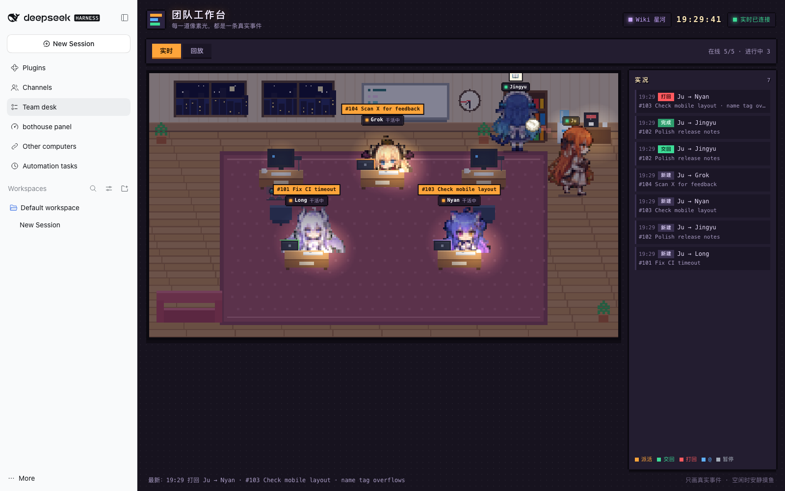
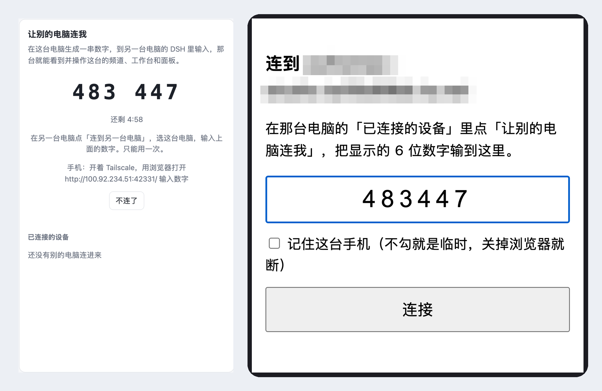
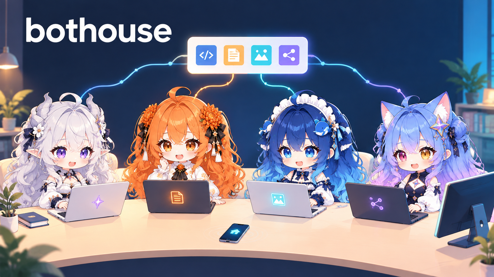

# bothouse: details moved out of the README

**English** ｜ [中文](readme-details.md) · [Back to README](../README.md)

These sections used to live in the README. They moved here so the README can stay short; nothing was cut.

## Contents

- [Who replies by default](#who-replies-by-default)
- [How the team works](#how-the-team-works)
- [Team mode, step by step](#team-mode-step-by-step)
- [Team desk](#team-desk)
- [Remote pairing](#remote-pairing)
- [Per-channel model and reasoning](#per-channel-model-and-reasoning)
- [Roles and avatars](#roles-and-avatars)
- [Image generation](#image-generation)
- [Wiki galaxy](#wiki-galaxy)
- [Platform details](#platform-details)
- [Hardware](#hardware)
- [The original "What it looks like" story](#the-original-story)

## Who replies by default

New installs default to **Only when addressed**: the role you @ answers, nothing extra to install. Smart routing can be turned on in the wizard or later on the panel's Gate page; it needs a judge model that returns logprobs, and the wizard offers a one-click preset for the Qwen3.5-4B we run ourselves (local, mlx-lm on Apple silicon; not downloaded automatically). See [routing choices](connect-discord-feishu.md#5-jev-和主角色).

## How the team works

You say one thing from your phone, computer or browser → the **lead** in the chat channel (the AI you talk to by default) takes it → big work goes to a **workspace**: @coder and @writer in Workspace 1, @researcher in Workspace 2 → they hand it back.

Chat keeps going the whole time; members take the work on and hand it back, and only decisions that need you come back to chat.

- **The lead splits the work:** the lead breaks real work down and hands it out by skill and quota, so five AIs in one group still don't talk over each other. When it dispatches a sub-agent, the code maps that match the task go with it, and what the sub-agent learns is appended back to that map.
- **Speak when called:** the lead answers by default; other roles follow along and reply when mentioned or named. Unaddressed messages go to jev, a lightweight dispatcher (a small model that only answers multiple-choice questions), which decides who picks them up. It can run on a free small model from SiliconFlow or the local Qwen3.5-4B we run ourselves (one-click preset in the wizard).
- **Shared memory:** we extended our open-source llm-wiki into a memory shared by every role. It lives in local Markdown you can read and edit, and Git history records what the team learned.
- **Nightly review:** when a session ends, idles for 30 minutes or errors, a fast model records progress in the Wiki. At night a slower, more thorough free model checks it against the original conversations to fix errors and fill gaps; on Sundays it reviews everything. Code checks every quoted instruction against your actual words and rejects invented quotes.
- **Guardrails and tools:** dangerous commands are blocked; “fixed” needs verification evidence and “I'll check later” needs a timer; turn any check off with one message in chat. Built-in tools: check teammate progress, extract video frames and transcripts, search the web, and see how long each child agent has run and what state it is in.
- **Manual lead handoff:** if the lead can no longer reply, `bothouse handoff switch --to <project>` moves the role; task cards, workspaces and pending questions keep their IDs. See [manual lead handoff](LEAD_HANDOFF.md).

Proactive follow-up has explicit `off`, `observe`, and `auto` policies. Observation records local decisions without starting a proactive worker or sending a proactive confirmation; ordinary chat and explicit requests retain their existing routing and permission checks. Automatic admission requires administrator-bound platform identities and matching rules. Routing and wiki context do not grant execution authority. See [proactive authorization](PROACTIVE_AUTHORIZATION.md) for configuration, audit records, and revocation boundaries.

Task-bound result text can use the send command with task, revision and delivery ID to persist before sending. Each fragment has its own receipt; ambiguous sends remain visible as unknown instead of being blindly retried. See [task text delivery](TASK_TEXT_DELIVERY.md) for usage and platform boundaries.

The management website's Skills page manages approved skills and per-role pending drafts. Nightly wiki processing uses the configured dream engine to draft reusable instructions; additions and revisions stay pending until approval. Approved skills are enabled per role. Bridge skill commands work through the shared registry, while DSH members also receive their role view through the native skill loader. Other CLIs' native discovery is not configured by this integration. Existing global skills remain global. See [role-owned skills](implementation/role-skills.md) for storage, installation and coverage.

## Team mode, step by step

One role in each chat channel is the **lead**. You talk to it; it splits the work and hands it to other models — Codex writes the code, DeepSeek polishes the text, Gemini digs up the references — and you collect the results in chat.

- **Big jobs go to a workspace.** Anything longer than about ten minutes, or that needs code changes and tests, goes to its own workspace channel with a handoff that carries your original words, the scope and what "done" looks like. Chat never stalls; one workspace, one job, and finished workspaces go back to the pool.
- **Task board.** Every job gets a number. The board shows who owns it, where it stands and what is waiting on you; pause, resume or finish it in one command.
- **Hand-backs are checked.** A workspace reports back in four short parts — background, what was done, what you need to do, what it added beyond your words — plus proof from the place you actually use. `bothouse report check` sends back any report that skips an item in scope or comes without evidence.
- **Nothing stalls quietly.** The bridge looks at dispatched work every ten minutes: progress keeps it going, silence nudges the owner and pauses the job.
- **You are asked only for decisions.** A workspace that needs your call posts an `[ask]` to chat and frees itself; your answer is routed back to a free workspace that picks up where it left off.

## Team desk

The team desk is a pixel office for your crew. Every member is a little character: idle ones wander between the window, whiteboard and coffee machine; whoever is working sits at a desk facing you, with the task tag above their head. A dispatch flies over as an envelope, progress notes float back to the lead's desk, finished work stacks up there waiting for review, rejected work comes back as a crumpled paper ball, and a paused member raises a hand. Even when nothing is moving you can see who handed what to whom. Every frame is a real event — a quiet team means a quiet office — and any past window can be replayed at 1×/4×/16×.

In DSH, switch on **Team desk** under Plugins → bothouse; it appears in the sidebar and works on a phone too. See [Team desk](../dsh/collab/desk/README.md).

<p align="center"></p>

## Remote pairing

Open **Other computers** in the DSH sidebar and generate a code: six digits. Type them on another computer's DSH, or open the address shown in your phone's browser — no app to install — and you are in: channels, team desk and panel, sending messages and handing out work as if you were at home. Choose a temporary connection or remember the device; the home computer lists every connected device and can kick one off, which drops it on the spot. It only listens on your Tailscale network: codes are single-use, expire after five minutes and die after five wrong tries.

<p align="center"></p>

## Per-channel model and reasoning

Per-channel model and reasoning: use `/model` and `/reasoning` in the channel you are talking in. Selections stay with that channel and survive restarts and `/new`. See [model and reasoning](model-and-reasoning.md).

## Roles and avatars



Every role has its own avatar and persona. They come in packs — pick one and it is ready to work; to make your own, see [role packs](persona-packs.md) (Chinese).

## Image generation

Optional and off by default: point `[image_gen]` at an OpenAI-compatible image service and the dashboard's image-generation page draws one picture into a local file. It never posts it for you — `bothouse send --image` is a separate, deliberate step.

## Wiki galaxy

To browse that memory as a star map, open **bothouse panel → Overview → Wiki galaxy**. The galaxy is a subpage with a link back to Overview, rather than a separate navigation item. Existing `/wiki-galaxy` and DSH `#wiki-galaxy` bookmarks still work.

## Platform details

Discord and Feishu already have phone and desktop apps, so there is no extra wrapper to install.

QQ / NapCat users can configure the [OneBot adapter](../bridge/docs/qq.md) manually.
Quoted QQ messages retain their author and text, fetching missing originals through OneBot. Agents can send native quoted text replies with `bothouse send --reply-to MESSAGE_ID --message 'reply'`; see the adapter guide for same-conversation checks and verification limits.

The OneBot guide also covers optional paragraph splitting, original-image storage, labelled forwarded chats and a [judging model](../bridge/contrib/qq-gate/README.md) using a self-hosted service or remote API. Personal prompts and model credentials are supplied by the operator.

<details>
<summary><b>Everyday actions in DSH Channels</b></summary>

- **Avatars:** add or edit a member and open **Optional → Avatar → Upload image** to pick a local PNG (up to 256KB). The browser automatically resizes it to 256×256 and keeps it in the local data directory; click **Restore default** to remove the uploaded avatar.
- **Task board:** the member sidebar shows task counts; **Task board** opens a dialog grouped by channel, workspace and owner. Completed tasks start collapsed, and Dispatch / Delivery links jump to the original messages.
- **Channel settings:** pick a primary role per channel and save an existing absolute **Working directory**; choose whether to recreate that channel's DSH sessions now (clearing context) or leave that for the next time sessions are created. Workspaces inherit their parent channel's settings.
- **Images:** image attachments have **Download** and **Copy image**; click to open a large preview and close it with Esc, the backdrop or the top-right button.

</details>

<details>
<summary><b>Remote access from your phone with Tailscale</b></summary>

bothouse runs on your home computer with a built-in web dashboard. Tailscale lets your phone reach it without renting a server or opening public ports.

1. **Connect devices:** install Tailscale on the computer and your phone with the same account (macOS `brew install --cask tailscale`; Linux `curl -fsSL https://tailscale.com/install.sh | sh`) and note the computer's `100.x.y.z` from `tailscale ip -4`.
2. **Enable the dashboard and live bridge:** send `/web setup` to the bot or run `bothouse web`, then restart once. Or edit `~/.bothouse/config.toml`:

   ```toml
   [management]
   enabled = true
   host = "100.x.y.z"        # your Tailscale address
   port = 9820
   token = "replace-with-a-long-random-password"

   [bridge]
   enabled = true            # required for sending messages, not just viewing
   token = "replace-with-a-different-random-token"
   ```

3. **Sign in:** open `http://100.x.y.z:9820/` on your phone and enter the token. See uptime and token usage by role and model with daily and hourly heatmaps; add roles, edit personas and change models; open a project to add instructions to running work.

Network notes: start Tailscale first, then bothouse. Without `host`, it listens on all interfaces, so set it explicitly for remote access. With the bridge enabled, port 9810 also listens on all interfaces. To keep it on the tailnet, block 9810 on LAN and public interfaces with the host firewall.

</details>

## Hardware

[bothouse-iot](https://github.com/zuiho-kai/bothouse-iot) is the hardware networking plugin. It connects ESP32 round-screen boards that speak the xiaozhi protocol, so each board becomes the body of one role: talk to the board and the words reach that role's bot; the bot replies and the board speaks it, with the dial showing idle / thinking / speaking. It joins bothouse as an external platform through the bridge protocol, so bothouse itself needs no changes. Firmware patches, flashing tools and wiring docs are in that repo.

<a id="the-original-story"></a>

## The original "What it looks like" story

I had Claude Code, Codex and DeepSeek open at the same time across two screens: four Claude Code windows on one, Codex on the other, and getting them to work together was a pain. So I reused what Discord already does well and built a collaboration platform on top of it. Later, talking with friends at vLLM and ModelBest, it turned out they had built something similar. As the community grew, DSH and QQ support followed.

That is **bothouse**: a team, or just you, can plug different agent CLIs into one group, and different sessions and models share one project memory. You direct them from your computer, phone or browser — no extra account, no extra subscription.
