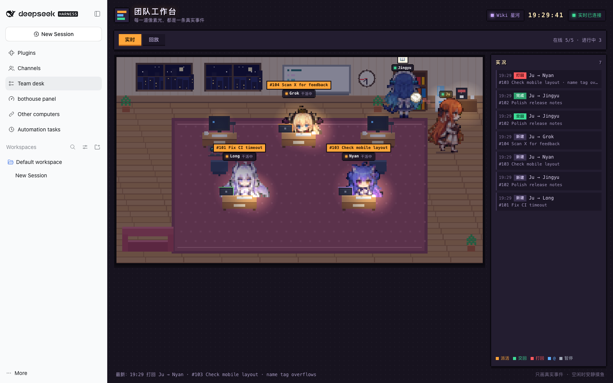
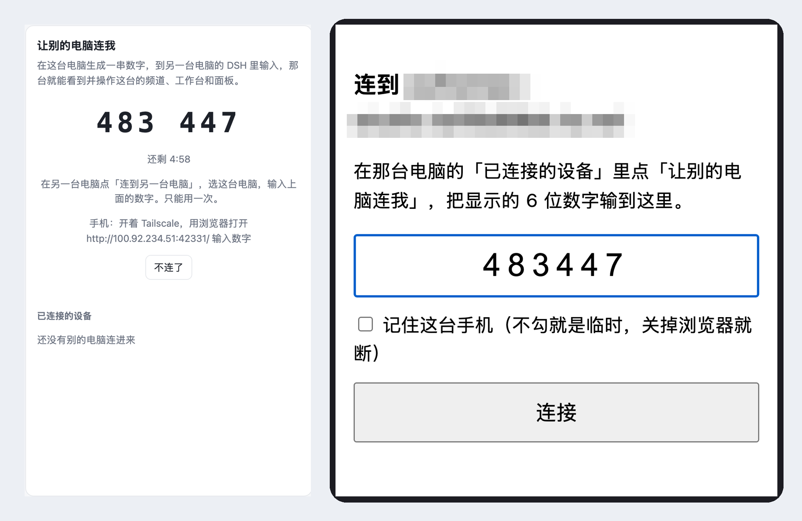
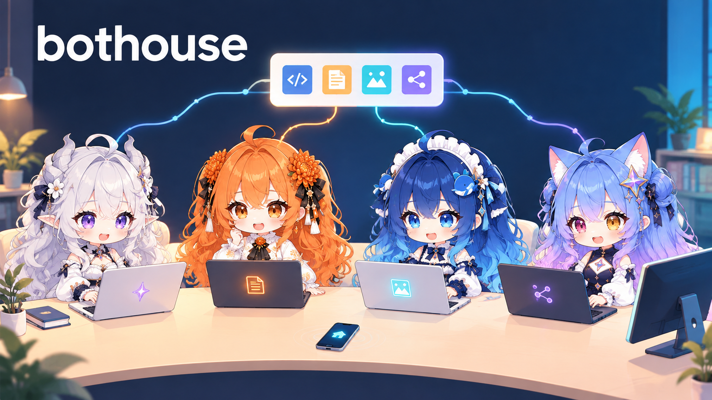

# bothouse：从 README 挪出来的细节

[English](readme-details.en.md) ｜ **中文** · [回到 README](../README.zh-CN.md)

这些段落原来写在 README 里，为了让 README 短一点挪到这里，内容没删。

## 目录

- [默认谁来回话](#默认谁来回话)
- [团队怎么运转](#团队怎么运转)
- [团队模式逐条说明](#团队模式逐条说明)
- [团队工作台](#团队工作台)
- [远程配对](#远程配对)
- [按频道的模型和推理档位](#按频道的模型和推理档位)
- [角色和头像](#角色和头像)
- [Wiki 星图](#wiki-星图)
- [平台细节](#平台细节)
- [硬件](#硬件)
- [原来的「用起来是什么样」](#原来的用起来是什么样)

## 默认谁来回话

安装向导可选**仅被点名时回复**，无需运行路由小模型，减少主控插话。智能分流推荐本地起我们在用的 Qwen3.5-4B（向导里一键填），需提供 logprobs，向导不会自动下载。详见[参与方式与成本](connect-discord-feishu.md#5-jev-和主角色)。

## 团队怎么运转

你在手机、电脑或浏览器上说一句话 → 聊天频道里的**主角色**（你默认在跟它说话的那个 AI）接下 → 大活交给**工作区**：工作区1 里 @写代码的、@写文案的，工作区2 里 @做调研的 → 干完交回。

聊天频道一直不停；只有要你拍板的事才回到聊天频道，别的不打扰你。

- **主角色自己拆活**：主角色把真正的活拆开，按所长和额度派出去，一个群里五个 AI 也不会抢话。它派子 agent 时，把对得上的代码地图一起带过去，子 agent 学到的东西再补回那张地图。
- **叫到才开口**：默认主角色接话，其他角色跟着看，被 @ 或点名才回。没点名的消息由轻量调度模块 jev（一个只做选择题的小模型）判断该谁接；它能用硅基流动的免费小模型，也能用本地 Qwen3.5-4B。
- **共享记忆**：基于我们开源的 llm-wiki 扩展成多角色共用的记忆，存在本地 Markdown 里，能直接读、直接改，Git 记录团队学到的东西。
- **夜间复盘**：会话结束、闲置 30 分钟或出错时，快模型把进度记进 Wiki。夜里换更慢但更细的免费模型，对照原始对话纠错补漏，周日再全量查一遍。引用你的话会被代码逐字核对，编造的引用直接拒掉。
- **护栏和工具**：拦危险命令；说「修好了」要附验证证据，说「稍后看」要挂定时器；在群里一句话就能关掉某项检查。自带的工具有：看队友进度、视频抽帧和转写、联网搜索，还有查分身（子 agent）干了多久、现在什么状态。
- **手动换主角色**：旧主角色回不了话时，`bothouse handoff switch --to <项目>` 切过去，任务卡、工作区和待答问题都保留原编号。见[手动交接主角色](LEAD_HANDOFF.md)。

## 团队模式逐条说明

每个聊天频道有一个**主角色**。你只跟它说话，它拆活、派给别的模型：Codex 写代码，DeepSeek 改文字，Gemini 查资料，结果回到聊天里给你看。

- **大活交工作区**：超过十分钟、要改代码跑测试的活，单独交给一个工作区频道，交接里带着你的原话、范围和做成什么样算好。聊天一直不卡；一个工作区同一时间只做一件活，做完放回池子。
- **任务板**：每件活一个编号，谁在做、做到哪、哪件在等你，一眼看清；暂停、恢复、收尾一条命令。
- **交回有检查**：工作区交回固定四段（背景、做了什么、要你做的、原话之外自己加的），还要附在你实际用的入口亲手走一遍的证据。`bothouse report check` 发现漏了范围里的项、没带证据，直接退回重写。
- **不会悄悄卡住**：派出去的活系统每十分钟看一次，有进展就接着做，没动静就催负责人并暂停。
- **只在要拍板时叫你**：工作区要你定方向时往聊天里发 `[ask]` 并让出工作区；你回复后系统找空工作区带着答复接着做。

## 团队工作台

团队工作台是一间像素办公室。每个成员是一个小人：没活的在窗边、白板、咖啡机之间溜达，有活的回工位面朝你坐下，头上挂着任务牌。派活是一封飞过去的信，干活中的纸条飘回主角色桌，交回的文件在主角色桌上摞成一摞等验收，打回是一个纸团砸回去，暂停的人会举手。就算画面静止，也看得出谁把活派给了谁。每一个画面都是真实事件，没人干活办公室就安安静静；过去任意一段可以 1×/4×/16× 回放。

在 DSH 里打开「插件 → bothouse」里的**团队工作台**，左栏就会出现，手机上也能看。见[团队工作台](../dsh/collab/desk/README.md)。

<p align="center"></p>

## 远程配对

在 DSH 左栏打开「其他电脑」，点「让别的电脑连我」，出来一串 6 位数字。在另一台电脑的 DSH 里输入，或者用手机浏览器打开页面上给的地址输入（手机不用装 App），就连上了：频道、工作台、面板都能看，能发消息、派活，跟坐在家里那台电脑前一样。可以选临时连接，也可以记住这台设备；家里那台列出所有已连的设备，点「踢掉」当场断开。只在你的 Tailscale 内网里开放：数字只能用一次，5 分钟过期，输错 5 次作废。

<p align="center"></p>

## 按频道的模型和推理档位

模型和推理档位按频道分开记：在哪个频道说话，就在那个频道用 `/model` 和 `/reasoning`。改过的设置跟着这个频道走，重启和 `/new` 之后还在。见[模型和推理档位](model-and-reasoning.md)。

## 角色和头像



每个角色都有自己的头像和人设，按包管理，挑一个就能上岗；想自己做一个，见[角色包](persona-packs.md)。

## Wiki 星图

想看记忆的全貌，打开 **bothouse 面板 → 概览 → Wiki 星图**。星图是概览下的子页，有一条链接回到概览，不再单独占一个导航项；原来的 `/wiki-galaxy` 和 DSH 里的 `#wiki-galaxy` 书签照样能用。

## 平台细节

Discord 和飞书本来就有手机和电脑客户端，不用再包一层 App。

QQ / NapCat 用户可手动配 [OneBot 适配器](../bridge/docs/qq.md)。

接入指南也包含可选拆条、原图保存、带发言者标签的合并转发，以及支持自部署服务或远程 API 的[判断模型](../bridge/contrib/qq-gate/README.md)。个人提示词和模型凭据由使用者自行配置。

<details>
<summary><b>DSH 频道里的常用操作</b></summary>

- **上传头像**：添加或编辑成员，打开 **可选 → 头像 → 上传图片**，选本地 PNG（256KB 以内），浏览器会自动缩到 256×256，存在本地数据目录；点 **恢复默认** 就删掉上传的头像。
- **任务板**：成员侧栏显示任务数，点 **任务板** 打开按频道、工作区、负责人分组的弹窗；已完成的默认折叠，派活/交付链接能跳回原消息。
- **频道设置**：每个频道单独选主角色、填一个已存在的绝对 **工作目录**；保存时可选立刻重建该频道的 DSH 会话（清空上下文），或下次建会话时再用。工作区继承所属频道的设置。
- **图片**：图片附件有 **下载** 和 **复制图片**；点图片打开大图预览，Esc、点背景或右上角关闭。

</details>

<details>
<summary><b>用 Tailscale 在手机上远程管理</b></summary>

bothouse 跑在家里电脑上，自带网页管理面板。Tailscale 让手机连回来，不用租服务器、不用开公网端口。

1. **连上设备**：电脑和手机都装 Tailscale、登录同一账号（macOS `brew install --cask tailscale`；Linux `curl -fsSL https://tailscale.com/install.sh | sh`），用 `tailscale ip -4` 记下电脑的 `100.x.y.z`。
2. **打开面板和实时桥**：对机器人发 `/web setup`，或运行 `bothouse web`，按提示重启一次。也可以手动改 `~/.bothouse/config.toml`：

   ```toml
   [management]
   enabled = true
   host = "100.x.y.z"        # 上一步的 Tailscale 地址
   port = 9820
   token = "换成一串长随机密码"

   [bridge]
   enabled = true            # 要在手机上发消息就得开
   token = "换成另一串随机密码"
   ```

3. **登录使用**：手机打开 `http://100.x.y.z:9820/`，填 token。能看运行时间、今天和本月各角色各模型的 token 用量与热力图；能加角色、改人设、换模型；能打开项目给正在跑的活插话。

网络提示：先启动 Tailscale，再启动 bothouse。不写 `host` 时会监听所有网卡，远程访问请写明。桥开启后还会在所有网卡监听 9810。只想给 tailnet 用，就在本机防火墙挡掉局域网和公网的 9810。

</details>

## 硬件

[bothouse-iot](https://github.com/zuiho-kai/bothouse-iot) 是 bothouse 的硬件联网插件。它把跑小智协议的 ESP32 圆屏板接进来，让每块板成为一个角色的身体：对板子说话，话进到这个角色的 bot；bot 回话，板子念出来，表盘跟着在待机、思考、说话之间切换。它走 bridge 协议以外部平台身份接入，bothouse 本体不用改。固件补丁、刷写工具和接线说明都在那个仓里。

## 原来的「用起来是什么样」

我手上同时开着 cc、codex、ds，两个屏幕：一个屏幕开 4 个 cc 窗口，另一个开 codex，几个之间协作有点牢。所以就复用 Discord 的能力搞了个协作平台。后来跟 vLLM 和面壁的同学聊了聊，他们也是类似的做法。再后来随着社区发展，又加上了 DSH、QQ 等支持。

这就是 **bothouse**：团队成员或者你自己一个人，都能把不同的 agent CLI 接进同一个群，不同会话、不同模型共享同一份项目记忆。你在电脑、手机和浏览器上都能指挥，不用另开账号，不用另买订阅。
